# VAYUJIT OS Product Handbook

Practical seller guide

Updated 6 November 2026

## 1 Choose your first task

Where: Start from Dashboard or the task links in the sidebar.

VAYUJIT OS brings product research, supplier evidence, product preparation, content and operational review into one seller workspace. You do not need to complete every module before doing useful work.

1. No product yet: open Business Agent, describe a narrow research goal, review its plan and inspect the resulting opportunities.
2. Already have a product: open Products or Catalog. Enter genuine product facts; product research is not a prerequisite to creating a seller-authored product.
3. Already hold physical stock: prepare the correct Product and SKU, then record counted opening stock through Inventory.
4. Need to know what requires attention: open Dashboard, then Action Center and follow an issue to its source.

Check: One owner uses one isolated installation. An opportunity, a seller-owned Product, a supplier and a marketplace listing are different records.

Next: Follow the research route in sections 6 to 19, or the existing-product route in sections 20 to 32.

## 2 Sign in to the intended workspace

Where: Open the login URL configured for your installation.

Use the existing owner account. First-installation setup is not a password reset or a way to bypass a connection error.

1. Enter Email and Password, then choose Sign in. Show password changes visibility only.
2. After login, check the active brand before editing any records.
3. If the API cannot be reached, use the troubleshooting section rather than creating another owner.

Check: Never put real passwords in screenshots or support messages. Keep the configured browser origin consistent; localhost and 127.0.0.1 are not interchangeable session assumptions.

Next: Open Dashboard and choose the task you need.

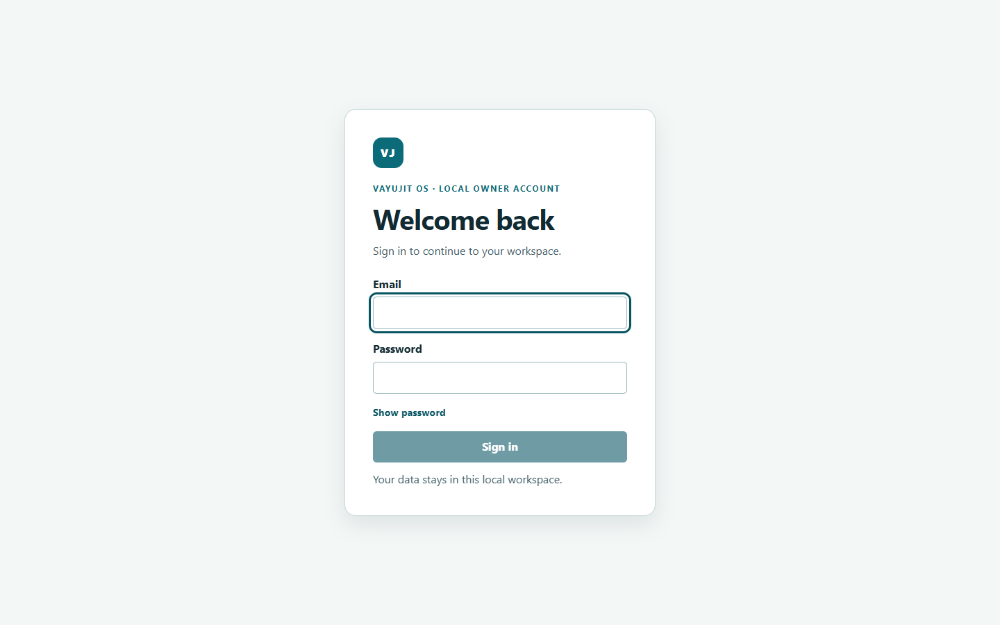

Figure 5. Empty login with visible Email keyboard focus. No credentials entered. Genuine historical synthetic capture, 2026-11-05.

## 3 Find your way around the product

Where: Use the left navigation and the current page breadcrumb.

The menu groups everyday seller work. A contextual detail page may be reached from a saved record rather than having its own menu item.

1. Home: Dashboard, Business Agent, Action Center and Launch readiness.
2. Research and Source: Product Opportunities, My Research, Suppliers, Requirements and quotes, Supplier engagement and Sourcing decisions.
3. Sell: Catalog, Products, Listings, Inventory, Orders and Financials.
4. Create, Grow and Manage: content, SEO, images, videos, campaigns, social, advertising and calendar. Advanced contains specialist intelligence, operations and settings.

Check: Use the record link or breadcrumb to preserve context. Do not guess an identifier in a deep link. A visible menu item does not mean a live provider is configured.

Next: Keep the current brand, product and supplier identity in view as you move between modules.

## 4 Use a simple daily routine

Where: Dashboard, Action Center, Orders and Financials.

Begin with evidence and exceptions rather than trying to clear every warning. An empty state, a failed request and zero activity mean different things.

1. Check that the intended workspace and brand are selected.
2. Review Action Center by severity and status. Open the source record for each important issue.
3. Inspect recorded orders and inventory exceptions for the same period and SKU.
4. Review missing financial inputs before relying on profitability.
5. Review pending approvals, failed jobs and upcoming calendar items. Make only the local changes you understand and are authorized to make.

Check: Acknowledging or resolving a signal is not permission to execute its recommendation. A successful background job is not, by itself, proof of marketplace delivery.

Next: Return to a specific source workflow to correct the legitimate missing condition.

## 5 Understand evidence and product status

Where: Evidence panels, assessments, readiness results and source records.

Read a finding together with its source, date, scope and missing information. These labels help you avoid treating an idea as a verified business fact.

1. Observed: a source supplied a recorded statement. It may still be incomplete, stale or wrong.
2. Derived or estimated: a result depends on stated inputs and a calculation or model.
3. Human-entered or AI-generated: identify who supplied the statement; neither label proves verification.
4. UNKNOWN: a fact is not established. It is not zero. Stale means the result may no longer match current inputs.
5. Eligible, ready, selected and approved apply to a specific next operation. They do not mean the product will sell or that procurement is authorized.

Check: The application has bounded local workflow evidence, not universal production or live-provider certification. Marketplace access, provider actions, recovery and remaining accessibility checks have separate limits.

Next: Keep assumptions and missing evidence visible in every decision.

## 6 Write a useful research goal

Where: Business Agent > Start another research goal.

Tell the agent what to investigate, not the commercial outcome it must guarantee.

1. Expand the goal form. State marketplace, category, available INR capital and practical product constraints.
2. Ask for source-backed product identity and explicit evidence gaps. Do not request invented sales or margins.
3. Choose Create research goal. Review the saved interpretation before preparing the plan.

Check: A goal alone does not start all research, grant source access or authorize supplier contact. Unknown information can remain unknown.

Next: Use the examples on the next page, then review the saved goal and plan.

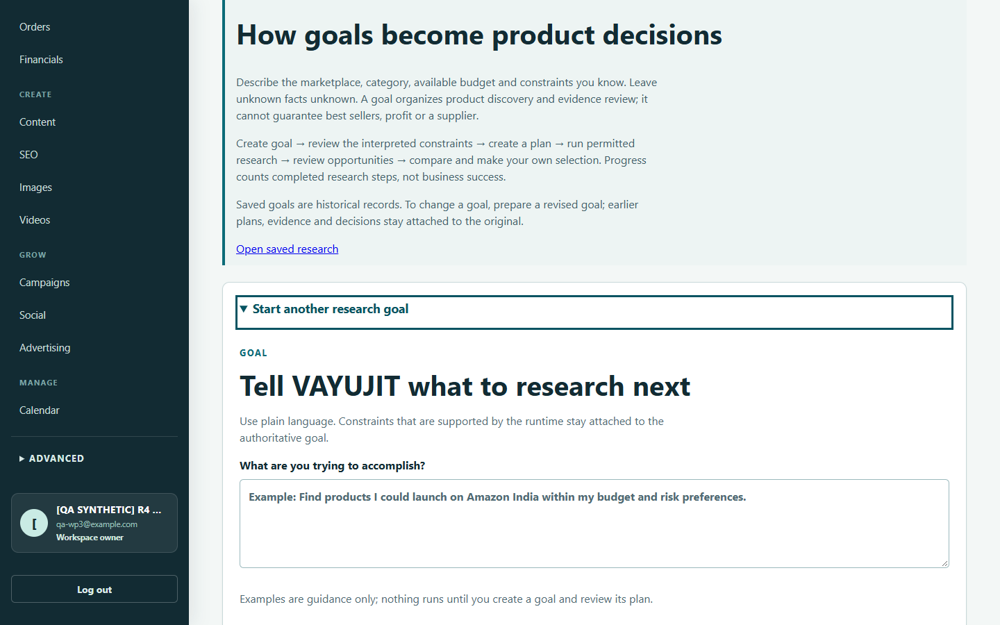

Figure 3. Expanded goal disclosure and the goal textarea. Genuine historical synthetic capture, 2026-11-05.

## 7 Research goal examples you can adapt

Where: Use Business Agent for product discovery; use specialist intelligence pages for stored competitor or review evidence.

Replace category and capital with your genuine constraints. These examples are requests, not promises of available evidence.

1. Discovery: I have INR 300000 and want to sell on Amazon India. Find up to 3 home organization product opportunities. Prefer lightweight, non-fragile products. Verify product identity from permitted product pages, show source URLs and evidence gaps, and stop for my selection before supplier research.
2. Category-specific: Find up to 3 kids-category products for Amazon India within INR 300000. Keep the category authoritative. Mark demand, costs and compliance UNKNOWN unless supported. Do not contact suppliers.
3. Evidence review: Summarize supported complaints and praise in the saved customer-review evidence for this product. Separate observed themes from hypotheses and explain sample limitations.

Check: A target selling price is a preference, not proof of profit. Requesting a broad best-seller list cannot create missing market evidence.

Next: Check that the saved goal has the intended category, marketplace and capital before proceeding.

## 8 Review the goal and start a permitted run

Where: Business Agent > Research goals and runs.

Goal creation, plan creation and run execution are separate steps. The screenshot shows an unsaved form state, not a completed submission.

1. Check the saved goal details and assumptions. Resolve material misunderstandings first.
2. Create the versioned research plan using the available control. Read its steps and prerequisites.
3. Start the eligible run only under the configured permitted mode; inspect progress and actual discovery outcomes.

Check: Progress counts completed plan steps, not successful products. Read-only research still needs provider availability and permitted source access.

Next: Open the discovery outcomes, then review opportunities for this exact goal.

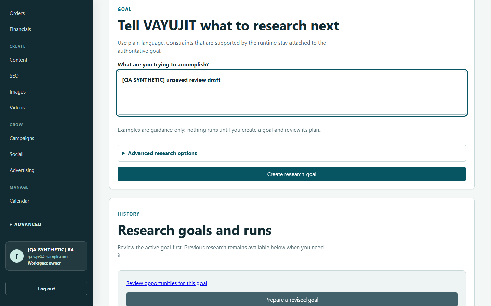

Figure 4. A synthetic unsaved review draft and Create research goal. This image does not prove submission or an error announcement. Genuine historical synthetic capture, 2026-11-05.

## 9 Resolve research blockers without guessing

Where: Business Agent > What happened during discovery and Research needs attention.

Product discovery may truthfully return no eligible product. Read the reason before retrying; a successful search or fetched page is not automatically product evidence.

1. Expand search queries and page outcomes. Distinguish a new provider request from reused search or cached-page evidence.
2. For a provider/quota error, ask the operator to check the configured provider and its actual response. Credit balance alone does not prove the application used the right credential or succeeded.
3. For a blocked source, review the discovered site and only make truthful source-policy confirmations. Approval reason may be recorded automatically; an additional note is optional where labelled.
4. For a non-product, category mismatch or insufficient identity, inspect eligibility reasons. Source approval cannot make the candidate suitable.
5. Use Continue product discovery or Retry product discovery only after resolving the recorded blocker. Refresh run only retrieves state.

Check: Do not repeatedly recreate the goal or approve a site merely to get a result. Do not bypass authentication, terms, robots or network controls.

Next: Proceed only when canonical Product Opportunities exist for the current goal.

## 10 Review and select a product opportunity

Where: Product Opportunities, preferably through Review opportunities for this goal.

An opportunity is a research candidate. It is not automatically your seller-owned Product, approved supplier choice or marketplace listing.

1. Open the candidate and confirm the originating goal, category, product identity and source evidence.
2. Inspect observed price/currency, freshness, assessment inputs, missing dimensions and contradictions. Avoid treating a score as a success probability.
3. Compare only compatible candidates and assessments. NOT_COMPARABLE is a useful limitation, not a ranking.
4. Choose Select this product for supplier research only when its current prerequisites allow. Otherwise continue research or archive the opportunity when appropriate.

Check: If selection is disabled, inspect the actual evidence, lifecycle or context blocker. Do not force-enable the button. Selection is HUMAN-controlled and does not contact suppliers.

Next: Follow Find suppliers for the selected opportunity and verify the identity at the destination.

## 11 Use competitor reviews and trend evidence

Where: Advanced intelligence links or the relevant research context.

Use specialist evidence to answer a defined question. Do not confuse online interest with actual product sales.

1. Competitors: compare the same product type, pack size, currency and observation period. A single snapshot does not prove a trend.
2. Customer reviews: inspect sources and sample dates before summarizing repeated problems or praise.
3. Trends: check geography, period and the signal being measured. A chart can be incomplete or incomparable.
4. Opportunity assessment: read the model dimensions, eligibility, hard blocks and missing inputs before interpreting a score.

Check: Turn supported findings into validation questions. Do not copy speculative improvements, estimated demand or uncertified claims into a listing.

Next: Return the evidence to the matching opportunity and retain its source context.

## 12 Reopen saved research and revise a goal

Where: My Research or Business Agent > Research goals and runs.

Saved research preserves the original goal and its evidence. Historical work is not necessarily the current active task.

1. Open the intended goal/run and check its recorded mode, plan and findings.
2. Use the supported continuation control for an eligible failed step rather than automatically making a duplicate run.
3. To change requirements, choose Prepare a revised goal and review the new statement. Earlier plans and decisions remain attached to the original.

Check: The screenshot is a historical synthetic overview. It does not prove your current goal has results or that every stage is ready.

Next: Review opportunities belonging to the goal you actually intend to pursue.

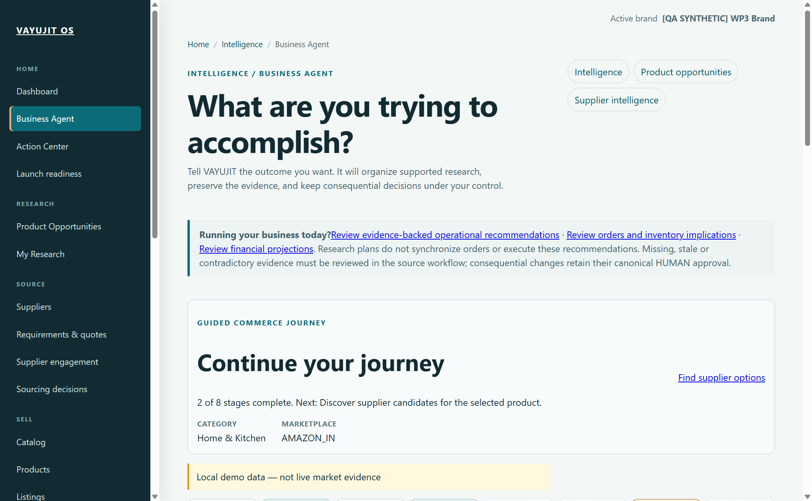

Figure 2. Business Agent overview and a saved synthetic journey. Pixel dimensions are recorded; exact CSS viewport is not verified for this capture. Genuine historical synthetic capture, 2026-11-06.

## 13 Find suppliers for the selected product

Where: Suppliers, reached from the selected opportunity where possible.

Supplier discovery mode and product context must remain explicit.

1. Confirm the selected product/opportunity before discovery or opening a saved supplier.
2. Distinguish synthetic discovery from approved real discovery and unavailable or unauthorized discovery.
3. Inspect supplier identity, correlated sources, product match and commercial claims before comparing candidates.

Check: The supplier name and MOQ shown are synthetic teaching data, not a real quote or endorsement. A directory hit or website claim does not verify a manufacturer.

Next: Open supplier verification and review the evidence gaps.

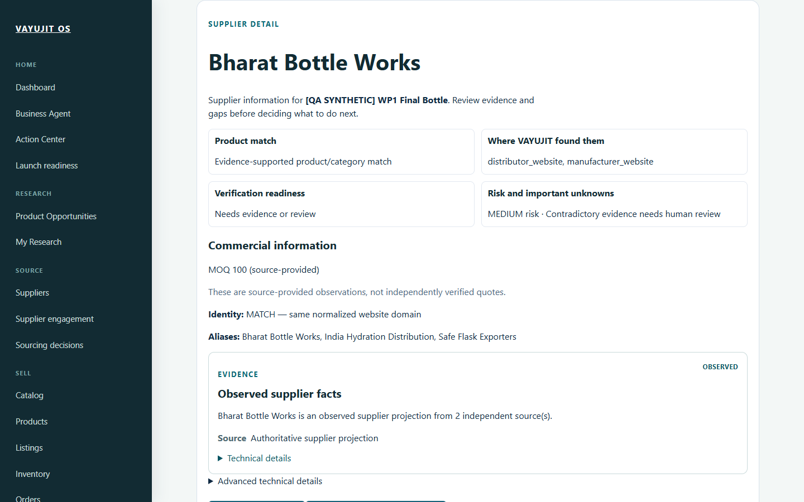

Figure 19. Historical synthetic supplier detail, with claims distinguished from independently verified quotes. Exact supplier substate is fixture-specific. Genuine historical synthetic capture, 2026-10-28.

## 14 Assess supplier evidence and risks

Where: Supplier Verification or the supplier detail assessment path.

An unassessed supplier is not a verified supplier. Assessment may remain blocked or insufficient.

1. Select the intended supplier and confirm its product context.
2. Review claims, source provenance, dates, missing evidence and contradictions.
3. Use the supported assessment path when prerequisites permit; inspect the resulting findings rather than assuming approval.

Check: A claimed certificate is not independently verified evidence. Assessment or shortlist approval is not permission to place an order.

Next: Keep risks visible in supplier comparison and the sourcing decision.

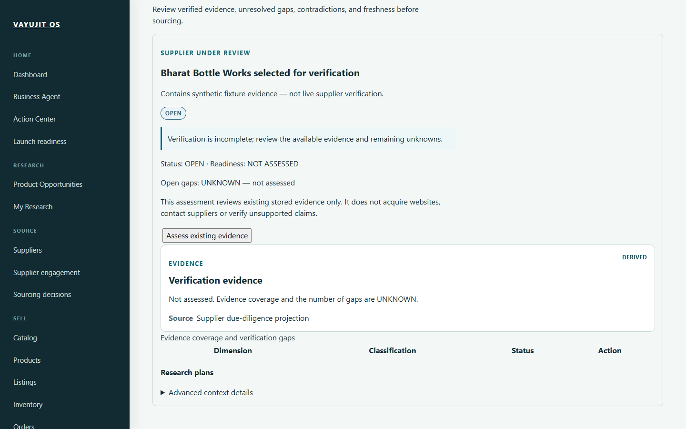

Figure 7. Historical synthetic supplier selected for verification, not yet assessed. Genuine historical synthetic capture, 2026-10-28.

## 15 Record requirements and supplier quotes

Where: Requirements and quotes for the matching product/supplier.

A quote has an identity and a basis: who supplied it, what quantity and unit it covers, its currency, conditions and date. Missing commercial facts must remain unknown.

1. Open the correct sourcing context and record genuine quantity, units and specification requirements.
2. Associate commercial inputs with the intended supplier and source evidence where supported.
3. Distinguish a supplier-provided quote from a planning assumption or website observation.
4. Review revisions and stale inputs before carrying a quote into a scenario.

Check: Do not manufacture a quote to unlock economics. A number entered locally is not proof the supplier offered it or agreed to your requirements.

Next: Open Sourcing economics with the same product, supplier and cost basis.

## 16 Open the correct sourcing economics

Where: Sourcing economics, reached from the relevant product/supplier workflow.

Economics is useful only when the saved context and input basis are correct.

1. Check the product/opportunity and supplier shown at the top.
2. Review saved economic inputs. Confirm quote, quantity, units, currency and calculation context; do not accept a substituted basis.
3. Read missing and stale inputs before calculating or relying on a readiness result.

Check: The historical screenshot demonstrates restored synthetic context with missing inputs still UNKNOWN. It is not evidence of real supplier economics or profit.

Next: Complete legitimate inputs and review the calculation breakdown.

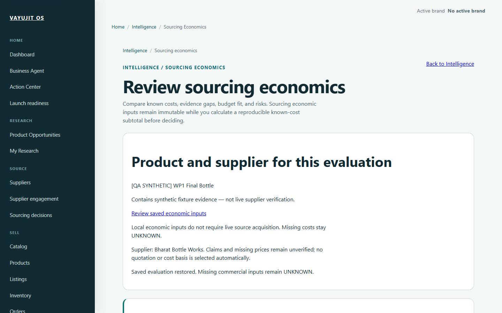

Figure 1. Historical saved synthetic product and supplier evaluation restored; missing inputs remain UNKNOWN. Genuine historical synthetic capture, 2026-10-28.

## 17 Interpret costs margins and capital fit

Where: Sourcing economics and the matching scenario/financial view.

Product master cost, acquisition assumptions, landed cost and operational profitability are different concepts. Do not treat one amount as the complete economics.

1. Check the documented components included in the current calculation. Freight, fees, duties, GST and exchange rates need a valid basis where applicable.
2. Keep selling price, quantity, unit cost, currency and tax treatment consistent. Never combine INR and another currency without supported conversion evidence.
3. Read the known-cost subtotal together with excluded or UNKNOWN components. A subtotal is not a complete net margin.
4. After materially changing inputs, use a current calculation and inspect freshness. Historical results must not silently support a new decision.
5. Review capital fit together with order quantity and uncertainties; a READY label is scoped to its contract, not guaranteed affordability.

Check: No universal marketplace fee schedule or tax formula is supplied here. Use the application breakdown and genuine applicable evidence; do not enter zero to hide a missing cost.

Next: Save/reopen the intended evaluation and record a scoped human decision only when the basis is understood.

## 18 Compare scenarios and make a decision

Where: Sourcing decisions, supplier shortlisting and supported portfolio views.

Compare alternatives on the same basis. One supplier may look cheaper only because an important cost or risk is absent.

1. Confirm the same product requirements, quantity, units, currency and assessment date across alternatives.
2. Review supplier verification, quote identity, included costs, excluded costs and capital assumptions.
3. Keep UNKNOWN and NOT_COMPARABLE results visible. Investigate contradictions rather than averaging them away.
4. Record the supported HUMAN choice and rationale for the exact scenario/version. Reopen the saved decision to check persistence.
5. If the context changes or an approval is stale, review the updated basis before making a new decision.

Check: A decision to continue research or shortlist a supplier is not a procurement, payment or RFQ authorization.

Next: Prepare a truthful Product record or collect missing evidence; do not automatically order inventory.

## 19 Understand supplier engagement boundaries

Where: Supplier engagement and Requirements and quotes.

Preparation, HUMAN authorization, delivery and response evidence are separate stages. A visible engagement record does not mean an email was sent or a supplier replied.

1. Check product, supplier, recipient and current artifact before preparing a request.
2. Review the exact content and the scope of any authorization. Previewing is not sending.
3. Treat delivery status and supplier response/quote evidence as separate records.
4. For unknown or failed delivery, inspect canonical history and recovery eligibility before retrying.

Check: This handbook does not authorize contact, RFQs or supplier negotiations. Do not send a message simply to complete a training exercise.

Next: Use only legitimately obtained responses as evidence in the matching sourcing workflow.

## 20 Create a brand and product master

Where: Brands and Products > create or edit form.

Use this path when you already have truthful seller-authored product information. An opportunity and a Product are not interchangeable.

1. Choose the intended owned brand. Enter genuine identity and descriptive information; do not invent trademark registration.
2. Create/edit the Product with the required Brand, Name and Product type.
3. For prices and master cost, use decimal text and the correct currency. For example, 499.00 with INR describes a price, not proven profitability.
4. Keep unsupported facts unknown. Check units for dimensions and weight; a SKU is distinct from a URL-friendly slug.
5. Save through normal validation, then reopen the Product to check identity and lifecycle.

Check: A Product master quantity is not the stock ledger. A draft Product is not a published marketplace offer.

Next: Open Catalog for the same Product to review variants, media, lineage and listing preparation.

## 21 Use Catalog as the preparation workspace

Where: Catalog > the intended Product.

Catalog brings the Product context and local preparation links together.

1. Check brand, Product name, SKU/category and research lineage before continuing.
2. Use the supported sections for variants, private media, costs and listing drafts.
3. Follow Record counted opening stock, Review stock ledger or Marketplace readiness only for the same Product.

Check: Nothing is published just because a Catalog record exists. The screenshot shows an intentionally synthetic Product, not real business inventory.

Next: Complete the missing genuine data, then prepare the intended marketplace draft.

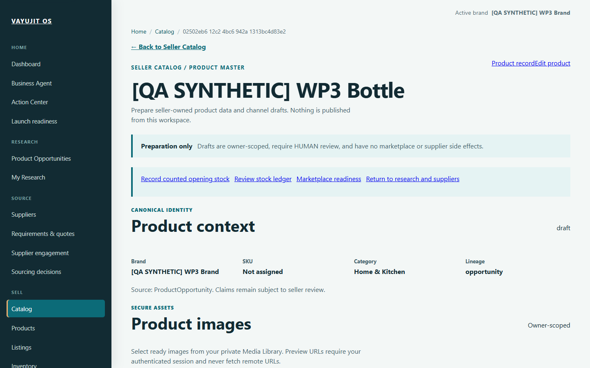

Figure 17. Synthetic Catalog product and research lineage. The viewport does not show every variant/media control. Genuine historical synthetic capture, 2026-10-30.

## 22 Edit variants and preserve product identity

Where: The Product or Catalog variant editor where supported.

Variants describe real sellable differences such as size or colour. Their identifiers and units must remain consistent with the inventory and listing context.

1. Open the correct Product and inspect existing variants before adding another.
2. Enter only genuine option values and the supported SKU/price information. Avoid duplicate variants or reusing an unrelated SKU.
3. Save through normal validation and reopen the Product to verify the intended record.
4. If an edit is stale or conflicts with a newer version, reload and review the latest state instead of forcing the old submission.

Check: This short guide does not enumerate every dynamic variant rule. The current form and backend validation remain authoritative. Editing a Product does not independently authorize stock changes.

Next: Check media association and the exact variant/SKU required by the listing or inventory workflow.

## 23 Add authorized product images

Where: Catalog > Product images, or Media Library and Upload image.

Store and associate only images you own or are permitted to use.

1. Choose the intended Product, then select an eligible saved private image or the supported secure upload path.
2. Current UI guidance allows JPEG, PNG or WebP up to 10 MB; backend checks still apply.
3. Preview the selected file before uploading/attaching. Reopen the Product to check the intended association.

Check: The image shows the private-image entry, not every picker control. Private preview links require authorization and must not be treated as public listing URLs.

Next: Use accurate, reviewed images in the correct local listing draft.

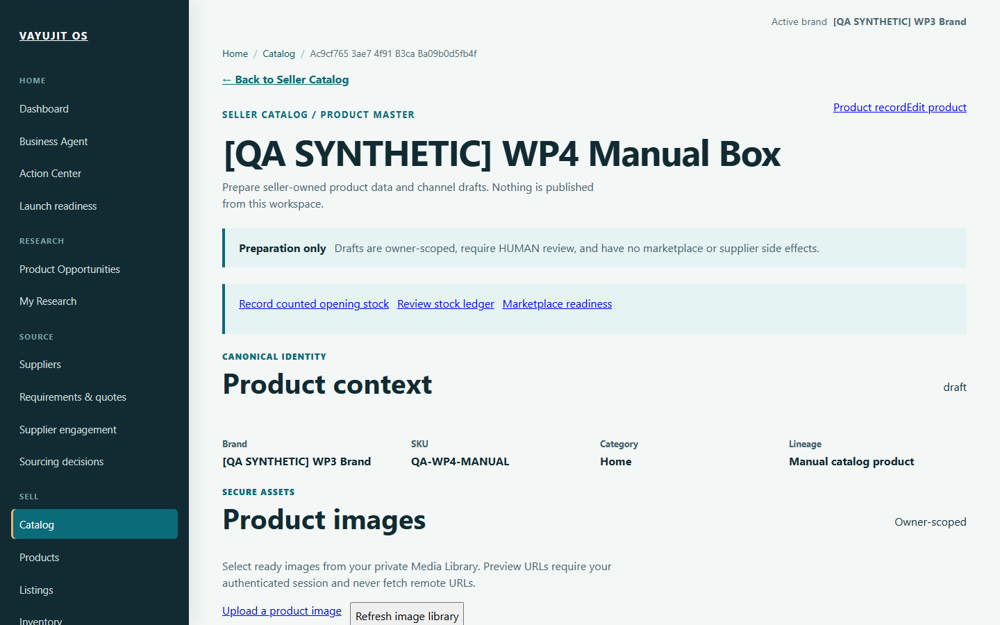

Figure 18. Catalog private-image section and upload entry after a synthetic media workflow. Not a close-up of the upload dialog. Genuine historical synthetic capture, 2026-10-30.

## 24 Record counted opening stock

Where: Inventory > opening stock, or Catalog > Record counted opening stock.

Use this only for actual physically counted stock in the intended location.

1. Check Product, variant, Internal SKU, Location code and Unit.
2. Enter the genuine counted quantity. Review the summary and explicit count confirmation before saving.
3. Verify the resulting stock ledger. If the response is uncertain, use the supported identical retry rather than a new duplicate submission.

Check: The example 12 units are synthetic and must not be copied. A different folder, Product master number or marketplace mapping does not establish owned stock.

Next: Review movements and stock positions for that exact SKU/location.

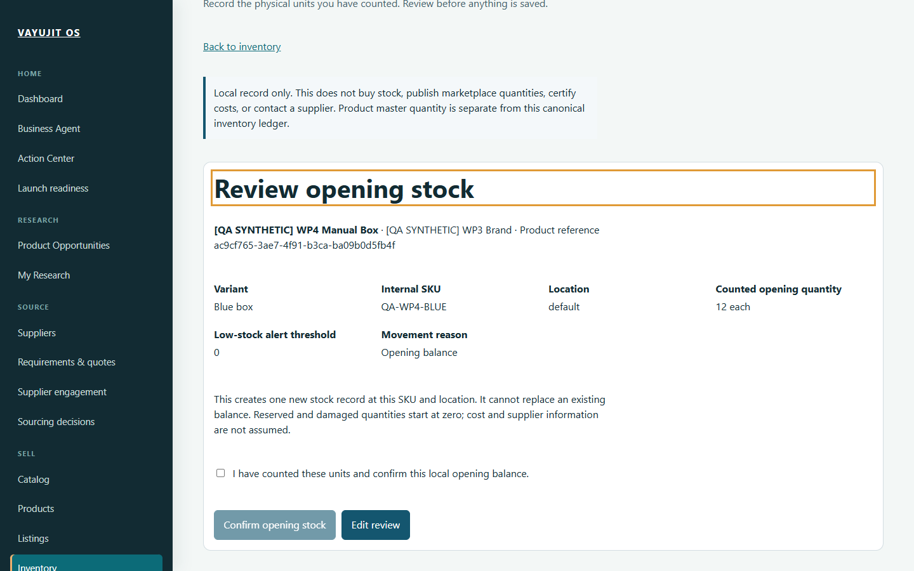

Figure 15. Synthetic opening-stock HUMAN review. The displayed 12 units are not real stock and must not be copied. Genuine historical synthetic capture, 2026-10-30.

## 25 Keep SKU mappings and stock consistent

Where: Unified Inventory, mapping controls and Product marketplace preparation.

A SKU mapping connects identities; it does not create physical stock or confirm that a marketplace has received an update.

1. Identify the internal Product/variant/SKU and intended channel listing before mapping.
2. Inspect recorded stock positions and movements, not just a summary number.
3. Use legitimate reasons and current context for any supported adjustment. Do not create inventory to clear readiness.
4. Inspect order provenance and reservation/stock implications where supported. Avoid duplicate ingestion or replaying an unknown outcome.
5. Keep missing mappings and stock evidence as visible blockers until genuinely resolved.

Check: Inventory publication and external marketplace synchronization require separate authorization. A local successful record is not proof of live synchronization.

Next: Review listing readiness and the underlying order/movement evidence.

## 26 Understand marketplace accounts and modes

Where: Marketplaces > Accounts and the intended marketplace workspace.

Local configuration, seller registration, API entitlement and live authorization are different prerequisites.

1. Choose the intended marketplace and inspect its actual configured mode/capabilities.
2. Keep credentials private and use only the supported write-only fields when separately authorized.
3. Distinguish synthetic import data from real seller activity. Do not start an import as a tutorial exercise.

Check: A configured or valid account under fake transport is not live connectivity. This guide does not certify real Amazon/Flipkart access or authorize external calls.

Next: Prepare local listing data and resolve genuine account/provider prerequisites separately.

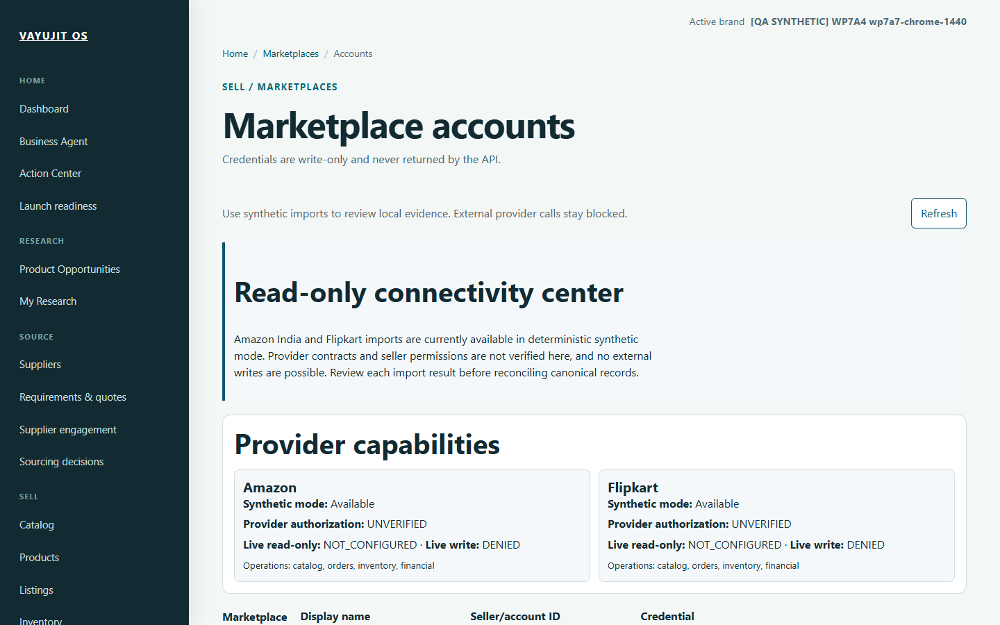

Figure 14. Synthetic import capability and explicit unverified live-provider authorization. Genuine historical synthetic capture, 2026-11-04.

## 27 Prepare an Amazon India listing locally

Where: Marketplaces > Amazon or the Catalog-linked Amazon draft.

Use the local workspace to organize supported listing data and readiness.

1. Check the selected Product, SKU and listing identity.
2. Complete genuine required content/category/media information and inspect the actual missing-field messages.
3. Review the current artifact and readiness before a HUMAN review. Execution authorization, where supported, is a separate controlled step.

Check: Local/fake-transport validation does not certify real OAuth, SP-API, sandbox acceptance or live publication. Never press Submit based solely on this guide.

Next: Correct the specific local blocker or obtain separately authorized provider certification.

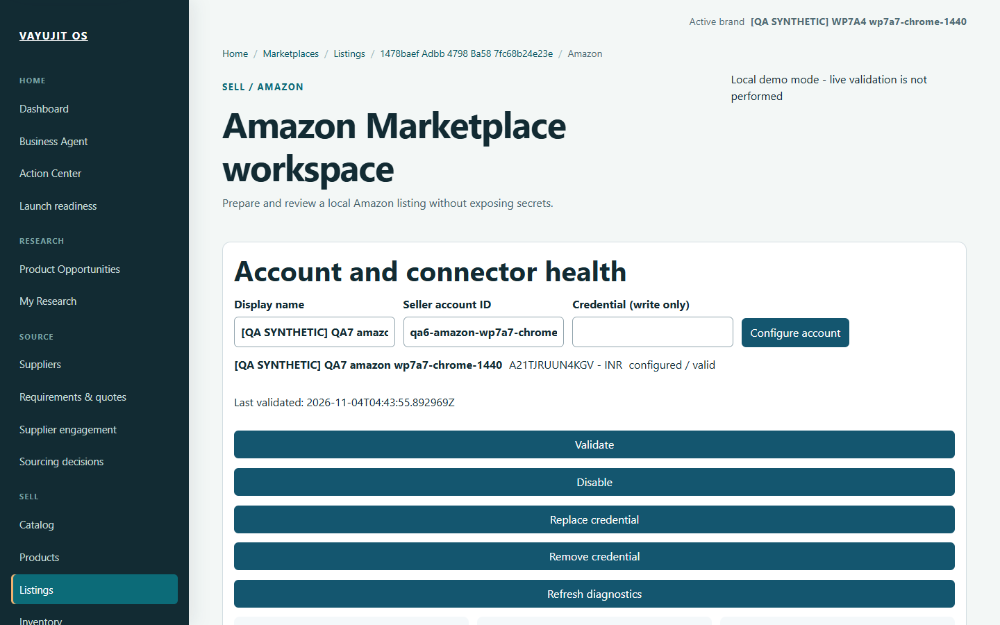

Figure 13. Synthetic Amazon local account workspace. Blank credential field is write-only; this is not real SP-API certification. Genuine historical synthetic capture, 2026-11-04.

## 28 Prepare a Flipkart listing locally

Where: Marketplaces > Flipkart or the Product-linked Flipkart editor.

Keep the Product/SKU context while preparing the supported channel-specific draft.

1. Open the intended listing and inspect required content, category, price and media prerequisites.
2. Use real Product facts. Let missing-information messages identify the legitimate next correction.
3. Reassess readiness after changes and re-review any context that has become stale.

Check: The screenshot is a synthetic blocked state, not a submitted listing. Local tests and fake transport are not live Flipkart certification.

Next: Return to the exact missing source field; do not manufacture account or listing data.

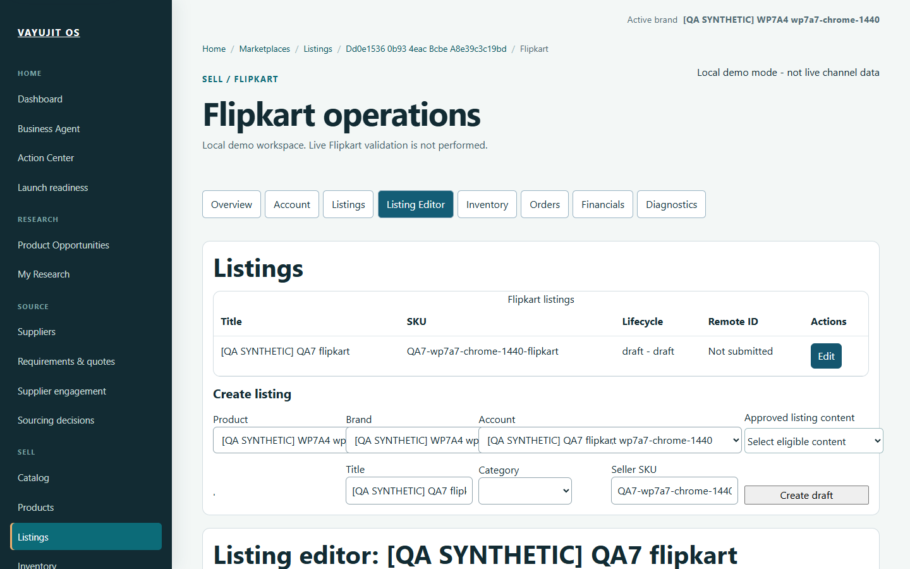

Figure 11. Synthetic Flipkart editor with missing prerequisites; a visible draft is not a submitted listing. Genuine historical synthetic capture, 2026-11-04.

## 29 Use Meesho local preparation

Where: Marketplaces > Meesho or its listing editor.

The supported Meesho experience includes local/manual preparation. Editor sections are not automatic marketplace actions.

1. Open the intended Product-linked draft and move through its supported sections.
2. Inspect pricing, inventory and content in the correct scope; keep unknown inputs explicit.
3. Open Readiness to identify genuine missing prerequisites and the supported local/manual next step.

Check: Do not infer live submission, order synchronization or remote edits from a visible local tab. A local draft is not a marketplace offer.

Next: Complete the permitted local preparation or follow separately authorized manual/provider procedures.

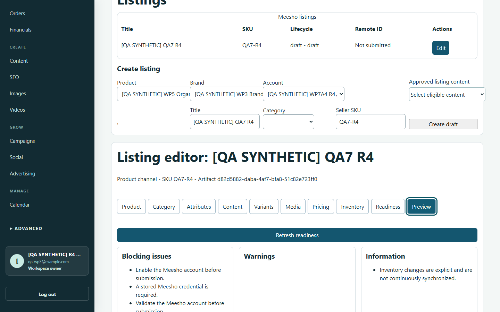

Figure 12. Synthetic Meesho section navigation and readiness blockers. Genuine historical synthetic capture, 2026-11-05.

## 30 Review listing readiness and approvals

Where: Listings, the channel editor and Approvals.

Readiness tells you whether a specific next operation meets its prerequisites. Review and execution permissions must match the current artifact.

1. Confirm Product, variant/SKU, channel, draft version and any account context.
2. Read each missing-field or evidence blocker and follow its useful source link.
3. After correcting data, request a current assessment through the supported control.
4. Review the exact current version. Edits can make an earlier review or authorization stale.
5. Treat expiry, revocation, fingerprint checks and single-use execution as safeguards, not obstacles to bypass.

Check: No local HUMAN approval grants universal permission to publish. Do not reuse an authorization for a different version or operation.

Next: Remain at preparation/review until real provider eligibility and the exact external action are separately authorized.

## 31 Read orders settlements and profitability

Where: Orders, Settlements and Financials.

Start from the provenance of the recorded activity, then interpret the projection.

1. Choose the intended period, marketplace and product/SKU context.
2. Check order/settlement source records and which costs/deductions are included.
3. Read UNKNOWN costs and contribution honestly. Inspect missing inputs before using a total or chart.

Check: Synthetic orders and amounts are not real seller activity. A settlement record is not proof of a bank-reconciled payment. Current financial projections are not an immutable statutory ledger.

Next: Resolve legitimate missing financial evidence without inventing transactions.

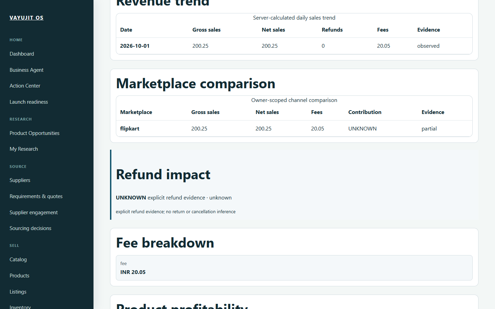

Figure 16. Synthetic financial table and UNKNOWN contribution. An observed label inside a synthetic fixture is not genuine marketplace evidence. Genuine historical synthetic capture, 2026-11-05.

## 32 Avoid common financial interpretation errors

Where: Financials, Marketplace analytics and Sourcing economics.

Financial views answer different questions. A product acquisition estimate, an order projection, revenue and available cash must not be treated as the same result.

1. Check source period, currency, quantity/unit and input precision before comparing values.
2. Distinguish known zero from UNKNOWN. An absent fee, cost, refund or tax basis must not silently become zero.
3. Read the actual documented calculation breakdown; do not assume a universal GST or marketplace-fee rule.
4. Check freshness after changing costs or assumptions. Reopen the saved result to verify the intended basis.
5. If UI and source records disagree, retain a safe reference and investigate before making a commercial decision.

Check: A chart is not proof of completeness, provider billing or accounting reconciliation. Use a separately chosen accounting authority for statutory requirements.

Next: Base decisions on current, comparable evidence and retain unresolved gaps.

## 33 Prepare accurate content and SEO

Where: Content, Content studio, SEO and artifact review.

Start with a saved Product and facts you can support. AI helps draft wording; it does not establish safety, compliance or product capabilities.

1. Choose the intended Product, output type and supported brand voice/preset.
2. Check provider/mode and the scope before generation; a generation action can make a real provider call.
3. Review the exact saved artifact/version. Correct unsupported claims and inaccurate specifications.
4. Use supported comparison and HUMAN review controls. Editing can make a prior approval stale.
5. Treat keyword suggestions as suggestions, not verified volume, rankings or guaranteed traffic.

Check: Do not send confidential information to a provider without permission. Content approval is separate from publishing authorization.

Next: Use the reviewed artifact in the correct local listing/campaign workflow.

## 34 Prepare images and videos safely

Where: Images, image Output review and Videos.

A storyboard, generated media, reviewed output and delivered asset are distinct stages.

1. Choose the correct Product and authorized reference assets. Keep the intended output purpose clear.
2. Review provider mode, cost and eligibility before requesting generation or rendering.
3. Inspect the actual image/video and the immutable output/version. Check product accuracy, rights and misleading claims.
4. Review captions/storyboard and artifact readiness through supported controls.
5. Use a bounded single-item workflow before any separately authorized bulk action.

Check: A generated picture is not product evidence, and an approved image does not automatically approve an ad or marketplace listing. A queued render is not a finished video.

Next: Associate the eligible reviewed output with its intended Product or draft.

## 35 Manage media workflows and HUMAN review

Where: Media Library, Workflows and Approvals.

Use saved identities and versions to keep assets and approvals connected to the right task.

1. In Media Library, inspect the file and its metadata before reusing it. Keep private preview URLs private.
2. Open the owned workflow and read the current step, prerequisites and actual artifact state.
3. In Approvals, review the exact object, version, purpose and scope before deciding.
4. If a workflow fails, use only its eligible recovery step. Do not mark the entire workflow complete or bypass a missing approval.
5. For a duplicate/uncertain action, check current history before issuing a new request.

Check: An approval is not transferable to a replacement artifact. File availability alone does not establish media rights or publication consent.

Next: Continue the canonical owning workflow only when its prerequisites are genuinely satisfied.

## 36 Prepare campaigns and dependencies

Where: Campaigns > intended campaign > activities and dependencies.

A campaign groups work; it is not proof that delivery has been activated.

1. Check the campaign Product/brand, lifecycle and activity identity.
2. Review the artifact version, destination, local date/timezone and predecessor relationships.
3. Inspect dependency/readiness previews again after changing or replacing an upstream activity.

Check: The screenshot shows a synthetic dependency review, not a release. Saving a local campaign and authorizing future execution are different actions.

Next: Inspect the campaign detail and Calendar before any separately authorized activation.

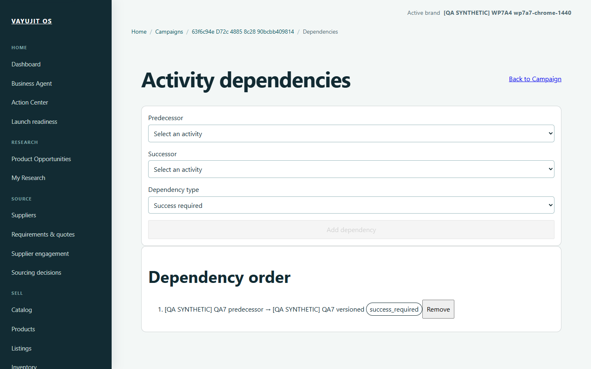

Figure 8. Synthetic predecessor/successor dependency review; no campaign release. Genuine historical synthetic capture, 2026-11-04.

## 37 Preview an activity reschedule

Where: Campaign detail > eligible activity > Reschedule Activity.

Reschedule Activity is an inline section, not a modal dialog. R5 corrected its authored keyboard-focus cue; it did not change scheduling or authorization rules.

1. Check Local date, Local time and IANA timezone. All three are required. For genuine India local time, use Asia/Kolkata. Reason is optional, at most 500 characters.
2. Choose Preview change. Inspect original/proposed local and UTC time, offset, DST classification, readiness issues and conflicts.
3. For an ambiguous daylight-saving time, choose Fold 0 or Fold 1 only after reviewing the interpretations. For a nonexistent time, choose another time.
4. If you change inputs, refresh the preview. Confirm reschedule is a separate action and must be explicitly authorized.
5. After a stale/rejected confirmation, refresh the preview and review current context before retrying.

Check: A preview is not a saved change. The focus-cue correction measured 8.56:1 against white in retained tests; it is not full accessibility certification.

Next: After a legitimate confirmation, inspect the recorded schedule/history and Calendar for the same activity.

## 38 Prepare and review social posts

Where: Social and its supported compose, account, post and recovery views.

Separate a local draft from an approved artifact and a remotely delivered post.

1. Select the intended Product, channel and current content/image identity.
2. Review the saved post and its supported readiness/preview controls.
3. Inspect history for an actual delivery outcome rather than assuming a local status means remote publication.

Check: Provider authorization, HUMAN confirmation and stale references remain separate gates. The screenshot is synthetic local history, not a live social post.

Next: Stop at preparation unless the exact remote action is separately authorized.

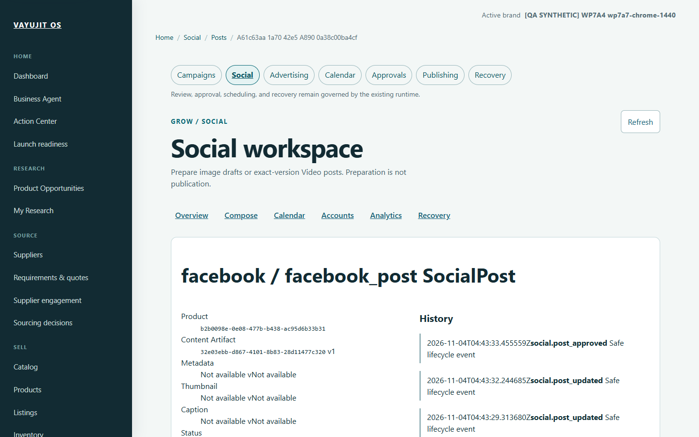

Figure 9. Synthetic social post history; preparation and local review are not remote publication. Genuine historical synthetic capture, 2026-11-04.

## 39 Use narrow screens and keyboard navigation

Where: The relevant workspace at its supported responsive width.

Use section disclosures and normal navigation to keep the current task manageable.

1. Use Tab and Shift+Tab to move between controls; look for a visible focus cue.
2. Use Enter/Space on the appropriate links or buttons. Do not rely on colour alone to infer readiness.
3. For wide evidence tables, inspect all columns using the supported horizontal scrolling; do not interpret hidden columns as absent data.

Check: This is a historical 390-pixel emulation, not a physical-device test. Accessibility remains incomplete: empty login border contrast and speech/zoom checks are still outstanding.

Next: If a control is unusable, capture a safe description and use support rather than bypassing its workflow.

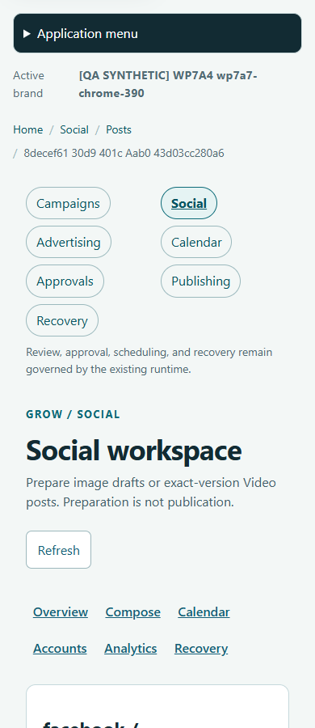

Figure 10. Historical mobile-width social workspace. Viewport emulation is not a physical mobile-device test. Genuine historical synthetic capture, 2026-11-04.

## 40 Review advertising without authorizing spend

Where: Advertising, marketing plans and optimization views.

An advertising recommendation or local creative preview is advisory until its specific canonical workflow permits an action.

1. Check Product, account, creative/output version and the evidence behind the recommendation.
2. Inspect readiness and missing authorization without changing provider modes just to clear a blocker.
3. Distinguish modeled budget allocation, local confirmation and real provider execution.

Check: The screenshot does not prove live provider approval or ad spend. Real authorization/expiry must not be inferred from offline fixtures. Do not activate advertising from a handbook example.

Next: Keep the recommendation advisory or obtain the separately required provider/HUMAN authority.

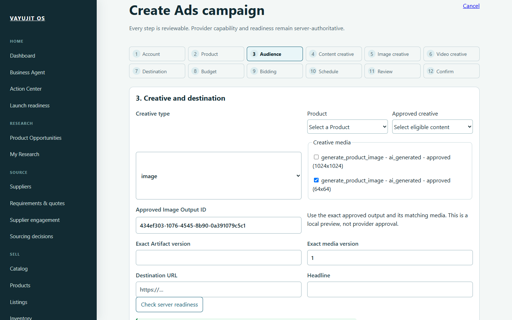

Figure 6. Synthetic image creative identity and local readiness, not an advertising provider approval. Genuine historical synthetic capture, 2026-11-04.

## 41 Understand publishing schedules and jobs

Where: Publishing, destinations, schedules, jobs and execution history.

Content destinations are not marketplace seller registrations. Background work has its own lifecycle, distinct from the business result.

1. Check the exact artifact/version and configured destination before publication preparation.
2. Treat enabling a schedule as potentially queuing future work. Confirm timezone and activation prerequisites.
3. Inspect a job timeline for state and original error. Queued is not delivered; a local mock success is not real publication.
4. For a failed or uncertain attempt, inspect canonical outcome/recovery eligibility before retrying.
5. Do not terminate workers, change credentials or force a successful state to clear a warning.

Check: Publishing, connector validation and retry can have external effects. This handbook grants no external execution authority.

Next: Use the owning workflow or ask support with a sanitized execution reference.

## 42 Act on warnings and launch readiness

Where: Action Center and Launch readiness.

Warnings should lead to a legitimate source correction, not cosmetic green indicators.

1. Filter Action Center by supported status, category and severity. Active and Resolved have different meanings.
2. Open a warning source and confirm product/SKU/account context.
3. Correct actual missing images, costs, stock evidence, mapping or approval prerequisites through their owning workflow.
4. Refresh the result and verify the condition legitimately clears or transitions.
5. Keep mandatory safety restrictions in place. Disabled external mutations and missing real authorization must not be cleared by fake approvals.

Check: A locally green readiness view is not proof of live deployment, registered marketplace accounts or independent recovery. A failed API request must not be treated as nothing needing attention.

Next: Review remaining business/security/provider prerequisites with the owner before any activation.

## 43 Use settings and operational diagnostics carefully

Where: Advanced > Operations, System Doctor, recovery, backups and Settings.

These areas help an operator inspect configuration and failures. They are not routine beginner tasks to change while browsing.

1. Use read-only health/status views first and identify the exact failing component.
2. Keep provider endpoint/model/mode and write-only credentials private. Configuration does not establish live connectivity.
3. Preserve the original error, owner/version context and current outcome before any authorized recovery.
4. Treat backup artifacts and successful independent restore as different evidence. PC-first backup certification remains parked.
5. Ask support before changing database URLs, migrations, host configuration, worker state or automatic schedules.

Check: One seller, one PostgreSQL installation and one owner remain the architecture. Do not create a new owner or database as an error workaround.

Next: Use an approved operator procedure for the exact problem, not a general reset.

## 44 Troubleshoot common problems

Where: The affected page, its source workflow and safe diagnostics.

Record the page, action, time and safe correlation reference. Do not share passwords, tokens, session cookies or database connection strings.

1. Cannot connect: check the intended API and configured origin with support. The application uses /health/live and /health/ready; a 404 at /health alone does not prove an outage.
2. 401: sign in normally to the intended origin. ownerExists is application state, not a setting to add to .env.
3. 500: this is a server error, not an empty successful result. Preserve the safe correlation reference for investigation.
4. 409 or stale version: reload and inspect the latest record/context. Do not blindly replace identifiers or repeat a changed action.
5. No product opportunity: inspect actual queries, page outcomes, source policy and eligibility. Retry is not guaranteed to produce a product.
6. Unknown external outcome: inspect canonical history/reconciliation before retrying to avoid duplicate effects.

Check: Do not run database migrations, disable controls, change provider credentials or delete data without a separately approved procedure.

Next: Return to the intended saved context after the underlying issue is resolved.

## 45 Keep these terms and final checks handy

Where: Use this page when a workflow label is unclear.

These distinctions prevent common seller mistakes.

1. Goal: your research question. Opportunity: an evidence-backed candidate. Product: the seller-authored master. Listing: a channel-specific preparation/offer context.
2. SKU: stock identity. Variant: a sellable option. Stock ledger: recorded movements/positions, not a Product master quantity.
3. Source approval: permission for the stated evidence access. HUMAN selection/review: a scoped decision. Execution authorization: permission for a specific eligible action, not a universal approval.
4. Lineage: where a fact/result came from. Fingerprint/version: the exact context an approval or calculation refers to. Idempotency: an identical supported replay must not duplicate its business action.
5. Before relying on a result: verify owner/brand, product/supplier, currency/units, current evidence/inputs, missing facts and exact next-action authority.

Check: Use the detailed handbook for the full page and field reference. This practical guide deliberately omits the exhaustive route catalogue and QA evidence ledger.

Next: Work on one real task at a time, save through normal controls and verify the persisted result before proceeding.

