# VAYUJIT OS Complete Product Handbook

Edition 0.9.1 • 6 November 2026

# Start here

VAYUJIT OS is a private workspace for one seller. It connects product research, supplier evidence, product records, sourcing estimates, listing preparation, content and operational review. It helps you decide what to investigate and what needs attention. It does not guarantee that a product will sell or that a supplier is trustworthy.

Use this handbook first to choose a business task, then open the relevant page reference. The examples use imaginary products and synthetic amounts. Do not copy example stock, costs, accounts or transactions into your business records. Keep UNKNOWN whenever a fact has not been established.

The current application is not fully certified or production-ready. Local functional tests cover defined workflows; real marketplace connectivity, independent recovery and required accessibility evidence remain separate gates. You can learn the local preparation workflows without assuming permission to publish, contact a supplier or spend money.

This edition has no fresh authenticated browser verification. Screenshots are genuine retained synthetic QA captures, individually labelled by capture date and evidence. They are not illustrations, live market results or proof that your current screen is identical. Missing views are identified rather than invented.

# Understand the product

The name VAYUJIT OS identifies this seller operating workspace. The reviewed sources do not establish a formal expansion of VAYUJIT, so this handbook does not invent one. OS here describes connected business operations, not a replacement for Windows.

A first-time entrepreneur can use it to organize questions before buying inventory. An existing seller can prepare products, inspect recorded stock and orders, compare current cost assumptions, and prepare content. Research, sourcing, marketplace and marketing tasks describe kinds of work, not separate staff roles with independent logins. The current supported account model is one owner per isolated installation.

For example, instead of keeping a product idea, three supplier pages and a cost estimate in unrelated notes, you can retain their identities and evidence links through the supported journey. A later decision should refer to the same product and supplier, not an accidentally selected replacement.

VAYUJIT does not replace seller-account registration, a marketplace, banking, tax advice, statutory accounting, physical quality inspection or human commercial judgment. Financial projections are not an immutable accounting ledger. A local valid account or local approval is not proof of real API access.

# Choose your first task

If you have no product yet, open Home → Business Agent and describe a narrow research question. If you already own a product, open Sell → Products or Catalog; research is not a prerequisite to entering a truthful seller-authored product.

If you already hold counted physical stock, first create the correct Product and SKU, then use Sell → Inventory and its opening-stock path. The Product master quantity field is not the stock ledger. Do not record the same opening stock twice.

If you only want to understand the day, open Dashboard, then Action Center. Follow the source link for an issue. Marking an issue acknowledged or resolved is not approval to execute its recommendation.

Use the Advanced disclosure for specialist intelligence, operations and settings. You do not need to configure every provider or visit every menu before completing a local preparation task.

# First login and safe navigation

Open the exact URL configured for your installation. Do not substitute a retired QA port, an example URL or a different database. Normal local development uses loopback addresses, but its current availability is not established by this edition. Keep localhost and 127.0.0.1 consistent with the configured frontend/API origin and cookie settings.

On an existing workspace, use Welcome back → Email and Password → Sign in. The current client requires a valid email and at least ten password characters. Show password changes visibility; it does not reset the password. Never include a real password in a screenshot or support message.

Create your owner account is a first-installation operation, not the remedy for a failed login. Full name is 2–120 characters in the current client; confirmation must match the password. Do not initialize a permanent business database or create an extra owner just to follow this handbook.

After sign-in, check the active brand and product context before editing. Use normal links for record details; do not replace an identifier in a URL with a guessed one. Reload can retrieve saved state, but cannot recover unsaved form text reliably. A stale-version response means reload and review the latest record before resubmitting.

If the page says it cannot connect to the local API, check the intended service and its /health/live and /health/ready endpoints with support. A response of Not Found at /health alone does not establish an outage. Do not add ownerExists to .env: that is application state, not a documented environment setting. Do not run a migration or change database URLs blindly.

# How the modules fit together

Research path: Product idea → Research goal → supported trend, competitor and customer-feedback evidence → opportunity assessment → explicit HUMAN selection → supplier research → due diligence → sourcing scenarios and economics → business decision → product and listing preparation. This is a conceptual map, not a requirement that every intelligence source must exist or every stage will succeed.

Existing-product path: Product record → Catalog details and private media → SKU and counted inventory → local marketplace draft → readiness review. Recorded orders and financial evidence feed operational projections when genuine supported inputs are available. Local synthetic examples are not real transactions.

Content path: product facts → content or media draft → review of the exact version → campaign/activity preparation → scheduling and controlled execution gates. Approving an image is not the same as approving a social post or ad spend.

Every handoff should preserve the same owner, goal, opportunity, product, supplier and relevant evidence version. If a destination shows a different identity or no context, stop and choose the intended context explicitly. Do not silently accept a substituted quotation or cost basis.

Idea and goal → Evidence review → HUMAN selection → Supplier and DD → Economics decision → Local product preparation → Separate external gates

# Understand evidence and results

Observed means a source supplied a recorded fact. Derived means a documented calculation or analysis used inputs. AI-generated means a model drafted an explanation or content. Human-entered means a person supplied a statement. None of these labels alone proves that the fact is current, complete or commercially correct.

Confidence describes support for a particular finding; it is not a profit forecast. A score is the output of a defined model, not a success probability. Eligibility asks whether a candidate meets the present rules. Readiness asks whether a particular next workflow can proceed. A product can be eligible for research while not ready for sale.

Freshness tells you whether evidence and its inputs are still current enough. Materiality concerns whether a change matters under the applicable comparison rules. Contradictory sources need investigation, not an average that conceals disagreement. A source link and capture date help you trace the statement back to its origin.

UNKNOWN is different from zero. Missing shipping cost is not free shipping. Zero profit can be a valid calculated result; unknown profit means required inputs are absent. NOT_COMPARABLE means the present evidence cannot support the comparison, for example because currencies or units differ.

Review counts do not directly establish sales. Historical search interest is not future demand. A fetched product page is not a verified supplier. A local fake provider success is not a real provider action. A recommendation never grants spending authority.

# Business Agent and useful research goals

Business Agent is the workspace that organizes supported research steps. A research goal is your saved statement of the business question. A plan is the versioned set of supported steps proposed for that goal. A run records what actually executed. A prompt in an image or content tool instead describes that tool’s output; it does not create a universal business automation instruction.

A useful goal names the marketplace and geography, category or product, capital and currency, constraints, number of candidates, desired evidence and permitted next boundary. For an initial search, ask for up to three candidates rather than ten proven best sellers. The system may legitimately find none.

Use Home → Business Agent → Start with a business outcome, or Start another research goal. In What are you trying to accomplish?, enter at least five characters and a clear question. Advanced research options contains Marketplace context (optional), Include competitor intelligence, Include customer-feedback evidence and Include Trend Intelligence. These request supported goal capabilities; they do not supply credentials or override runtime budgets.

Click Create research goal. Review the interpreted goal, marketplace, category, budget and unknowns. Confirm goal context only if correct. Create versioned research plan, inspect the proposed capabilities, then Start run only in an authorized mode. Creating the goal itself does not run the search.

Inspect What happened during discovery. Distinguish new provider searches from reused evidence, page-fetch attempts from successful fetches, and fetched pages from eligible products. Source approval permits a bounded read; it does not establish product suitability. Tick policy confirmations only after actually reviewing the permitted access. The additional policy note is optional where the current form says optional; the audit purpose is recorded automatically.

If blocked, inspect the exact reason before choosing Continue product discovery or Retry product discovery. Repeating a cached query may reuse the same evidence and will not guarantee a candidate. A supplier-directory/category page may be unsuitable as product identity evidence. Do not weaken category constraints or invent a product to make progress.

When results exist, use Review opportunities for this goal or Open Product Opportunities, inspect evidence and assessments, compare candidates and make an explicit HUMAN selection. Supplier research begins after the required selection boundary; approval of a research source is not selection.

A decision brief summarizes available evidence and gaps. Read its assumptions, evidence dates, identity and missing inputs before accepting a recommendation. Approve and complete is a decision workflow, not permission for undisclosed procurement or publication. Requested content/portfolio/operational prompts may require their specialist screens rather than the current Business Agent plan.

# Financial estimates and capital decisions

Acquisition assumptions, supplier quotations, landed cost and operational financial projections are different records. A manually entered Product master cost is not automatically a verified supplier quote or a complete landed cost. Record the amount, currency, unit basis, quantity, evidence and whether it is assumed or supported.

A landed-cost result should identify the included components and missing inputs. Compare like units and currencies. Duties, GST, marketplace fees and exchange rates must come from supported explicit evidence; this handbook supplies no fee schedule or tax treatment. Review a stale or changed assumption before calculating or using readiness.

Illustrative arithmetic only: if the relevant implemented profit view has known sales of INR 200, recorded deductions of INR 197.99 and known acquisition cost of zero, profit is INR 2.01 and the displayed two-place margin is 1.01%. If cost knowledge is missing, profit remains UNKNOWN. Zero is valid only when it is actually known, not used to fill a blank.

A recorded unit price may be rounded to two places while an independently recorded line total retains its own authority. For example, source 100.125 for two units can be projected as unit 100.13 and total 200.25. Do not reconstruct that total as 100.13 × 2. Detailed economics can retain eight-place values; a displayed 0.00 is not proof a sub-paise input is free.

Current Finance calculation snapshots are working projections for a scope and calculation version. Recalculation can replace the current same-version metrics. Do not rely on the screen as immutable transaction history, a bank reconciliation or a statutory accounting ledger. Decide the separate accounting record and retention arrangement before real-business activation.

# Approvals and provider modes

HUMAN means the actual owner makes the consequential decision through the supported workflow. A checkbox is meaningful consent, not a technical obstacle to tick automatically. Review the exact product, supplier, artifact, version, account and operation before approval.

Synthetic or local demo data is a deterministic test representation. SANDBOX means a provider-specific non-production environment only where implemented and actually verified; a local mode name does not prove a provider accepted anything. LIVE_READ_ONLY permits only specifically approved real reads under current safeguards. LIVE or live-write readiness must not be inferred from a configuration label.

Source approval and live-execution authorization are separate. A single-use authorization may expire, be revoked, or become stale after an edit. Do not reuse an old review to authorize a changed listing or creative. An identical replay may return the existing result under its contract; a conflicting or stale request must be rejected.

Credential fields are write-only: blank on reopening does not mean the provider was never configured. Never paste a secret into a reason, prompt, screenshot or help ticket. Real Amazon/Flipkart seller registration, API eligibility, application consent and verified contract/connectivity are separate prerequisites. No real provider action is certified by the handbook’s synthetic screenshots.

# Research and Business Agent prompt library

Twenty-four illustrative task briefs follow. Only some map to the Business Agent’s current goal planner. The destination and support note tell you when to use a specialist screen instead. These prompts do not grant source access, substitute for required fields or authorize external effects.

## Prompt 1 Beginner discovery

Business objective and destination: Beginner discovery. Use Business Agent.

Example prompt: Find up to 3 product opportunities for Amazon India with a maximum total launch budget of INR 300000. Category: home and kitchen organization. Prefer compact, non-fragile, non-perishable products. Use permitted product-specific evidence, show source and date, separate observations from assumptions, and mark unknown costs and demand. Stop for my product selection before supplier discovery. No contact, orders, publication or spending.

Why this works: A narrow category and candidate limit make evidence review manageable. Verify the interpreted budget and category before starting.

What VAYUJIT can attempt: Current goal/plan and local discovery boundaries have functional evidence; genuine permitted search results are not guaranteed.

Inspect: Product identity, category match, sources and missing costs.

Evidence that may be missing: No meaningful product page, provider quota, source approval or insufficient identity.

Next: Review candidates or the exact discovery blocker; do not select an unsupported result.

## Prompt 2 Validate an existing idea

Business objective and destination: Validate an existing idea. Use Business Agent.

Example prompt: Evaluate reusable kitchen storage containers as a product idea for Amazon India. Use available evidence for product identity, competing offers, customer problems and sourcing feasibility. Do not call it profitable or best-selling without supporting evidence. Distinguish unknowns. Stop before supplier contact or orders.

Why this works: Names a hypothesis rather than presuming a winner.

What VAYUJIT can attempt: Research capabilities depend on the generated plan and enabled evidence sources.

Inspect: Reasons for and against further research, with dates and provenance.

Evidence that may be missing: Demand, actual sales and landed costs may be absent.

Next: Choose more research, comparison or rejection after reviewing evidence.

## Prompt 3 Sports category research

Business objective and destination: Sports category research. Use Business Agent.

Example prompt: Find up to 3 lightweight non-electronic sports and outdoor fitness product ideas for Amazon India within INR 300000. Use real product-specific pages when permitted. Retain the category constraint. Show observed features, observed price/currency and missing evidence; do not infer sales or supplier suitability. Stop for my selection.

Why this works: Keeps category and product identity authoritative instead of requesting unsupported best-seller claims.

What VAYUJIT can attempt: Local category/evidence eligibility is supported; a live outcome is unverified.

Inspect: Final candidate eligibility and rejected-page reasons.

Evidence that may be missing: Directory/category pages may not identify a product.

Next: Inspect page outcomes before retrying.

## Prompt 4 Explicit kids category

Business objective and destination: Explicit kids category. Use Business Agent.

Example prompt: Research up to 3 kids-category product ideas for Amazon India within INR 300000. Preserve this explicit category in every step, including reused evidence. Record product identity and relevant safety/compliance questions without claiming compliance. No purchase, supplier contact or publication; stop for HUMAN selection.

Why this works: Makes category and safety uncertainty explicit without inventing certification.

What VAYUJIT can attempt: Category constraints are a supported authority; live product and compliance evidence may be unavailable.

Inspect: Category compatibility, product evidence and unresolved safety questions.

Evidence that may be missing: Compliance and supplier claims require independent evidence.

Next: Reject incompatible cached products and investigate safety requirements separately.

## Prompt 5 Trend evidence

Business objective and destination: Trend evidence. Use Trend Intelligence.

Example prompt: For the selected product and India context, summarize available observed trend signals over the supported period. Show source, observation dates, direction, gaps and disagreements. Do not convert interest into sales or a demand forecast.

Why this works: Requests bounded observations instead of prediction.

What VAYUJIT can attempt: Use the specialist screen and its supported context/period; arbitrary agent routing is not promised.

Inspect: Signal definitions, time coverage, source agreement and freshness.

Evidence that may be missing: A comparable time series may be missing.

Next: Retain uncertainty or obtain permitted comparable observations.

## Prompt 6 Compare competitors

Business objective and destination: Compare competitors. Use Competitors.

Example prompt: Compare the recorded competitors for my selected product in Amazon India. Use matching products and currencies. Show observed price, availability and positioning with source dates; do not estimate competitor profit or sales without evidence.

Why this works: Keeps comparison scoped and comparable.

What VAYUJIT can attempt: Specialist competitor analysis exists; provider acquisition depends on authorization.

Inspect: Identity matches, price basis and missing observations.

Evidence that may be missing: Different pack sizes or stale offers can prevent comparison.

Next: Review the original products before drawing a positioning conclusion.

## Prompt 7 Monitor competitor changes

Business objective and destination: Monitor competitor changes. Use Competitors.

Example prompt: Review changes between existing comparable competitor observations for the selected product. Distinguish price, availability and review-count changes, with before/after dates and evidence. Do not create a change from incomparable snapshots.

Why this works: Requires a real baseline instead of a single screenshot.

What VAYUJIT can attempt: Change analysis is a specialist capability, not a guaranteed recurring monitor.

Inspect: Baseline identity, dates and materiality explanation.

Evidence that may be missing: Only one observation or incompatible intervals.

Next: Collect another permitted observation if the baseline is insufficient.

## Prompt 8 Customer pain points

Business objective and destination: Customer pain points. Use Customer Reviews.

Example prompt: Summarize recurring complaints and praise in the available customer-feedback evidence for this product. Separate directly supported themes from hypotheses. Show counts only when the evidence supports them; identify freshness and sample limitations.

Why this works: Asks for grounded themes rather than invented customer opinions.

What VAYUJIT can attempt: Review analysis requires actual stored evidence.

Inspect: Review source, sample coverage, contradictory themes and quotations where provided.

Evidence that may be missing: No reviews or a biased/old sample.

Next: Turn supported problems into questions for product validation.

## Prompt 9 Product differentiation

Business objective and destination: Product differentiation. Use Customer Reviews and product research.

Example prompt: Suggest product-improvement hypotheses from the recorded review themes and competitor features. For each idea, cite the supporting evidence and what must be tested. Do not claim the modified product exists or is compliant.

Why this works: Separates an idea from a verified product fact.

What VAYUJIT can attempt: Use specialist evidence and owner analysis; automatic product redesign is not certified.

Inspect: Evidence-to-hypothesis link and feasibility questions.

Evidence that may be missing: Manufacturing, cost, safety and consumer testing.

Next: Prepare a test brief, not a listing claim.

## Prompt 10 Winning Product assessment

Business objective and destination: Winning Product assessment. Use Winning product research.

Example prompt: Assess this selected opportunity using the current supported assessment model. Explain eligibility, confidence, input freshness, hard blocks and missing dimensions. Do not interpret the score as probability of success.

Why this works: Requests explanations and blocks, not a naked rank.

What VAYUJIT can attempt: Existing canonical assessment local paths have functional evidence.

Inspect: Assessment identity/version, included dimensions and gaps.

Evidence that may be missing: Unscorable or stale inputs.

Next: Request more evidence or compare compatible assessments.

## Prompt 11 Supplier comparison

Business objective and destination: Supplier comparison. Use Suppliers and Shortlists.

Example prompt: Compare available suppliers for this selected opportunity using documented MOQ, quoted price/currency, lead time, verification evidence and risks. Mark missing facts UNKNOWN. Do not contact suppliers or auto-shortlist them.

Why this works: Preserves product context and HUMAN selection.

What VAYUJIT can attempt: Canonical supplier comparison/local fixtures tested; genuine commercial facts not guaranteed.

Inspect: Evidence coverage, contradictions, not-comparable reasons and scope.

Evidence that may be missing: Quotes, MOQ, logistics and source verification.

Next: Review supplier details and decide what due diligence is needed.

## Prompt 12 Supplier due diligence

Business objective and destination: Supplier due diligence. Use Supplier Verification.

Example prompt: For the selected supplier, summarize supported claims, verification findings, missing evidence, contradictions and freshness. Distinguish a claimed certificate from verified evidence. Do not call the supplier approved for procurement.

Why this works: Prevents research from being mistaken for verification.

What VAYUJIT can attempt: Specialist due-diligence workflow exists; real company verification remains evidence-dependent.

Inspect: Claim/source correlation, stale findings and blockers.

Evidence that may be missing: Authentic certificates, identity or inspection evidence.

Next: Record a scoped human decision or leave unassessed.

## Prompt 13 Capital constrained sourcing

Business objective and destination: Capital constrained sourcing. Use Sourcing decisions and economics.

Example prompt: Compare supported sourcing scenarios for INR 200000 available capital. Preserve supplier and quote identity. Show quantity, known acquisition components, explicit freight/duty/FX evidence, missing inputs and capital fit. Do not replace missing costs with zero or assume fees/GST.

Why this works: Requests supported components without inventing a fee model.

What VAYUJIT can attempt: Canonical scenario/economics engines exist; no universal free-text calculator promised.

Inspect: Units, currencies, input lineage, calculation versions and UNKNOWN.

Evidence that may be missing: Freight, duties, quotes or exchange-rate evidence.

Next: Complete legitimate inputs and recalculate stale results.

## Prompt 14 Sourcing resilience

Business objective and destination: Sourcing resilience. Use Portfolio and Resilience.

Example prompt: Review the recorded supplier portfolio for concentration and dependency risks. Separate observed relationships from modeled scenarios. Identify missing capacity, region and alternate-source evidence. Do not add a fictional backup supplier.

Why this works: Resilience depends on real relationships, not a supplier count alone.

What VAYUJIT can attempt: Specialist portfolio screens exist; arbitrary automated portfolio actions are not certified.

Inspect: Product/supplier scope and assumptions behind risk.

Evidence that may be missing: Capacity, region or alternate feasibility.

Next: Plan evidence collection for a credible alternative.

## Prompt 15 Content preparation

Business objective and destination: Content preparation. Use Content.

Example prompt: Draft a concise product description for the selected product using only its verified material, dimensions and features. Separate proposed language from facts needing confirmation. Do not add certifications, health claims, guarantees or competitor trademarks. Do not publish.

Why this works: Limits unsupported marketing claims.

What VAYUJIT can attempt: Content tool and review workflow exist; configured AI availability is separate.

Inspect: Exact product/version and factual claims in the draft.

Evidence that may be missing: Dimensions/material may be unknown.

Next: Edit and review the exact artifact version.

## Prompt 16 SEO planning

Business objective and destination: SEO planning. Use SEO.

Example prompt: Prepare supported keyword and content suggestions for this product and intended India audience. Explain their basis and mark any unsupported search-volume or ranking claims as unknown. Keep the wording accurate and do not publish.

Why this works: SEO suggestions are not evidence of ranking or demand.

What VAYUJIT can attempt: SEO workspace exists; available analysis depends on provider/evidence.

Inspect: Keyword relevance, claim accuracy and metadata length guidance.

Evidence that may be missing: Verified search volume and competitor ranking evidence.

Next: Review copy manually before using it in a draft.

## Prompt 17 Image brief

Business objective and destination: Image brief. Use Images.

Example prompt: Prepare a product image concept using the selected product and authorized reference assets. Preserve appearance and do not invent accessories, dimensions, certifications or real usage evidence. Keep the result a reviewable draft with no publishing.

Why this works: An image brief must stay grounded in product facts.

What VAYUJIT can attempt: Image studio/review local workflow exists; actual generation requires a configured provider.

Inspect: Product/reference identity, version and visual accuracy.

Evidence that may be missing: Approved reference photos or generation access.

Next: Review generated pixels; never use a misleading product image.

## Prompt 18 Video brief

Business objective and destination: Video brief. Use Videos.

Example prompt: Prepare a short product video plan from verified product facts and approved assets. List supported scenes, captions and unresolved requirements. Do not claim a render occurred or publish anything.

Why this works: Separates planning from generation and delivery.

What VAYUJIT can attempt: Video/storyboard/local review exists; render/provider paths are not universally certified.

Inspect: Storyboard, audio/caption settings, referenced asset versions.

Evidence that may be missing: Render provider, rights, missing media.

Next: Review the plan and stop at the configured provider boundary.

## Prompt 19 Marketplace readiness

Business objective and destination: Marketplace readiness. Use Listings and product marketplace preparation.

Example prompt: Review this local Amazon India listing draft for missing supported fields, images, SKU mapping, price/currency and stale reviews. Explain the next local correction. Do not create fake seller authorization or submit the listing.

Why this works: Readiness is specific to an artifact and prerequisites.

What VAYUJIT can attempt: Local Amazon/Flipkart preparation and default-deny controls tested; live APIs unverified.

Inspect: Exact product/listing/account, readiness blockers and review fingerprint.

Evidence that may be missing: Genuine account registration, category requirements or provider contract.

Next: Correct local facts and reassess; obtain real authorization separately.

## Prompt 20 Campaign planning

Business objective and destination: Campaign planning. Use Campaigns.

Example prompt: Prepare a campaign outline for this selected product using existing approved content/image versions. Show activities, dates, timezone, dependencies and missing approvals. Do not activate, dispatch, publish or spend.

Why this works: Explicitly names dependencies and the no-execution boundary.

What VAYUJIT can attempt: Campaign/activity/dependency preparation exists; free-text goal does not guarantee automatic campaign creation.

Inspect: Activity order, selected immutable assets and schedule context.

Evidence that may be missing: Valid assets, approval or provider readiness.

Next: Enter/review the supported local campaign fields; stop before activation.

## Prompt 21 Weekly business review

Business objective and destination: Weekly business review. Use Dashboard and Action Center.

Example prompt: Summarize available recorded operational signals for the week: failed jobs, stale evidence, stock concerns and financial gaps. Distinguish observed events, projections and advisory recommendations. Do not resolve issues or execute actions automatically.

Why this works: An operating review is not an instruction to mutate the business.

What VAYUJIT can attempt: Use operational screens; Business Agent research plans do not sync orders or execute recommendations.

Inspect: Signal scope/status, source links and date coverage.

Evidence that may be missing: No recorded transactions or missing cost evidence.

Next: Open each source workflow and choose the appropriate human action.

## Prompt 22 Portfolio review

Business objective and destination: Portfolio review. Use Portfolio and Resilience.

Example prompt: Review my recorded product/supplier portfolio for modeled concentration and capital exposure. Use compatible currencies and explicit inputs. Identify UNKNOWN relationships and avoid inventing rankings or risk-free alternatives.

Why this works: Makes portfolio assumptions visible.

What VAYUJIT can attempt: Specialist screen/source-declared controls, not universal agent support.

Inspect: Coverage, relationships, risk explanation and input freshness.

Evidence that may be missing: Incomplete supplier/product links and cost evidence.

Next: Validate the portfolio membership before scenario changes.

## Prompt 23 Operational failure investigation

Business objective and destination: Operational failure investigation. Use System Doctor and Recovery.

Example prompt: Help interpret the recorded failed workflow or job using its current status, safe correlation reference and supported recovery actions. Identify stale or unknown outcomes before retry. Do not reset data, disable safety controls or repeat an external action.

Why this works: Unknown outcomes can make blind retries dangerous.

What VAYUJIT can attempt: Diagnostics/recovery authorities exist; no autonomous production repair implied.

Inspect: Failure stage, original error classification, current canonical state and replay identity.

Evidence that may be missing: Missing safe diagnostics or unclassified historical failure.

Next: Ask support with sanitized evidence or use the explicitly eligible recovery path.

## Prompt 24 Reject weak evidence

Business objective and destination: Reject weak evidence. Use Business Agent and opportunity review.

Example prompt: Review this opportunity for reasons not to proceed. Check category compatibility, stale/cached evidence, missing identity, contradictory claims and unknown commercial inputs. Do not manufacture a replacement product or change my goal automatically.

Why this works: A useful outcome can be rejection or more research.

What VAYUJIT can attempt: Existing research/selection boundaries support safe review; no guaranteed candidate.

Inspect: Exact goal, evidence eligibility and negative findings.

Evidence that may be missing: No independent supporting source.

Next: Reject/archive only through the appropriate scoped HUMAN action.

# Six worked beginner journeys

## Journey 1 Starting a business with INR 300000

Starting situation: You have a budget, no chosen product and no registered marketplace account.

Goal: Reach a defensible product-research and sourcing-preparation decision without a transaction.

Prerequisites: An existing authorized owner workspace; permitted research mode and sources. Genuine evidence may be unavailable. Do not create business data merely to reproduce a synthetic screenshot.

1. Open Home → Business Agent. Enter prompt 1 or another narrow category goal. Keep the total capital explicit as INR 300000.

2. Review the saved goal and unknowns, then Create versioned research plan. Check that the category, marketplace and evidence boundaries match what you asked.

3. Start run only in the permitted mode. Review search/page/eligibility outcomes, not just a completion counter. If no eligible product exists, stop here and inspect the specific blocker.

4. When Product Opportunities contains supported candidates, follow Review opportunities for this goal. Inspect product identity, category, source date and unknown commercial facts. Compare compatible assessments.

5. Choose Select this product for supplier research only after its canonical prerequisites are satisfied. A disabled button requires the indicated evidence/context step, not a bypass.

6. Follow Find suppliers or Source → Suppliers with the selected product preserved. Review modes and source approvals. No supplier contact is included.

7. Open Supplier Verification and Shortlists to inspect claims, contradictions and eligibility. A shortlist is not procurement permission.

8. Review Requirements & quotes and Sourcing decisions. Enter only known quotes or clearly assumed inputs; use current economics to inspect capital fit. Unknown freight/fees stay UNKNOWN.

9. If a local product-preparation decision is justified, use the supported Catalog conversion/entry path and preserve lineage. Prepare a listing draft, then stop at missing genuine seller/provider prerequisites.

Expected type of outcome: A saved research context, reviewed evidence, an explicit selection if eligible, and a local preparation decision. No promised profit, real purchase or publication.

Common mistake: Treating a fetched page, score, cached result or source approval as proof that the product is suitable.

Next: Obtain missing facts and separate real seller registration, accounting, recovery and provider approvals before activation.

Current boundary: Full real research-to-launch success is not certified. The tutorial stops at any unsupported, unknown or authorization boundary.

Exact fields, screenshots and source evidence: page references P005, P009, P104, P025, P102, P001, P052. Illustrative input is not an observed provider result.

## Journey 2 Improving an existing product

Starting situation: You already know the product and want to understand customer problems.

Goal: Create evidence-backed improvement hypotheses, not invented features.

Prerequisites: An owned Product/opportunity and legitimate competitor/review context; comparable evidence if available.

1. Open Sell → Products and the exact product record. Confirm brand, SKU, category and current product description.

2. Use Advanced → Intelligence → Competitors to choose the relevant context. Compare matching offers and units; a different pack size is not directly comparable.

3. Use Customer Reviews for the corresponding context. Inspect source, sample dates, pain points, praise and contradictions.

4. Use Trend Intelligence only for available comparable signals. Do not equate interest with sales.

5. Record a proposed improvement separately from verified product facts. Use prompts 7–9 as review briefs in the corresponding tools, not guaranteed universal agent commands.

6. If you later edit the Product, enter only features that are actually true. Re-review dependent content and readiness after a material change.

Expected type of outcome: A traceable set of hypotheses and missing tests.

Common mistake: Adding a suggested feature or certification to a listing before the product actually has it.

Next: Validate feasibility and product facts before changing commercial claims.

Current boundary: No physical testing, sales forecast or automatic redesign is established.

Exact fields, screenshots and source evidence: page references P051, P008, P007, P003. Illustrative input is not an observed provider result.

## Journey 3 Finding safer supplier options

Starting situation: You depend on one supplier or have incomplete supplier information.

Goal: Compare supported evidence and identify due-diligence needs.

Prerequisites: Selected opportunity/product, existing supplier candidates or separately permitted acquisition, and a clear no-contact boundary.

1. Open Source → Suppliers from the selected opportunity when possible. Confirm the product name and current mode.

2. Inspect each supplier’s source/evidence, identity and missing commercial facts. A directory claim is not a verified factory.

3. Use Supplier Verification to assess the candidate through the existing due-diligence workflow. Review claims, findings, contradictions and freshness.

4. Use Shortlists to compare eligible evidence. Leave NOT_COMPARABLE suppliers unranked rather than inventing a winner.

5. Use Requirements & quotes and Sourcing decisions only with the exact quote/input basis. Model alternates as assumptions, not actual supplier commitments.

6. Use Portfolio & Resilience for supported dependency/concentration review; an unverified alternate is not operational backup capacity.

Expected type of outcome: A bounded human research/shortlist decision with missing evidence explicit.

Common mistake: Assuming more supplier records means less actual supply risk.

Next: Collect legitimate identity, quality, capacity and commercial evidence through separately approved processes.

Current boundary: No supplier contact, contract, verification of a real company or procurement is performed by this tutorial.

Exact fields, screenshots and source evidence: page references P104, P025, P102, P017, P006, P103. Illustrative input is not an observed provider result.

## Journey 4 Preparing an accurate product listing

Starting situation: You have genuine product facts and want a local listing draft.

Goal: Prepare correct data and assets without publishing.

Prerequisites: Owned brand/Product, truthful SKU/category/price/currency, authorized media and an existing safe workspace.

1. Open Sell → Products → the supported create/edit form. Enter Brand *, Name * and Product type * accurately. For an Indian price, verify Currency is INR; never assume the default.

2. Keep Product master cost (optional) separate from a full sourcing cost. Product master quantity (not stock ledger) does not record counted opening stock.

3. Open Catalog for the same Product. Review variants, SKU, private image selection, readiness and source lineage where present.

4. Use Content and SEO to draft copy based only on established facts. Review image/video outputs before use; generated imagery must not invent the product’s appearance.

5. Open the Product marketplace preparation or Listings path. Select the correct Amazon/Flipkart/Meesho local editor and complete only supported, known fields.

6. Read missing-information warnings. Correcting a field may invalidate prior review/authorization; obtain a new current assessment rather than reusing stale consent.

7. Stop before external execution. A local eligible draft or fake account is not a registered seller account or verified live connector.

Expected type of outcome: A locally saved, reviewable listing draft and an honest readiness status.

Common mistake: Replacing missing product facts with persuasive AI copy or a synthetic account.

Next: Register/verify the real account and official API contract separately, then request narrowly scoped certification.

Current boundary: No real OAuth/SP-API acceptance or marketplace publication is certified.

Exact fields, screenshots and source evidence: page references P053, P052, P059, P065, P039, P037, P038. Illustrative input is not an observed provider result.

## Journey 5 Planning a campaign without accidental publication

Starting situation: You want to organize marketing activities before approving delivery.

Goal: Prepare a coherent local campaign with exact assets and dates.

Prerequisites: Owned Product/brand and legitimate draft or reviewed artifacts. Provider execution remains disabled/unapproved.

1. Open Grow → Campaigns and the create form. Read its actual fields and supported channel choices; do not assume an unfamiliar option is a live connector.

2. Enter a descriptive local campaign name and supported dates. Record the time zone explicitly wherever the form asks for it.

3. Prepare activities through the campaign’s normal Add activity path. Choose the intended immutable content/image version; review dependencies before scheduling.

4. Use Calendar to inspect local scheduled items. A visible date is not proof of dispatch or marketplace delivery.

5. Read the exact preview and HUMAN prerequisite. Updating content or a dependency can make a prior preview stale; refresh and review rather than confirming an old fingerprint.

6. Do not activate, dispatch, confirm a real optimization or spend. Review Jobs/Execution History only for what actually occurred.

Expected type of outcome: A local plan and dependencies, not an executed advertising campaign.

Common mistake: Thinking approval of an image automatically authorizes a post, ad or spend.

Next: Only use a separately authorized canonical execution workflow when real prerequisites are verified.

Current boundary: Some operations schedule/execute work; this tutorial stops before those consequential controls.

Exact fields, screenshots and source evidence: page references P027, P028, P030, P031, P033, P013. Illustrative input is not an observed provider result.

## Journey 6 Daily business review

Starting situation: You need to know what is recorded, what is stale and what failed.

Goal: Choose safe next actions without resetting or duplicating work.

Prerequisites: Existing authorized workspace with genuine records where available; empty data is a valid state.

1. Open Dashboard. Distinguish missing evidence from zero sales, stock or profit.

2. Open Action Center. Use Search issues, Category, Severity and Status filters as available. Resolved records are different from active signals.

3. Follow the source link for an issue. Inspect product/order/workflow identity, evidence date and current status before resolving or retrying.

4. Open My Research for saved goals/runs. Review the actual failed stage and evidence outcome; do not repeatedly rerun an unchanged blocked search.

5. Use Advanced → Operations → System Doctor for diagnostic context and Recovery for eligible recovery actions. Do not reset a database or disable a safeguard.

6. Review Jobs, Schedules and Execution History when relevant. For an unknown external outcome, read canonical state and ask support before retrying.

Expected type of outcome: A prioritized human operating review with uncertainties retained.

Common mistake: Treating an API error as an empty healthy dashboard, or resolving a signal as executing its recommendation.

Next: Record the next task and missing evidence; ask support with sanitized errors, never passwords/tokens.

Current boundary: The advisory workspace does not execute procurement, payment, import or publishing simply because a recommendation is visible.

Exact fields, screenshots and source evidence: page references P014, P015, P004, P096, P097, P099. Illustrative input is not an observed provider result.

# Page by page reference

Each reference uses A–M consistently. A shared page family can serve several routes; every exact route is listed, and parameterized routes require a legitimate record ID. The Word reference explains all 104 routed families, while the companion inventory retains all 150 page-route declarations and six redirects. Shared component controls are in the later shared-field appendix.

VERIFIED IN CURRENT UI means fresh observation of this build; none is claimed. VERIFIED THROUGH FUNCTIONAL EVIDENCE refers only to cited historical assertions. DOCUMENTED BUT NOT CURRENTLY VERIFIED means source inspected but no current rendered verification. PARTIALLY IMPLEMENTED, PLANNED, BLOCKED and UNKNOWN are not synonyms for working. A rendered route or test filename alone cannot verify every action.

## P001 Sourcing economics

### A. What is this page?

Review the acquisition and unit-economics inputs for the selected product and supplier. Use it before relying on a capital-fit or commercial-readiness result.

### B. Why would someone use it?

Confirm the opportunity, supplier, quotation and calculation identity. Inspect missing/stale inputs before using a result.

### C. Where can I find it?

Advanced → Intelligence → Sourcing Economics → /intelligence/sourcing-economics

Route: /intelligence/sourcing-economics

### D. Screenshot

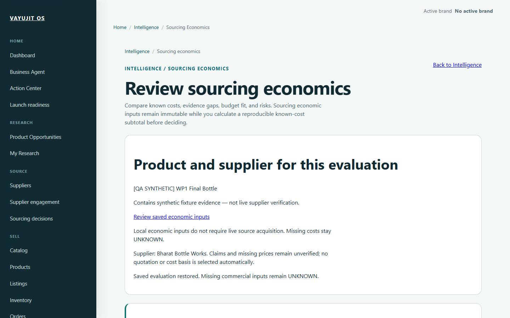

Figure 1. Historical saved synthetic product and supplier evaluation restored; missing inputs remain UNKNOWN. Genuine historical synthetic capture, 2026-10-28.

### E. What do I see on this page?

Source-defined sections: Review sourcing economics; Product and supplier for this evaluation; Your sourcing evaluation at a glance; Approve, authorize, then review one source; Scoped approvals; Execution authorizations; Certification history; Decision brief; Dynamic label varies with the selected record; exact current text is unverified.; Review and control supplier contact; Review supplier responses; No inbound supplier responses; Evidence-backed commercial reassessment; Compare supplier scenarios; Supplier comparison review; Comparable metrics and differences; Supplier due diligence and procurement readiness; Reassess from reviewed supplier evidence; Decision readiness; Blocking evidence; Warnings; Unknowns; Explainable decision synthesis; What supports this state; What prevents stronger progression; Warnings and unknowns; Next safe actions; Controlled recommendation and your decision; Evidence supporting progression; Evidence against progression or still unresolved; Limitations; Your decision; Explainable landed-cost breakdown; Modeled unit economics and capital fit; Included selling-cost components; Unknown or excluded costs; Scenario comparison (no automatic winner); What still needs review; Sourcing context; Inputs and provenance; Cost breakdown and lineage; Missing / excluded inputs; Bounded what-if scenario; Comparison result; Bounded sensitivity points

Disclosures: Optional: live supplier source certification; Gate outcomes and provenance; Advanced decision identifiers; Inspect draft message, warnings, unknowns, and limitations; SUPPLIER SAID — inspect immutable raw response; Dynamic label varies with the selected record; exact current text is unverified.; Review decision readiness, warnings and unknowns; Review explainable decision synthesis; Exact component values; Exact canonical decimal values (unrounded); Exact selling-cost values. Open only the relevant section; expanded state does not mean its action ran.

Detected structures: 4 table declaration(s), 0 dialog declaration(s). Conditional/shared controls can appear only after valid context. Loading, empty, error and blocked conditions must be distinguished; their complete current runtime combinations are not verified in this edition.

| Action shown in source | Meaning and safety | Availability |
| --- | --- | --- |
| Back to Intelligence | Source-declared navigation/view control; exact destination/state UNVERIFIED. | Not statically disabled |
| Dynamic label varies with the selected record; exact current text is unverified. | Effect UNVERIFIED; potentially changes data or invokes another workflow. Confirm prerequisites before acting. | Not statically disabled |
| Review product opportunities | Source-declared navigation/view control; exact destination/state UNVERIFIED. | Not statically disabled |
| Choose a product opportunity | Source-declared navigation/view control; exact destination/state UNVERIFIED. | Not statically disabled |
| Review inputs | Source-declared navigation/view control; exact destination/state UNVERIFIED. | Not statically disabled |
| Review cost model | Source-declared navigation/view control; exact destination/state UNVERIFIED. | Not statically disabled |
| Review HUMAN decision | Source-declared navigation/view control; exact destination/state UNVERIFIED. | Not statically disabled |
| Create HUMAN approval | Effect UNVERIFIED; potentially changes data or invokes another workflow. Confirm prerequisites before acting. | Conditional |
| Authorize one HUMAN read | Source-declared navigation/view control; exact destination/state UNVERIFIED. | Conditional |
| Revoke approval | Source-declared navigation/view control; exact destination/state UNVERIFIED. | Conditional |
| Execute authorized read | Effect UNVERIFIED; potentially changes data or invokes another workflow. Confirm prerequisites before acting. | Conditional |
| Revoke authorization | Source-declared navigation/view control; exact destination/state UNVERIFIED. | Conditional |
| Accept evidence as HUMAN-reviewed | Source-declared navigation/view control; exact destination/state UNVERIFIED. | Conditional |
| Mark contradiction | Source-declared navigation/view control; exact destination/state UNVERIFIED. | Conditional |
| Choose a product opportunity | Source-declared navigation/view control; exact destination/state UNVERIFIED. | Not statically disabled |
| Set up this supplier's economic inputs | Source-declared navigation/view control; exact destination/state UNVERIFIED. | Not statically disabled |
| Load decision brief | Source-declared navigation/view control; exact destination/state UNVERIFIED. | Conditional |
| Approve for future send (no message sent) | Effect UNVERIFIED; potentially changes data or invokes another workflow. Confirm prerequisites before acting. | Conditional |
| Authorize Send RFQ | Effect UNVERIFIED; potentially changes data or invokes another workflow. Confirm prerequisites before acting. | Conditional |
| Send RFQ | Effect UNVERIFIED; potentially changes data or invokes another workflow. Confirm prerequisites before acting. | Conditional |
| Cancel draft | Effect UNVERIFIED; potentially changes data or invokes another workflow. Confirm prerequisites before acting. | Conditional |
| Accept extracted claims for promotion | Source-declared navigation/view control; exact destination/state UNVERIFIED. | Conditional |
| Correct extraction | Source-declared navigation/view control; exact destination/state UNVERIFIED. | Conditional |
| Keep under review | Source-declared navigation/view control; exact destination/state UNVERIFIED. | Conditional |
| Reject extraction | Source-declared navigation/view control; exact destination/state UNVERIFIED. | Conditional |
| Promote accepted claims to PR-5A evidence | Source-declared navigation/view control; exact destination/state UNVERIFIED. | Conditional |
| Acknowledge and keep under review | Source-declared navigation/view control; exact destination/state UNVERIFIED. | Conditional |
| Create or refresh comparison | Effect UNVERIFIED; potentially changes data or invokes another workflow. Confirm prerequisites before acting. | Conditional |
| Keep under review | Source-declared navigation/view control; exact destination/state UNVERIFIED. | Conditional |
| Approve for sourcing (HUMAN) | Effect UNVERIFIED; potentially changes data or invokes another workflow. Confirm prerequisites before acting. | Conditional |
| Exclude from shortlist | Source-declared navigation/view control; exact destination/state UNVERIFIED. | Conditional |
| Dynamic label varies with the selected record; exact current text is unverified. | Effect UNVERIFIED; potentially changes data or invokes another workflow. Confirm prerequisites before acting. | Conditional |
| Acknowledge review | Source-declared navigation/view control; exact destination/state UNVERIFIED. | Conditional |
| Request further evidence | Source-declared navigation/view control; exact destination/state UNVERIFIED. | Conditional |
| Keep under review | Source-declared navigation/view control; exact destination/state UNVERIFIED. | Conditional |
| Reassess reviewed supplier quote | Effect UNVERIFIED; potentially changes data or invokes another workflow. Confirm prerequisites before acting. | Conditional |
| Proceed | Source-declared navigation/view control; exact destination/state UNVERIFIED. | Conditional |
| Keep under review | Source-declared navigation/view control; exact destination/state UNVERIFIED. | Conditional |
| Do not proceed | Source-declared navigation/view control; exact destination/state UNVERIFIED. | Conditional |
| Prepare advisory assessment for review | Effect UNVERIFIED; potentially changes data or invokes another workflow. Confirm prerequisites before acting. | Conditional |
| Dynamic label varies with the selected record; exact current text is unverified. | Source-declared navigation/view control; exact destination/state UNVERIFIED. | Conditional |
| Create context | Effect UNVERIFIED; potentially changes data or invokes another workflow. Confirm prerequisites before acting. | Conditional |
| Freeze immutable input snapshot | Source-declared navigation/view control; exact destination/state UNVERIFIED. | Conditional |
| Calculate from snapshot | Effect UNVERIFIED; potentially changes data or invokes another workflow. Confirm prerequisites before acting. | Conditional |
| Create hypothetical scenario | Effect UNVERIFIED; potentially changes data or invokes another workflow. Confirm prerequisites before acting. | Conditional |
| Run comparison | Source-declared navigation/view control; exact destination/state UNVERIFIED. | Conditional |
| Run bounded sensitivity | Source-declared navigation/view control; exact destination/state UNVERIFIED. | Conditional |

### F. Input-field guide

Field records below state type, purpose, requiredness, accepted values and examples. Unless a specific effect is described, the parent action’s save/provider effect is UNVERIFIED. Common rule: enter only genuine facts, preserve UNKNOWN and units, and obey backend validation; no blank or unchecked prerequisite is permission to proceed. Complete per-field maintenance records retain these explicit limitations.

| Field | Type requiredness and accepted values | Purpose example and effect |
| --- | --- | --- |
| Approved source URL [sourcing-economics-workspace-F001] | text. Required in the template. Exact API limits/accepted vocabulary are not fully verified. | Provides the stated input to this page’s supported workflow. Example: Use the actual business fact; no invented value is supplied. Effect unverified; common field rules apply. |
| Purpose [sourcing-economics-workspace-F002] | text. Required in the template. Exact API limits/accepted vocabulary are not fully verified. | Provides the stated input to this page’s supported workflow. Example: Use the actual business fact; no invented value is supplied. Effect unverified; common field rules apply. |
| Source category [sourcing-economics-workspace-F003] | select. Requiredness is not established by the template; do not assume optional. Supplier website; Manufacturer website; Distributor website | Chooses the relevant saved context or supported option. Example: Choose only a relevant legitimate saved option. Effect unverified; common field rules apply. |
| Product opportunity ID [sourcing-economics-workspace-F004] | text. Requiredness is not established by the template; do not assume optional. Exact API limits/accepted vocabulary are not fully verified. | Provides the stated input to this page’s supported workflow. Example: Use the actual business fact; no invented value is supplied. Effect unverified; common field rules apply. |
| Journey ID (for decision) [sourcing-economics-workspace-F005] | text. Requiredness is not established by the template; do not assume optional. Exact API limits/accepted vocabulary are not fully verified. | Provides the stated input to this page’s supported workflow. Example: Use the actual business fact; no invented value is supplied. Effect unverified; common field rules apply. |
| Exact visible label not established [sourcing-economics-workspace-F006] | textarea. Requiredness is not established by the template; do not assume optional. Exact API limits/accepted vocabulary are not fully verified. | Provides the stated input to this page’s supported workflow. Example: Use the actual business fact; no invented value is supplied. Effect unverified; common field rules apply. |
| Base currency [sourcing-economics-workspace-F007] | text. Requiredness is not established by the template; do not assume optional. maxlength 3 | Provides the stated input to this page’s supported workflow. Example: INR only if this is the genuine currency. Effect unverified; common field rules apply. |
| Target quantity [sourcing-economics-workspace-F008] | number. Requiredness is not established by the template; do not assume optional. min 0.0001 | Provides the stated input to this page’s supported workflow. Example: Use the genuine measured amount/quantity; units must be established. Effect unverified; common field rules apply. |
| Quantity unit [sourcing-economics-workspace-F009] | text. Requiredness is not established by the template; do not assume optional. Exact API limits/accepted vocabulary are not fully verified. | Provides the stated input to this page’s supported workflow. Example: Use the actual business fact; no invented value is supplied. Effect unverified; common field rules apply. |
| Origin country [sourcing-economics-workspace-F010] | text. Requiredness is not established by the template; do not assume optional. Exact API limits/accepted vocabulary are not fully verified. | Provides the stated input to this page’s supported workflow. Example: Use the actual business fact; no invented value is supplied. Effect unverified; common field rules apply. |
| Destination country [sourcing-economics-workspace-F011] | text. Requiredness is not established by the template; do not assume optional. Exact API limits/accepted vocabulary are not fully verified. | Provides the stated input to this page’s supported workflow. Example: Use the actual business fact; no invented value is supplied. Effect unverified; common field rules apply. |
| FX snapshot ID (optional) [sourcing-economics-workspace-F012] | text. Requiredness is not established by the template; do not assume optional. Exact API limits/accepted vocabulary are not fully verified. | Provides the stated input to this page’s supported workflow. Example: Use the actual business fact; no invented value is supplied. Effect unverified; common field rules apply. |
| Freight snapshot ID (optional) [sourcing-economics-workspace-F013] | text. Requiredness is not established by the template; do not assume optional. Exact API limits/accepted vocabulary are not fully verified. | Provides the stated input to this page’s supported workflow. Example: Use the actual business fact; no invented value is supplied. Effect unverified; common field rules apply. |
| Customs/tax snapshot ID (optional) [sourcing-economics-workspace-F014] | text. Requiredness is not established by the template; do not assume optional. Exact API limits/accepted vocabulary are not fully verified. | Provides the stated input to this page’s supported workflow. Example: Use the actual business fact; no invented value is supplied. Effect unverified; common field rules apply. |
| Scenario name [sourcing-economics-workspace-F015] | text. Required in the template. Exact API limits/accepted vocabulary are not fully verified. | Provides the stated input to this page’s supported workflow. Example: Use the actual business fact; no invented value is supplied. Effect unverified; common field rules apply. |
| Product unit cost (optional) [sourcing-economics-workspace-F016] | number. Requiredness is not established by the template; do not assume optional. min 0; step 0.00000001 | Provides the stated input to this page’s supported workflow. Example: Use the genuine measured amount/quantity; units must be established. Effect unverified; common field rules apply. |
| Reason [sourcing-economics-workspace-F017] | text. Required in the template. Exact API limits/accepted vocabulary are not fully verified. | Records your scoped explanation; keep it factual and free of secrets. Example: Use the actual business fact; no invented value is supplied. Effect unverified; common field rules apply. |
| One-variable product-cost points [sourcing-economics-workspace-F018] | text. Requiredness is not established by the template; do not assume optional. Exact API limits/accepted vocabulary are not fully verified. | Provides the stated input to this page’s supported workflow. Example: Use the actual business fact; no invented value is supplied. Effect unverified; common field rules apply. |

### G. Step-by-step usage

1. Open the intended owned context using the navigation/route above. Verify the brand and any Product, opportunity, supplier, listing or artifact identity before continuing.

2. Confirm the opportunity, supplier, quotation and calculation identity. Inspect missing/stale inputs before using a result.

3. Read current warnings and input guidance. Use only an action whose purpose and authority you understand. Stop before unapproved provider, commercial or permanent-data effects.

### H. Worked example

Illustrative task: Review the acquisition and unit-economics inputs for the selected product and supplier. Use it before relying on a capital-fit or commercial-readiness result. Use a genuine selected record in your own authorized workspace; a synthetic screenshot is a learning example only. The field examples above illustrate the type of input, not prescribed business values.

### I. How to interpret the results

Inspect identity, source/provenance, date/freshness, included assumptions and missing information. A local status, score or successful fake workflow is not proof of real external completion. UNKNOWN, blocked, stale and not-comparable results must retain their actual meaning.

### J. What should I do next?

Return to the corresponding sourcing decision after legitimate inputs are complete.

### K. Troubleshooting

If context is missing/invalid, use the appropriate collection or saved record link. If a request fails, retain the safe correlation reference and inspect current state before retrying. A 401 needs normal authentication; a 500 is not an empty successful result. Do not force-enable disabled actions or insert synthetic facts.

### L. Availability and limitations

DOCUMENTED BUT NOT CURRENTLY VERIFIED: current template and source inspected; no fresh authenticated session or complete per-control execution performed. Historical synthetic screenshot/functional evidence illustrates only its recorded state. Confirm the opportunity, supplier, quotation and calculation identity. Inspect missing/stale inputs before using a result. The entire module is not certified by the presence of a route.

### M. Documentation evidence

Current source: apps/web/src/app/intelligence/sourcing-economics-workspace.component.ts. Source and template hashes are in source/ui-inventory.json; exact field/action declarations in inventory/field-register.md and source/control-inventory.md. Screenshot evidence: docs/product-handbook/screenshots/economics/01-restored-context.png (Figure 1).

[Current UI source for Sourcing economics](../../../apps/web/src/app/intelligence/sourcing-economics-workspace.component.ts)

## P002 Supplier engagement

### A. What is this page?

Prepare and review the supported supplier-engagement records. Preparation, HUMAN authorization, email delivery and supplier response evidence are separate stages.

### B. Why would someone use it?

Review the exact product, supplier, recipient and current approval. Do not send an RFQ or email while learning from this handbook.

### C. Where can I find it?

Source → Supplier engagement → /intelligence/supplier-engagement; Advanced → Intelligence → Supplier Engagement → /intelligence/supplier-engagement

Route: /intelligence/supplier-engagement

### D. Screenshot

MISSING: no reviewed safe screenshot selected for this page family. The source-defined layout below is not a substitute for a real current capture.

### E. What do I see on this page?

Source-defined sections: Prepare and review supplier engagement; Dynamic label varies with the selected record; exact current text is unverified.; Prepare a supplier information request; Review the exact RFQ draft; Separate approval from execution; Review inbound evidence; Continue only after evidence review; Engagement history

Disclosures: Inspect draft message and evidence limitations; Inspect immutable supplier response. Open only the relevant section; expanded state does not mean its action ran.

Detected structures: 0 table declaration(s), 0 dialog declaration(s). Conditional/shared controls can appear only after valid context. Loading, empty, error and blocked conditions must be distinguished; their complete current runtime combinations are not verified in this edition.

| Action shown in source | Meaning and safety | Availability |
| --- | --- | --- |
| Review economics | Source-declared navigation/view control; exact destination/state UNVERIFIED. | Not statically disabled |
| Choose a product opportunity | Source-declared navigation/view control; exact destination/state UNVERIFIED. | Not statically disabled |
| Open supplier verification | Source-declared navigation/view control; exact destination/state UNVERIFIED. | Not statically disabled |
| Open supplier shortlisting | Source-declared navigation/view control; exact destination/state UNVERIFIED. | Not statically disabled |
| Prepare internal draft | Source-declared navigation/view control; exact destination/state UNVERIFIED. | Conditional |
| Approve draft for future review | Effect UNVERIFIED; potentially changes data or invokes another workflow. Confirm prerequisites before acting. | Conditional |
| Cancel internal draft | Effect UNVERIFIED; potentially changes data or invokes another workflow. Confirm prerequisites before acting. | Conditional |
| Issue single-use send authorization | Effect UNVERIFIED; potentially changes data or invokes another workflow. Confirm prerequisites before acting. | Conditional |
| Accept extracted claims | Source-declared navigation/view control; exact destination/state UNVERIFIED. | Conditional |
| Keep under review | Source-declared navigation/view control; exact destination/state UNVERIFIED. | Conditional |
| Review sourcing economics and readiness | Source-declared navigation/view control; exact destination/state UNVERIFIED. | Not statically disabled |
| Refresh history | Source-declared navigation/view control; exact destination/state UNVERIFIED. | Conditional |

### F. Input-field guide

Field records below state type, purpose, requiredness, accepted values and examples. Unless a specific effect is described, the parent action’s save/provider effect is UNVERIFIED. Common rule: enter only genuine facts, preserve UNKNOWN and units, and obey backend validation; no blank or unchecked prerequisite is permission to proceed. Complete per-field maintenance records retain these explicit limitations.

| Field | Type requiredness and accepted values | Purpose example and effect |
| --- | --- | --- |
| Supplier ID [supplier-engagement-workspace-F001] | text. Requiredness is not established by the template; do not assume optional. Exact API limits/accepted vocabulary are not fully verified. | Provides the stated input to this page’s supported workflow. Example: Use the actual business fact; no invented value is supplied. Effect unverified; common field rules apply. |
| Contact ID [supplier-engagement-workspace-F002] | text. Requiredness is not established by the template; do not assume optional. Exact API limits/accepted vocabulary are not fully verified. | Provides the stated input to this page’s supported workflow. Example: Use the actual business fact; no invented value is supplied. Effect unverified; common field rules apply. |
| Requested quantity [supplier-engagement-workspace-F003] | number. Required in the template. min 1 | Provides the stated input to this page’s supported workflow. Example: Use the genuine measured amount/quantity; units must be established. Effect unverified; common field rules apply. |
| Destination region [supplier-engagement-workspace-F004] | text. Requiredness is not established by the template; do not assume optional. Exact API limits/accepted vocabulary are not fully verified. | Provides the stated input to this page’s supported workflow. Example: Use the actual business fact; no invented value is supplied. Effect unverified; common field rules apply. |
| Questions to request [supplier-engagement-workspace-F005] | text. Requiredness is not established by the template; do not assume optional. Exact API limits/accepted vocabulary are not fully verified. | Provides the stated input to this page’s supported workflow. Example: Use the actual business fact; no invented value is supplied. Effect unverified; common field rules apply. |

### G. Step-by-step usage

1. Open the intended owned context using the navigation/route above. Verify the brand and any Product, opportunity, supplier, listing or artifact identity before continuing.

2. Review the exact product, supplier, recipient and current approval. Do not send an RFQ or email while learning from this handbook.

3. Read current warnings and input guidance. Use only an action whose purpose and authority you understand. Stop before unapproved provider, commercial or permanent-data effects.

### H. Worked example

Illustrative task: Prepare and review the supported supplier-engagement records. Preparation, HUMAN authorization, email delivery and supplier response evidence are separate stages. Use a genuine selected record in your own authorized workspace; a synthetic screenshot is a learning example only. The field examples above illustrate the type of input, not prescribed business values.

### I. How to interpret the results

Inspect identity, source/provenance, date/freshness, included assumptions and missing information. A local status, score or successful fake workflow is not proof of real external completion. UNKNOWN, blocked, stale and not-comparable results must retain their actual meaning.

### J. What should I do next?

Inspect existing response/quote evidence in the corresponding sourcing context.

### K. Troubleshooting

If context is missing/invalid, use the appropriate collection or saved record link. If a request fails, retain the safe correlation reference and inspect current state before retrying. A 401 needs normal authentication; a 500 is not an empty successful result. Do not force-enable disabled actions or insert synthetic facts.

### L. Availability and limitations

DOCUMENTED BUT NOT CURRENTLY VERIFIED: current template and source inspected; no fresh authenticated session or complete per-control execution performed. Screenshot coverage is BLOCKED pending an approved safe session. Review the exact product, supplier, recipient and current approval. Do not send an RFQ or email while learning from this handbook. The entire module is not certified by the presence of a route.

### M. Documentation evidence

Current source: apps/web/src/app/intelligence/supplier-engagement-workspace.component.ts. Source and template hashes are in source/ui-inventory.json; exact field/action declarations in inventory/field-register.md and source/control-inventory.md. Missing screenshot recorded in quality/documentation-gaps.md.

[Current UI source for Supplier engagement](../../../apps/web/src/app/intelligence/supplier-engagement-workspace.component.ts)

## P003 Trend Intelligence

### A. What is this page?

Inspect available recorded trend contexts, observations and analyses. Use it to understand changes in a defined signal, not to infer product sales.

### B. Why would someone use it?

Select the matching context and supported analysis. Check period, geography, signal definitions, freshness and gaps.

### C. Where can I find it?

Advanced → Intelligence → Trend Intelligence → /intelligence/trends

Route: /intelligence/trends

Route: /intelligence/trends/:contextId — replace a parameter only through a legitimate saved record link, not a guessed ID.

### D. Screenshot

MISSING: no reviewed safe screenshot selected for this page family. The source-defined layout below is not a substitute for a real current capture.

### E. What do I see on this page?

Source-defined sections: Trend Intelligence; Trend research context; Contexts; Trend evidence; Local fixture ingestion; Evidence observations; Observed time-series analysis; Evidence validation and confidence; Change and momentum history

Disclosures: Advanced / manual context. Open only the relevant section; expanded state does not mean its action ran.

Detected structures: 3 table declaration(s), 0 dialog declaration(s). Conditional/shared controls can appear only after valid context. Loading, empty, error and blocked conditions must be distinguished; their complete current runtime combinations are not verified in this edition.

| Action shown in source | Meaning and safety | Availability |
| --- | --- | --- |
| Back to Intelligence | Source-declared navigation/view control; exact destination/state UNVERIFIED. | Not statically disabled |
| Dynamic label varies with the selected record; exact current text is unverified. | Source-declared navigation/view control; exact destination/state UNVERIFIED. | Not statically disabled |
| Create manual context | Effect UNVERIFIED; potentially changes data or invokes another workflow. Confirm prerequisites before acting. | Not statically disabled |
| Dynamic label varies with the selected record; exact current text is unverified. | Source-declared navigation/view control; exact destination/state UNVERIFIED. | Not statically disabled |
| Ingest local fixture | Source-declared navigation/view control; exact destination/state UNVERIFIED. | Not statically disabled |
| Analyze latest immutable snapshot | Source-declared navigation/view control; exact destination/state UNVERIFIED. | Not statically disabled |
| Validate latest analysis | Source-declared navigation/view control; exact destination/state UNVERIFIED. | Conditional |
| Compare latest analyses | Source-declared navigation/view control; exact destination/state UNVERIFIED. | Conditional |

### F. Input-field guide

Field records below state type, purpose, requiredness, accepted values and examples. Unless a specific effect is described, the parent action’s save/provider effect is UNVERIFIED. Common rule: enter only genuine facts, preserve UNKNOWN and units, and obey backend validation; no blank or unchecked prerequisite is permission to proceed. Complete per-field maintenance records retain these explicit limitations.

| Field | Type requiredness and accepted values | Purpose example and effect |
| --- | --- | --- |
| Context name [trend-intelligence-workspace-F001] | text. Required in the template. Exact API limits/accepted vocabulary are not fully verified. | Provides the stated input to this page’s supported workflow. Example: Use the actual business fact; no invented value is supplied. Effect unverified; common field rules apply. |
| Subject type [trend-intelligence-workspace-F002] | select. Requiredness is not established by the template; do not assume optional. PRODUCT; BRAND; CATEGORY; KEYWORD; CUSTOM | Chooses the relevant saved context or supported option. Example: Choose only a relevant legitimate saved option. Effect unverified; common field rules apply. |
| Subject key [trend-intelligence-workspace-F003] | text. Required in the template. Exact API limits/accepted vocabulary are not fully verified. | Provides the stated input to this page’s supported workflow. Example: Use the actual business fact; no invented value is supplied. Effect unverified; common field rules apply. |
| Source ID [trend-intelligence-workspace-F004] | text. Required in the template. Exact API limits/accepted vocabulary are not fully verified. | Provides the stated input to this page’s supported workflow. Example: Use the actual business fact; no invented value is supplied. Effect unverified; common field rules apply. |
| Signal [trend-intelligence-workspace-F005] | text. Required in the template. Exact API limits/accepted vocabulary are not fully verified. | Provides the stated input to this page’s supported workflow. Example: Use the actual business fact; no invented value is supplied. Effect unverified; common field rules apply. |
| Value [trend-intelligence-workspace-F006] | text. Required in the template. Exact API limits/accepted vocabulary are not fully verified. | Provides the stated input to this page’s supported workflow. Example: Use the actual business fact; no invented value is supplied. Effect unverified; common field rules apply. |

### G. Step-by-step usage

1. Open the intended owned context using the navigation/route above. Verify the brand and any Product, opportunity, supplier, listing or artifact identity before continuing.

2. Select the matching context and supported analysis. Check period, geography, signal definitions, freshness and gaps.

3. Read current warnings and input guidance. Use only an action whose purpose and authority you understand. Stop before unapproved provider, commercial or permanent-data effects.

### H. Worked example

Illustrative task: Inspect available recorded trend contexts, observations and analyses. Use it to understand changes in a defined signal, not to infer product sales. Use a genuine selected record in your own authorized workspace; a synthetic screenshot is a learning example only. The field examples above illustrate the type of input, not prescribed business values.

### I. How to interpret the results

Inspect identity, source/provenance, date/freshness, included assumptions and missing information. A local status, score or successful fake workflow is not proof of real external completion. UNKNOWN, blocked, stale and not-comparable results must retain their actual meaning.

### J. What should I do next?

Return relevant findings to the product opportunity; leave unsupported projections unknown.

### K. Troubleshooting

If context is missing/invalid, use the appropriate collection or saved record link. If a request fails, retain the safe correlation reference and inspect current state before retrying. A 401 needs normal authentication; a 500 is not an empty successful result. Do not force-enable disabled actions or insert synthetic facts.

### L. Availability and limitations

DOCUMENTED BUT NOT CURRENTLY VERIFIED: current template and source inspected; no fresh authenticated session or complete per-control execution performed. Screenshot coverage is BLOCKED pending an approved safe session. Select the matching context and supported analysis. Check period, geography, signal definitions, freshness and gaps. The entire module is not certified by the presence of a route.

### M. Documentation evidence

Current source: apps/web/src/app/intelligence/trend-intelligence-workspace.component.ts. Source and template hashes are in source/ui-inventory.json; exact field/action declarations in inventory/field-register.md and source/control-inventory.md. Missing screenshot recorded in quality/documentation-gaps.md.

[Current UI source for Trend Intelligence](../../../apps/web/src/app/intelligence/trend-intelligence-workspace.component.ts)

## P004 My research

### A. What is this page?

Reopen saved research without treating every historical run as current work.

### B. Why would someone use it?

Open the intended goal/run, inspect its recorded mode, plan and findings, and follow the link back to its workspace.

### C. Where can I find it?

Research → My Research → /intelligence/research

Route: /intelligence/research

### D. Screenshot

MISSING: no reviewed safe screenshot selected for this page family. The source-defined layout below is not a substitute for a real current capture.

### E. What do I see on this page?

Source-defined sections: My research; No saved goals yet; Dynamic label varies with the selected record; exact current text is unverified.

Disclosures: Advanced research configuration. Open only the relevant section; expanded state does not mean its action ran.

Detected structures: 0 table declaration(s), 0 dialog declaration(s). Conditional/shared controls can appear only after valid context. Loading, empty, error and blocked conditions must be distinguished; their complete current runtime combinations are not verified in this edition.

| Action shown in source | Meaning and safety | Availability |
| --- | --- | --- |
| Create a research goal | Effect UNVERIFIED; potentially changes data or invokes another workflow. Confirm prerequisites before acting. | Not statically disabled |
| Retry saved research | Effect UNVERIFIED; potentially changes data or invokes another workflow. Confirm prerequisites before acting. | Not statically disabled |
| Open goal, plan and research | Source-declared navigation/view control; exact destination/state UNVERIFIED. | Not statically disabled |
| Review this goal's opportunities | Source-declared navigation/view control; exact destination/state UNVERIFIED. | Not statically disabled |
| Open research tools and configuration | Source-declared navigation/view control; exact destination/state UNVERIFIED. | Not statically disabled |

### F. Input-field guide

No direct editable fields were extracted from this page template. Review controls inherited from shared components in the shared-field appendix. No missing form is invented.

### G. Step-by-step usage

1. Open the intended owned context using the navigation/route above. Verify the brand and any Product, opportunity, supplier, listing or artifact identity before continuing.

2. Open the intended goal/run, inspect its recorded mode, plan and findings, and follow the link back to its workspace.

3. Read current warnings and input guidance. Use only an action whose purpose and authority you understand. Stop before unapproved provider, commercial or permanent-data effects.

### H. Worked example

Illustrative task: Reopen saved research without treating every historical run as current work. Use a genuine selected record in your own authorized workspace; a synthetic screenshot is a learning example only. The expected type of result is the relevant recorded view or a truthful empty/blocked state, not fabricated data.

### I. How to interpret the results

Inspect identity, source/provenance, date/freshness, included assumptions and missing information. A local status, score or successful fake workflow is not proof of real external completion. UNKNOWN, blocked, stale and not-comparable results must retain their actual meaning.

### J. What should I do next?

Continue the eligible current step rather than creating a duplicate goal automatically.

### K. Troubleshooting

If context is missing/invalid, use the appropriate collection or saved record link. If a request fails, retain the safe correlation reference and inspect current state before retrying. A 401 needs normal authentication; a 500 is not an empty successful result. Do not force-enable disabled actions or insert synthetic facts.

### L. Availability and limitations

DOCUMENTED BUT NOT CURRENTLY VERIFIED: current template and source inspected; no fresh authenticated session or complete per-control execution performed. Screenshot coverage is BLOCKED pending an approved safe session. Open the intended goal/run, inspect its recorded mode, plan and findings, and follow the link back to its workspace. The entire module is not certified by the presence of a route.

### M. Documentation evidence

Current source: apps/web/src/app/intelligence/seller-research.component.ts. Source and template hashes are in source/ui-inventory.json; exact field/action declarations in inventory/field-register.md and source/control-inventory.md. Missing screenshot recorded in quality/documentation-gaps.md.

[Current UI source for My research](../../../apps/web/src/app/intelligence/seller-research.component.ts)

## P005 Business Agent

### A. What is this page?

Save a business question, review its plan and inspect the actual research run and decision boundaries.

### B. Why would someone use it?

Follow the Business Agent training chapter. A goal is not a guarantee that providers or product evidence are available.

### C. Where can I find it?

Home → Business Agent → /intelligence/business-agent

Route: /intelligence/business-agent

### D. Screenshot

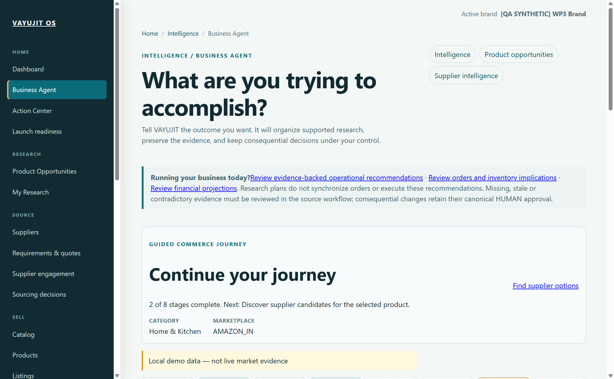

Figure 2. Business Agent overview and a saved synthetic journey. Pixel dimensions are recorded; exact CSS viewport is not verified for this capture. Genuine historical synthetic capture, 2026-11-06.

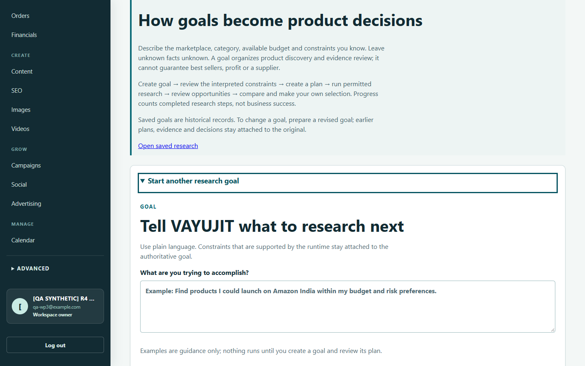

Figure 3. Expanded goal disclosure and the goal textarea. Genuine historical synthetic capture, 2026-11-05.

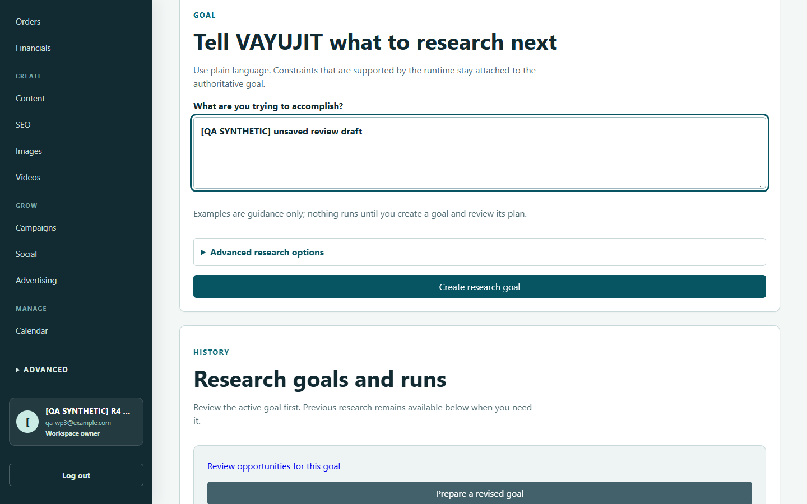

Figure 4. A synthetic unsaved review draft and Create research goal. This image does not prove submission or an error announcement. Genuine historical synthetic capture, 2026-11-05.

### E. What do I see on this page?

Source-defined sections: What are you trying to accomplish?; How goals become product decisions; Dynamic label varies with the selected record; exact current text is unverified.; Research goals and runs; Research plan; Research progress; What surfaced for review; No canonical product opportunity yet; VAYUJIT is waiting for your approval; Evidence-backed outcome; Trend Intelligence; Customer-feedback evidence; Sourcing Economics; Supplier intelligence continuation; Supporting evidence; What VAYUJIT found

Disclosures: How this workspace operates; Dynamic label varies with the selected record; exact current text is unverified.; Advanced research options; Goal assumptions and technical details; Execution detail; Research detail; Research details and execution timeline. Open only the relevant section; expanded state does not mean its action ran.

Detected structures: 0 table declaration(s), 0 dialog declaration(s). Conditional/shared controls can appear only after valid context. Loading, empty, error and blocked conditions must be distinguished; their complete current runtime combinations are not verified in this edition.

| Action shown in source | Meaning and safety | Availability |
| --- | --- | --- |
| Intelligence | Source-declared navigation/view control; exact destination/state UNVERIFIED. | Not statically disabled |
| Product opportunities | Source-declared navigation/view control; exact destination/state UNVERIFIED. | Not statically disabled |
| Supplier intelligence | Source-declared navigation/view control; exact destination/state UNVERIFIED. | Not statically disabled |
| Review evidence-backed operational recommendations | Source-declared navigation/view control; exact destination/state UNVERIFIED. | Not statically disabled |
| Review orders and inventory implications | Source-declared navigation/view control; exact destination/state UNVERIFIED. | Not statically disabled |
| Review financial projections | Source-declared navigation/view control; exact destination/state UNVERIFIED. | Not statically disabled |
| Open saved research | Effect UNVERIFIED; potentially changes data or invokes another workflow. Confirm prerequisites before acting. | Not statically disabled |
| Create research goal | Saves the stated goal for review; it does not itself establish a product or start all research. | Conditional |
| Create goal | Effect UNVERIFIED; potentially changes data or invokes another workflow. Confirm prerequisites before acting. | Not statically disabled |
| Review opportunities for this goal | Source-declared navigation/view control; exact destination/state UNVERIFIED. | Not statically disabled |
| Prepare a revised goal | Prepares a new goal statement while retaining earlier historical context. | Not statically disabled |
| Create versioned research plan | Creates a plan version for the saved goal using supported capabilities. | Conditional |
| Start run | Attempts the plan under the configured permitted mode; provider/evidence prerequisites still apply. | Conditional |
| Compare products | Source-declared navigation/view control; exact destination/state UNVERIFIED. | Not statically disabled |
| Open Product Opportunities | Source-declared navigation/view control; exact destination/state UNVERIFIED. | Not statically disabled |
| Open Product Opportunities | Source-declared navigation/view control; exact destination/state UNVERIFIED. | Not statically disabled |
| Pause run | Source-declared navigation/view control; exact destination/state UNVERIFIED. | Not statically disabled |
| Dynamic label varies with the selected record; exact current text is unverified. | Source-declared navigation/view control; exact destination/state UNVERIFIED. | Not statically disabled |
| Cancel run | Effect UNVERIFIED; potentially changes data or invokes another workflow. Confirm prerequisites before acting. | Not statically disabled |
| Dynamic label varies with the selected record; exact current text is unverified. | Effect UNVERIFIED; potentially changes data or invokes another workflow. Confirm prerequisites before acting. | Not statically disabled |
| Refresh run | Retrieves recorded run state; it does not guarantee a fresh provider search. | Not statically disabled |
| Approve and complete | Effect UNVERIFIED; potentially changes data or invokes another workflow. Confirm prerequisites before acting. | Not statically disabled |
| Reject and stop | Source-declared navigation/view control; exact destination/state UNVERIFIED. | Not statically disabled |
| Review supplier intelligence | Source-declared navigation/view control; exact destination/state UNVERIFIED. | Not statically disabled |
| Open saved goal and research | Effect UNVERIFIED; potentially changes data or invokes another workflow. Confirm prerequisites before acting. | Not statically disabled |
| Delete | Effect UNVERIFIED; potentially changes data or invokes another workflow. Confirm prerequisites before acting. | Conditional |

### F. Input-field guide

Field records below state type, purpose, requiredness, accepted values and examples. Unless a specific effect is described, the parent action’s save/provider effect is UNVERIFIED. Common rule: enter only genuine facts, preserve UNKNOWN and units, and obey backend validation; no blank or unchecked prerequisite is permission to proceed. Complete per-field maintenance records retain these explicit limitations.

| Field | Type requiredness and accepted values | Purpose example and effect |
| --- | --- | --- |
| What are you trying to accomplish? [business-agent-workspace-F001] | textarea. Required. At least 5 characters in the template; include geography, marketplace, category, INR capital and evidence boundaries. Validation: At least 5 characters in the template; include geography, marketplace, category, INR capital and evidence boundaries. | States the product/business research question. Example: Find up to 3 home organization product ideas for Amazon India within INR 300000; mark missing evidence and stop for my selection. Effect: Saved as a goal before a separate plan and run. Avoid: Demanding guaranteed sales, profit or live execution from a goal. |
| Marketplace context (optional) [business-agent-workspace-F002] | text. Optional as labelled. Text; current example is AMAZON_IN. Exact backend accepted context is not fully enumerated in this edition. Validation: Text; current example is AMAZON_IN. Exact backend accepted context is not fully enumerated in this edition. | Provides optional marketplace context for the goal. Example: AMAZON_IN Effect: Supplies context, not seller-account authorization. Avoid: Entering credentials instead of a marketplace identifier. |
| Include competitor intelligence [business-agent-workspace-F003] | checkbox. Optional checkbox. Checked or unchecked. Validation: Checked or unchecked. | Requests supported competitor intelligence in planning. Example: Check only when relevant to the research question. Effect: Maps to an existing goal option; does not guarantee competitor acquisition. Avoid: Assuming it grants source access. |
| Include customer-feedback evidence [business-agent-workspace-F004] | checkbox. Optional checkbox. Checked or unchecked. Validation: Checked or unchecked. | Requests supported customer-feedback evidence. Example: Check for an evidence review of complaints. Effect: Maps to the goal’s review-intelligence option. Avoid: Assuming absent reviews can be generated as facts. |
| Include Trend Intelligence [business-agent-workspace-F005] | checkbox. Optional checkbox. Checked or unchecked. Validation: Checked or unchecked. | Requests supported Trend Intelligence. Example: Check when comparable observed signals are useful. Effect: Adds the supported trend option, subject to runtime capability. Avoid: Treating interest trends as sales forecasts. |
| Decision note (optional) [business-agent-workspace-F006] | textarea. Optional as labelled. Text; do not include secrets or invented facts. Validation: Text; do not include secrets or invented facts. | Records optional reasoning for the supported human decision. Example: More supplier evidence needed before proceeding. Effect: Documents human reasoning in its existing decision scope. Avoid: Assuming a note alone authorizes spending. |

### G. Step-by-step usage

1. Open the intended owned context using the navigation/route above. Verify the brand and any Product, opportunity, supplier, listing or artifact identity before continuing.

2. Follow the Business Agent training chapter. A goal is not a guarantee that providers or product evidence are available.

3. Read current warnings and input guidance. Use only an action whose purpose and authority you understand. Stop before unapproved provider, commercial or permanent-data effects.

### H. Worked example

Illustrative task: Save a business question, review its plan and inspect the actual research run and decision boundaries. Use a genuine selected record in your own authorized workspace; a synthetic screenshot is a learning example only. The field examples above illustrate the type of input, not prescribed business values.

### I. How to interpret the results

Inspect identity, source/provenance, date/freshness, included assumptions and missing information. A local status, score or successful fake workflow is not proof of real external completion. UNKNOWN, blocked, stale and not-comparable results must retain their actual meaning.

### J. What should I do next?

Review opportunities for the exact goal, or resolve its recorded research blocker.

### K. Troubleshooting

If context is missing/invalid, use the appropriate collection or saved record link. If a request fails, retain the safe correlation reference and inspect current state before retrying. A 401 needs normal authentication; a 500 is not an empty successful result. Do not force-enable disabled actions or insert synthetic facts.

### L. Availability and limitations

DOCUMENTED BUT NOT CURRENTLY VERIFIED: current template and source inspected; no fresh authenticated session or complete per-control execution performed. Historical synthetic screenshot/functional evidence illustrates only its recorded state. Follow the Business Agent training chapter. A goal is not a guarantee that providers or product evidence are available. The entire module is not certified by the presence of a route.

### M. Documentation evidence

Current source: apps/web/src/app/intelligence/business-agent-workspace.component.ts. Source and template hashes are in source/ui-inventory.json; exact field/action declarations in inventory/field-register.md and source/control-inventory.md. Screenshot evidence: docs/product-handbook/screenshots/business-agent/01-overview.png (Figure 2); docs/product-handbook/screenshots/business-agent/02-goal-form.png (Figure 3); docs/product-handbook/screenshots/business-agent/03-unsaved-goal.png (Figure 4).

[Current UI source for Business Agent](../../../apps/web/src/app/intelligence/business-agent-workspace.component.ts)

## P006 Sourcing decisions and scenarios

### A. What is this page?

Compare supported sourcing alternatives for the same commercial context.

### B. Why would someone use it?

Keep quantity, supplier, currency, quote and calculation assumptions comparable. Review HUMAN decisions and unknown inputs.

### C. Where can I find it?

Source → Sourcing decisions → /intelligence/sourcing-scenarios

Route: /intelligence/sourcing-scenarios

### D. Screenshot

MISSING: no reviewed safe screenshot selected for this page family. The source-defined layout below is not a substitute for a real current capture.

### E. What do I see on this page?

Source-defined sections: Sourcing Scenarios; Start from a shortlist; Analysis contexts; Custom supplier mix; Comparison; History and report; Dynamic label varies with the selected record; exact current text is unverified.; What-if (does not change supplier evidence)

Disclosures: Allocation, cost, capital, MOQ, lead time, FX, risk, and evidence. Open only the relevant section; expanded state does not mean its action ran.

Detected structures: 1 table declaration(s), 0 dialog declaration(s). Conditional/shared controls can appear only after valid context. Loading, empty, error and blocked conditions must be distinguished; their complete current runtime combinations are not verified in this edition.

| Action shown in source | Meaning and safety | Availability |
| --- | --- | --- |
| Supplier Shortlisting | Source-declared navigation/view control; exact destination/state UNVERIFIED. | Not statically disabled |
| Due Diligence | Source-declared navigation/view control; exact destination/state UNVERIFIED. | Not statically disabled |
| Create analysis context | Effect UNVERIFIED; potentially changes data or invokes another workflow. Confirm prerequisites before acting. | Conditional |
| Dynamic label varies with the selected record; exact current text is unverified. | Source-declared navigation/view control; exact destination/state UNVERIFIED. | Conditional |
| Open Supplier Shortlisting | Source-declared navigation/view control; exact destination/state UNVERIFIED. | Not statically disabled |
| Remove allocation | Effect UNVERIFIED; potentially changes data or invokes another workflow. Confirm prerequisites before acting. | Conditional |
| Add supplier allocation | Source-declared navigation/view control; exact destination/state UNVERIFIED. | Conditional |
| Calculate custom scenario | Effect UNVERIFIED; potentially changes data or invokes another workflow. Confirm prerequisites before acting. | Conditional |
| Generate evidenced baselines | Effect UNVERIFIED; potentially changes data or invokes another workflow. Confirm prerequisites before acting. | Conditional |
| Dynamic label varies with the selected record; exact current text is unverified. | Source-declared navigation/view control; exact destination/state UNVERIFIED. | Not statically disabled |
| Recommend for human review | Source-declared navigation/view control; exact destination/state UNVERIFIED. | Conditional |
| Dynamic label varies with the selected record; exact current text is unverified. | Source-declared navigation/view control; exact destination/state UNVERIFIED. | Not statically disabled |
| View immutable history | Source-declared navigation/view control; exact destination/state UNVERIFIED. | Not statically disabled |
| View report | Source-declared navigation/view control; exact destination/state UNVERIFIED. | Not statically disabled |
| Approve for internal sourcing | Effect UNVERIFIED; potentially changes data or invokes another workflow. Confirm prerequisites before acting. | Conditional |
| Reject | Source-declared navigation/view control; exact destination/state UNVERIFIED. | Conditional |
| Keep under review | Source-declared navigation/view control; exact destination/state UNVERIFIED. | Conditional |
| Archive | Source-declared navigation/view control; exact destination/state UNVERIFIED. | Conditional |
| Recalculate | Effect UNVERIFIED; potentially changes data or invokes another workflow. Confirm prerequisites before acting. | Conditional |
| Request more research | Source-declared navigation/view control; exact destination/state UNVERIFIED. | Conditional |
| Create internal handoff | Effect UNVERIFIED; potentially changes data or invokes another workflow. Confirm prerequisites before acting. | Conditional |
| Calculate sensitivity | Effect UNVERIFIED; potentially changes data or invokes another workflow. Confirm prerequisites before acting. | Conditional |

### F. Input-field guide

Field records below state type, purpose, requiredness, accepted values and examples. Unless a specific effect is described, the parent action’s save/provider effect is UNVERIFIED. Common rule: enter only genuine facts, preserve UNKNOWN and units, and obey backend validation; no blank or unchecked prerequisite is permission to proceed. Complete per-field maintenance records retain these explicit limitations.

| Field | Type requiredness and accepted values | Purpose example and effect |
| --- | --- | --- |
| Shortlist context [sourcing-scenarios-F001] | select. Required in the template. Select a shortlist Additional choices depend on saved records/current context and are UNVERIFIED. | Chooses the relevant saved context or supported option. Example: Choose only a relevant legitimate saved option. Effect unverified; common field rules apply. |
| Shortlist version [sourcing-scenarios-F002] | select. Required in the template. Select current version Additional choices depend on saved records/current context and are UNVERIFIED. | Chooses the relevant saved context or supported option. Example: Choose only a relevant legitimate saved option. Effect unverified; common field rules apply. |
| Currency [sourcing-scenarios-F003] | text. Required in the template. pattern [A-Z]{3} | Provides the stated input to this page’s supported workflow. Example: INR only if this is the genuine currency. Effect unverified; common field rules apply. |
| Market [sourcing-scenarios-F004] | text. Required in the template. maxlength 80 | Provides the stated input to this page’s supported workflow. Example: Use the actual business fact; no invented value is supplied. Effect unverified; common field rules apply. |
| Channel [sourcing-scenarios-F005] | text. Required in the template. maxlength 80 | Provides the stated input to this page’s supported workflow. Example: Use the actual business fact; no invented value is supplied. Effect unverified; common field rules apply. |
| Target units [sourcing-scenarios-F006] | number. Required in the template. min 1; step 1 | Provides the stated input to this page’s supported workflow. Example: Use the genuine measured amount/quantity; units must be established. Effect unverified; common field rules apply. |
| Sale price [sourcing-scenarios-F007] | text. Requiredness is not established by the template; do not assume optional. Exact API limits/accepted vocabulary are not fully verified. | Provides the stated input to this page’s supported workflow. Example: Use the actual business fact; no invented value is supplied. Effect unverified; common field rules apply. |
| Capital limit [sourcing-scenarios-F008] | text. Requiredness is not established by the template; do not assume optional. Exact API limits/accepted vocabulary are not fully verified. | Provides the stated input to this page’s supported workflow. Example: Use the actual business fact; no invented value is supplied. Effect unverified; common field rules apply. |
| Name [sourcing-scenarios-F009] | text. Required in the template. maxlength 120 | Provides the stated input to this page’s supported workflow. Example: Use the actual business fact; no invented value is supplied. Effect unverified; common field rules apply. |
| Supplier [sourcing-scenarios-F010] | select. Required in the template. Select candidate Additional choices depend on saved records/current context and are UNVERIFIED. | Chooses the relevant saved context or supported option. Example: Choose only a relevant legitimate saved option. Effect unverified; common field rules apply. |
| Due diligence [sourcing-scenarios-F011] | select. Required in the template. Select matching assessment Additional choices depend on saved records/current context and are UNVERIFIED. | Chooses the relevant saved context or supported option. Example: Choose only a relevant legitimate saved option. Effect unverified; common field rules apply. |
| Units [sourcing-scenarios-F012] | number. Required in the template. min 1; step 1 | Provides the stated input to this page’s supported workflow. Example: Use the genuine measured amount/quantity; units must be established. Effect unverified; common field rules apply. |
| Unit price [sourcing-scenarios-F013] | text. Requiredness is not established by the template; do not assume optional. Exact API limits/accepted vocabulary are not fully verified. | Provides the stated input to this page’s supported workflow. Example: Use the actual business fact; no invented value is supplied. Effect unverified; common field rules apply. |
| Currency [sourcing-scenarios-F014] | text. Required in the template. pattern [A-Z]{3} | Provides the stated input to this page’s supported workflow. Example: INR only if this is the genuine currency. Effect unverified; common field rules apply. |
| MOQ [sourcing-scenarios-F015] | number. Requiredness is not established by the template; do not assume optional. min 1; step 1 | Provides the stated input to this page’s supported workflow. Example: Use the genuine measured amount/quantity; units must be established. Effect unverified; common field rules apply. |
| Production days [sourcing-scenarios-F016] | number. Requiredness is not established by the template; do not assume optional. min 0; step 1 | Provides the stated input to this page’s supported workflow. Example: Use the genuine measured amount/quantity; units must be established. Effect unverified; common field rules apply. |
| Availability [sourcing-scenarios-F017] | select. Requiredness is not established by the template; do not assume optional. UNKNOWN; AVAILABLE; UNAVAILABLE | Chooses the relevant saved context or supported option. Example: Choose only a relevant legitimate saved option. Effect unverified; common field rules apply. |
| Incoterm [sourcing-scenarios-F018] | select. Requiredness is not established by the template; do not assume optional. Unknown Additional choices depend on saved records/current context and are UNVERIFIED. | Chooses the relevant saved context or supported option. Example: Choose only a relevant legitimate saved option. Effect unverified; common field rules apply. |
| Assumption source/reason [sourcing-scenarios-F019] | text. Required in the template. minlength 3; maxlength 500 | Records your scoped explanation; keep it factual and free of secrets. Example: Use the actual business fact; no invented value is supplied. Effect unverified; common field rules apply. |
| Transport [sourcing-scenarios-F020] | select. Requiredness is not established by the template; do not assume optional. No fixed options enumerated in the template. Additional choices depend on saved records/current context and are UNVERIFIED. | Chooses the relevant saved context or supported option. Example: Choose only a relevant legitimate saved option. Effect unverified; common field rules apply. |
| Dynamic label varies with the selected record; exact current text is unverified. [sourcing-scenarios-F021] | text. Requiredness is not established by the template; do not assume optional. Exact API limits/accepted vocabulary are not fully verified. | Provides the stated input to this page’s supported workflow. Example: Use the actual business fact; no invented value is supplied. Effect unverified; common field rules apply. |
| Dynamic label varies with the selected record; exact current text is unverified. [sourcing-scenarios-F022] | text. Requiredness is not established by the template; do not assume optional. Exact API limits/accepted vocabulary are not fully verified. | Provides the stated input to this page’s supported workflow. Example: Use the actual business fact; no invented value is supplied. Effect unverified; common field rules apply. |
| Dynamic label varies with the selected record; exact current text is unverified. [sourcing-scenarios-F023] | number. Requiredness is not established by the template; do not assume optional. min 0; step 1 | Provides the stated input to this page’s supported workflow. Example: Use the genuine measured amount/quantity; units must be established. Effect unverified; common field rules apply. |
| Decision/research reason [sourcing-scenarios-F024] | text. Requiredness is not established by the template; do not assume optional. minlength 3; maxlength 500 | Narrows the records shown for the stated context. Example: An existing product name or SKU. Effect unverified; common field rules apply. |
| I reviewed this exact version. Internal planning only. [sourcing-scenarios-F025] | checkbox. Requiredness is not established by the template; do not assume optional. Checked or unchecked; confirm only truthful statements. | Records the specific choice or confirmation stated by its label. Example: Leave unchecked unless the statement is true. Effect unverified; common field rules apply. |
| Dimension [sourcing-scenarios-F026] | select. Requiredness is not established by the template; do not assume optional. No fixed options enumerated in the template. Additional choices depend on saved records/current context and are UNVERIFIED. | Chooses the relevant saved context or supported option. Example: Choose only a relevant legitimate saved option. Effect unverified; common field rules apply. |
| Change % [sourcing-scenarios-F027] | number. Requiredness is not established by the template; do not assume optional. min -20; max 20 | Provides the stated input to this page’s supported workflow. Example: Use the genuine measured amount/quantity; units must be established. Effect unverified; common field rules apply. |

### G. Step-by-step usage

1. Open the intended owned context using the navigation/route above. Verify the brand and any Product, opportunity, supplier, listing or artifact identity before continuing.

2. Keep quantity, supplier, currency, quote and calculation assumptions comparable. Review HUMAN decisions and unknown inputs.

3. Read current warnings and input guidance. Use only an action whose purpose and authority you understand. Stop before unapproved provider, commercial or permanent-data effects.

### H. Worked example

Illustrative task: Compare supported sourcing alternatives for the same commercial context. Use a genuine selected record in your own authorized workspace; a synthetic screenshot is a learning example only. The field examples above illustrate the type of input, not prescribed business values.

### I. How to interpret the results

Inspect identity, source/provenance, date/freshness, included assumptions and missing information. A local status, score or successful fake workflow is not proof of real external completion. UNKNOWN, blocked, stale and not-comparable results must retain their actual meaning.

### J. What should I do next?

Use Sourcing economics or the supported supplier decision workflow, not an automatic purchase.

### K. Troubleshooting

If context is missing/invalid, use the appropriate collection or saved record link. If a request fails, retain the safe correlation reference and inspect current state before retrying. A 401 needs normal authentication; a 500 is not an empty successful result. Do not force-enable disabled actions or insert synthetic facts.

### L. Availability and limitations

DOCUMENTED BUT NOT CURRENTLY VERIFIED: current template and source inspected; no fresh authenticated session or complete per-control execution performed. Screenshot coverage is BLOCKED pending an approved safe session. Keep quantity, supplier, currency, quote and calculation assumptions comparable. Review HUMAN decisions and unknown inputs. The entire module is not certified by the presence of a route.

### M. Documentation evidence

Current source: apps/web/src/app/intelligence/sourcing-scenarios.component.ts. Source and template hashes are in source/ui-inventory.json; exact field/action declarations in inventory/field-register.md and source/control-inventory.md. Missing screenshot recorded in quality/documentation-gaps.md.

[Current UI source for Sourcing decisions and scenarios](../../../apps/web/src/app/intelligence/sourcing-scenarios.component.ts)

## P007 Customer review intelligence

### A. What is this page?

Inspect recorded feedback and supported themes, pain points and evidence gaps.

### B. Why would someone use it?

Select the matching context and examine the source/sample dates before interpreting recurring problems.

### C. Where can I find it?

Advanced → Intelligence → Customer Reviews → /intelligence/reviews

Route: /intelligence/reviews

### D. Screenshot

MISSING: no reviewed safe screenshot selected for this page family. The source-defined layout below is not a substitute for a real current capture.

### E. What do I see on this page?

Source-defined sections: Review Intelligence; Review contexts; Dynamic label varies with the selected record; exact current text is unverified.; Deterministic ingestion; Reviews; Deterministic analysis; What customers are saying; Feature requests; Product gaps and opportunity signals; Review evidence changed; Snapshots; Foundation integrity

Disclosures: Advanced / manual context. Open only the relevant section; expanded state does not mean its action ran.

Detected structures: 0 table declaration(s), 0 dialog declaration(s). Conditional/shared controls can appear only after valid context. Loading, empty, error and blocked conditions must be distinguished; their complete current runtime combinations are not verified in this edition.

| Action shown in source | Meaning and safety | Availability |
| --- | --- | --- |
| Back to Intelligence | Source-declared navigation/view control; exact destination/state UNVERIFIED. | Not statically disabled |
| Business Agent | Source-declared navigation/view control; exact destination/state UNVERIFIED. | Not statically disabled |
| Product opportunities | Source-declared navigation/view control; exact destination/state UNVERIFIED. | Not statically disabled |
| Open advanced research controls | Source-declared navigation/view control; exact destination/state UNVERIFIED. | Not statically disabled |
| Create manual context | Effect UNVERIFIED; potentially changes data or invokes another workflow. Confirm prerequisites before acting. | Conditional |
| Dynamic label varies with the selected record; exact current text is unverified. | Source-declared navigation/view control; exact destination/state UNVERIFIED. | Not statically disabled |
| Import local review | Effect UNVERIFIED; potentially changes data or invokes another workflow. Confirm prerequisites before acting. | Conditional |
| Ingest fixture batch | Source-declared navigation/view control; exact destination/state UNVERIFIED. | Conditional |
| Analyze current snapshot | Source-declared navigation/view control; exact destination/state UNVERIFIED. | Conditional |
| Derive product gaps | Source-declared navigation/view control; exact destination/state UNVERIFIED. | Conditional |
| Compare review evidence | Source-declared navigation/view control; exact destination/state UNVERIFIED. | Conditional |
| Create immutable snapshot | Effect UNVERIFIED; potentially changes data or invokes another workflow. Confirm prerequisites before acting. | Conditional |

### F. Input-field guide

Field records below state type, purpose, requiredness, accepted values and examples. Unless a specific effect is described, the parent action’s save/provider effect is UNVERIFIED. Common rule: enter only genuine facts, preserve UNKNOWN and units, and obey backend validation; no blank or unchecked prerequisite is permission to proceed. Complete per-field maintenance records retain these explicit limitations.

| Field | Type requiredness and accepted values | Purpose example and effect |
| --- | --- | --- |
| Name [review-intelligence-workspace-F001] | text. Required in the template. Exact API limits/accepted vocabulary are not fully verified. | Provides the stated input to this page’s supported workflow. Example: Use the actual business fact; no invented value is supplied. Effect unverified; common field rules apply. |
| Product ID [review-intelligence-workspace-F002] | text. Requiredness is not established by the template; do not assume optional. Exact API limits/accepted vocabulary are not fully verified. | Provides the stated input to this page’s supported workflow. Example: Use the actual business fact; no invented value is supplied. Effect unverified; common field rules apply. |
| Product opportunity ID [review-intelligence-workspace-F003] | text. Requiredness is not established by the template; do not assume optional. Exact API limits/accepted vocabulary are not fully verified. | Provides the stated input to this page’s supported workflow. Example: Use the actual business fact; no invented value is supplied. Effect unverified; common field rules apply. |
| Marketplace [review-intelligence-workspace-F004] | text. Requiredness is not established by the template; do not assume optional. Exact API limits/accepted vocabulary are not fully verified. | Provides the stated input to this page’s supported workflow. Example: Use the actual business fact; no invented value is supplied. Effect unverified; common field rules apply. |
| Market [review-intelligence-workspace-F005] | text. Requiredness is not established by the template; do not assume optional. Exact API limits/accepted vocabulary are not fully verified. | Provides the stated input to this page’s supported workflow. Example: Use the actual business fact; no invented value is supplied. Effect unverified; common field rules apply. |
| Rating [review-intelligence-workspace-F006] | text. Requiredness is not established by the template; do not assume optional. Exact API limits/accepted vocabulary are not fully verified. | Provides the stated input to this page’s supported workflow. Example: Use the actual business fact; no invented value is supplied. Effect unverified; common field rules apply. |
| Scale [review-intelligence-workspace-F007] | text. Requiredness is not established by the template; do not assume optional. Exact API limits/accepted vocabulary are not fully verified. | Provides the stated input to this page’s supported workflow. Example: Use the actual business fact; no invented value is supplied. Effect unverified; common field rules apply. |
| Title [review-intelligence-workspace-F008] | text. Requiredness is not established by the template; do not assume optional. Exact API limits/accepted vocabulary are not fully verified. | Provides the stated input to this page’s supported workflow. Example: Use the actual business fact; no invented value is supplied. Effect unverified; common field rules apply. |
| Review body [review-intelligence-workspace-F009] | textarea. Requiredness is not established by the template; do not assume optional. Exact API limits/accepted vocabulary are not fully verified. | Provides the stated input to this page’s supported workflow. Example: Use the actual business fact; no invented value is supplied. Effect unverified; common field rules apply. |
| Provider review ID [review-intelligence-workspace-F010] | text. Requiredness is not established by the template; do not assume optional. Exact API limits/accepted vocabulary are not fully verified. | Provides the stated input to this page’s supported workflow. Example: Use the actual business fact; no invented value is supplied. Effect unverified; common field rules apply. |
| Provider [review-intelligence-workspace-F011] | text. Requiredness is not established by the template; do not assume optional. Exact API limits/accepted vocabulary are not fully verified. | Provides the stated input to this page’s supported workflow. Example: Use the actual business fact; no invented value is supplied. Effect unverified; common field rules apply. |
| Provider [review-intelligence-workspace-F012] | text. Requiredness is not established by the template; do not assume optional. Exact API limits/accepted vocabulary are not fully verified. | Provides the stated input to this page’s supported workflow. Example: Use the actual business fact; no invented value is supplied. Effect unverified; common field rules apply. |
| Mode [review-intelligence-workspace-F013] | select. Requiredness is not established by the template; do not assume optional. LOCAL_FIXTURE; DISABLED; LIVE_READ_ONLY | Chooses the relevant saved context or supported option. Example: Choose only a relevant legitimate saved option. Effect unverified; common field rules apply. |
| Records JSON [review-intelligence-workspace-F014] | textarea. Requiredness is not established by the template; do not assume optional. Exact API limits/accepted vocabulary are not fully verified. | Provides the stated input to this page’s supported workflow. Example: Use the actual business fact; no invented value is supplied. Effect unverified; common field rules apply. |
| Baseline analysis [review-intelligence-workspace-F015] | select. Requiredness is not established by the template; do not assume optional. Select baseline Additional choices depend on saved records/current context and are UNVERIFIED. | Chooses the relevant saved context or supported option. Example: Choose only a relevant legitimate saved option. Effect unverified; common field rules apply. |
| Current analysis [review-intelligence-workspace-F016] | select. Requiredness is not established by the template; do not assume optional. Select current Additional choices depend on saved records/current context and are UNVERIFIED. | Chooses the relevant saved context or supported option. Example: Choose only a relevant legitimate saved option. Effect unverified; common field rules apply. |

### G. Step-by-step usage

1. Open the intended owned context using the navigation/route above. Verify the brand and any Product, opportunity, supplier, listing or artifact identity before continuing.

2. Select the matching context and examine the source/sample dates before interpreting recurring problems.

3. Read current warnings and input guidance. Use only an action whose purpose and authority you understand. Stop before unapproved provider, commercial or permanent-data effects.

### H. Worked example

Illustrative task: Inspect recorded feedback and supported themes, pain points and evidence gaps. Use a genuine selected record in your own authorized workspace; a synthetic screenshot is a learning example only. The field examples above illustrate the type of input, not prescribed business values.

### I. How to interpret the results

Inspect identity, source/provenance, date/freshness, included assumptions and missing information. A local status, score or successful fake workflow is not proof of real external completion. UNKNOWN, blocked, stale and not-comparable results must retain their actual meaning.

### J. What should I do next?

Create improvement hypotheses for validation; do not add unverified claims to the Product.

### K. Troubleshooting

If context is missing/invalid, use the appropriate collection or saved record link. If a request fails, retain the safe correlation reference and inspect current state before retrying. A 401 needs normal authentication; a 500 is not an empty successful result. Do not force-enable disabled actions or insert synthetic facts.

### L. Availability and limitations

DOCUMENTED BUT NOT CURRENTLY VERIFIED: current template and source inspected; no fresh authenticated session or complete per-control execution performed. Screenshot coverage is BLOCKED pending an approved safe session. Select the matching context and examine the source/sample dates before interpreting recurring problems. The entire module is not certified by the presence of a route.

### M. Documentation evidence

Current source: apps/web/src/app/intelligence/review-intelligence-workspace.component.ts. Source and template hashes are in source/ui-inventory.json; exact field/action declarations in inventory/field-register.md and source/control-inventory.md. Missing screenshot recorded in quality/documentation-gaps.md.

[Current UI source for Customer review intelligence](../../../apps/web/src/app/intelligence/review-intelligence-workspace.component.ts)

## P008 Competitor intelligence

### A. What is this page?

Review competitor context, matching offers and supported comparison/change evidence.

### B. Why would someone use it?

Check product identity, pack size, price currency, observation date and comparable baseline.

### C. Where can I find it?

Advanced → Intelligence → Competitors → /intelligence/competitors

Route: /intelligence/competitors

### D. Screenshot

MISSING: no reviewed safe screenshot selected for this page family. The source-defined layout below is not a substitute for a real current capture.

### E. What do I see on this page?

Source-defined sections: Competitor intelligence; Research contexts; Competitor entities; Discovery and identity review; Pricing, positioning, and assortment; Competitive changes; Dynamic label varies with the selected record; exact current text is unverified.; Foundation integrity

Disclosures: Advanced / manual context. Open only the relevant section; expanded state does not mean its action ran.

Detected structures: 0 table declaration(s), 0 dialog declaration(s). Conditional/shared controls can appear only after valid context. Loading, empty, error and blocked conditions must be distinguished; their complete current runtime combinations are not verified in this edition.

| Action shown in source | Meaning and safety | Availability |
| --- | --- | --- |
| Back to Intelligence | Source-declared navigation/view control; exact destination/state UNVERIFIED. | Not statically disabled |
| Open advanced research controls | Source-declared navigation/view control; exact destination/state UNVERIFIED. | Not statically disabled |
| Create manual context | Effect UNVERIFIED; potentially changes data or invokes another workflow. Confirm prerequisites before acting. | Conditional |
| Dynamic label varies with the selected record; exact current text is unverified. | Source-declared navigation/view control; exact destination/state UNVERIFIED. | Not statically disabled |
| Add entity | Source-declared navigation/view control; exact destination/state UNVERIFIED. | Conditional |
| Run local discovery | Effect UNVERIFIED; potentially changes data or invokes another workflow. Confirm prerequisites before acting. | Conditional |
| Confirm | Effect UNVERIFIED; potentially changes data or invokes another workflow. Confirm prerequisites before acting. | Conditional |
| Reject | Source-declared navigation/view control; exact destination/state UNVERIFIED. | Conditional |
| Mark ambiguous | Source-declared navigation/view control; exact destination/state UNVERIFIED. | Conditional |
| Run commercial analysis | Source-declared navigation/view control; exact destination/state UNVERIFIED. | Conditional |
| Run change comparison | Source-declared navigation/view control; exact destination/state UNVERIFIED. | Conditional |
| Add competitor product | Source-declared navigation/view control; exact destination/state UNVERIFIED. | Conditional |
| Mark confirmed | Effect UNVERIFIED; potentially changes data or invokes another workflow. Confirm prerequisites before acting. | Conditional |

### F. Input-field guide

Field records below state type, purpose, requiredness, accepted values and examples. Unless a specific effect is described, the parent action’s save/provider effect is UNVERIFIED. Common rule: enter only genuine facts, preserve UNKNOWN and units, and obey backend validation; no blank or unchecked prerequisite is permission to proceed. Complete per-field maintenance records retain these explicit limitations.

| Field | Type requiredness and accepted values | Purpose example and effect |
| --- | --- | --- |
| Product or opportunity ID [competitor-intelligence-workspace-F001] | text. Required in the template. Exact API limits/accepted vocabulary are not fully verified. | Provides the stated input to this page’s supported workflow. Example: Use the actual business fact; no invented value is supplied. Effect unverified; common field rules apply. |
| Marketplace [competitor-intelligence-workspace-F002] | text. Requiredness is not established by the template; do not assume optional. Exact API limits/accepted vocabulary are not fully verified. | Provides the stated input to this page’s supported workflow. Example: Use the actual business fact; no invented value is supplied. Effect unverified; common field rules apply. |
| Market [competitor-intelligence-workspace-F003] | text. Requiredness is not established by the template; do not assume optional. Exact API limits/accepted vocabulary are not fully verified. | Provides the stated input to this page’s supported workflow. Example: Use the actual business fact; no invented value is supplied. Effect unverified; common field rules apply. |
| Display name [competitor-intelligence-workspace-F004] | text. Required in the template. Exact API limits/accepted vocabulary are not fully verified. | Provides the stated input to this page’s supported workflow. Example: Use the actual business fact; no invented value is supplied. Effect unverified; common field rules apply. |
| Canonical name [competitor-intelligence-workspace-F005] | text. Required in the template. Exact API limits/accepted vocabulary are not fully verified. | Provides the stated input to this page’s supported workflow. Example: Use the actual business fact; no invented value is supplied. Effect unverified; common field rules apply. |
| Type [competitor-intelligence-workspace-F006] | select. Requiredness is not established by the template; do not assume optional. No fixed options enumerated in the template. Additional choices depend on saved records/current context and are UNVERIFIED. | Chooses the relevant saved context or supported option. Example: Choose only a relevant legitimate saved option. Effect unverified; common field rules apply. |
| Title [competitor-intelligence-workspace-F007] | text. Required in the template. Exact API limits/accepted vocabulary are not fully verified. | Provides the stated input to this page’s supported workflow. Example: Use the actual business fact; no invented value is supplied. Effect unverified; common field rules apply. |
| External ID [competitor-intelligence-workspace-F008] | text. Required in the template. Exact API limits/accepted vocabulary are not fully verified. | Provides the stated input to this page’s supported workflow. Example: Use the actual business fact; no invented value is supplied. Effect unverified; common field rules apply. |

### G. Step-by-step usage

1. Open the intended owned context using the navigation/route above. Verify the brand and any Product, opportunity, supplier, listing or artifact identity before continuing.

2. Check product identity, pack size, price currency, observation date and comparable baseline.

3. Read current warnings and input guidance. Use only an action whose purpose and authority you understand. Stop before unapproved provider, commercial or permanent-data effects.

### H. Worked example

Illustrative task: Review competitor context, matching offers and supported comparison/change evidence. Use a genuine selected record in your own authorized workspace; a synthetic screenshot is a learning example only. The field examples above illustrate the type of input, not prescribed business values.

### I. How to interpret the results

Inspect identity, source/provenance, date/freshness, included assumptions and missing information. A local status, score or successful fake workflow is not proof of real external completion. UNKNOWN, blocked, stale and not-comparable results must retain their actual meaning.

### J. What should I do next?

Return supported competitive findings to the opportunity review.

### K. Troubleshooting

If context is missing/invalid, use the appropriate collection or saved record link. If a request fails, retain the safe correlation reference and inspect current state before retrying. A 401 needs normal authentication; a 500 is not an empty successful result. Do not force-enable disabled actions or insert synthetic facts.

### L. Availability and limitations

DOCUMENTED BUT NOT CURRENTLY VERIFIED: current template and source inspected; no fresh authenticated session or complete per-control execution performed. Screenshot coverage is BLOCKED pending an approved safe session. Check product identity, pack size, price currency, observation date and comparable baseline. The entire module is not certified by the presence of a route.

### M. Documentation evidence

Current source: apps/web/src/app/intelligence/competitor-intelligence-workspace.component.ts. Source and template hashes are in source/ui-inventory.json; exact field/action declarations in inventory/field-register.md and source/control-inventory.md. Missing screenshot recorded in quality/documentation-gaps.md.

[Current UI source for Competitor intelligence](../../../apps/web/src/app/intelligence/competitor-intelligence-workspace.component.ts)

## P009 Product Opportunities

### A. What is this page?

Review research candidates, evidence, canonical assessments and explicit selection. An opportunity is not automatically your Catalog Product.

### B. Why would someone use it?

Keep the goal context, review missing/stale evidence, compare compatible assessments and select only when prerequisites allow.

### C. Where can I find it?

Research → Product Opportunities → /intelligence/product-opportunities

Route: /intelligence/product-opportunities

Route: /intelligence/product-opportunities/:opportunityId — replace a parameter only through a legitimate saved record link, not a guessed ID.

### D. Screenshot

MISSING: no reviewed safe screenshot selected for this page family. The source-defined layout below is not a substitute for a real current capture.

### E. What do I see on this page?

Source-defined sections: Dynamic label varies with the selected record; exact current text is unverified.; Your product research results; Why this product surfaced; Evidence-backed comparison; What are you researching?; Current research; Previous research; Compare assessed opportunities; Why VAYUJIT surfaced this product; How it relates to your goal; What this product means; Why VAYUJIT found this; Use case / customer problem; Key characteristics; Research keywords; Representative image; Observed price; Evidence gaps; Assessment summary; How this score was formed; What we know; Research objective; Customer / business context; Brand strategy; Tags; Research areas; Trend; Competition Intelligence; Customers / reviews; Suppliers / sourcing; Candidate evidence; Economics; Risk / completeness; Evidence; Sourcing economics; What we still do not know; Research gaps; Conflicting evidence; Continue research; History; Record a governed next action

Disclosures: View evidence and sources; Advanced technical details; Start a product opportunity; View previous research. Open only the relevant section; expanded state does not mean its action ran.

Detected structures: 0 table declaration(s), 0 dialog declaration(s). Conditional/shared controls can appear only after valid context. Loading, empty, error and blocked conditions must be distinguished; their complete current runtime combinations are not verified in this edition.

| Action shown in source | Meaning and safety | Availability |
| --- | --- | --- |
| All opportunities | Source-declared navigation/view control; exact destination/state UNVERIFIED. | Not statically disabled |
| Intelligence | Source-declared navigation/view control; exact destination/state UNVERIFIED. | Not statically disabled |
| Continue in Business Agent | Source-declared navigation/view control; exact destination/state UNVERIFIED. | Not statically disabled |
| Dynamic label varies with the selected record; exact current text is unverified. | Source-declared navigation/view control; exact destination/state UNVERIFIED. | Not statically disabled |
| Dynamic label varies with the selected record; exact current text is unverified. | Effect UNVERIFIED; potentially changes data or invokes another workflow. Confirm prerequisites before acting. | Not statically disabled |
| Research this product | Source-declared navigation/view control; exact destination/state UNVERIFIED. | Not statically disabled |
| Select this product | Source-declared navigation/view control; exact destination/state UNVERIFIED. | Conditional |
| Compare selected products | Source-declared navigation/view control; exact destination/state UNVERIFIED. | Conditional |
| Select this product for supplier research | Requests explicit selection through the current canonical prerequisites; not supplier contact. | Conditional |
| Find suppliers | Navigates to the supported supplier research context; any acquisition remains separately gated. | Not statically disabled |
| Ask VAYUJIT | Source-declared navigation/view control; exact destination/state UNVERIFIED. | Not statically disabled |
| Create opportunity | Effect UNVERIFIED; potentially changes data or invokes another workflow. Confirm prerequisites before acting. | Conditional |
| View research | Source-declared navigation/view control; exact destination/state UNVERIFIED. | Not statically disabled |
| View historical research | Source-declared navigation/view control; exact destination/state UNVERIFIED. | Not statically disabled |
| Compare up to five assessments | Effect UNVERIFIED; potentially changes data or invokes another workflow. Confirm prerequisites before acting. | Conditional |
| Back to current opportunities | Source-declared navigation/view control; exact destination/state UNVERIFIED. | Not statically disabled |
| Find suppliers | Navigates to the supported supplier research context; any acquisition remains separately gated. | Not statically disabled |
| Select this product for supplier research | Requests explicit selection through the current canonical prerequisites; not supplier contact. | Conditional |
| Continue research with VAYUJIT | Source-declared navigation/view control; exact destination/state UNVERIFIED. | Not statically disabled |
| Research market evidence | Source-declared navigation/view control; exact destination/state UNVERIFIED. | Conditional |
| Archive opportunity | Changes a local opportunity lifecycle; review scope first. | Conditional |
| Load authoritative assessment | Effect UNVERIFIED; potentially changes data or invokes another workflow. Confirm prerequisites before acting. | Conditional |
| Start authoritative assessment | Effect UNVERIFIED; potentially changes data or invokes another workflow. Confirm prerequisites before acting. | Conditional |
| Continue in Business Agent | Source-declared navigation/view control; exact destination/state UNVERIFIED. | Not statically disabled |
| Open Trend Intelligence | Source-declared navigation/view control; exact destination/state UNVERIFIED. | Not statically disabled |
| Load Trend evidence | Source-declared navigation/view control; exact destination/state UNVERIFIED. | Conditional |
| Open Competitor Intelligence | Source-declared navigation/view control; exact destination/state UNVERIFIED. | Not statically disabled |
| Load competition evidence | Source-declared navigation/view control; exact destination/state UNVERIFIED. | Conditional |
| Open Customer Reviews | Source-declared navigation/view control; exact destination/state UNVERIFIED. | Not statically disabled |
| Load customer evidence | Source-declared navigation/view control; exact destination/state UNVERIFIED. | Conditional |
| View Suppliers | Source-declared navigation/view control; exact destination/state UNVERIFIED. | Not statically disabled |
| Review Due Diligence | Source-declared navigation/view control; exact destination/state UNVERIFIED. | Not statically disabled |
| Compare Sourcing Scenarios | Source-declared navigation/view control; exact destination/state UNVERIFIED. | Not statically disabled |
| Review Economics & Decision Brief | Source-declared navigation/view control; exact destination/state UNVERIFIED. | Not statically disabled |
| Load supplier evidence | Source-declared navigation/view control; exact destination/state UNVERIFIED. | Conditional |
| Load economics | Source-declared navigation/view control; exact destination/state UNVERIFIED. | Conditional |
| Load risk evidence | Source-declared navigation/view control; exact destination/state UNVERIFIED. | Conditional |
| Load sourcing economics | Source-declared navigation/view control; exact destination/state UNVERIFIED. | Conditional |
| Review evidence | Source-declared navigation/view control; exact destination/state UNVERIFIED. | Not statically disabled |
| Refresh Trend projection | Source-declared navigation/view control; exact destination/state UNVERIFIED. | Conditional |
| Refresh Competition projection | Source-declared navigation/view control; exact destination/state UNVERIFIED. | Conditional |
| Refresh Customer projection | Source-declared navigation/view control; exact destination/state UNVERIFIED. | Conditional |
| Calculate Winning Product assessment | Effect UNVERIFIED; potentially changes data or invokes another workflow. Confirm prerequisites before acting. | Conditional |
| Calculate demand intelligence | Effect UNVERIFIED; potentially changes data or invokes another workflow. Confirm prerequisites before acting. | Conditional |
| Calculate economics | Effect UNVERIFIED; potentially changes data or invokes another workflow. Confirm prerequisites before acting. | Conditional |
| Synthesize risk evidence | Source-declared navigation/view control; exact destination/state UNVERIFIED. | Conditional |
| Assess sourcing feasibility | Effect UNVERIFIED; potentially changes data or invokes another workflow. Confirm prerequisites before acting. | Conditional |
| Ask VAYUJIT | Source-declared navigation/view control; exact destination/state UNVERIFIED. | Not statically disabled |
| Load score history | Source-declared navigation/view control; exact destination/state UNVERIFIED. | Conditional |
| Request more research | Source-declared navigation/view control; exact destination/state UNVERIFIED. | Conditional |
| Watch | Source-declared navigation/view control; exact destination/state UNVERIFIED. | Conditional |
| Shortlist for human review | Source-declared navigation/view control; exact destination/state UNVERIFIED. | Conditional |

### F. Input-field guide

Field records below state type, purpose, requiredness, accepted values and examples. Unless a specific effect is described, the parent action’s save/provider effect is UNVERIFIED. Common rule: enter only genuine facts, preserve UNKNOWN and units, and obey backend validation; no blank or unchecked prerequisite is permission to proceed. Complete per-field maintenance records retain these explicit limitations.

| Field | Type requiredness and accepted values | Purpose example and effect |
| --- | --- | --- |
| Name [product-opportunity-workspace-F001] | text. Required in the template. minlength 2; maxlength 200 | Provides the stated input to this page’s supported workflow. Example: Use the actual business fact; no invented value is supplied. Effect unverified; common field rules apply. |
| Product concept [product-opportunity-workspace-F002] | textarea. Requiredness is not established by the template; do not assume optional. maxlength 10000 | Provides the stated input to this page’s supported workflow. Example: Use the actual business fact; no invented value is supplied. Effect unverified; common field rules apply. |
| Category [product-opportunity-workspace-F003] | text. Requiredness is not established by the template; do not assume optional. maxlength 120 | Provides the stated input to this page’s supported workflow. Example: Use the actual business fact; no invented value is supplied. Effect unverified; common field rules apply. |
| Marketplace [product-opportunity-workspace-F004] | text. Requiredness is not established by the template; do not assume optional. maxlength 120 | Provides the stated input to this page’s supported workflow. Example: Use the actual business fact; no invented value is supplied. Effect unverified; common field rules apply. |
| Region [product-opportunity-workspace-F005] | text. Requiredness is not established by the template; do not assume optional. maxlength 120 | Provides the stated input to this page’s supported workflow. Example: Use the actual business fact; no invented value is supplied. Effect unverified; common field rules apply. |
| Research origin [product-opportunity-workspace-F006] | select. Requiredness is not established by the template; do not assume optional. No fixed options enumerated in the template. Additional choices depend on saved records/current context and are UNVERIFIED. | Narrows the records shown for the stated context. Example: Choose only a relevant legitimate saved option. Effect unverified; common field rules apply. |

### G. Step-by-step usage

1. Open the intended owned context using the navigation/route above. Verify the brand and any Product, opportunity, supplier, listing or artifact identity before continuing.

2. Keep the goal context, review missing/stale evidence, compare compatible assessments and select only when prerequisites allow.

3. Read current warnings and input guidance. Use only an action whose purpose and authority you understand. Stop before unapproved provider, commercial or permanent-data effects.

### H. Worked example

Illustrative task: Review research candidates, evidence, canonical assessments and explicit selection. An opportunity is not automatically your Catalog Product. Use a genuine selected record in your own authorized workspace; a synthetic screenshot is a learning example only. The field examples above illustrate the type of input, not prescribed business values.

### I. How to interpret the results

Inspect identity, source/provenance, date/freshness, included assumptions and missing information. A local status, score or successful fake workflow is not proof of real external completion. UNKNOWN, blocked, stale and not-comparable results must retain their actual meaning.

### J. What should I do next?

Find suppliers for the explicitly selected candidate, or request more research.

### K. Troubleshooting

If context is missing/invalid, use the appropriate collection or saved record link. If a request fails, retain the safe correlation reference and inspect current state before retrying. A 401 needs normal authentication; a 500 is not an empty successful result. Do not force-enable disabled actions or insert synthetic facts.

### L. Availability and limitations

DOCUMENTED BUT NOT CURRENTLY VERIFIED: current template and source inspected; no fresh authenticated session or complete per-control execution performed. Screenshot coverage is BLOCKED pending an approved safe session. Keep the goal context, review missing/stale evidence, compare compatible assessments and select only when prerequisites allow. The entire module is not certified by the presence of a route.

### M. Documentation evidence

Current source: apps/web/src/app/intelligence/product-opportunity-workspace.component.ts. Source and template hashes are in source/ui-inventory.json; exact field/action declarations in inventory/field-register.md and source/control-inventory.md. Missing screenshot recorded in quality/documentation-gaps.md.

[Current UI source for Product Opportunities](../../../apps/web/src/app/intelligence/product-opportunity-workspace.component.ts)

## P010 Login and owner setup

### A. What is this page?

Enter the existing owner workspace or set up a genuinely new installation when separately authorized.

### B. Why would someone use it?

Use the intended login URL. Do not create an owner to bypass login or missing API/schema readiness.

### C. Where can I find it?

Contextual link from the relevant owned record, or the exact route below; not a separately verified primary-menu item.

Route: /setup

Route: /login

### D. Screenshot

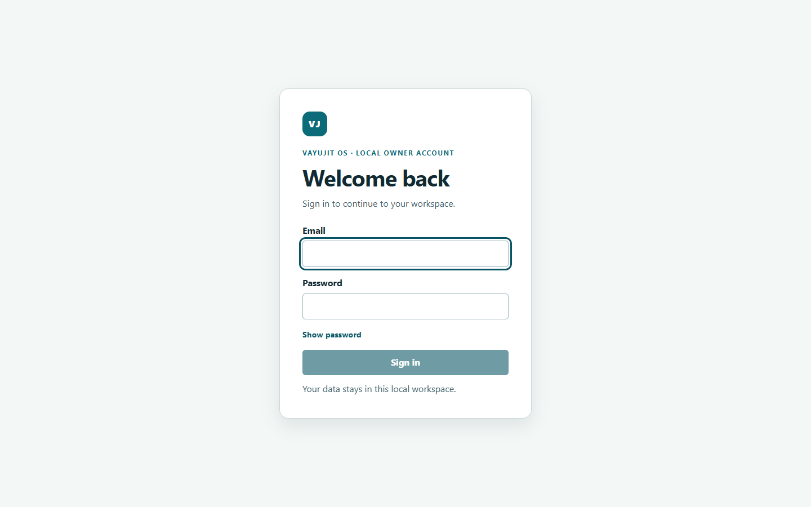

Figure 5. Empty login with visible Email keyboard focus. No credentials entered. Genuine historical synthetic capture, 2026-11-05.

### E. What do I see on this page?

Source-defined sections: Dynamic label varies with the selected record; exact current text is unverified.

Detected structures: 0 table declaration(s), 0 dialog declaration(s). Conditional/shared controls can appear only after valid context. Loading, empty, error and blocked conditions must be distinguished; their complete current runtime combinations are not verified in this edition.

| Action shown in source | Meaning and safety | Availability |
| --- | --- | --- |
| Dynamic label varies with the selected record; exact current text is unverified. | Source-declared navigation/view control; exact destination/state UNVERIFIED. | Not statically disabled |
| Dynamic label varies with the selected record; exact current text is unverified. | Effect UNVERIFIED; potentially changes data or invokes another workflow. Confirm prerequisites before acting. | Conditional |

### F. Input-field guide

Field records below state type, purpose, requiredness, accepted values and examples. Unless a specific effect is described, the parent action’s save/provider effect is UNVERIFIED. Common rule: enter only genuine facts, preserve UNKNOWN and units, and obey backend validation; no blank or unchecked prerequisite is permission to proceed. Complete per-field maintenance records retain these explicit limitations.

| Field | Type requiredness and accepted values | Purpose example and effect |
| --- | --- | --- |
| Full name [auth-page-F001] | text. Required on setup only. 2–120 characters under the current client validation. Validation: 2–120 characters under the current client validation. | Owner display identity on first installation. Example: Synthetic Owner Effect: Used when creating the owner; not an extra staff account. Avoid: Creating another owner to fix a login failure. |
| Email [auth-page-F002] | email. Required. Valid email address under client validation. Validation: Valid email address under client validation. | Identifies the existing local owner. Example: owner@example.test Effect: Used for owner sign-in or initial setup. Avoid: Using a different owner or origin instead of fixing the intended session. |
| Password [auth-page-F003] | Conditional input type. Required. At least 10 characters in the current client; backend remains authoritative. Validation: At least 10 characters in the current client; backend remains authoritative. | Authenticates the owner. Example: Use your own private password; none is printed here. Effect: Show/Hide changes visibility only. Avoid: Printing a password in documentation or support logs. |
| Confirm password [auth-page-F004] | Conditional input type. Required on setup only. Must match Password. Validation: Must match Password. | Confirms the new password during setup. Example: Enter the same private value again. Effect: Rejects mismatched setup input. Avoid: Treating confirmation as a password reset. |

### G. Step-by-step usage

1. Open the intended owned context using the navigation/route above. Verify the brand and any Product, opportunity, supplier, listing or artifact identity before continuing.

2. Use the intended login URL. Do not create an owner to bypass login or missing API/schema readiness.

3. Read current warnings and input guidance. Use only an action whose purpose and authority you understand. Stop before unapproved provider, commercial or permanent-data effects.

### H. Worked example

Illustrative task: Enter the existing owner workspace or set up a genuinely new installation when separately authorized. Use a genuine selected record in your own authorized workspace; a synthetic screenshot is a learning example only. The field examples above illustrate the type of input, not prescribed business values.

### I. How to interpret the results

Inspect identity, source/provenance, date/freshness, included assumptions and missing information. A local status, score or successful fake workflow is not proof of real external completion. UNKNOWN, blocked, stale and not-comparable results must retain their actual meaning.

### J. What should I do next?

Open Dashboard and verify the active brand before editing.

### K. Troubleshooting

If context is missing/invalid, use the appropriate collection or saved record link. If a request fails, retain the safe correlation reference and inspect current state before retrying. A 401 needs normal authentication; a 500 is not an empty successful result. Do not force-enable disabled actions or insert synthetic facts.

### L. Availability and limitations

DOCUMENTED BUT NOT CURRENTLY VERIFIED: current template and source inspected; no fresh authenticated session or complete per-control execution performed. Historical synthetic screenshot/functional evidence illustrates only its recorded state. Use the intended login URL. Do not create an owner to bypass login or missing API/schema readiness. The entire module is not certified by the presence of a route.

### M. Documentation evidence

Current source: apps/web/src/app/auth/auth-page.component.ts. Source and template hashes are in source/ui-inventory.json; exact field/action declarations in inventory/field-register.md and source/control-inventory.md. Screenshot evidence: docs/product-handbook/screenshots/login/01-empty-login.png (Figure 5).

[Current UI source for Login and owner setup](../../../apps/web/src/app/auth/auth-page.component.ts)

## P011 Advertising workspace

### A. What is this page?

Inspect local advertising accounts, campaign preparation and recorded operational states.

### B. Why would someone use it?

Distinguish local configuration from real provider authorization. Treat creation, activation and execution as potentially consequential.

### C. Where can I find it?

Grow → Advertising → /ads

Route: /ads

Route: /ads/create

Route: /ads/calendar

Route: /ads/accounts/:id — replace a parameter only through a legitimate saved record link, not a guessed ID.

Route: /ads/campaigns/:id — replace a parameter only through a legitimate saved record link, not a guessed ID.

Route: /ads/accounts

Route: /ads/campaigns

Route: /ads/analytics

Route: /ads/recovery

Route: /ads/settings

### D. Screenshot

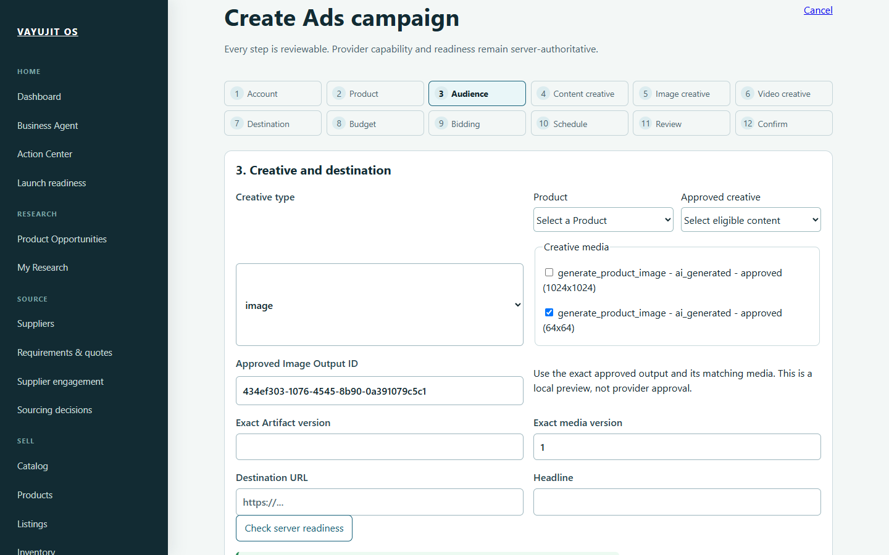

Figure 6. Synthetic image creative identity and local readiness, not an advertising provider approval. Genuine historical synthetic capture, 2026-11-04.

### E. What do I see on this page?

Source-defined sections: Operational ads workspace; Overview; Provider health; Quick actions; Attention and boundary; Accounts; Add Ads account; Campaigns; Create Ads campaign; Dynamic label varies with the selected record; exact current text is unverified.; Approved creatives and exact lineage; Analytics and profitability; Ads calendar; Recovery and failures; Ads settings; Server capabilities; Operational boundary

Detected structures: 5 table declaration(s), 0 dialog declaration(s). Conditional/shared controls can appear only after valid context. Loading, empty, error and blocked conditions must be distinguished; their complete current runtime combinations are not verified in this edition.

| Action shown in source | Meaning and safety | Availability |
| --- | --- | --- |
| Create campaign | Effect UNVERIFIED; potentially changes data or invokes another workflow. Confirm prerequisites before acting. | Not statically disabled |
| Dynamic label varies with the selected record; exact current text is unverified. | Source-declared navigation/view control; exact destination/state UNVERIFIED. | Not statically disabled |
| Refresh | Reloads the relevant view; exact data-source side effects still depend on that screen. | Not statically disabled |
| Manage accounts | Source-declared navigation/view control; exact destination/state UNVERIFIED. | Not statically disabled |
| Review campaigns | Source-declared navigation/view control; exact destination/state UNVERIFIED. | Not statically disabled |
| Open recovery | Source-declared navigation/view control; exact destination/state UNVERIFIED. | Not statically disabled |
| Dynamic label varies with the selected record; exact current text is unverified. | Source-declared navigation/view control; exact destination/state UNVERIFIED. | Not statically disabled |
| Save account | Effect UNVERIFIED; potentially changes data or invokes another workflow. Confirm prerequisites before acting. | Conditional |
| Dynamic label varies with the selected record; exact current text is unverified. | Source-declared navigation/view control; exact destination/state UNVERIFIED. | Not statically disabled |
| Validate | Invokes the page-specific validation contract. A provider validation can make a remote call; do not use without appropriate scope. | Not statically disabled |
| Dynamic label varies with the selected record; exact current text is unverified. | Effect UNVERIFIED; potentially changes data or invokes another workflow. Confirm prerequisites before acting. | Not statically disabled |
| Replace | Source-declared navigation/view control; exact destination/state UNVERIFIED. | Not statically disabled |
| Remove | Effect UNVERIFIED; potentially changes data or invokes another workflow. Confirm prerequisites before acting. | Not statically disabled |
| Create campaign | Effect UNVERIFIED; potentially changes data or invokes another workflow. Confirm prerequisites before acting. | Not statically disabled |
| Dynamic label varies with the selected record; exact current text is unverified. | Source-declared navigation/view control; exact destination/state UNVERIFIED. | Not statically disabled |
| Cancel | Abandons the current local operation where supported; saved records or remote effects may remain. | Not statically disabled |
| Back | Source-declared navigation/view control; exact destination/state UNVERIFIED. | Conditional |
| Next | Source-declared navigation/view control; exact destination/state UNVERIFIED. | Conditional |
| Back to campaigns | Source-declared navigation/view control; exact destination/state UNVERIFIED. | Not statically disabled |
| Dynamic label varies with the selected record; exact current text is unverified. | Source-declared navigation/view control; exact destination/state UNVERIFIED. | Not statically disabled |
| Reconcile | Source-declared navigation/view control; exact destination/state UNVERIFIED. | Not statically disabled |
| Recovery | Source-declared navigation/view control; exact destination/state UNVERIFIED. | Not statically disabled |
| Dynamic label varies with the selected record; exact current text is unverified. | Source-declared navigation/view control; exact destination/state UNVERIFIED. | Not statically disabled |
| Dynamic label varies with the selected record; exact current text is unverified. | Source-declared navigation/view control; exact destination/state UNVERIFIED. | Not statically disabled |
| Dynamic label varies with the selected record; exact current text is unverified. | Source-declared navigation/view control; exact destination/state UNVERIFIED. | Not statically disabled |

### F. Input-field guide

Field records below state type, purpose, requiredness, accepted values and examples. Unless a specific effect is described, the parent action’s save/provider effect is UNVERIFIED. Common rule: enter only genuine facts, preserve UNKNOWN and units, and obey backend validation; no blank or unchecked prerequisite is permission to proceed. Complete per-field maintenance records retain these explicit limitations.

| Field | Type requiredness and accepted values | Purpose example and effect |
| --- | --- | --- |
| Provider [ads-workspace-F001] | select. Required in the template. Meta; Google; Amazon Ads; Flipkart Ads | Chooses the relevant saved context or supported option. Example: Choose only a relevant legitimate saved option. Effect unverified; common field rules apply. |
| Display name [ads-workspace-F002] | text. Required in the template. maxlength 160 | Provides the stated input to this page’s supported workflow. Example: Use the actual business fact; no invented value is supplied. Effect unverified; common field rules apply. |
| External account ID [ads-workspace-F003] | text. Required in the template. Exact API limits/accepted vocabulary are not fully verified. | Provides the stated input to this page’s supported workflow. Example: Use the actual business fact; no invented value is supplied. Effect unverified; common field rules apply. |
| Environment [ads-workspace-F004] | select. Requiredness is not established by the template; do not assume optional. local; sandbox; production | Chooses the relevant saved context or supported option. Example: Choose only a relevant legitimate saved option. Effect unverified; common field rules apply. |
| Credential (write only) [ads-workspace-F005] | password. Requiredness is not established by the template; do not assume optional. Exact API limits/accepted vocabulary are not fully verified. | Provides the stated input to this page’s supported workflow. Example: Use the actual business fact; no invented value is supplied. Effect unverified; common field rules apply. |
| Search [ads-workspace-F006] | text. Requiredness is not established by the template; do not assume optional. Exact API limits/accepted vocabulary are not fully verified. | Narrows the records shown for the stated context. Example: An existing product name or SKU. Effect unverified; common field rules apply. |
| Provider [ads-workspace-F007] | select. Requiredness is not established by the template; do not assume optional. All providers; Meta; Google; Amazon Ads; Flipkart Ads | Chooses the relevant saved context or supported option. Example: Choose only a relevant legitimate saved option. Effect unverified; common field rules apply. |
| State [ads-workspace-F008] | select. Requiredness is not established by the template; do not assume optional. All states; draft; active; paused; failed | Chooses the relevant saved context or supported option. Example: Choose only a relevant legitimate saved option. Effect unverified; common field rules apply. |

### G. Step-by-step usage

1. Open the intended owned context using the navigation/route above. Verify the brand and any Product, opportunity, supplier, listing or artifact identity before continuing.

2. Distinguish local configuration from real provider authorization. Treat creation, activation and execution as potentially consequential.

3. Read current warnings and input guidance. Use only an action whose purpose and authority you understand. Stop before unapproved provider, commercial or permanent-data effects.

### H. Worked example

Illustrative task: Inspect local advertising accounts, campaign preparation and recorded operational states. Use a genuine selected record in your own authorized workspace; a synthetic screenshot is a learning example only. The field examples above illustrate the type of input, not prescribed business values.

### I. How to interpret the results

Inspect identity, source/provenance, date/freshness, included assumptions and missing information. A local status, score or successful fake workflow is not proof of real external completion. UNKNOWN, blocked, stale and not-comparable results must retain their actual meaning.

### J. What should I do next?

Review a local preview or authorized analysis; do not activate or spend from a handbook example.

### K. Troubleshooting

If context is missing/invalid, use the appropriate collection or saved record link. If a request fails, retain the safe correlation reference and inspect current state before retrying. A 401 needs normal authentication; a 500 is not an empty successful result. Do not force-enable disabled actions or insert synthetic facts.

### L. Availability and limitations

DOCUMENTED BUT NOT CURRENTLY VERIFIED: current template and source inspected; no fresh authenticated session or complete per-control execution performed. Historical synthetic screenshot/functional evidence illustrates only its recorded state. Distinguish local configuration from real provider authorization. Treat creation, activation and execution as potentially consequential. The entire module is not certified by the presence of a route.

### M. Documentation evidence

Current source: apps/web/src/app/ads/ads-workspace.component.ts. Source and template hashes are in source/ui-inventory.json; exact field/action declarations in inventory/field-register.md and source/control-inventory.md. Screenshot evidence: docs/product-handbook/screenshots/ads/01-creative-boundary.png (Figure 6).

[Current UI source for Advertising workspace](../../../apps/web/src/app/ads/ads-workspace.component.ts)

## P012 Marketing plans

### A. What is this page?

Review supported cross-channel marketing plan preparation and its assumptions.

### B. Why would someone use it?

Check product, channel, budget/currency basis and exact plan version. A modeled allocation is not a payment authorization.

### C. Where can I find it?

Contextual link from the relevant owned record, or the exact route below; not a separately verified primary-menu item.

Route: /ads/marketing

### D. Screenshot

MISSING: no reviewed safe screenshot selected for this page family. The source-defined layout below is not a substitute for a real current capture.

### E. What do I see on this page?

Source-defined sections: Cross-channel marketing plans; Plan readiness; 12-step Marketing Plan wizard; Dynamic label varies with the selected record; exact current text is unverified.; Plans; Canonical recommendations; Persisted history

Detected structures: 0 table declaration(s), 0 dialog declaration(s). Conditional/shared controls can appear only after valid context. Loading, empty, error and blocked conditions must be distinguished; their complete current runtime combinations are not verified in this edition.

| Action shown in source | Meaning and safety | Availability |
| --- | --- | --- |
| Dynamic label varies with the selected record; exact current text is unverified. | Effect UNVERIFIED; potentially changes data or invokes another workflow. Confirm prerequisites before acting. | Not statically disabled |
| Dynamic label varies with the selected record; exact current text is unverified. | Source-declared navigation/view control; exact destination/state UNVERIFIED. | Not statically disabled |
| Back | Source-declared navigation/view control; exact destination/state UNVERIFIED. | Conditional |
| Next | Source-declared navigation/view control; exact destination/state UNVERIFIED. | Not statically disabled |
| Preview and confirm | Effect UNVERIFIED; potentially changes data or invokes another workflow. Confirm prerequisites before acting. | Conditional |
| Refresh | Reloads the relevant view; exact data-source side effects still depend on that screen. | Not statically disabled |
| Review plan details | Source-declared navigation/view control; exact destination/state UNVERIFIED. | Not statically disabled |
| Preview budget revision | Source-declared navigation/view control; exact destination/state UNVERIFIED. | Conditional |
| Confirm reviewed budget revision | Effect UNVERIFIED; potentially changes data or invokes another workflow. Confirm prerequisites before acting. | Conditional |

### F. Input-field guide

Field records below state type, purpose, requiredness, accepted values and examples. Unless a specific effect is described, the parent action’s save/provider effect is UNVERIFIED. Common rule: enter only genuine facts, preserve UNKNOWN and units, and obey backend validation; no blank or unchecked prerequisite is permission to proceed. Complete per-field maintenance records retain these explicit limitations.

| Field | Type requiredness and accepted values | Purpose example and effect |
| --- | --- | --- |
| Objective [marketing-plan-F001] | select. Requiredness is not established by the template; do not assume optional. Sales; Traffic; Awareness | Chooses the relevant saved context or supported option. Example: Choose only a relevant legitimate saved option. Effect unverified; common field rules apply. |
| Channels [marketing-plan-F002] | text. Requiredness is not established by the template; do not assume optional. Exact API limits/accepted vocabulary are not fully verified. | Provides the stated input to this page’s supported workflow. Example: Use the actual business fact; no invented value is supplied. Effect unverified; common field rules apply. |
| Total budget [marketing-plan-F003] | number. Requiredness is not established by the template; do not assume optional. min 0 | Provides the stated input to this page’s supported workflow. Example: Use the genuine measured amount/quantity; units must be established. Effect unverified; common field rules apply. |
| Currency [marketing-plan-F004] | text. Requiredness is not established by the template; do not assume optional. maxlength 3 | Provides the stated input to this page’s supported workflow. Example: INR only if this is the genuine currency. Effect unverified; common field rules apply. |
| Dynamic label varies with the selected record; exact current text is unverified. [marketing-plan-F005] | text. Requiredness is not established by the template; do not assume optional. Exact API limits/accepted vocabulary are not fully verified. | Provides the stated input to this page’s supported workflow. Example: Use the actual business fact; no invented value is supplied. Effect unverified; common field rules apply. |
| Proposed total budget [marketing-plan-F006] | text. Requiredness is not established by the template; do not assume optional. Exact API limits/accepted vocabulary are not fully verified. | Provides the stated input to this page’s supported workflow. Example: Use the actual business fact; no invented value is supplied. Effect unverified; common field rules apply. |

### G. Step-by-step usage

1. Open the intended owned context using the navigation/route above. Verify the brand and any Product, opportunity, supplier, listing or artifact identity before continuing.

2. Check product, channel, budget/currency basis and exact plan version. A modeled allocation is not a payment authorization.

3. Read current warnings and input guidance. Use only an action whose purpose and authority you understand. Stop before unapproved provider, commercial or permanent-data effects.

### H. Worked example

Illustrative task: Review supported cross-channel marketing plan preparation and its assumptions. Use a genuine selected record in your own authorized workspace; a synthetic screenshot is a learning example only. The field examples above illustrate the type of input, not prescribed business values.

### I. How to interpret the results

Inspect identity, source/provenance, date/freshness, included assumptions and missing information. A local status, score or successful fake workflow is not proof of real external completion. UNKNOWN, blocked, stale and not-comparable results must retain their actual meaning.

### J. What should I do next?

Use the relevant controlled review path; do not execute or reallocate actual spend.

### K. Troubleshooting

If context is missing/invalid, use the appropriate collection or saved record link. If a request fails, retain the safe correlation reference and inspect current state before retrying. A 401 needs normal authentication; a 500 is not an empty successful result. Do not force-enable disabled actions or insert synthetic facts.

### L. Availability and limitations

DOCUMENTED BUT NOT CURRENTLY VERIFIED: current template and source inspected; no fresh authenticated session or complete per-control execution performed. Screenshot coverage is BLOCKED pending an approved safe session. Check product, channel, budget/currency basis and exact plan version. A modeled allocation is not a payment authorization. The entire module is not certified by the presence of a route.

### M. Documentation evidence

Current source: apps/web/src/app/ads/marketing-plan.component.ts. Source and template hashes are in source/ui-inventory.json; exact field/action declarations in inventory/field-register.md and source/control-inventory.md. Missing screenshot recorded in quality/documentation-gaps.md.

[Current UI source for Marketing plans](../../../apps/web/src/app/ads/marketing-plan.component.ts)

## P013 Advertising optimization intelligence

### A. What is this page?

Inspect recommendations, anomalies, experiments and history available under the actual route.

### B. Why would someone use it?

Open read-only preview, inspect the evidence and exact immutable creative context. Confirmation and execution are distinct from viewing.

### C. Where can I find it?

Contextual link from the relevant owned record, or the exact route below; not a separately verified primary-menu item.

Route: /ads/optimization

Route: /ads/recommendations

Route: /ads/optimization-rules

Route: /ads/anomalies

Route: /ads/experiments

Route: /ads/optimization-history

Route: /ads/comparison

### D. Screenshot

MISSING: no reviewed safe screenshot selected for this page family. The source-defined layout below is not a substitute for a real current capture.

### E. What do I see on this page?

Source-defined sections: Optimization intelligence; Review queue; Recommendations; Optimization rules; Anomalies and fatigue; Experiments; Cross-provider comparison; Optimization history; Preview optimization

Detected structures: 2 table declaration(s), 1 dialog declaration(s). Conditional/shared controls can appear only after valid context. Loading, empty, error and blocked conditions must be distinguished; their complete current runtime combinations are not verified in this edition.

| Action shown in source | Meaning and safety | Availability |
| --- | --- | --- |
| Back to Ads workspace | Source-declared navigation/view control; exact destination/state UNVERIFIED. | Not statically disabled |
| Dynamic label varies with the selected record; exact current text is unverified. | Source-declared navigation/view control; exact destination/state UNVERIFIED. | Not statically disabled |
| Evaluate campaigns | Source-declared navigation/view control; exact destination/state UNVERIFIED. | Not statically disabled |
| Evaluate campaigns | Source-declared navigation/view control; exact destination/state UNVERIFIED. | Not statically disabled |
| Preview | Opens the supported preview; no confirmation or execution should be inferred. | Not statically disabled |
| Close | Source-declared navigation/view control; exact destination/state UNVERIFIED. | Not statically disabled |

### F. Input-field guide

No direct editable fields were extracted from this page template. Review controls inherited from shared components in the shared-field appendix. No missing form is invented.

### G. Step-by-step usage

1. Open the intended owned context using the navigation/route above. Verify the brand and any Product, opportunity, supplier, listing or artifact identity before continuing.

2. Open read-only preview, inspect the evidence and exact immutable creative context. Confirmation and execution are distinct from viewing.

3. Read current warnings and input guidance. Use only an action whose purpose and authority you understand. Stop before unapproved provider, commercial or permanent-data effects.

### H. Worked example

Illustrative task: Inspect recommendations, anomalies, experiments and history available under the actual route. Use a genuine selected record in your own authorized workspace; a synthetic screenshot is a learning example only. The expected type of result is the relevant recorded view or a truthful empty/blocked state, not fabricated data.

### I. How to interpret the results

Inspect identity, source/provenance, date/freshness, included assumptions and missing information. A local status, score or successful fake workflow is not proof of real external completion. UNKNOWN, blocked, stale and not-comparable results must retain their actual meaning.

### J. What should I do next?

Leave a recommendation advisory until its separate canonical HUMAN workflow is legitimately authorized.

### K. Troubleshooting

If context is missing/invalid, use the appropriate collection or saved record link. If a request fails, retain the safe correlation reference and inspect current state before retrying. A 401 needs normal authentication; a 500 is not an empty successful result. Do not force-enable disabled actions or insert synthetic facts.

### L. Availability and limitations

DOCUMENTED BUT NOT CURRENTLY VERIFIED: current template and source inspected; no fresh authenticated session or complete per-control execution performed. Screenshot coverage is BLOCKED pending an approved safe session. Open read-only preview, inspect the evidence and exact immutable creative context. Confirmation and execution are distinct from viewing. The entire module is not certified by the presence of a route.

### M. Documentation evidence

Current source: apps/web/src/app/ads/ads-optimization.component.ts. Source and template hashes are in source/ui-inventory.json; exact field/action declarations in inventory/field-register.md and source/control-inventory.md. Missing screenshot recorded in quality/documentation-gaps.md.

[Current UI source for Advertising optimization intelligence](../../../apps/web/src/app/ads/ads-optimization.component.ts)

## P014 Dashboard

### A. What is this page?

Understand the recorded workspace and choose a supported next business task.

### B. Why would someone use it?

Check active brand, incomplete evidence and operational warnings. Do not read missing inputs as zero business activity.

### C. Where can I find it?

Home → Dashboard → /dashboard

Route: /dashboard

### D. Screenshot

MISSING: no reviewed safe screenshot selected for this page family. The source-defined layout below is not a substitute for a real current capture.

### E. What do I see on this page?

Source-defined sections: What should you do today?; Daily seller status; What are you trying to achieve?; Dynamic label varies with the selected record; exact current text is unverified.; Needs your attention; Opportunities and findings; Your workspace; Take the next useful step; Workflow status; Recent activity

Disclosures: Advanced system health. Open only the relevant section; expanded state does not mean its action ran.

Detected structures: 0 table declaration(s), 0 dialog declaration(s). Conditional/shared controls can appear only after valid context. Loading, empty, error and blocked conditions must be distinguished; their complete current runtime combinations are not verified in this edition.

| Action shown in source | Meaning and safety | Availability |
| --- | --- | --- |
| Review operational evidence | Source-declared navigation/view control; exact destination/state UNVERIFIED. | Not statically disabled |
| Review stock ledger | Source-declared navigation/view control; exact destination/state UNVERIFIED. | Not statically disabled |
| Review orders | Source-declared navigation/view control; exact destination/state UNVERIFIED. | Not statically disabled |
| Review marketplace prerequisites | Source-declared navigation/view control; exact destination/state UNVERIFIED. | Not statically disabled |
| Review sales and contribution evidence | Source-declared navigation/view control; exact destination/state UNVERIFIED. | Not statically disabled |
| Start with Business Agent | Effect UNVERIFIED; potentially changes data or invokes another workflow. Confirm prerequisites before acting. | Not statically disabled |
| Dynamic label varies with the selected record; exact current text is unverified. | Source-declared navigation/view control; exact destination/state UNVERIFIED. | Not statically disabled |
| Dynamic label varies with the selected record; exact current text is unverified. | Source-declared navigation/view control; exact destination/state UNVERIFIED. | Not statically disabled |
| Open workspace | Source-declared navigation/view control; exact destination/state UNVERIFIED. | Not statically disabled |
| + Start product research Find and compare opportunities worth investigating. | Effect UNVERIFIED; potentially changes data or invokes another workflow. Confirm prerequisites before acting. | Not statically disabled |
| + Open Action Center Review evidence-backed operational issues and next steps. | Source-declared navigation/view control; exact destination/state UNVERIFIED. | Not statically disabled |
| + Find suppliers Review sourcing options for a product. | Source-declared navigation/view control; exact destination/state UNVERIFIED. | Not statically disabled |
| + Create content Prepare content for a product or launch. | Effect UNVERIFIED; potentially changes data or invokes another workflow. Confirm prerequisites before acting. | Not statically disabled |
| + View calendar See planned work and upcoming activity. | Source-declared navigation/view control; exact destination/state UNVERIFIED. | Not statically disabled |
| + Prepare a launch Continue into campaign and launch workflows. | Source-declared navigation/view control; exact destination/state UNVERIFIED. | Not statically disabled |
| View details | Source-declared navigation/view control; exact destination/state UNVERIFIED. | Not statically disabled |

### F. Input-field guide

Field records below state type, purpose, requiredness, accepted values and examples. Unless a specific effect is described, the parent action’s save/provider effect is UNVERIFIED. Common rule: enter only genuine facts, preserve UNKNOWN and units, and obey backend validation; no blank or unchecked prerequisite is permission to proceed. Complete per-field maintenance records retain these explicit limitations.

| Field | Type requiredness and accepted values | Purpose example and effect |
| --- | --- | --- |
| View by brand [dashboard-F001] | select. Requiredness is not established by the template; do not assume optional. All Brands Additional choices depend on saved records/current context and are UNVERIFIED. | Chooses the relevant saved context or supported option. Example: Choose only a relevant legitimate saved option. Effect unverified; common field rules apply. |

### G. Step-by-step usage

1. Open the intended owned context using the navigation/route above. Verify the brand and any Product, opportunity, supplier, listing or artifact identity before continuing.

2. Check active brand, incomplete evidence and operational warnings. Do not read missing inputs as zero business activity.

3. Read current warnings and input guidance. Use only an action whose purpose and authority you understand. Stop before unapproved provider, commercial or permanent-data effects.

### H. Worked example

Illustrative task: Understand the recorded workspace and choose a supported next business task. Use a genuine selected record in your own authorized workspace; a synthetic screenshot is a learning example only. The field examples above illustrate the type of input, not prescribed business values.

### I. How to interpret the results

Inspect identity, source/provenance, date/freshness, included assumptions and missing information. A local status, score or successful fake workflow is not proof of real external completion. UNKNOWN, blocked, stale and not-comparable results must retain their actual meaning.

### J. What should I do next?

Follow Action Center, research, Catalog or operations links for the specific task.

### K. Troubleshooting

If context is missing/invalid, use the appropriate collection or saved record link. If a request fails, retain the safe correlation reference and inspect current state before retrying. A 401 needs normal authentication; a 500 is not an empty successful result. Do not force-enable disabled actions or insert synthetic facts.

### L. Availability and limitations

DOCUMENTED BUT NOT CURRENTLY VERIFIED: current template and source inspected; no fresh authenticated session or complete per-control execution performed. Screenshot coverage is BLOCKED pending an approved safe session. Check active brand, incomplete evidence and operational warnings. Do not read missing inputs as zero business activity. The entire module is not certified by the presence of a route.

### M. Documentation evidence

Current source: apps/web/src/app/operations/dashboard.component.ts. Source and template hashes are in source/ui-inventory.json; exact field/action declarations in inventory/field-register.md and source/control-inventory.md. Missing screenshot recorded in quality/documentation-gaps.md.

[Current UI source for Dashboard](../../../apps/web/src/app/operations/dashboard.component.ts)

## P015 Action Center

### A. What is this page?

Filter operational signals and follow them to their source workflow.

### B. Why would someone use it?

Distinguish Active/Resolved status from acknowledgement, approval and execution. Review a signal before changing its local lifecycle.

### C. Where can I find it?

Home → Action Center → /operations/action-center

Route: /operations/action-center

### D. Screenshot

MISSING: no reviewed safe screenshot selected for this page family. The source-defined layout below is not a substitute for a real current capture.

### E. What do I see on this page?

Source-defined sections: Action Center; Operational briefing; Dynamic label varies with the selected record; exact current text is unverified.; Evidence and audit context; Resolution history; Automation policy

Detected structures: 0 table declaration(s), 0 dialog declaration(s). Conditional/shared controls can appear only after valid context. Loading, empty, error and blocked conditions must be distinguished; their complete current runtime combinations are not verified in this edition.

| Action shown in source | Meaning and safety | Availability |
| --- | --- | --- |
| Back to Business Agent | Source-declared navigation/view control; exact destination/state UNVERIFIED. | Not statically disabled |
| Refresh scan | Source-declared navigation/view control; exact destination/state UNVERIFIED. | Conditional |
| Inspect evidence | Source-declared navigation/view control; exact destination/state UNVERIFIED. | Not statically disabled |
| Reopen | Source-declared navigation/view control; exact destination/state UNVERIFIED. | Conditional |
| Acknowledge | Source-declared navigation/view control; exact destination/state UNVERIFIED. | Conditional |
| Snooze 1 hour | Source-declared navigation/view control; exact destination/state UNVERIFIED. | Conditional |
| Resolve notice locally | Source-declared navigation/view control; exact destination/state UNVERIFIED. | Conditional |
| Open source | Source-declared navigation/view control; exact destination/state UNVERIFIED. | Not statically disabled |
| Previous page | Source-declared navigation/view control; exact destination/state UNVERIFIED. | Conditional |
| Next page | Source-declared navigation/view control; exact destination/state UNVERIFIED. | Conditional |

### F. Input-field guide

Field records below state type, purpose, requiredness, accepted values and examples. Unless a specific effect is described, the parent action’s save/provider effect is UNVERIFIED. Common rule: enter only genuine facts, preserve UNKNOWN and units, and obey backend validation; no blank or unchecked prerequisite is permission to proceed. Complete per-field maintenance records retain these explicit limitations.

| Field | Type requiredness and accepted values | Purpose example and effect |
| --- | --- | --- |
| Search [action-center-F001] | search. Requiredness is not established by the template; do not assume optional. Exact API limits/accepted vocabulary are not fully verified. | Narrows the records shown for the stated context. Example: An existing product name or SKU. Effect unverified; common field rules apply. |
| Category [action-center-F002] | select. Requiredness is not established by the template; do not assume optional. All categories; Catalog; Inventory; Orders; Financial; Supplier | Chooses the relevant saved context or supported option. Example: Choose only a relevant legitimate saved option. Effect unverified; common field rules apply. |
| Severity [action-center-F003] | select. Requiredness is not established by the template; do not assume optional. All severities; Critical; High; Medium; Low | Chooses the relevant saved context or supported option. Example: Choose only a relevant legitimate saved option. Effect unverified; common field rules apply. |
| Status [action-center-F004] | select. Requiredness is not established by the template; do not assume optional. Active; New; Acknowledged; Snoozed; Reopened; Resolved; Stale evidence | Chooses the relevant saved context or supported option. Example: Choose only a relevant legitimate saved option. Effect unverified; common field rules apply. |
| Dry-run mode [action-center-F005] | checkbox. Requiredness is not established by the template; do not assume optional. Checked or unchecked; confirm only truthful statements. | Records the specific choice or confirmation stated by its label. Example: Leave unchecked unless the statement is true. Effect unverified; common field rules apply. |
| Emergency stop [action-center-F006] | checkbox. Requiredness is not established by the template; do not assume optional. Checked or unchecked; confirm only truthful statements. | Records the specific choice or confirmation stated by its label. Example: Leave unchecked unless the statement is true. Effect unverified; common field rules apply. |

### G. Step-by-step usage

1. Open the intended owned context using the navigation/route above. Verify the brand and any Product, opportunity, supplier, listing or artifact identity before continuing.

2. Distinguish Active/Resolved status from acknowledgement, approval and execution. Review a signal before changing its local lifecycle.

3. Read current warnings and input guidance. Use only an action whose purpose and authority you understand. Stop before unapproved provider, commercial or permanent-data effects.

### H. Worked example

Illustrative task: Filter operational signals and follow them to their source workflow. Use a genuine selected record in your own authorized workspace; a synthetic screenshot is a learning example only. The field examples above illustrate the type of input, not prescribed business values.

### I. How to interpret the results

Inspect identity, source/provenance, date/freshness, included assumptions and missing information. A local status, score or successful fake workflow is not proof of real external completion. UNKNOWN, blocked, stale and not-comparable results must retain their actual meaning.

### J. What should I do next?

Use the source workflow; the generic recommendations are advisory.

### K. Troubleshooting

If context is missing/invalid, use the appropriate collection or saved record link. If a request fails, retain the safe correlation reference and inspect current state before retrying. A 401 needs normal authentication; a 500 is not an empty successful result. Do not force-enable disabled actions or insert synthetic facts.

### L. Availability and limitations

DOCUMENTED BUT NOT CURRENTLY VERIFIED: current template and source inspected; no fresh authenticated session or complete per-control execution performed. Screenshot coverage is BLOCKED pending an approved safe session. Distinguish Active/Resolved status from acknowledgement, approval and execution. Review a signal before changing its local lifecycle. The entire module is not certified by the presence of a route.

### M. Documentation evidence

Current source: apps/web/src/app/operations/action-center.component.ts. Source and template hashes are in source/ui-inventory.json; exact field/action declarations in inventory/field-register.md and source/control-inventory.md. Missing screenshot recorded in quality/documentation-gaps.md.

[Current UI source for Action Center](../../../apps/web/src/app/operations/action-center.component.ts)

## P016 Launch readiness

### A. What is this page?

Review canonical readiness warnings for current product, stock, finance, marketplace and HUMAN prerequisites.

### B. Why would someone use it?

A green local warning matrix does not establish real account registration, independent backups or live publication eligibility.

### C. Where can I find it?

Home → Launch readiness → /operations/launch-readiness

Route: /operations/launch-readiness

### D. Screenshot

MISSING: no reviewed safe screenshot selected for this page family. The source-defined layout below is not a substitute for a real current capture.

### E. What do I see on this page?

Source-defined sections: Launch readiness; Dynamic label varies with the selected record; exact current text is unverified.; Warnings before a production-ready decision; Prepare, review, then authorize

Detected structures: 0 table declaration(s), 0 dialog declaration(s). Conditional/shared controls can appear only after valid context. Loading, empty, error and blocked conditions must be distinguished; their complete current runtime combinations are not verified in this edition.

| Action shown in source | Meaning and safety | Availability |
| --- | --- | --- |
| Back to dashboard | Source-declared navigation/view control; exact destination/state UNVERIFIED. | Not statically disabled |
| Review Action Center | Source-declared navigation/view control; exact destination/state UNVERIFIED. | Not statically disabled |
| Dynamic label varies with the selected record; exact current text is unverified. | Source-declared navigation/view control; exact destination/state UNVERIFIED. | Not statically disabled |
| Dynamic label varies with the selected record; exact current text is unverified. | Source-declared navigation/view control; exact destination/state UNVERIFIED. | Not statically disabled |
| Confirm business identity, timezone, and seller preferences. | Effect UNVERIFIED; potentially changes data or invokes another workflow. Confirm prerequisites before acting. | Not statically disabled |
| Prepare a real product, variant, SKU, images, costs, and listing draft. | Source-declared navigation/view control; exact destination/state UNVERIFIED. | Not statically disabled |
| Record only HUMAN-confirmed physical stock and location evidence. | Effect UNVERIFIED; potentially changes data or invokes another workflow. Confirm prerequisites before acting. | Not statically disabled |
| Review marketplace account readiness; keep providers synthetic or read-only until separately approved. | Effect UNVERIFIED; potentially changes data or invokes another workflow. Confirm prerequisites before acting. | Not statically disabled |
| Create and verify an encrypted off-host backup plan before any production migration. | Effect UNVERIFIED; potentially changes data or invokes another workflow. Confirm prerequisites before acting. | Not statically disabled |
| Resolve evidence gaps and record the final HUMAN go-live decision. | Source-declared navigation/view control; exact destination/state UNVERIFIED. | Not statically disabled |

### F. Input-field guide

No direct editable fields were extracted from this page template. Review controls inherited from shared components in the shared-field appendix. No missing form is invented.

### G. Step-by-step usage

1. Open the intended owned context using the navigation/route above. Verify the brand and any Product, opportunity, supplier, listing or artifact identity before continuing.

2. A green local warning matrix does not establish real account registration, independent backups or live publication eligibility.

3. Read current warnings and input guidance. Use only an action whose purpose and authority you understand. Stop before unapproved provider, commercial or permanent-data effects.

### H. Worked example

Illustrative task: Review canonical readiness warnings for current product, stock, finance, marketplace and HUMAN prerequisites. Use a genuine selected record in your own authorized workspace; a synthetic screenshot is a learning example only. The expected type of result is the relevant recorded view or a truthful empty/blocked state, not fabricated data.

### I. How to interpret the results

Inspect identity, source/provenance, date/freshness, included assumptions and missing information. A local status, score or successful fake workflow is not proof of real external completion. UNKNOWN, blocked, stale and not-comparable results must retain their actual meaning.

### J. What should I do next?

Follow the specific warning link and satisfy the legitimate missing condition.

### K. Troubleshooting

If context is missing/invalid, use the appropriate collection or saved record link. If a request fails, retain the safe correlation reference and inspect current state before retrying. A 401 needs normal authentication; a 500 is not an empty successful result. Do not force-enable disabled actions or insert synthetic facts.

### L. Availability and limitations

DOCUMENTED BUT NOT CURRENTLY VERIFIED: current template and source inspected; no fresh authenticated session or complete per-control execution performed. Screenshot coverage is BLOCKED pending an approved safe session. A green local warning matrix does not establish real account registration, independent backups or live publication eligibility. The entire module is not certified by the presence of a route.

### M. Documentation evidence

Current source: apps/web/src/app/operations/launch-readiness.component.ts. Source and template hashes are in source/ui-inventory.json; exact field/action declarations in inventory/field-register.md and source/control-inventory.md. Missing screenshot recorded in quality/documentation-gaps.md.

[Current UI source for Launch readiness](../../../apps/web/src/app/operations/launch-readiness.component.ts)

## P017 Requirements and supplier quotes

### A. What is this page?

Keep sourcing requirements, supplier-linked commercial inputs and supported quote context together.

### B. Why would someone use it?

Use genuine quantities, units, currency and evidence. A manually assumed amount must not be labelled a verified quotation.

### C. Where can I find it?

Source → Requirements & quotes → /intelligence/sourcing

Route: /intelligence/sourcing

### D. Screenshot

MISSING: no reviewed safe screenshot selected for this page family. The source-defined layout below is not a substitute for a real current capture.

### E. What do I see on this page?

Source-defined sections: Requirements and supplier quotes; Know what is ready before you spend; Confirm the sourcing requirement; Prepare a supplier pricing request; Record supplier quotes; Validate samples and inspections; Complete landed-cost inputs; Quote comparison; Negotiation history; Sensitivity analysis; Capital and cash timeline; Critic findings; Supplier concentration; Human sourcing decision

Disclosures: Advanced requirement identifiers; Advanced RFQ controls; Advanced quote identifiers and provenance; Advanced sample/RFQ identifiers; Advanced local scenario tool; Advanced decision identifiers. Open only the relevant section; expanded state does not mean its action ran.

Detected structures: 0 table declaration(s), 0 dialog declaration(s). Conditional/shared controls can appear only after valid context. Loading, empty, error and blocked conditions must be distinguished; their complete current runtime combinations are not verified in this edition.

| Action shown in source | Meaning and safety | Availability |
| --- | --- | --- |
| Back to Intelligence | Source-declared navigation/view control; exact destination/state UNVERIFIED. | Not statically disabled |
| Return to this product and prepare its Catalog draft | Source-declared navigation/view control; exact destination/state UNVERIFIED. | Not statically disabled |
| Open Product Opportunities | Source-declared navigation/view control; exact destination/state UNVERIFIED. | Not statically disabled |
| Requirements | Source-declared navigation/view control; exact destination/state UNVERIFIED. | Not statically disabled |
| RFQs | Source-declared navigation/view control; exact destination/state UNVERIFIED. | Not statically disabled |
| Quotes | Source-declared navigation/view control; exact destination/state UNVERIFIED. | Not statically disabled |
| Samples & inspection | Source-declared navigation/view control; exact destination/state UNVERIFIED. | Not statically disabled |
| Comparison | Source-declared navigation/view control; exact destination/state UNVERIFIED. | Not statically disabled |
| Negotiation | Source-declared navigation/view control; exact destination/state UNVERIFIED. | Not statically disabled |
| Landed cost & economics | Source-declared navigation/view control; exact destination/state UNVERIFIED. | Not statically disabled |
| Sensitivity | Source-declared navigation/view control; exact destination/state UNVERIFIED. | Not statically disabled |
| Capital & cash | Source-declared navigation/view control; exact destination/state UNVERIFIED. | Not statically disabled |
| Critic | Source-declared navigation/view control; exact destination/state UNVERIFIED. | Not statically disabled |
| Concentration | Source-declared navigation/view control; exact destination/state UNVERIFIED. | Not statically disabled |
| Decisions | Source-declared navigation/view control; exact destination/state UNVERIFIED. | Not statically disabled |
| Confirm requirement | Effect UNVERIFIED; potentially changes data or invokes another workflow. Confirm prerequisites before acting. | Conditional |
| Review Supplier Intelligence | Source-declared navigation/view control; exact destination/state UNVERIFIED. | Not statically disabled |
| Prepare RFQ for review | Source-declared navigation/view control; exact destination/state UNVERIFIED. | Conditional |
| Record supplier quote | Source-declared navigation/view control; exact destination/state UNVERIFIED. | Conditional |
| Refresh recorded quotes | Source-declared navigation/view control; exact destination/state UNVERIFIED. | Not statically disabled |
| Request sample locally | Source-declared navigation/view control; exact destination/state UNVERIFIED. | Conditional |
| Open landed-cost economics | Source-declared navigation/view control; exact destination/state UNVERIFIED. | Not statically disabled |
| Calculate deterministic scenario | Effect UNVERIFIED; potentially changes data or invokes another workflow. Confirm prerequisites before acting. | Conditional |
| Compare scenarios | Source-declared navigation/view control; exact destination/state UNVERIFIED. | Not statically disabled |
| Review sensitivity | Source-declared navigation/view control; exact destination/state UNVERIFIED. | Not statically disabled |
| Review capital requirement | Source-declared navigation/view control; exact destination/state UNVERIFIED. | Not statically disabled |
| Open Decision Brief | Source-declared navigation/view control; exact destination/state UNVERIFIED. | Not statically disabled |
| Record human decision | Source-declared navigation/view control; exact destination/state UNVERIFIED. | Conditional |

### F. Input-field guide

Field records below state type, purpose, requiredness, accepted values and examples. Unless a specific effect is described, the parent action’s save/provider effect is UNVERIFIED. Common rule: enter only genuine facts, preserve UNKNOWN and units, and obey backend validation; no blank or unchecked prerequisite is permission to proceed. Complete per-field maintenance records retain these explicit limitations.

| Field | Type requiredness and accepted values | Purpose example and effect |
| --- | --- | --- |
| Category [sourcing-workspace-F001] | text. Required in the template. Exact API limits/accepted vocabulary are not fully verified. | Provides the stated input to this page’s supported workflow. Example: Use the actual business fact; no invented value is supplied. Effect unverified; common field rules apply. |
| Target quantity Required starting quantity [sourcing-workspace-F002] | number. Requiredness is not established by the template; do not assume optional. min 1 | Provides the stated input to this page’s supported workflow. Example: Use the genuine measured amount/quantity; units must be established. Effect unverified; common field rules apply. |
| Target market [sourcing-workspace-F003] | text. Requiredness is not established by the template; do not assume optional. Exact API limits/accepted vocabulary are not fully verified. | Provides the stated input to this page’s supported workflow. Example: Use the actual business fact; no invented value is supplied. Effect unverified; common field rules apply. |
| Maximum MOQ Leave blank if unknown [sourcing-workspace-F004] | number. Requiredness is not established by the template; do not assume optional. min 1 | Provides the stated input to this page’s supported workflow. Example: Use the genuine measured amount/quantity; units must be established. Effect unverified; common field rules apply. |
| Saved local pricing draft [sourcing-workspace-F005] | select. Requiredness is not established by the template; do not assume optional. Choose a saved draft explicitly Additional choices depend on saved records/current context and are UNVERIFIED. | Chooses the relevant saved context or supported option. Example: Choose only a relevant legitimate saved option. Effect unverified; common field rules apply. |
| RFQ title [sourcing-workspace-F006] | text. Required in the template. Exact API limits/accepted vocabulary are not fully verified. | Provides the stated input to this page’s supported workflow. Example: Use the actual business fact; no invented value is supplied. Effect unverified; common field rules apply. |
| Dynamic label varies with the selected record; exact current text is unverified. [sourcing-workspace-F007] | checkbox. Requiredness is not established by the template; do not assume optional. Checked or unchecked; confirm only truthful statements. | Records the specific choice or confirmation stated by its label. Example: Leave unchecked unless the statement is true. Effect unverified; common field rules apply. |
| Requirement ID [sourcing-workspace-F008] | text. Requiredness is not established by the template; do not assume optional. Exact API limits/accepted vocabulary are not fully verified. | Provides the stated input to this page’s supported workflow. Example: Use the actual business fact; no invented value is supplied. Effect unverified; common field rules apply. |
| Supplier IDs [sourcing-workspace-F009] | text. Requiredness is not established by the template; do not assume optional. Exact API limits/accepted vocabulary are not fully verified. | Provides the stated input to this page’s supported workflow. Example: Use the actual business fact; no invented value is supplied. Effect unverified; common field rules apply. |
| Supplier [sourcing-workspace-F010] | select. Requiredness is not established by the template; do not assume optional. Select product-related supplier record Additional choices depend on saved records/current context and are UNVERIFIED. | Chooses the relevant saved context or supported option. Example: Choose only a relevant legitimate saved option. Effect unverified; common field rules apply. |
| Quote reference [sourcing-workspace-F011] | text. Required in the template. Exact API limits/accepted vocabulary are not fully verified. | Provides the stated input to this page’s supported workflow. Example: Use the actual business fact; no invented value is supplied. Effect unverified; common field rules apply. |
| Currency [sourcing-workspace-F012] | text. Required in the template. maxlength 3 | Provides the stated input to this page’s supported workflow. Example: INR only if this is the genuine currency. Effect unverified; common field rules apply. |
| Quoted unit price Required; leave unknown values blank [sourcing-workspace-F013] | number. Required in the template. min 0; step 0.00000001 | Provides the stated input to this page’s supported workflow. Example: Use the genuine measured amount/quantity; units must be established. Effect unverified; common field rules apply. |
| MOQ Unknown until supplied by the seller [sourcing-workspace-F014] | number. Required in the template. min 1 | Provides the stated input to this page’s supported workflow. Example: Use the genuine measured amount/quantity; units must be established. Effect unverified; common field rules apply. |
| Quote valid until (optional ISO timestamp) [sourcing-workspace-F015] | text. Requiredness is not established by the template; do not assume optional. Exact API limits/accepted vocabulary are not fully verified. | Provides the stated input to this page’s supported workflow. Example: Use the actual business fact; no invented value is supplied. Effect unverified; common field rules apply. |
| RFQ ID [sourcing-workspace-F016] | text. Requiredness is not established by the template; do not assume optional. Exact API limits/accepted vocabulary are not fully verified. | Provides the stated input to this page’s supported workflow. Example: Use the actual business fact; no invented value is supplied. Effect unverified; common field rules apply. |
| Supplier [sourcing-workspace-F017] | select. Requiredness is not established by the template; do not assume optional. Select product-related supplier record Additional choices depend on saved records/current context and are UNVERIFIED. | Chooses the relevant saved context or supported option. Example: Choose only a relevant legitimate saved option. Effect unverified; common field rules apply. |
| Quantity [sourcing-workspace-F018] | number. Requiredness is not established by the template; do not assume optional. min 1 | Provides the stated input to this page’s supported workflow. Example: Use the genuine measured amount/quantity; units must be established. Effect unverified; common field rules apply. |
| RFQ ID [sourcing-workspace-F019] | text. Requiredness is not established by the template; do not assume optional. Exact API limits/accepted vocabulary are not fully verified. | Provides the stated input to this page’s supported workflow. Example: Use the actual business fact; no invented value is supplied. Effect unverified; common field rules apply. |
| Requirement ID [sourcing-workspace-F020] | text. Requiredness is not established by the template; do not assume optional. Exact API limits/accepted vocabulary are not fully verified. | Provides the stated input to this page’s supported workflow. Example: Use the actual business fact; no invented value is supplied. Effect unverified; common field rules apply. |
| Supplier price [sourcing-workspace-F021] | number. Requiredness is not established by the template; do not assume optional. min 0 | Provides the stated input to this page’s supported workflow. Example: Use the genuine measured amount/quantity; units must be established. Effect unverified; common field rules apply. |
| Freight assumption [sourcing-workspace-F022] | number. Requiredness is not established by the template; do not assume optional. min 0 | Provides the stated input to this page’s supported workflow. Example: Use the genuine measured amount/quantity; units must be established. Effect unverified; common field rules apply. |
| Selling price [sourcing-workspace-F023] | number. Requiredness is not established by the template; do not assume optional. min 0 | Provides the stated input to this page’s supported workflow. Example: Use the genuine measured amount/quantity; units must be established. Effect unverified; common field rules apply. |
| Quantity [sourcing-workspace-F024] | number. Requiredness is not established by the template; do not assume optional. min 1 | Provides the stated input to this page’s supported workflow. Example: Use the genuine measured amount/quantity; units must be established. Effect unverified; common field rules apply. |
| Decision [sourcing-workspace-F025] | select. Requiredness is not established by the template; do not assume optional. hold; request_negotiation; request_requote; approve_for_future_purchase; reject | Chooses the relevant saved context or supported option. Example: Choose only a relevant legitimate saved option. Effect unverified; common field rules apply. |
| Confirm for human review [sourcing-workspace-F026] | checkbox. Requiredness is not established by the template; do not assume optional. Checked or unchecked; confirm only truthful statements. | Records the specific choice or confirmation stated by its label. Example: Leave unchecked unless the statement is true. Effect unverified; common field rules apply. |
| Requirement ID [sourcing-workspace-F027] | text. Requiredness is not established by the template; do not assume optional. Exact API limits/accepted vocabulary are not fully verified. | Provides the stated input to this page’s supported workflow. Example: Use the actual business fact; no invented value is supplied. Effect unverified; common field rules apply. |
| Quote ID [sourcing-workspace-F028] | text. Requiredness is not established by the template; do not assume optional. Exact API limits/accepted vocabulary are not fully verified. | Provides the stated input to this page’s supported workflow. Example: Use the actual business fact; no invented value is supplied. Effect unverified; common field rules apply. |

### G. Step-by-step usage

1. Open the intended owned context using the navigation/route above. Verify the brand and any Product, opportunity, supplier, listing or artifact identity before continuing.

2. Use genuine quantities, units, currency and evidence. A manually assumed amount must not be labelled a verified quotation.

3. Read current warnings and input guidance. Use only an action whose purpose and authority you understand. Stop before unapproved provider, commercial or permanent-data effects.

### H. Worked example

Illustrative task: Keep sourcing requirements, supplier-linked commercial inputs and supported quote context together. Use a genuine selected record in your own authorized workspace; a synthetic screenshot is a learning example only. The field examples above illustrate the type of input, not prescribed business values.

### I. How to interpret the results

Inspect identity, source/provenance, date/freshness, included assumptions and missing information. A local status, score or successful fake workflow is not proof of real external completion. UNKNOWN, blocked, stale and not-comparable results must retain their actual meaning.

### J. What should I do next?

Compare the appropriate scenario and current economics.

### K. Troubleshooting

If context is missing/invalid, use the appropriate collection or saved record link. If a request fails, retain the safe correlation reference and inspect current state before retrying. A 401 needs normal authentication; a 500 is not an empty successful result. Do not force-enable disabled actions or insert synthetic facts.

### L. Availability and limitations

DOCUMENTED BUT NOT CURRENTLY VERIFIED: current template and source inspected; no fresh authenticated session or complete per-control execution performed. Screenshot coverage is BLOCKED pending an approved safe session. Use genuine quantities, units, currency and evidence. A manually assumed amount must not be labelled a verified quotation. The entire module is not certified by the presence of a route.

### M. Documentation evidence

Current source: apps/web/src/app/intelligence/sourcing-workspace.component.ts. Source and template hashes are in source/ui-inventory.json; exact field/action declarations in inventory/field-register.md and source/control-inventory.md. Missing screenshot recorded in quality/documentation-gaps.md.

[Current UI source for Requirements and supplier quotes](../../../apps/web/src/app/intelligence/sourcing-workspace.component.ts)

## P018 Alibaba discovery

### A. What is this page?

Review the supported Alibaba source-discovery entry point.

### B. Why would someone use it?

Provider mode, source access policy and product context remain authoritative; read-only does not mean access is automatically permitted.

### C. Where can I find it?

Advanced → Intelligence → Alibaba Discovery → /intelligence/alibaba

Route: /intelligence/alibaba

### D. Screenshot

MISSING: no reviewed safe screenshot selected for this page family. The source-defined layout below is not a substitute for a real current capture.

### E. What do I see on this page?

Source-defined sections: Alibaba read-only discovery; Provider boundary; Run local discovery; Discovery history; Normalized listings

Detected structures: 2 table declaration(s), 0 dialog declaration(s). Conditional/shared controls can appear only after valid context. Loading, empty, error and blocked conditions must be distinguished; their complete current runtime combinations are not verified in this edition.

| Action shown in source | Meaning and safety | Availability |
| --- | --- | --- |
| Back to Intelligence | Source-declared navigation/view control; exact destination/state UNVERIFIED. | Not statically disabled |
| Search suppliers | Source-declared navigation/view control; exact destination/state UNVERIFIED. | Conditional |
| Refresh | Reloads the relevant view; exact data-source side effects still depend on that screen. | Conditional |
| Dynamic label varies with the selected record; exact current text is unverified. | Source-declared navigation/view control; exact destination/state UNVERIFIED. | Not statically disabled |

### F. Input-field guide

Field records below state type, purpose, requiredness, accepted values and examples. Unless a specific effect is described, the parent action’s save/provider effect is UNVERIFIED. Common rule: enter only genuine facts, preserve UNKNOWN and units, and obey backend validation; no blank or unchecked prerequisite is permission to proceed. Complete per-field maintenance records retain these explicit limitations.

| Field | Type requiredness and accepted values | Purpose example and effect |
| --- | --- | --- |
| Product or category query [alibaba-discovery-F001] | text. Required in the template. minlength 2; maxlength 240 | Provides the stated input to this page’s supported workflow. Example: Use the actual business fact; no invented value is supplied. Effect unverified; common field rules apply. |
| Country code [alibaba-discovery-F002] | text. Requiredness is not established by the template; do not assume optional. maxlength 2 | Provides the stated input to this page’s supported workflow. Example: Use the actual business fact; no invented value is supplied. Effect unverified; common field rules apply. |
| Region [alibaba-discovery-F003] | text. Requiredness is not established by the template; do not assume optional. maxlength 120 | Provides the stated input to this page’s supported workflow. Example: Use the actual business fact; no invented value is supplied. Effect unverified; common field rules apply. |
| Result limit [alibaba-discovery-F004] | number. Requiredness is not established by the template; do not assume optional. min 1; max 20 | Provides the stated input to this page’s supported workflow. Example: Use the genuine measured amount/quantity; units must be established. Effect unverified; common field rules apply. |

### G. Step-by-step usage

1. Open the intended owned context using the navigation/route above. Verify the brand and any Product, opportunity, supplier, listing or artifact identity before continuing.

2. Provider mode, source access policy and product context remain authoritative; read-only does not mean access is automatically permitted.

3. Read current warnings and input guidance. Use only an action whose purpose and authority you understand. Stop before unapproved provider, commercial or permanent-data effects.

### H. Worked example

Illustrative task: Review the supported Alibaba source-discovery entry point. Use a genuine selected record in your own authorized workspace; a synthetic screenshot is a learning example only. The field examples above illustrate the type of input, not prescribed business values.

### I. How to interpret the results

Inspect identity, source/provenance, date/freshness, included assumptions and missing information. A local status, score or successful fake workflow is not proof of real external completion. UNKNOWN, blocked, stale and not-comparable results must retain their actual meaning.

### J. What should I do next?

Inspect canonical supplier candidates and their evidence when legitimately available.

### K. Troubleshooting

If context is missing/invalid, use the appropriate collection or saved record link. If a request fails, retain the safe correlation reference and inspect current state before retrying. A 401 needs normal authentication; a 500 is not an empty successful result. Do not force-enable disabled actions or insert synthetic facts.

### L. Availability and limitations

DOCUMENTED BUT NOT CURRENTLY VERIFIED: current template and source inspected; no fresh authenticated session or complete per-control execution performed. Screenshot coverage is BLOCKED pending an approved safe session. Provider mode, source access policy and product context remain authoritative; read-only does not mean access is automatically permitted. The entire module is not certified by the presence of a route.

### M. Documentation evidence

Current source: apps/web/src/app/intelligence/alibaba-discovery.component.ts. Source and template hashes are in source/ui-inventory.json; exact field/action declarations in inventory/field-register.md and source/control-inventory.md. Missing screenshot recorded in quality/documentation-gaps.md.

[Current UI source for Alibaba discovery](../../../apps/web/src/app/intelligence/alibaba-discovery.component.ts)

## P019 IndiaMART discovery

### A. What is this page?

Review the supported IndiaMART source-discovery entry point.

### B. Why would someone use it?

Do not interpret a directory hit as a verified manufacturer or supplier quote. Check mode and source approval first.

### C. Where can I find it?

Advanced → Intelligence → IndiaMART Discovery → /intelligence/indiamart

Route: /intelligence/indiamart

### D. Screenshot

MISSING: no reviewed safe screenshot selected for this page family. The source-defined layout below is not a substitute for a real current capture.

### E. What do I see on this page?

Source-defined sections: IndiaMART read-only discovery; Provider boundary; Run local discovery; Discovery history; Normalized listings

Detected structures: 2 table declaration(s), 0 dialog declaration(s). Conditional/shared controls can appear only after valid context. Loading, empty, error and blocked conditions must be distinguished; their complete current runtime combinations are not verified in this edition.

| Action shown in source | Meaning and safety | Availability |
| --- | --- | --- |
| Back to Intelligence | Source-declared navigation/view control; exact destination/state UNVERIFIED. | Not statically disabled |
| Search suppliers | Source-declared navigation/view control; exact destination/state UNVERIFIED. | Conditional |
| Refresh | Reloads the relevant view; exact data-source side effects still depend on that screen. | Conditional |
| Dynamic label varies with the selected record; exact current text is unverified. | Source-declared navigation/view control; exact destination/state UNVERIFIED. | Not statically disabled |

### F. Input-field guide

Field records below state type, purpose, requiredness, accepted values and examples. Unless a specific effect is described, the parent action’s save/provider effect is UNVERIFIED. Common rule: enter only genuine facts, preserve UNKNOWN and units, and obey backend validation; no blank or unchecked prerequisite is permission to proceed. Complete per-field maintenance records retain these explicit limitations.

| Field | Type requiredness and accepted values | Purpose example and effect |
| --- | --- | --- |
| Product or category query [indiamart-discovery-F001] | text. Required in the template. minlength 2; maxlength 240 | Provides the stated input to this page’s supported workflow. Example: Use the actual business fact; no invented value is supplied. Effect unverified; common field rules apply. |
| Country code [indiamart-discovery-F002] | text. Requiredness is not established by the template; do not assume optional. maxlength 2 | Provides the stated input to this page’s supported workflow. Example: Use the actual business fact; no invented value is supplied. Effect unverified; common field rules apply. |
| Region [indiamart-discovery-F003] | text. Requiredness is not established by the template; do not assume optional. maxlength 120 | Provides the stated input to this page’s supported workflow. Example: Use the actual business fact; no invented value is supplied. Effect unverified; common field rules apply. |
| Result limit [indiamart-discovery-F004] | number. Requiredness is not established by the template; do not assume optional. min 1; max 20 | Provides the stated input to this page’s supported workflow. Example: Use the genuine measured amount/quantity; units must be established. Effect unverified; common field rules apply. |

### G. Step-by-step usage

1. Open the intended owned context using the navigation/route above. Verify the brand and any Product, opportunity, supplier, listing or artifact identity before continuing.

2. Do not interpret a directory hit as a verified manufacturer or supplier quote. Check mode and source approval first.

3. Read current warnings and input guidance. Use only an action whose purpose and authority you understand. Stop before unapproved provider, commercial or permanent-data effects.

### H. Worked example

Illustrative task: Review the supported IndiaMART source-discovery entry point. Use a genuine selected record in your own authorized workspace; a synthetic screenshot is a learning example only. The field examples above illustrate the type of input, not prescribed business values.

### I. How to interpret the results

Inspect identity, source/provenance, date/freshness, included assumptions and missing information. A local status, score or successful fake workflow is not proof of real external completion. UNKNOWN, blocked, stale and not-comparable results must retain their actual meaning.

### J. What should I do next?

Review evidence in the supplier workspace; no contact follows from discovery.

### K. Troubleshooting

If context is missing/invalid, use the appropriate collection or saved record link. If a request fails, retain the safe correlation reference and inspect current state before retrying. A 401 needs normal authentication; a 500 is not an empty successful result. Do not force-enable disabled actions or insert synthetic facts.

### L. Availability and limitations

DOCUMENTED BUT NOT CURRENTLY VERIFIED: current template and source inspected; no fresh authenticated session or complete per-control execution performed. Screenshot coverage is BLOCKED pending an approved safe session. Do not interpret a directory hit as a verified manufacturer or supplier quote. Check mode and source approval first. The entire module is not certified by the presence of a route.

### M. Documentation evidence

Current source: apps/web/src/app/intelligence/indiamart-discovery.component.ts. Source and template hashes are in source/ui-inventory.json; exact field/action declarations in inventory/field-register.md and source/control-inventory.md. Missing screenshot recorded in quality/documentation-gaps.md.

[Current UI source for IndiaMART discovery](../../../apps/web/src/app/intelligence/indiamart-discovery.component.ts)

## P020 TradeIndia discovery

### A. What is this page?

Review the supported TradeIndia source-discovery entry point.

### B. Why would someone use it?

Check source policy, current product/category and allowed mode before any acquisition.

### C. Where can I find it?

Advanced → Intelligence → TradeIndia Discovery → /intelligence/tradeindia

Route: /intelligence/tradeindia

### D. Screenshot

MISSING: no reviewed safe screenshot selected for this page family. The source-defined layout below is not a substitute for a real current capture.

### E. What do I see on this page?

Source-defined sections: TradeIndia read-only discovery; Provider boundary; Run local discovery; Discovery history; Normalized listings

Detected structures: 2 table declaration(s), 0 dialog declaration(s). Conditional/shared controls can appear only after valid context. Loading, empty, error and blocked conditions must be distinguished; their complete current runtime combinations are not verified in this edition.

| Action shown in source | Meaning and safety | Availability |
| --- | --- | --- |
| Back to Intelligence | Source-declared navigation/view control; exact destination/state UNVERIFIED. | Not statically disabled |
| Search suppliers | Source-declared navigation/view control; exact destination/state UNVERIFIED. | Conditional |
| Refresh | Reloads the relevant view; exact data-source side effects still depend on that screen. | Conditional |
| Dynamic label varies with the selected record; exact current text is unverified. | Source-declared navigation/view control; exact destination/state UNVERIFIED. | Not statically disabled |

### F. Input-field guide

Field records below state type, purpose, requiredness, accepted values and examples. Unless a specific effect is described, the parent action’s save/provider effect is UNVERIFIED. Common rule: enter only genuine facts, preserve UNKNOWN and units, and obey backend validation; no blank or unchecked prerequisite is permission to proceed. Complete per-field maintenance records retain these explicit limitations.

| Field | Type requiredness and accepted values | Purpose example and effect |
| --- | --- | --- |
| Product or category query [tradeindia-discovery-F001] | text. Required in the template. minlength 2; maxlength 240 | Provides the stated input to this page’s supported workflow. Example: Use the actual business fact; no invented value is supplied. Effect unverified; common field rules apply. |
| Country code [tradeindia-discovery-F002] | text. Requiredness is not established by the template; do not assume optional. maxlength 2 | Provides the stated input to this page’s supported workflow. Example: Use the actual business fact; no invented value is supplied. Effect unverified; common field rules apply. |
| Region [tradeindia-discovery-F003] | text. Requiredness is not established by the template; do not assume optional. maxlength 120 | Provides the stated input to this page’s supported workflow. Example: Use the actual business fact; no invented value is supplied. Effect unverified; common field rules apply. |
| Result limit [tradeindia-discovery-F004] | number. Requiredness is not established by the template; do not assume optional. min 1; max 20 | Provides the stated input to this page’s supported workflow. Example: Use the genuine measured amount/quantity; units must be established. Effect unverified; common field rules apply. |

### G. Step-by-step usage

1. Open the intended owned context using the navigation/route above. Verify the brand and any Product, opportunity, supplier, listing or artifact identity before continuing.

2. Check source policy, current product/category and allowed mode before any acquisition.

3. Read current warnings and input guidance. Use only an action whose purpose and authority you understand. Stop before unapproved provider, commercial or permanent-data effects.

### H. Worked example

Illustrative task: Review the supported TradeIndia source-discovery entry point. Use a genuine selected record in your own authorized workspace; a synthetic screenshot is a learning example only. The field examples above illustrate the type of input, not prescribed business values.

### I. How to interpret the results

Inspect identity, source/provenance, date/freshness, included assumptions and missing information. A local status, score or successful fake workflow is not proof of real external completion. UNKNOWN, blocked, stale and not-comparable results must retain their actual meaning.

### J. What should I do next?

Review supplier identity and evidence; unknown commercial claims remain unknown.

### K. Troubleshooting

If context is missing/invalid, use the appropriate collection or saved record link. If a request fails, retain the safe correlation reference and inspect current state before retrying. A 401 needs normal authentication; a 500 is not an empty successful result. Do not force-enable disabled actions or insert synthetic facts.

### L. Availability and limitations

DOCUMENTED BUT NOT CURRENTLY VERIFIED: current template and source inspected; no fresh authenticated session or complete per-control execution performed. Screenshot coverage is BLOCKED pending an approved safe session. Check source policy, current product/category and allowed mode before any acquisition. The entire module is not certified by the presence of a route.

### M. Documentation evidence

Current source: apps/web/src/app/intelligence/tradeindia-discovery.component.ts. Source and template hashes are in source/ui-inventory.json; exact field/action declarations in inventory/field-register.md and source/control-inventory.md. Missing screenshot recorded in quality/documentation-gaps.md.

[Current UI source for TradeIndia discovery](../../../apps/web/src/app/intelligence/tradeindia-discovery.component.ts)

## P021 Global Sources discovery

### A. What is this page?

Review the supported Global Sources discovery entry point.

### B. Why would someone use it?

A configured adapter is not proof of permitted source access or a useful live result.

### C. Where can I find it?

Advanced → Intelligence → Global Sources Discovery → /intelligence/global-sources

Route: /intelligence/global-sources

### D. Screenshot

MISSING: no reviewed safe screenshot selected for this page family. The source-defined layout below is not a substitute for a real current capture.

### E. What do I see on this page?

Source-defined sections: Global Sources read-only discovery; Provider boundary; Run local discovery; Discovery history; Normalized listings

Detected structures: 2 table declaration(s), 0 dialog declaration(s). Conditional/shared controls can appear only after valid context. Loading, empty, error and blocked conditions must be distinguished; their complete current runtime combinations are not verified in this edition.

| Action shown in source | Meaning and safety | Availability |
| --- | --- | --- |
| Back to Intelligence | Source-declared navigation/view control; exact destination/state UNVERIFIED. | Not statically disabled |
| Search suppliers | Source-declared navigation/view control; exact destination/state UNVERIFIED. | Conditional |
| Refresh | Reloads the relevant view; exact data-source side effects still depend on that screen. | Conditional |
| Dynamic label varies with the selected record; exact current text is unverified. | Source-declared navigation/view control; exact destination/state UNVERIFIED. | Not statically disabled |

### F. Input-field guide

Field records below state type, purpose, requiredness, accepted values and examples. Unless a specific effect is described, the parent action’s save/provider effect is UNVERIFIED. Common rule: enter only genuine facts, preserve UNKNOWN and units, and obey backend validation; no blank or unchecked prerequisite is permission to proceed. Complete per-field maintenance records retain these explicit limitations.

| Field | Type requiredness and accepted values | Purpose example and effect |
| --- | --- | --- |
| Product or category query [global-sources-discovery-F001] | text. Required in the template. minlength 2; maxlength 240 | Provides the stated input to this page’s supported workflow. Example: Use the actual business fact; no invented value is supplied. Effect unverified; common field rules apply. |
| Country code [global-sources-discovery-F002] | text. Requiredness is not established by the template; do not assume optional. maxlength 2 | Provides the stated input to this page’s supported workflow. Example: Use the actual business fact; no invented value is supplied. Effect unverified; common field rules apply. |
| Region [global-sources-discovery-F003] | text. Requiredness is not established by the template; do not assume optional. maxlength 120 | Provides the stated input to this page’s supported workflow. Example: Use the actual business fact; no invented value is supplied. Effect unverified; common field rules apply. |
| Result limit [global-sources-discovery-F004] | number. Requiredness is not established by the template; do not assume optional. min 1; max 20 | Provides the stated input to this page’s supported workflow. Example: Use the genuine measured amount/quantity; units must be established. Effect unverified; common field rules apply. |

### G. Step-by-step usage

1. Open the intended owned context using the navigation/route above. Verify the brand and any Product, opportunity, supplier, listing or artifact identity before continuing.

2. A configured adapter is not proof of permitted source access or a useful live result.

3. Read current warnings and input guidance. Use only an action whose purpose and authority you understand. Stop before unapproved provider, commercial or permanent-data effects.

### H. Worked example

Illustrative task: Review the supported Global Sources discovery entry point. Use a genuine selected record in your own authorized workspace; a synthetic screenshot is a learning example only. The field examples above illustrate the type of input, not prescribed business values.

### I. How to interpret the results

Inspect identity, source/provenance, date/freshness, included assumptions and missing information. A local status, score or successful fake workflow is not proof of real external completion. UNKNOWN, blocked, stale and not-comparable results must retain their actual meaning.

### J. What should I do next?

Inspect canonical supplier candidates and gaps without contacting them.

### K. Troubleshooting

If context is missing/invalid, use the appropriate collection or saved record link. If a request fails, retain the safe correlation reference and inspect current state before retrying. A 401 needs normal authentication; a 500 is not an empty successful result. Do not force-enable disabled actions or insert synthetic facts.

### L. Availability and limitations

DOCUMENTED BUT NOT CURRENTLY VERIFIED: current template and source inspected; no fresh authenticated session or complete per-control execution performed. Screenshot coverage is BLOCKED pending an approved safe session. A configured adapter is not proof of permitted source access or a useful live result. The entire module is not certified by the presence of a route.

### M. Documentation evidence

Current source: apps/web/src/app/intelligence/global-sources-discovery.component.ts. Source and template hashes are in source/ui-inventory.json; exact field/action declarations in inventory/field-register.md and source/control-inventory.md. Missing screenshot recorded in quality/documentation-gaps.md.

[Current UI source for Global Sources discovery](../../../apps/web/src/app/intelligence/global-sources-discovery.component.ts)

## P022 Manufacturer and supplier websites

### A. What is this page?

Review website-source discovery, identity, approval and evidence where supported.

### B. Why would someone use it?

A site claim, fetched page and verified supplier fact differ. Do not bypass terms, robots policy, authentication or network safeguards.

### C. Where can I find it?

Advanced → Intelligence → Website Intelligence → /intelligence/websites

Route: /intelligence/websites

### D. Screenshot

MISSING: no reviewed safe screenshot selected for this page family. The source-defined layout below is not a substitute for a real current capture.

### E. What do I see on this page?

Source-defined sections: Manufacturer & supplier websites; Runtime boundary; Website intelligence at a glance; Server-backed manufacturer list; Evidence detail; Business identity; Review boundary; Products / catalog; Offerings & match state; Capabilities; Facilities; Supplier website candidates; Catalog and supplier matches; Claim lifecycle; Certification status matrix; Observed terms and append-only history; Explainable risk review; Risk overview; Confidence components; Evidence comparison; Materiality and lineage; Review alerts; Allowlisted source profiles; Durable refresh jobs; Safe recovery actions; Unified website history; Website intelligence reports; Website research channel state; Refresh calendar; Operational linkage

Detected structures: 11 table declaration(s), 0 dialog declaration(s). Conditional/shared controls can appear only after valid context. Loading, empty, error and blocked conditions must be distinguished; their complete current runtime combinations are not verified in this edition.

| Action shown in source | Meaning and safety | Availability |
| --- | --- | --- |
| Back to Intelligence | Source-declared navigation/view control; exact destination/state UNVERIFIED. | Not statically disabled |
| Dynamic label varies with the selected record; exact current text is unverified. | Source-declared navigation/view control; exact destination/state UNVERIFIED. | Not statically disabled |
| Refresh list | Source-declared navigation/view control; exact destination/state UNVERIFIED. | Conditional |
| Dynamic label varies with the selected record; exact current text is unverified. | Source-declared navigation/view control; exact destination/state UNVERIFIED. | Not statically disabled |
| View | Source-declared navigation/view control; exact destination/state UNVERIFIED. | Not statically disabled |
| View | Source-declared navigation/view control; exact destination/state UNVERIFIED. | Not statically disabled |
| View | Source-declared navigation/view control; exact destination/state UNVERIFIED. | Not statically disabled |
| Rerun | Source-declared navigation/view control; exact destination/state UNVERIFIED. | Conditional |
| Recover | Source-declared navigation/view control; exact destination/state UNVERIFIED. | Conditional |
| Apply filters | Source-declared navigation/view control; exact destination/state UNVERIFIED. | Conditional |
| View | Source-declared navigation/view control; exact destination/state UNVERIFIED. | Not statically disabled |
| Dynamic label varies with the selected record; exact current text is unverified. | Source-declared navigation/view control; exact destination/state UNVERIFIED. | Conditional |
| Operations | Source-declared navigation/view control; exact destination/state UNVERIFIED. | Not statically disabled |

### F. Input-field guide

Field records below state type, purpose, requiredness, accepted values and examples. Unless a specific effect is described, the parent action’s save/provider effect is UNVERIFIED. Common rule: enter only genuine facts, preserve UNKNOWN and units, and obey backend validation; no blank or unchecked prerequisite is permission to proceed. Complete per-field maintenance records retain these explicit limitations.

| Field | Type requiredness and accepted values | Purpose example and effect |
| --- | --- | --- |
| Country [website-intelligence-F001] | text. Requiredness is not established by the template; do not assume optional. Exact API limits/accepted vocabulary are not fully verified. | Provides the stated input to this page’s supported workflow. Example: Use the actual business fact; no invented value is supplied. Effect unverified; common field rules apply. |
| Region [website-intelligence-F002] | text. Requiredness is not established by the template; do not assume optional. Exact API limits/accepted vocabulary are not fully verified. | Provides the stated input to this page’s supported workflow. Example: Use the actual business fact; no invented value is supplied. Effect unverified; common field rules apply. |
| Category [website-intelligence-F003] | text. Requiredness is not established by the template; do not assume optional. Exact API limits/accepted vocabulary are not fully verified. | Provides the stated input to this page’s supported workflow. Example: Use the actual business fact; no invented value is supplied. Effect unverified; common field rules apply. |
| Business type [website-intelligence-F004] | text. Requiredness is not established by the template; do not assume optional. Exact API limits/accepted vocabulary are not fully verified. | Provides the stated input to this page’s supported workflow. Example: Use the actual business fact; no invented value is supplied. Effect unverified; common field rules apply. |
| Status [website-intelligence-F005] | text. Requiredness is not established by the template; do not assume optional. Exact API limits/accepted vocabulary are not fully verified. | Provides the stated input to this page’s supported workflow. Example: Use the actual business fact; no invented value is supplied. Effect unverified; common field rules apply. |
| Verification [website-intelligence-F006] | select. Requiredness is not established by the template; do not assume optional. Any; VERIFIED; SUPPORTED; UNVERIFIED; REJECTED | Chooses the relevant saved context or supported option. Example: Choose only a relevant legitimate saved option. Effect unverified; common field rules apply. |
| Confidence [website-intelligence-F007] | select. Requiredness is not established by the template; do not assume optional. Any; At least 0.75; At least 0.50 | Chooses the relevant saved context or supported option. Example: Choose only a relevant legitimate saved option. Effect unverified; common field rules apply. |
| Risk [website-intelligence-F008] | select. Requiredness is not established by the template; do not assume optional. Any; LOW; MEDIUM; HIGH | Chooses the relevant saved context or supported option. Example: Choose only a relevant legitimate saved option. Effect unverified; common field rules apply. |
| Freshness [website-intelligence-F009] | select. Requiredness is not established by the template; do not assume optional. Any; FRESH; AGING; STALE; EXPIRED | Chooses the relevant saved context or supported option. Example: Choose only a relevant legitimate saved option. Effect unverified; common field rules apply. |
| Event type [website-intelligence-F010] | text. Requiredness is not established by the template; do not assume optional. Exact API limits/accepted vocabulary are not fully verified. | Provides the stated input to this page’s supported workflow. Example: Use the actual business fact; no invented value is supplied. Effect unverified; common field rules apply. |
| Source/domain [website-intelligence-F011] | text. Requiredness is not established by the template; do not assume optional. Exact API limits/accepted vocabulary are not fully verified. | Provides the stated input to this page’s supported workflow. Example: Use the actual business fact; no invented value is supplied. Effect unverified; common field rules apply. |
| Correlation ID [website-intelligence-F012] | text. Requiredness is not established by the template; do not assume optional. Exact API limits/accepted vocabulary are not fully verified. | Provides the stated input to this page’s supported workflow. Example: Use the actual business fact; no invented value is supplied. Effect unverified; common field rules apply. |
| Product ID [website-intelligence-F013] | text. Requiredness is not established by the template; do not assume optional. Exact API limits/accepted vocabulary are not fully verified. | Provides the stated input to this page’s supported workflow. Example: Use the actual business fact; no invented value is supplied. Effect unverified; common field rules apply. |

### G. Step-by-step usage

1. Open the intended owned context using the navigation/route above. Verify the brand and any Product, opportunity, supplier, listing or artifact identity before continuing.

2. A site claim, fetched page and verified supplier fact differ. Do not bypass terms, robots policy, authentication or network safeguards.

3. Read current warnings and input guidance. Use only an action whose purpose and authority you understand. Stop before unapproved provider, commercial or permanent-data effects.

### H. Worked example

Illustrative task: Review website-source discovery, identity, approval and evidence where supported. Use a genuine selected record in your own authorized workspace; a synthetic screenshot is a learning example only. The field examples above illustrate the type of input, not prescribed business values.

### I. How to interpret the results

Inspect identity, source/provenance, date/freshness, included assumptions and missing information. A local status, score or successful fake workflow is not proof of real external completion. UNKNOWN, blocked, stale and not-comparable results must retain their actual meaning.

### J. What should I do next?

Review correlated supplier/source evidence and due diligence.

### K. Troubleshooting

If context is missing/invalid, use the appropriate collection or saved record link. If a request fails, retain the safe correlation reference and inspect current state before retrying. A 401 needs normal authentication; a 500 is not an empty successful result. Do not force-enable disabled actions or insert synthetic facts.

### L. Availability and limitations

DOCUMENTED BUT NOT CURRENTLY VERIFIED: current template and source inspected; no fresh authenticated session or complete per-control execution performed. Screenshot coverage is BLOCKED pending an approved safe session. A site claim, fetched page and verified supplier fact differ. Do not bypass terms, robots policy, authentication or network safeguards. The entire module is not certified by the presence of a route.

### M. Documentation evidence

Current source: apps/web/src/app/intelligence/website-intelligence.component.ts. Source and template hashes are in source/ui-inventory.json; exact field/action declarations in inventory/field-register.md and source/control-inventory.md. Missing screenshot recorded in quality/documentation-gaps.md.

[Current UI source for Manufacturer and supplier websites](../../../apps/web/src/app/intelligence/website-intelligence.component.ts)

## P023 External Research

### A. What is this page?

Inspect the supported external-research workspace and recorded provider policy/evidence.

### B. Why would someone use it?

Do not start an external request merely to fill a blank tutorial. Review actual permitted provider mode and budget.

### C. Where can I find it?

Advanced → Intelligence → External Research → /intelligence/external

Route: /intelligence/external

### D. Screenshot

MISSING: no reviewed safe screenshot selected for this page family. The source-defined layout below is not a substitute for a real current capture.

### E. What do I see on this page?

Source-defined sections: External Research; External research readiness; Provider registry; Approved source policy; Source profiles; Search history; Search results; Search detail; Approved fetch history; Fetch detail; Evidence Inspector; Evidence detail and freshness history; Source diversity and confidence; Contradiction review; Dynamic label varies with the selected record; exact current text is unverified.; Material change history; External research alerts; Safe recovery catalog; Execution checkpoints, budgets, and rate limits; Unified external timeline; External research projection; Informational research events; Integrity, performance, and diagnostics; External storage inventory

Detected structures: 8 table declaration(s), 0 dialog declaration(s). Conditional/shared controls can appear only after valid context. Loading, empty, error and blocked conditions must be distinguished; their complete current runtime combinations are not verified in this edition.

| Action shown in source | Meaning and safety | Availability |
| --- | --- | --- |
| Back to Intelligence | Source-declared navigation/view control; exact destination/state UNVERIFIED. | Not statically disabled |
| Dynamic label varies with the selected record; exact current text is unverified. | Source-declared navigation/view control; exact destination/state UNVERIFIED. | Not statically disabled |
| Refresh | Reloads the relevant view; exact data-source side effects still depend on that screen. | Conditional |
| Open Operations | Source-declared navigation/view control; exact destination/state UNVERIFIED. | Not statically disabled |
| Dynamic label varies with the selected record; exact current text is unverified. | Source-declared navigation/view control; exact destination/state UNVERIFIED. | Conditional |
| View Operations Control Center | Source-declared navigation/view control; exact destination/state UNVERIFIED. | Not statically disabled |

### F. Input-field guide

Field records below state type, purpose, requiredness, accepted values and examples. Unless a specific effect is described, the parent action’s save/provider effect is UNVERIFIED. Common rule: enter only genuine facts, preserve UNKNOWN and units, and obey backend validation; no blank or unchecked prerequisite is permission to proceed. Complete per-field maintenance records retain these explicit limitations.

| Field | Type requiredness and accepted values | Purpose example and effect |
| --- | --- | --- |
| Product ID [external-research-workspace-F001] | text. Requiredness is not established by the template; do not assume optional. Exact API limits/accepted vocabulary are not fully verified. | Provides the stated input to this page’s supported workflow. Example: Use the actual business fact; no invented value is supplied. Effect unverified; common field rules apply. |

### G. Step-by-step usage

1. Open the intended owned context using the navigation/route above. Verify the brand and any Product, opportunity, supplier, listing or artifact identity before continuing.

2. Do not start an external request merely to fill a blank tutorial. Review actual permitted provider mode and budget.

3. Read current warnings and input guidance. Use only an action whose purpose and authority you understand. Stop before unapproved provider, commercial or permanent-data effects.

### H. Worked example

Illustrative task: Inspect the supported external-research workspace and recorded provider policy/evidence. Use a genuine selected record in your own authorized workspace; a synthetic screenshot is a learning example only. The field examples above illustrate the type of input, not prescribed business values.

### I. How to interpret the results

Inspect identity, source/provenance, date/freshness, included assumptions and missing information. A local status, score or successful fake workflow is not proof of real external completion. UNKNOWN, blocked, stale and not-comparable results must retain their actual meaning.

### J. What should I do next?

Use available evidence or keep the precise provider/approval blocker.

### K. Troubleshooting

If context is missing/invalid, use the appropriate collection or saved record link. If a request fails, retain the safe correlation reference and inspect current state before retrying. A 401 needs normal authentication; a 500 is not an empty successful result. Do not force-enable disabled actions or insert synthetic facts.

### L. Availability and limitations

DOCUMENTED BUT NOT CURRENTLY VERIFIED: current template and source inspected; no fresh authenticated session or complete per-control execution performed. Screenshot coverage is BLOCKED pending an approved safe session. Do not start an external request merely to fill a blank tutorial. Review actual permitted provider mode and budget. The entire module is not certified by the presence of a route.

### M. Documentation evidence

Current source: apps/web/src/app/intelligence/external-research-workspace.component.ts. Source and template hashes are in source/ui-inventory.json; exact field/action declarations in inventory/field-register.md and source/control-inventory.md. Missing screenshot recorded in quality/documentation-gaps.md.

[Current UI source for External Research](../../../apps/web/src/app/intelligence/external-research-workspace.component.ts)

## P024 Autonomous research

### A. What is this page?

Inspect bounded research mission controls and evidence. The word autonomous does not remove HUMAN safeguards.

### B. Why would someone use it?

Read the exact task scope and allowed effects. No general autonomous business execution is certified.

### C. Where can I find it?

Advanced → Intelligence → Autonomous Research → /intelligence/autonomous

Route: /intelligence/autonomous

### D. Screenshot

MISSING: no reviewed safe screenshot selected for this page family. The source-defined layout below is not a substitute for a real current capture.

### E. What do I see on this page?

Source-defined sections: Autonomous research; Bounded missions and reviewable outcomes; Provider status; Safety policy; External research; Start a bounded mission; Mission history

Disclosures: Advanced runtime and provider details. Open only the relevant section; expanded state does not mean its action ran.

Detected structures: 0 table declaration(s), 0 dialog declaration(s). Conditional/shared controls can appear only after valid context. Loading, empty, error and blocked conditions must be distinguished; their complete current runtime combinations are not verified in this edition.

| Action shown in source | Meaning and safety | Availability |
| --- | --- | --- |
| Back to intelligence | Source-declared navigation/view control; exact destination/state UNVERIFIED. | Not statically disabled |
| Search approved provider | Effect UNVERIFIED; potentially changes data or invokes another workflow. Confirm prerequisites before acting. | Conditional |
| Dynamic label varies with the selected record; exact current text is unverified. | Effect UNVERIFIED; potentially changes data or invokes another workflow. Confirm prerequisites before acting. | Conditional |
| Refresh | Reloads the relevant view; exact data-source side effects still depend on that screen. | Conditional |
| Run local fixture | Source-declared navigation/view control; exact destination/state UNVERIFIED. | Conditional |

### F. Input-field guide

Field records below state type, purpose, requiredness, accepted values and examples. Unless a specific effect is described, the parent action’s save/provider effect is UNVERIFIED. Common rule: enter only genuine facts, preserve UNKNOWN and units, and obey backend validation; no blank or unchecked prerequisite is permission to proceed. Complete per-field maintenance records retain these explicit limitations.

| Field | Type requiredness and accepted values | Purpose example and effect |
| --- | --- | --- |
| Search query [autonomous-research-F001] | text. Required in the template. maxlength 500 | Narrows the records shown for the stated context. Example: An existing product name or SKU. Effect unverified; common field rules apply. |
| Research purpose [autonomous-research-F002] | select. Requiredness is not established by the template; do not assume optional. No fixed options enumerated in the template. Additional choices depend on saved records/current context and are UNVERIFIED. | Narrows the records shown for the stated context. Example: Choose only a relevant legitimate saved option. Effect unverified; common field rules apply. |
| Goal [autonomous-research-F003] | text. Required in the template. minlength 3 | Provides the stated input to this page’s supported workflow. Example: Use the actual business fact; no invented value is supplied. Effect unverified; common field rules apply. |
| Market [autonomous-research-F004] | text. Requiredness is not established by the template; do not assume optional. Exact API limits/accepted vocabulary are not fully verified. | Provides the stated input to this page’s supported workflow. Example: Use the actual business fact; no invented value is supplied. Effect unverified; common field rules apply. |
| Category [autonomous-research-F005] | text. Requiredness is not established by the template; do not assume optional. Exact API limits/accepted vocabulary are not fully verified. | Provides the stated input to this page’s supported workflow. Example: Use the actual business fact; no invented value is supplied. Effect unverified; common field rules apply. |

### G. Step-by-step usage

1. Open the intended owned context using the navigation/route above. Verify the brand and any Product, opportunity, supplier, listing or artifact identity before continuing.

2. Read the exact task scope and allowed effects. No general autonomous business execution is certified.

3. Read current warnings and input guidance. Use only an action whose purpose and authority you understand. Stop before unapproved provider, commercial or permanent-data effects.

### H. Worked example

Illustrative task: Inspect bounded research mission controls and evidence. The word autonomous does not remove HUMAN safeguards. Use a genuine selected record in your own authorized workspace; a synthetic screenshot is a learning example only. The field examples above illustrate the type of input, not prescribed business values.

### I. How to interpret the results

Inspect identity, source/provenance, date/freshness, included assumptions and missing information. A local status, score or successful fake workflow is not proof of real external completion. UNKNOWN, blocked, stale and not-comparable results must retain their actual meaning.

### J. What should I do next?

Use supported research artifacts; stop before any unauthorized remote action.

### K. Troubleshooting

If context is missing/invalid, use the appropriate collection or saved record link. If a request fails, retain the safe correlation reference and inspect current state before retrying. A 401 needs normal authentication; a 500 is not an empty successful result. Do not force-enable disabled actions or insert synthetic facts.

### L. Availability and limitations

DOCUMENTED BUT NOT CURRENTLY VERIFIED: current template and source inspected; no fresh authenticated session or complete per-control execution performed. Screenshot coverage is BLOCKED pending an approved safe session. Read the exact task scope and allowed effects. No general autonomous business execution is certified. The entire module is not certified by the presence of a route.

### M. Documentation evidence

Current source: apps/web/src/app/intelligence/autonomous-research.component.ts. Source and template hashes are in source/ui-inventory.json; exact field/action declarations in inventory/field-register.md and source/control-inventory.md. Missing screenshot recorded in quality/documentation-gaps.md.

[Current UI source for Autonomous research](../../../apps/web/src/app/intelligence/autonomous-research.component.ts)

## P025 Supplier Verification

### A. What is this page?

Review due-diligence findings, claims, source provenance, missing information and contradictions.

### B. Why would someone use it?

An unassessed supplier is not verified. Assessments can be blocked or insufficient even when a supplier exists.

### C. Where can I find it?

Advanced → Intelligence → Supplier Verification → /intelligence/due-diligence

Route: /intelligence/due-diligence

### D. Screenshot

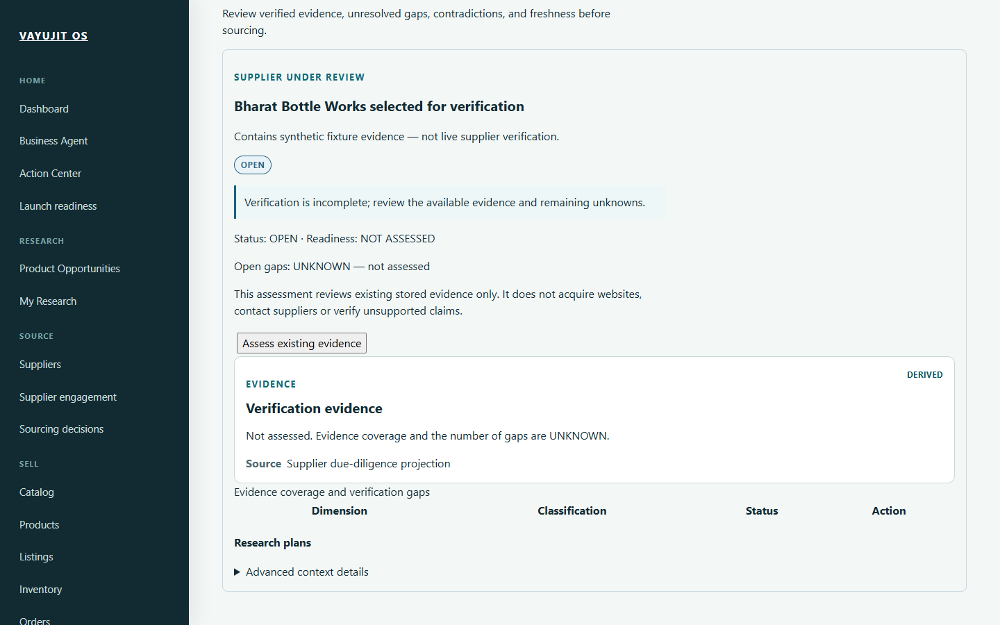

Figure 7. Historical synthetic supplier selected for verification, not yet assessed. Genuine historical synthetic capture, 2026-10-28.

### E. What do I see on this page?

Source-defined sections: Supplier Verification; Verification stays attached to the selected opportunity; What has been verified?; Dynamic label varies with the selected record; exact current text is unverified.; Research plans

Disclosures: Advanced context details; Advanced supplier reference. Open only the relevant section; expanded state does not mean its action ran.

Detected structures: 1 table declaration(s), 0 dialog declaration(s). Conditional/shared controls can appear only after valid context. Loading, empty, error and blocked conditions must be distinguished; their complete current runtime combinations are not verified in this edition.

| Action shown in source | Meaning and safety | Availability |
| --- | --- | --- |
| Back to Intelligence | Source-declared navigation/view control; exact destination/state UNVERIFIED. | Not statically disabled |
| Return to supplier discovery | Effect UNVERIFIED; potentially changes data or invokes another workflow. Confirm prerequisites before acting. | Not statically disabled |
| Review supplier shortlist | Source-declared navigation/view control; exact destination/state UNVERIFIED. | Not statically disabled |
| Dynamic label varies with the selected record; exact current text is unverified. | Effect UNVERIFIED; potentially changes data or invokes another workflow. Confirm prerequisites before acting. | Conditional |
| Review economics and missing commercial inputs | Source-declared navigation/view control; exact destination/state UNVERIFIED. | Not statically disabled |
| Research | Source-declared navigation/view control; exact destination/state UNVERIFIED. | Conditional |
| Research Selected Gaps | Source-declared navigation/view control; exact destination/state UNVERIFIED. | Conditional |
| Request more research | Source-declared navigation/view control; exact destination/state UNVERIFIED. | Conditional |
| Cancel research | Effect UNVERIFIED; potentially changes data or invokes another workflow. Confirm prerequisites before acting. | Not statically disabled |
| Waive | Source-declared navigation/view control; exact destination/state UNVERIFIED. | Conditional |
| Reopen | Source-declared navigation/view control; exact destination/state UNVERIFIED. | Conditional |
| Mark for human review | Source-declared navigation/view control; exact destination/state UNVERIFIED. | Not statically disabled |
| Review Evidence | Source-declared navigation/view control; exact destination/state UNVERIFIED. | Not statically disabled |

### F. Input-field guide

No direct editable fields were extracted from this page template. Review controls inherited from shared components in the shared-field appendix. No missing form is invented.

### G. Step-by-step usage

1. Open the intended owned context using the navigation/route above. Verify the brand and any Product, opportunity, supplier, listing or artifact identity before continuing.

2. An unassessed supplier is not verified. Assessments can be blocked or insufficient even when a supplier exists.

3. Read current warnings and input guidance. Use only an action whose purpose and authority you understand. Stop before unapproved provider, commercial or permanent-data effects.

### H. Worked example

Illustrative task: Review due-diligence findings, claims, source provenance, missing information and contradictions. Use a genuine selected record in your own authorized workspace; a synthetic screenshot is a learning example only. The expected type of result is the relevant recorded view or a truthful empty/blocked state, not fabricated data.

### I. How to interpret the results

Inspect identity, source/provenance, date/freshness, included assumptions and missing information. A local status, score or successful fake workflow is not proof of real external completion. UNKNOWN, blocked, stale and not-comparable results must retain their actual meaning.

### J. What should I do next?

Return to shortlist/decision with evidence limitations explicit.

### K. Troubleshooting

If context is missing/invalid, use the appropriate collection or saved record link. If a request fails, retain the safe correlation reference and inspect current state before retrying. A 401 needs normal authentication; a 500 is not an empty successful result. Do not force-enable disabled actions or insert synthetic facts.

### L. Availability and limitations

DOCUMENTED BUT NOT CURRENTLY VERIFIED: current template and source inspected; no fresh authenticated session or complete per-control execution performed. Historical synthetic screenshot/functional evidence illustrates only its recorded state. An unassessed supplier is not verified. Assessments can be blocked or insufficient even when a supplier exists. The entire module is not certified by the presence of a route.

### M. Documentation evidence

Current source: apps/web/src/app/intelligence/supplier-due-diligence.component.ts. Source and template hashes are in source/ui-inventory.json; exact field/action declarations in inventory/field-register.md and source/control-inventory.md. Screenshot evidence: docs/product-handbook/screenshots/suppliers/02-not-assessed.png (Figure 7).

[Current UI source for Supplier Verification](../../../apps/web/src/app/intelligence/supplier-due-diligence.component.ts)

## P026 Winning product research

### A. What is this page?

Use the advanced intelligence workspace for supported contexts, calculations and opportunity assessment.

### B. Why would someone use it?

Keep market evidence and model outputs distinct; inspect eligibility, scoring dimensions and unknowns.

### C. Where can I find it?

Contextual link from the relevant owned record, or the exact route below; not a separately verified primary-menu item.

Route: /intelligence

### D. Screenshot

MISSING: no reviewed safe screenshot selected for this page family. The source-defined layout below is not a substitute for a real current capture.

### E. What do I see on this page?

Source-defined sections: Winning product research; Research by purpose, then inspect the evidence; Understand the market signals; Understand suppliers and websites; Run bounded research; Review trust and recovery; Supplier discovery; Find suppliers; Add offline supplier; Dynamic label varies with the selected record; exact current text is unverified.; Risk dimensions; Research projects; Create mission; Research missions; Research candidates; Candidate detail; Signals and trend history; Opportunities; Opportunity detail; Score breakdown, demand, competition, pricing, trend, economics, capital, risk, legal/IP, rules, and provenance; Competitor intelligence; Review intelligence; Rule configuration and simulation; Research profile editor; Comparison workspace; Mission, score, report, and recovery history; Report workspace; Evidence inspector

Detected structures: 1 table declaration(s), 0 dialog declaration(s). Conditional/shared controls can appear only after valid context. Loading, empty, error and blocked conditions must be distinguished; their complete current runtime combinations are not verified in this edition.

| Action shown in source | Meaning and safety | Availability |
| --- | --- | --- |
| Back to dashboard | Source-declared navigation/view control; exact destination/state UNVERIFIED. | Not statically disabled |
| External Research | Source-declared navigation/view control; exact destination/state UNVERIFIED. | Not statically disabled |
| Sourcing Scenarios | Source-declared navigation/view control; exact destination/state UNVERIFIED. | Not statically disabled |
| Return to Guided Commerce | Source-declared navigation/view control; exact destination/state UNVERIFIED. | Not statically disabled |
| Trend Intelligence | Source-declared navigation/view control; exact destination/state UNVERIFIED. | Not statically disabled |
| Competitor Intelligence | Source-declared navigation/view control; exact destination/state UNVERIFIED. | Not statically disabled |
| Customer Reviews | Source-declared navigation/view control; exact destination/state UNVERIFIED. | Not statically disabled |
| Supplier Intelligence | Source-declared navigation/view control; exact destination/state UNVERIFIED. | Not statically disabled |
| Website Intelligence | Source-declared navigation/view control; exact destination/state UNVERIFIED. | Not statically disabled |
| Autonomous Research | Source-declared navigation/view control; exact destination/state UNVERIFIED. | Not statically disabled |
| External Research | Source-declared navigation/view control; exact destination/state UNVERIFIED. | Not statically disabled |
| Sources & evidence | Source-declared navigation/view control; exact destination/state UNVERIFIED. | Not statically disabled |
| Research history | Source-declared navigation/view control; exact destination/state UNVERIFIED. | Not statically disabled |
| Overview | Source-declared navigation/view control; exact destination/state UNVERIFIED. | Not statically disabled |
| Missions | Source-declared navigation/view control; exact destination/state UNVERIFIED. | Not statically disabled |
| Candidates | Source-declared navigation/view control; exact destination/state UNVERIFIED. | Not statically disabled |
| Opportunities | Source-declared navigation/view control; exact destination/state UNVERIFIED. | Not statically disabled |
| Rules | Source-declared navigation/view control; exact destination/state UNVERIFIED. | Not statically disabled |
| Profiles | Source-declared navigation/view control; exact destination/state UNVERIFIED. | Not statically disabled |
| Comparison | Source-declared navigation/view control; exact destination/state UNVERIFIED. | Not statically disabled |
| Reports | Source-declared navigation/view control; exact destination/state UNVERIFIED. | Not statically disabled |
| History | Source-declared navigation/view control; exact destination/state UNVERIFIED. | Not statically disabled |
| Sources & evidence | Source-declared navigation/view control; exact destination/state UNVERIFIED. | Not statically disabled |
| Suppliers | Source-declared navigation/view control; exact destination/state UNVERIFIED. | Not statically disabled |
| Refresh suppliers | Source-declared navigation/view control; exact destination/state UNVERIFIED. | Conditional |
| Dynamic label varies with the selected record; exact current text is unverified. | Effect UNVERIFIED; potentially changes data or invokes another workflow. Confirm prerequisites before acting. | Conditional |
| Dynamic label varies with the selected record; exact current text is unverified. | Effect UNVERIFIED; potentially changes data or invokes another workflow. Confirm prerequisites before acting. | Conditional |
| Add offline supplier | Source-declared navigation/view control; exact destination/state UNVERIFIED. | Conditional |
| Inspect | Source-declared navigation/view control; exact destination/state UNVERIFIED. | Not statically disabled |
| Shortlist | Source-declared navigation/view control; exact destination/state UNVERIFIED. | Conditional |
| Record partial verification | Source-declared navigation/view control; exact destination/state UNVERIFIED. | Not statically disabled |
| Generate report | Effect UNVERIFIED; potentially changes data or invokes another workflow. Confirm prerequisites before acting. | Not statically disabled |
| Create project | Effect UNVERIFIED; potentially changes data or invokes another workflow. Confirm prerequisites before acting. | Not statically disabled |
| Dynamic label varies with the selected record; exact current text is unverified. | Effect UNVERIFIED; potentially changes data or invokes another workflow. Confirm prerequisites before acting. | Conditional |
| Run now | Source-declared navigation/view control; exact destination/state UNVERIFIED. | Conditional |
| Dynamic label varies with the selected record; exact current text is unverified. | Source-declared navigation/view control; exact destination/state UNVERIFIED. | Conditional |
| Save schedule | Effect UNVERIFIED; potentially changes data or invokes another workflow. Confirm prerequisites before acting. | Conditional |
| Save edits | Effect UNVERIFIED; potentially changes data or invokes another workflow. Confirm prerequisites before acting. | Conditional |
| History | Source-declared navigation/view control; exact destination/state UNVERIFIED. | Not statically disabled |
| Dynamic label varies with the selected record; exact current text is unverified. | Source-declared navigation/view control; exact destination/state UNVERIFIED. | Not statically disabled |
| Details | Source-declared navigation/view control; exact destination/state UNVERIFIED. | Conditional |
| Dynamic label varies with the selected record; exact current text is unverified. | Source-declared navigation/view control; exact destination/state UNVERIFIED. | Conditional |
| Inspect | Source-declared navigation/view control; exact destination/state UNVERIFIED. | Conditional |
| Create profile | Effect UNVERIFIED; potentially changes data or invokes another workflow. Confirm prerequisites before acting. | Conditional |

### F. Input-field guide

Field records below state type, purpose, requiredness, accepted values and examples. Unless a specific effect is described, the parent action’s save/provider effect is UNVERIFIED. Common rule: enter only genuine facts, preserve UNKNOWN and units, and obey backend validation; no blank or unchecked prerequisite is permission to proceed. Complete per-field maintenance records retain these explicit limitations.

| Field | Type requiredness and accepted values | Purpose example and effect |
| --- | --- | --- |
| Opportunity ID [intelligence-workspace-F001] | text. Requiredness is not established by the template; do not assume optional. Exact API limits/accepted vocabulary are not fully verified. | Provides the stated input to this page’s supported workflow. Example: Use the actual business fact; no invented value is supplied. Effect unverified; common field rules apply. |
| Product reference [intelligence-workspace-F002] | text. Requiredness is not established by the template; do not assume optional. Exact API limits/accepted vocabulary are not fully verified. | Provides the stated input to this page’s supported workflow. Example: Use the actual business fact; no invented value is supplied. Effect unverified; common field rules apply. |
| Market [intelligence-workspace-F003] | text. Requiredness is not established by the template; do not assume optional. Exact API limits/accepted vocabulary are not fully verified. | Provides the stated input to this page’s supported workflow. Example: Use the actual business fact; no invented value is supplied. Effect unverified; common field rules apply. |
| Category [intelligence-workspace-F004] | text. Required in the template. Exact API limits/accepted vocabulary are not fully verified. | Provides the stated input to this page’s supported workflow. Example: Use the actual business fact; no invented value is supplied. Effect unverified; common field rules apply. |
| Target unit cost [intelligence-workspace-F005] | number. Requiredness is not established by the template; do not assume optional. min 0 | Provides the stated input to this page’s supported workflow. Example: Use the genuine measured amount/quantity; units must be established. Effect unverified; common field rules apply. |
| Maximum MOQ [intelligence-workspace-F006] | number. Requiredness is not established by the template; do not assume optional. min 0 | Provides the stated input to this page’s supported workflow. Example: Use the genuine measured amount/quantity; units must be established. Effect unverified; common field rules apply. |
| Maximum lead time (days) [intelligence-workspace-F007] | number. Requiredness is not established by the template; do not assume optional. min 0 | Provides the stated input to this page’s supported workflow. Example: Use the genuine measured amount/quantity; units must be established. Effect unverified; common field rules apply. |
| Countries [intelligence-workspace-F008] | text. Requiredness is not established by the template; do not assume optional. Exact API limits/accepted vocabulary are not fully verified. | Provides the stated input to this page’s supported workflow. Example: Use the actual business fact; no invented value is supplied. Effect unverified; common field rules apply. |
| Private label required [intelligence-workspace-F009] | checkbox. Requiredness is not established by the template; do not assume optional. Checked or unchecked; confirm only truthful statements. | Records the specific choice or confirmation stated by its label. Example: Leave unchecked unless the statement is true. Effect unverified; common field rules apply. |
| Name [intelligence-workspace-F010] | text. Required in the template. Exact API limits/accepted vocabulary are not fully verified. | Provides the stated input to this page’s supported workflow. Example: Use the actual business fact; no invented value is supplied. Effect unverified; common field rules apply. |
| Type [intelligence-workspace-F011] | select. Requiredness is not established by the template; do not assume optional. Manufacturer; Wholesaler; Distributor; Unknown | Chooses the relevant saved context or supported option. Example: Choose only a relevant legitimate saved option. Effect unverified; common field rules apply. |
| Country code [intelligence-workspace-F012] | text. Required in the template. maxlength 2 | Provides the stated input to this page’s supported workflow. Example: Use the actual business fact; no invented value is supplied. Effect unverified; common field rules apply. |
| Country [intelligence-workspace-F013] | text. Required in the template. Exact API limits/accepted vocabulary are not fully verified. | Provides the stated input to this page’s supported workflow. Example: Use the actual business fact; no invented value is supplied. Effect unverified; common field rules apply. |
| City [intelligence-workspace-F014] | text. Requiredness is not established by the template; do not assume optional. Exact API limits/accepted vocabulary are not fully verified. | Provides the stated input to this page’s supported workflow. Example: Use the actual business fact; no invented value is supplied. Effect unverified; common field rules apply. |
| Provenance [intelligence-workspace-F015] | text. Required in the template. Exact API limits/accepted vocabulary are not fully verified. | Provides the stated input to this page’s supported workflow. Example: Use the actual business fact; no invented value is supplied. Effect unverified; common field rules apply. |
| Source [intelligence-workspace-F016] | select. Requiredness is not established by the template; do not assume optional. All sources; Manufacturer; IndiaMART fixture; Alibaba fixture; TradeIndia fixture; Global Sources fixture; Offline market | Chooses the relevant saved context or supported option. Example: Choose only a relevant legitimate saved option. Effect unverified; common field rules apply. |
| Verification [intelligence-workspace-F017] | select. Requiredness is not established by the template; do not assume optional. All states; Unverified; Self-reported; Partially verified; Verified | Chooses the relevant saved context or supported option. Example: Choose only a relevant legitimate saved option. Effect unverified; common field rules apply. |
| Offline only [intelligence-workspace-F018] | checkbox. Requiredness is not established by the template; do not assume optional. Checked or unchecked; confirm only truthful statements. | Records the specific choice or confirmation stated by its label. Example: Leave unchecked unless the statement is true. Effect unverified; common field rules apply. |
| Name [intelligence-workspace-F019] | text. Required in the template. minlength 2 | Provides the stated input to this page’s supported workflow. Example: Use the actual business fact; no invented value is supplied. Effect unverified; common field rules apply. |
| Project [intelligence-workspace-F020] | select. Required in the template. Select project Additional choices depend on saved records/current context and are UNVERIFIED. | Chooses the relevant saved context or supported option. Example: Choose only a relevant legitimate saved option. Effect unverified; common field rules apply. |
| Market [intelligence-workspace-F021] | text. Requiredness is not established by the template; do not assume optional. Exact API limits/accepted vocabulary are not fully verified. | Provides the stated input to this page’s supported workflow. Example: Use the actual business fact; no invented value is supplied. Effect unverified; common field rules apply. |
| Categories [intelligence-workspace-F022] | text. Requiredness is not established by the template; do not assume optional. Exact API limits/accepted vocabulary are not fully verified. | Provides the stated input to this page’s supported workflow. Example: Use the actual business fact; no invented value is supplied. Effect unverified; common field rules apply. |
| Frequency [intelligence-workspace-F023] | select. Requiredness is not established by the template; do not assume optional. Manual; Daily; Weekly | Chooses the relevant saved context or supported option. Example: Choose only a relevant legitimate saved option. Effect unverified; common field rules apply. |
| Timezone [intelligence-workspace-F024] | text. Requiredness is not established by the template; do not assume optional. Exact API limits/accepted vocabulary are not fully verified. | Provides the stated input to this page’s supported workflow. Example: Use the actual business fact; no invented value is supplied. Effect unverified; common field rules apply. |
| Minimum score [intelligence-workspace-F025] | number. Requiredness is not established by the template; do not assume optional. min 0; max 100 | Provides the stated input to this page’s supported workflow. Example: Use the genuine measured amount/quantity; units must be established. Effect unverified; common field rules apply. |
| Status [intelligence-workspace-F026] | text. Requiredness is not established by the template; do not assume optional. Exact API limits/accepted vocabulary are not fully verified. | Provides the stated input to this page’s supported workflow. Example: Use the actual business fact; no invented value is supplied. Effect unverified; common field rules apply. |
| Market [intelligence-workspace-F027] | text. Requiredness is not established by the template; do not assume optional. Exact API limits/accepted vocabulary are not fully verified. | Provides the stated input to this page’s supported workflow. Example: Use the actual business fact; no invented value is supplied. Effect unverified; common field rules apply. |
| Category [intelligence-workspace-F028] | text. Requiredness is not established by the template; do not assume optional. Exact API limits/accepted vocabulary are not fully verified. | Provides the stated input to this page’s supported workflow. Example: Use the actual business fact; no invented value is supplied. Effect unverified; common field rules apply. |
| Recommendation [intelligence-workspace-F029] | text. Requiredness is not established by the template; do not assume optional. Exact API limits/accepted vocabulary are not fully verified. | Provides the stated input to this page’s supported workflow. Example: Use the actual business fact; no invented value is supplied. Effect unverified; common field rules apply. |
| Market [intelligence-workspace-F030] | text. Requiredness is not established by the template; do not assume optional. Exact API limits/accepted vocabulary are not fully verified. | Provides the stated input to this page’s supported workflow. Example: Use the actual business fact; no invented value is supplied. Effect unverified; common field rules apply. |
| Category [intelligence-workspace-F031] | text. Requiredness is not established by the template; do not assume optional. Exact API limits/accepted vocabulary are not fully verified. | Provides the stated input to this page’s supported workflow. Example: Use the actual business fact; no invented value is supplied. Effect unverified; common field rules apply. |
| Freshness [intelligence-workspace-F032] | text. Requiredness is not established by the template; do not assume optional. Exact API limits/accepted vocabulary are not fully verified. | Provides the stated input to this page’s supported workflow. Example: Use the actual business fact; no invented value is supplied. Effect unverified; common field rules apply. |
| Name [intelligence-workspace-F033] | text. Required in the template. minlength 2 | Provides the stated input to this page’s supported workflow. Example: Use the actual business fact; no invented value is supplied. Effect unverified; common field rules apply. |
| Market [intelligence-workspace-F034] | text. Requiredness is not established by the template; do not assume optional. Exact API limits/accepted vocabulary are not fully verified. | Provides the stated input to this page’s supported workflow. Example: Use the actual business fact; no invented value is supplied. Effect unverified; common field rules apply. |
| Currency [intelligence-workspace-F035] | text. Requiredness is not established by the template; do not assume optional. minlength 3; maxlength 3 | Provides the stated input to this page’s supported workflow. Example: INR only if this is the genuine currency. Effect unverified; common field rules apply. |
| Categories [intelligence-workspace-F036] | text. Requiredness is not established by the template; do not assume optional. Exact API limits/accepted vocabulary are not fully verified. | Provides the stated input to this page’s supported workflow. Example: Use the actual business fact; no invented value is supplied. Effect unverified; common field rules apply. |
| Excluded categories [intelligence-workspace-F037] | text. Requiredness is not established by the template; do not assume optional. Exact API limits/accepted vocabulary are not fully verified. | Provides the stated input to this page’s supported workflow. Example: Use the actual business fact; no invented value is supplied. Effect unverified; common field rules apply. |
| Min price [intelligence-workspace-F038] | number. Requiredness is not established by the template; do not assume optional. min 0 | Provides the stated input to this page’s supported workflow. Example: Use the genuine measured amount/quantity; units must be established. Effect unverified; common field rules apply. |
| Max price [intelligence-workspace-F039] | number. Requiredness is not established by the template; do not assume optional. min 0 | Provides the stated input to this page’s supported workflow. Example: Use the genuine measured amount/quantity; units must be established. Effect unverified; common field rules apply. |
| Minimum margin [intelligence-workspace-F040] | number. Requiredness is not established by the template; do not assume optional. min 0; max 1; step 0.01 | Provides the stated input to this page’s supported workflow. Example: Use the genuine measured amount/quantity; units must be established. Effect unverified; common field rules apply. |

### G. Step-by-step usage

1. Open the intended owned context using the navigation/route above. Verify the brand and any Product, opportunity, supplier, listing or artifact identity before continuing.

2. Keep market evidence and model outputs distinct; inspect eligibility, scoring dimensions and unknowns.

3. Read current warnings and input guidance. Use only an action whose purpose and authority you understand. Stop before unapproved provider, commercial or permanent-data effects.

### H. Worked example

Illustrative task: Use the advanced intelligence workspace for supported contexts, calculations and opportunity assessment. Use a genuine selected record in your own authorized workspace; a synthetic screenshot is a learning example only. The field examples above illustrate the type of input, not prescribed business values.

### I. How to interpret the results

Inspect identity, source/provenance, date/freshness, included assumptions and missing information. A local status, score or successful fake workflow is not proof of real external completion. UNKNOWN, blocked, stale and not-comparable results must retain their actual meaning.

### J. What should I do next?

Review the matching Product Opportunity before HUMAN selection.

### K. Troubleshooting

If context is missing/invalid, use the appropriate collection or saved record link. If a request fails, retain the safe correlation reference and inspect current state before retrying. A 401 needs normal authentication; a 500 is not an empty successful result. Do not force-enable disabled actions or insert synthetic facts.

### L. Availability and limitations

DOCUMENTED BUT NOT CURRENTLY VERIFIED: current template and source inspected; no fresh authenticated session or complete per-control execution performed. Screenshot coverage is BLOCKED pending an approved safe session. Keep market evidence and model outputs distinct; inspect eligibility, scoring dimensions and unknowns. The entire module is not certified by the presence of a route.

### M. Documentation evidence

Current source: apps/web/src/app/intelligence/intelligence-workspace.component.ts. Source and template hashes are in source/ui-inventory.json; exact field/action declarations in inventory/field-register.md and source/control-inventory.md. Missing screenshot recorded in quality/documentation-gaps.md.

[Current UI source for Winning product research](../../../apps/web/src/app/intelligence/intelligence-workspace.component.ts)

## P027 Campaigns

### A. What is this page?

Find saved campaigns and open the correct plan or create form.

### B. Why would someone use it?

Inspect lifecycle and selected product/brand; a visible campaign is not a published campaign.

### C. Where can I find it?

Grow → Campaigns → /campaigns

Route: /campaigns

### D. Screenshot

MISSING: no reviewed safe screenshot selected for this page family. The source-defined layout below is not a substitute for a real current capture.

### E. What do I see on this page?

Source-defined sections: Campaigns; Dynamic label varies with the selected record; exact current text is unverified.

Detected structures: 0 table declaration(s), 0 dialog declaration(s). Conditional/shared controls can appear only after valid context. Loading, empty, error and blocked conditions must be distinguished; their complete current runtime combinations are not verified in this edition.

| Action shown in source | Meaning and safety | Availability |
| --- | --- | --- |
| Content calendar | Source-declared navigation/view control; exact destination/state UNVERIFIED. | Not statically disabled |
| Create campaign | Effect UNVERIFIED; potentially changes data or invokes another workflow. Confirm prerequisites before acting. | Not statically disabled |
| Dynamic label varies with the selected record; exact current text is unverified. | Source-declared navigation/view control; exact destination/state UNVERIFIED. | Not statically disabled |

### F. Input-field guide

No direct editable fields were extracted from this page template. Review controls inherited from shared components in the shared-field appendix. No missing form is invented.

### G. Step-by-step usage

1. Open the intended owned context using the navigation/route above. Verify the brand and any Product, opportunity, supplier, listing or artifact identity before continuing.

2. Inspect lifecycle and selected product/brand; a visible campaign is not a published campaign.

3. Read current warnings and input guidance. Use only an action whose purpose and authority you understand. Stop before unapproved provider, commercial or permanent-data effects.

### H. Worked example

Illustrative task: Find saved campaigns and open the correct plan or create form. Use a genuine selected record in your own authorized workspace; a synthetic screenshot is a learning example only. The expected type of result is the relevant recorded view or a truthful empty/blocked state, not fabricated data.

### I. How to interpret the results

Inspect identity, source/provenance, date/freshness, included assumptions and missing information. A local status, score or successful fake workflow is not proof of real external completion. UNKNOWN, blocked, stale and not-comparable results must retain their actual meaning.

### J. What should I do next?

Review activities and dependencies in the specific campaign.

### K. Troubleshooting

If context is missing/invalid, use the appropriate collection or saved record link. If a request fails, retain the safe correlation reference and inspect current state before retrying. A 401 needs normal authentication; a 500 is not an empty successful result. Do not force-enable disabled actions or insert synthetic facts.

### L. Availability and limitations

DOCUMENTED BUT NOT CURRENTLY VERIFIED: current template and source inspected; no fresh authenticated session or complete per-control execution performed. Screenshot coverage is BLOCKED pending an approved safe session. Inspect lifecycle and selected product/brand; a visible campaign is not a published campaign. The entire module is not certified by the presence of a route.

### M. Documentation evidence

Current source: apps/web/src/app/campaigns/campaign-list.component.ts. Source and template hashes are in source/ui-inventory.json; exact field/action declarations in inventory/field-register.md and source/control-inventory.md. Missing screenshot recorded in quality/documentation-gaps.md.

[Current UI source for Campaigns](../../../apps/web/src/app/campaigns/campaign-list.component.ts)

## P028 Create Campaign

### A. What is this page?

Prepare the supported campaign record through its form.

### B. Why would someone use it?

Read supported channel/type/date options. Saving local preparation is not the same as activating queued delivery.

### C. Where can I find it?

Contextual link from the relevant owned record, or the exact route below; not a separately verified primary-menu item.

Route: /campaigns/new

### D. Screenshot

MISSING: no reviewed safe screenshot selected for this page family. The source-defined layout below is not a substitute for a real current capture.

### E. What do I see on this page?

Source-defined sections: Create Campaign

Detected structures: 0 table declaration(s), 0 dialog declaration(s). Conditional/shared controls can appear only after valid context. Loading, empty, error and blocked conditions must be distinguished; their complete current runtime combinations are not verified in this edition.

| Action shown in source | Meaning and safety | Availability |
| --- | --- | --- |
| Cancel | Abandons the current local operation where supported; saved records or remote effects may remain. | Not statically disabled |
| Create Campaign | Effect UNVERIFIED; potentially changes data or invokes another workflow. Confirm prerequisites before acting. | Conditional |

### F. Input-field guide

Field records below state type, purpose, requiredness, accepted values and examples. Unless a specific effect is described, the parent action’s save/provider effect is UNVERIFIED. Common rule: enter only genuine facts, preserve UNKNOWN and units, and obey backend validation; no blank or unchecked prerequisite is permission to proceed. Complete per-field maintenance records retain these explicit limitations.

| Field | Type requiredness and accepted values | Purpose example and effect |
| --- | --- | --- |
| Search Brands [campaign-form-F001] | search. Requiredness is not established by the template; do not assume optional. Exact API limits/accepted vocabulary are not fully verified. | Narrows the records shown for the stated context. Example: An existing product name or SKU. Effect unverified; common field rules apply. |
| Brand [campaign-form-F002] | select. Required in the template. Select Brand Additional choices depend on saved records/current context and are UNVERIFIED. | Chooses the relevant saved context or supported option. Example: Choose only a relevant legitimate saved option. Effect unverified; common field rules apply. |
| Campaign manager search [campaign-form-F003] | search. Requiredness is not established by the template; do not assume optional. Exact API limits/accepted vocabulary are not fully verified. | Narrows the records shown for the stated context. Example: An existing product name or SKU. Effect unverified; common field rules apply. |
| Campaign manager [campaign-form-F004] | select. Requiredness is not established by the template; do not assume optional. No manager Additional choices depend on saved records/current context and are UNVERIFIED. | Chooses the relevant saved context or supported option. Example: Choose only a relevant legitimate saved option. Effect unverified; common field rules apply. |
| Name [campaign-form-F005] | text. Required in the template. maxlength 160 | Provides the stated input to this page’s supported workflow. Example: Use the actual business fact; no invented value is supplied. Effect unverified; common field rules apply. |
| Objective [campaign-form-F006] | textarea. Requiredness is not established by the template; do not assume optional. maxlength 500 | Provides the stated input to this page’s supported workflow. Example: Use the actual business fact; no invented value is supplied. Effect unverified; common field rules apply. |
| Timezone [campaign-form-F007] | text. Required in the template. Exact API limits/accepted vocabulary are not fully verified. | Provides the stated input to this page’s supported workflow. Example: Use the actual business fact; no invented value is supplied. Effect unverified; common field rules apply. |
| Starts [campaign-form-F008] | datetime-local. Required in the template. Exact API limits/accepted vocabulary are not fully verified. | Provides the stated input to this page’s supported workflow. Example: Use the actual business fact; no invented value is supplied. Effect unverified; common field rules apply. |
| Ends [campaign-form-F009] | datetime-local. Required in the template. Exact API limits/accepted vocabulary are not fully verified. | Provides the stated input to this page’s supported workflow. Example: Use the actual business fact; no invented value is supplied. Effect unverified; common field rules apply. |
| Approval policy [campaign-form-F010] | select. Requiredness is not established by the template; do not assume optional. Approve before scheduling; All Artifacts preapproved; Approve before execution; Manual Campaign release | Chooses the relevant saved context or supported option. Example: Choose only a relevant legitimate saved option. Effect unverified; common field rules apply. |
| Time window [campaign-form-F011] | select. Requiredness is not established by the template; do not assume optional. Strict window; Warn outside window; Allow with confirmation | Chooses the relevant saved context or supported option. Example: Choose only a relevant legitimate saved option. Effect unverified; common field rules apply. |

### G. Step-by-step usage

1. Open the intended owned context using the navigation/route above. Verify the brand and any Product, opportunity, supplier, listing or artifact identity before continuing.

2. Read supported channel/type/date options. Saving local preparation is not the same as activating queued delivery.

3. Read current warnings and input guidance. Use only an action whose purpose and authority you understand. Stop before unapproved provider, commercial or permanent-data effects.

### H. Worked example

Illustrative task: Prepare the supported campaign record through its form. Use a genuine selected record in your own authorized workspace; a synthetic screenshot is a learning example only. The field examples above illustrate the type of input, not prescribed business values.

### I. How to interpret the results

Inspect identity, source/provenance, date/freshness, included assumptions and missing information. A local status, score or successful fake workflow is not proof of real external completion. UNKNOWN, blocked, stale and not-comparable results must retain their actual meaning.

### J. What should I do next?

Review the campaign and its activities before any separately authorized activation.

### K. Troubleshooting

If context is missing/invalid, use the appropriate collection or saved record link. If a request fails, retain the safe correlation reference and inspect current state before retrying. A 401 needs normal authentication; a 500 is not an empty successful result. Do not force-enable disabled actions or insert synthetic facts.

### L. Availability and limitations

DOCUMENTED BUT NOT CURRENTLY VERIFIED: current template and source inspected; no fresh authenticated session or complete per-control execution performed. Screenshot coverage is BLOCKED pending an approved safe session. Read supported channel/type/date options. Saving local preparation is not the same as activating queued delivery. The entire module is not certified by the presence of a route.

### M. Documentation evidence

Current source: apps/web/src/app/campaigns/campaign-form.component.ts. Source and template hashes are in source/ui-inventory.json; exact field/action declarations in inventory/field-register.md and source/control-inventory.md. Missing screenshot recorded in quality/documentation-gaps.md.

[Current UI source for Create Campaign](../../../apps/web/src/app/campaigns/campaign-form.component.ts)

## P029 Campaign video

### A. What is this page?

Inspect video orchestration for the specific campaign and, where supported, activity.

### B. Why would someone use it?

Check the actual campaign/activity identity; do not infer a render or approval from a shared overview.

### C. Where can I find it?

Contextual link from the relevant owned record, or the exact route below; not a separately verified primary-menu item.

Route: /campaigns/:id/video/:activityId — replace a parameter only through a legitimate saved record link, not a guessed ID.

Route: /campaigns/:id/video — replace a parameter only through a legitimate saved record link, not a guessed ID.

### D. Screenshot

MISSING: no reviewed safe screenshot selected for this page family. The source-defined layout below is not a substitute for a real current capture.

### E. What do I see on this page?

Source-defined sections: Dynamic label varies with the selected record; exact current text is unverified.; Recovery state; Activity history; Video Activities; Exact Video Activities

Detected structures: 0 table declaration(s), 0 dialog declaration(s). Conditional/shared controls can appear only after valid context. Loading, empty, error and blocked conditions must be distinguished; their complete current runtime combinations are not verified in this edition.

| Action shown in source | Meaning and safety | Availability |
| --- | --- | --- |
| Back to Campaign | Source-declared navigation/view control; exact destination/state UNVERIFIED. | Not statically disabled |
| Review exact Video job | Source-declared navigation/view control; exact destination/state UNVERIFIED. | Not statically disabled |
| Open detail | Source-declared navigation/view control; exact destination/state UNVERIFIED. | Not statically disabled |

### F. Input-field guide

No direct editable fields were extracted from this page template. Review controls inherited from shared components in the shared-field appendix. No missing form is invented.

### G. Step-by-step usage

1. Open the intended owned context using the navigation/route above. Verify the brand and any Product, opportunity, supplier, listing or artifact identity before continuing.

2. Check the actual campaign/activity identity; do not infer a render or approval from a shared overview.

3. Read current warnings and input guidance. Use only an action whose purpose and authority you understand. Stop before unapproved provider, commercial or permanent-data effects.

### H. Worked example

Illustrative task: Inspect video orchestration for the specific campaign and, where supported, activity. Use a genuine selected record in your own authorized workspace; a synthetic screenshot is a learning example only. The expected type of result is the relevant recorded view or a truthful empty/blocked state, not fabricated data.

### I. How to interpret the results

Inspect identity, source/provenance, date/freshness, included assumptions and missing information. A local status, score or successful fake workflow is not proof of real external completion. UNKNOWN, blocked, stale and not-comparable results must retain their actual meaning.

### J. What should I do next?

Review storyboard/assets and the relevant controlled activity.

### K. Troubleshooting

If context is missing/invalid, use the appropriate collection or saved record link. If a request fails, retain the safe correlation reference and inspect current state before retrying. A 401 needs normal authentication; a 500 is not an empty successful result. Do not force-enable disabled actions or insert synthetic facts.

### L. Availability and limitations

DOCUMENTED BUT NOT CURRENTLY VERIFIED: current template and source inspected; no fresh authenticated session or complete per-control execution performed. Screenshot coverage is BLOCKED pending an approved safe session. Check the actual campaign/activity identity; do not infer a render or approval from a shared overview. The entire module is not certified by the presence of a route.

### M. Documentation evidence

Current source: apps/web/src/app/campaigns/campaign-video.component.ts. Source and template hashes are in source/ui-inventory.json; exact field/action declarations in inventory/field-register.md and source/control-inventory.md. Missing screenshot recorded in quality/documentation-gaps.md.

[Current UI source for Campaign video](../../../apps/web/src/app/campaigns/campaign-video.component.ts)

## P030 Campaign activity

### A. What is this page?

Prepare a specific activity within its campaign.

### B. Why would someone use it?

Keep exact product/artifact version, destination, date/time zone and prerequisite relationships.

### C. Where can I find it?

Contextual link from the relevant owned record, or the exact route below; not a separately verified primary-menu item.

Route: /campaigns/:id/activities/new — replace a parameter only through a legitimate saved record link, not a guessed ID.

### D. Screenshot

MISSING: no reviewed safe screenshot selected for this page family. The source-defined layout below is not a substitute for a real current capture.

### E. What do I see on this page?

Source-defined sections: Add Campaign activity

Detected structures: 0 table declaration(s), 0 dialog declaration(s). Conditional/shared controls can appear only after valid context. Loading, empty, error and blocked conditions must be distinguished; their complete current runtime combinations are not verified in this edition.

| Action shown in source | Meaning and safety | Availability |
| --- | --- | --- |
| Cancel | Abandons the current local operation where supported; saved records or remote effects may remain. | Not statically disabled |
| Add activity | Source-declared navigation/view control; exact destination/state UNVERIFIED. | Conditional |

### F. Input-field guide

Field records below state type, purpose, requiredness, accepted values and examples. Unless a specific effect is described, the parent action’s save/provider effect is UNVERIFIED. Common rule: enter only genuine facts, preserve UNKNOWN and units, and obey backend validation; no blank or unchecked prerequisite is permission to proceed. Complete per-field maintenance records retain these explicit limitations.

| Field | Type requiredness and accepted values | Purpose example and effect |
| --- | --- | --- |
| Activity type [activity-form-F001] | select. Required in the template. Publish with local mock; Create draft; Publish; Update; Move to draft; Create draft; Update Product; Activate Product; Archive Product; Reconcile; Review checkpoint; Approval checkpoint | Chooses the relevant saved context or supported option. Example: Choose only a relevant legitimate saved option. Effect unverified; common field rules apply. |
| Name [activity-form-F002] | text. Required in the template. Exact API limits/accepted vocabulary are not fully verified. | Provides the stated input to this page’s supported workflow. Example: Use the actual business fact; no invented value is supplied. Effect unverified; common field rules apply. |
| Search Products [activity-form-F003] | search. Requiredness is not established by the template; do not assume optional. Exact API limits/accepted vocabulary are not fully verified. | Narrows the records shown for the stated context. Example: An existing product name or SKU. Effect unverified; common field rules apply. |
| Product [activity-form-F004] | select. Requiredness is not established by the template; do not assume optional. Select Product Additional choices depend on saved records/current context and are UNVERIFIED. | Chooses the relevant saved context or supported option. Example: Choose only a relevant legitimate saved option. Effect unverified; common field rules apply. |
| Search approved Artifacts [activity-form-F005] | search. Requiredness is not established by the template; do not assume optional. Exact API limits/accepted vocabulary are not fully verified. | Narrows the records shown for the stated context. Example: An existing product name or SKU. Effect unverified; common field rules apply. |
| Exact approved Artifact version [activity-form-F006] | select. Requiredness is not established by the template; do not assume optional. Select exact version Additional choices depend on saved records/current context and are UNVERIFIED. | Chooses the relevant saved context or supported option. Example: Choose only a relevant legitimate saved option. Effect unverified; common field rules apply. |
| Search destinations [activity-form-F007] | search. Requiredness is not established by the template; do not assume optional. Exact API limits/accepted vocabulary are not fully verified. | Narrows the records shown for the stated context. Example: An existing product name or SKU. Effect unverified; common field rules apply. |
| Destination [activity-form-F008] | select. Requiredness is not established by the template; do not assume optional. Select destination Additional choices depend on saved records/current context and are UNVERIFIED. | Chooses the relevant saved context or supported option. Example: Choose only a relevant legitimate saved option. Effect unverified; common field rules apply. |
| Sequence [activity-form-F009] | number. Requiredness is conditional/client-defined; review the current form. min 1; max 500 | Provides the stated input to this page’s supported workflow. Example: Use the genuine measured amount/quantity; units must be established. Effect unverified; common field rules apply. |
| Date [activity-form-F010] | date. Required in the template. Exact API limits/accepted vocabulary are not fully verified. | Provides the stated input to this page’s supported workflow. Example: 2026-12-01, illustrative only; verify scheduling timezone. Effect unverified; common field rules apply. |
| Time [activity-form-F011] | time. Required in the template. Exact API limits/accepted vocabulary are not fully verified. | Provides the stated input to this page’s supported workflow. Example: 10:00, illustrative only; verify timezone and date. Effect unverified; common field rules apply. |
| Timezone [activity-form-F012] | text. Requiredness is not established by the template; do not assume optional. Exact API limits/accepted vocabulary are not fully verified. | Provides the stated input to this page’s supported workflow. Example: Use the actual business fact; no invented value is supplied. Effect unverified; common field rules apply. |
| Required activity [activity-form-F013] | checkbox. Requiredness is not established by the template; do not assume optional. Checked or unchecked; confirm only truthful statements. | Records the specific choice or confirmation stated by its label. Example: Leave unchecked unless the statement is true. Effect unverified; common field rules apply. |

### G. Step-by-step usage

1. Open the intended owned context using the navigation/route above. Verify the brand and any Product, opportunity, supplier, listing or artifact identity before continuing.

2. Keep exact product/artifact version, destination, date/time zone and prerequisite relationships.

3. Read current warnings and input guidance. Use only an action whose purpose and authority you understand. Stop before unapproved provider, commercial or permanent-data effects.

### H. Worked example

Illustrative task: Prepare a specific activity within its campaign. Use a genuine selected record in your own authorized workspace; a synthetic screenshot is a learning example only. The field examples above illustrate the type of input, not prescribed business values.

### I. How to interpret the results

Inspect identity, source/provenance, date/freshness, included assumptions and missing information. A local status, score or successful fake workflow is not proof of real external completion. UNKNOWN, blocked, stale and not-comparable results must retain their actual meaning.

### J. What should I do next?

Review dependencies and readiness; do not release work unintentionally.

### K. Troubleshooting

If context is missing/invalid, use the appropriate collection or saved record link. If a request fails, retain the safe correlation reference and inspect current state before retrying. A 401 needs normal authentication; a 500 is not an empty successful result. Do not force-enable disabled actions or insert synthetic facts.

### L. Availability and limitations

DOCUMENTED BUT NOT CURRENTLY VERIFIED: current template and source inspected; no fresh authenticated session or complete per-control execution performed. Screenshot coverage is BLOCKED pending an approved safe session. Keep exact product/artifact version, destination, date/time zone and prerequisite relationships. The entire module is not certified by the presence of a route.

### M. Documentation evidence

Current source: apps/web/src/app/campaigns/activity-form.component.ts. Source and template hashes are in source/ui-inventory.json; exact field/action declarations in inventory/field-register.md and source/control-inventory.md. Missing screenshot recorded in quality/documentation-gaps.md.

[Current UI source for Campaign activity](../../../apps/web/src/app/campaigns/activity-form.component.ts)

## P031 Activity dependencies

### A. What is this page?

Inspect and prepare relationships between campaign activities.

### B. Why would someone use it?

A dependency can change a preview fingerprint. Re-review after replacing or rescheduling an upstream artifact.

### C. Where can I find it?

Contextual link from the relevant owned record, or the exact route below; not a separately verified primary-menu item.

Route: /campaigns/:id/dependencies — replace a parameter only through a legitimate saved record link, not a guessed ID.

### D. Screenshot

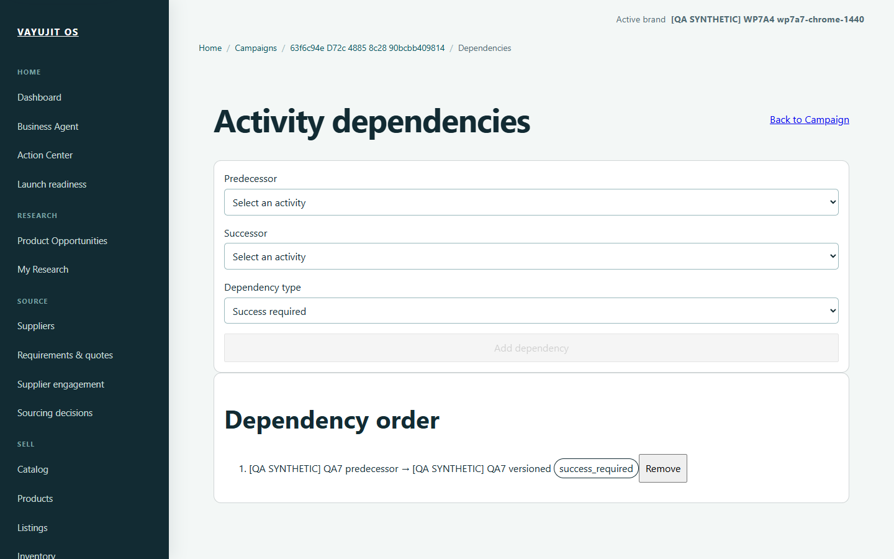

Figure 8. Synthetic predecessor/successor dependency review; no campaign release. Genuine historical synthetic capture, 2026-11-04.

### E. What do I see on this page?

Source-defined sections: Activity dependencies; Dependency order

Detected structures: 0 table declaration(s), 0 dialog declaration(s). Conditional/shared controls can appear only after valid context. Loading, empty, error and blocked conditions must be distinguished; their complete current runtime combinations are not verified in this edition.

| Action shown in source | Meaning and safety | Availability |
| --- | --- | --- |
| Back to Campaign | Source-declared navigation/view control; exact destination/state UNVERIFIED. | Not statically disabled |
| Add dependency | Source-declared navigation/view control; exact destination/state UNVERIFIED. | Conditional |
| Remove | Effect UNVERIFIED; potentially changes data or invokes another workflow. Confirm prerequisites before acting. | Not statically disabled |

### F. Input-field guide

Field records below state type, purpose, requiredness, accepted values and examples. Unless a specific effect is described, the parent action’s save/provider effect is UNVERIFIED. Common rule: enter only genuine facts, preserve UNKNOWN and units, and obey backend validation; no blank or unchecked prerequisite is permission to proceed. Complete per-field maintenance records retain these explicit limitations.

| Field | Type requiredness and accepted values | Purpose example and effect |
| --- | --- | --- |
| Predecessor [dependency-editor-F001] | select. Required in the template. Select an activity Additional choices depend on saved records/current context and are UNVERIFIED. | Chooses the relevant saved context or supported option. Example: Choose only a relevant legitimate saved option. Effect unverified; common field rules apply. |
| Successor [dependency-editor-F002] | select. Required in the template. Select an activity Additional choices depend on saved records/current context and are UNVERIFIED. | Chooses the relevant saved context or supported option. Example: Choose only a relevant legitimate saved option. Effect unverified; common field rules apply. |
| Dependency type [dependency-editor-F003] | select. Requiredness is not established by the template; do not assume optional. Success required; Finish to start; Completion required; Manual release | Chooses the relevant saved context or supported option. Example: Choose only a relevant legitimate saved option. Effect unverified; common field rules apply. |

### G. Step-by-step usage

1. Open the intended owned context using the navigation/route above. Verify the brand and any Product, opportunity, supplier, listing or artifact identity before continuing.

2. A dependency can change a preview fingerprint. Re-review after replacing or rescheduling an upstream artifact.

3. Read current warnings and input guidance. Use only an action whose purpose and authority you understand. Stop before unapproved provider, commercial or permanent-data effects.

### H. Worked example

Illustrative task: Inspect and prepare relationships between campaign activities. Use a genuine selected record in your own authorized workspace; a synthetic screenshot is a learning example only. The field examples above illustrate the type of input, not prescribed business values.

### I. How to interpret the results

Inspect identity, source/provenance, date/freshness, included assumptions and missing information. A local status, score or successful fake workflow is not proof of real external completion. UNKNOWN, blocked, stale and not-comparable results must retain their actual meaning.

### J. What should I do next?

Return to the campaign and inspect current readiness.

### K. Troubleshooting

If context is missing/invalid, use the appropriate collection or saved record link. If a request fails, retain the safe correlation reference and inspect current state before retrying. A 401 needs normal authentication; a 500 is not an empty successful result. Do not force-enable disabled actions or insert synthetic facts.

### L. Availability and limitations

DOCUMENTED BUT NOT CURRENTLY VERIFIED: current template and source inspected; no fresh authenticated session or complete per-control execution performed. Historical synthetic screenshot/functional evidence illustrates only its recorded state. A dependency can change a preview fingerprint. Re-review after replacing or rescheduling an upstream artifact. The entire module is not certified by the presence of a route.

### M. Documentation evidence

Current source: apps/web/src/app/campaigns/dependency-editor.component.ts. Source and template hashes are in source/ui-inventory.json; exact field/action declarations in inventory/field-register.md and source/control-inventory.md. Screenshot evidence: docs/product-handbook/screenshots/campaigns/01-dependencies.png (Figure 8).

[Current UI source for Activity dependencies](../../../apps/web/src/app/campaigns/dependency-editor.component.ts)

## P032 Campaign detail

### A. What is this page?

Review one campaign, its activities, lifecycle and supported rescheduling/recovery controls.

### B. Why would someone use it?

For an eligible activity, Reschedule Activity opens an inline section, not a modal. Check Local date, Local time and IANA timezone; Reason is optional. Preview change shows the proposed impact before the separate Confirm reschedule action.

### C. Where can I find it?

Contextual link from the relevant owned record, or the exact route below; not a separately verified primary-menu item.

Route: /campaigns/:id — replace a parameter only through a legitimate saved record link, not a guessed ID.

### D. Screenshot

MISSING: no reviewed safe screenshot selected for this page family. The source-defined layout below is not a substitute for a real current capture.

### E. What do I see on this page?

Source-defined sections: Dynamic label varies with the selected record; exact current text is unverified.; Window; Progress; Conflicts; Activities

Detected structures: 0 table declaration(s), 0 dialog declaration(s). Conditional/shared controls can appear only after valid context. Loading, empty, error and blocked conditions must be distinguished; their complete current runtime combinations are not verified in this edition.

| Action shown in source | Meaning and safety | Availability |
| --- | --- | --- |
| Add activity | Source-declared navigation/view control; exact destination/state UNVERIFIED. | Not statically disabled |
| Campaign Video | Source-declared navigation/view control; exact destination/state UNVERIFIED. | Not statically disabled |
| Calendar | Source-declared navigation/view control; exact destination/state UNVERIFIED. | Not statically disabled |
| Dependencies | Source-declared navigation/view control; exact destination/state UNVERIFIED. | Not statically disabled |
| Review readiness | Source-declared navigation/view control; exact destination/state UNVERIFIED. | Not statically disabled |
| Release | Source-declared navigation/view control; exact destination/state UNVERIFIED. | Conditional |
| Schedule all ready | Source-declared navigation/view control; exact destination/state UNVERIFIED. | Conditional |
| Pause | Source-declared navigation/view control; exact destination/state UNVERIFIED. | Conditional |
| Resume | Source-declared navigation/view control; exact destination/state UNVERIFIED. | Not statically disabled |
| Cancel | Abandons the current local operation where supported; saved records or remote effects may remain. | Conditional |
| Reschedule Activity | Effect UNVERIFIED; potentially changes data or invokes another workflow. Confirm prerequisites before acting. | Not statically disabled |
| Create one catch-up | Effect UNVERIFIED; potentially changes data or invokes another workflow. Confirm prerequisites before acting. | Not statically disabled |
| Open job | Source-declared navigation/view control; exact destination/state UNVERIFIED. | Not statically disabled |
| Open execution | Source-declared navigation/view control; exact destination/state UNVERIFIED. | Not statically disabled |

### F. Input-field guide

Field records below state type, purpose, requiredness, accepted values and examples. Unless a specific effect is described, the parent action’s save/provider effect is UNVERIFIED. Common rule: enter only genuine facts, preserve UNKNOWN and units, and obey backend validation; no blank or unchecked prerequisite is permission to proceed. Complete per-field maintenance records retain these explicit limitations.

| Field | Type requiredness and accepted values | Purpose example and effect |
| --- | --- | --- |
| Missed activities [campaign-detail-F001] | select. Requiredness is not established by the template; do not assume optional. Skip missed; Run next; One catch-up; Reschedule manually | Chooses the relevant saved context or supported option. Example: Choose only a relevant legitimate saved option. Effect unverified; common field rules apply. |

### G. Step-by-step usage

1. Open the intended owned context using the navigation/route above. Verify the brand and any Product, opportunity, supplier, listing or artifact identity before continuing.

2. For an eligible activity, Reschedule Activity opens an inline section, not a modal. Check Local date, Local time and IANA timezone; Reason is optional. Preview change shows the proposed impact before the separate Confirm reschedule action.

3. Read current warnings and input guidance. Use only an action whose purpose and authority you understand. Stop before unapproved provider, commercial or permanent-data effects.

Rescheduling: open the intended activity, check the three required date/time/zone fields and add a reason only if useful. Choose Preview change. Review Original local/UTC, Proposed local/UTC, offset, DST classification, readiness issues and conflicts. If you edit inputs, refresh the preview and inspect it again before any separate, explicitly authorized confirmation. This inline section has no modal focus trap to expect.

### H. Worked example

Illustrative task: Review one campaign, its activities, lifecycle and supported rescheduling/recovery controls. Use a genuine selected record in your own authorized workspace; a synthetic screenshot is a learning example only. The field examples above illustrate the type of input, not prescribed business values.

Illustrative preview only: 2026-12-01 at 10:00 in Asia/Kolkata, with an optional factual reason. These values are not a saved schedule or a real campaign result. Do not click Confirm reschedule merely to follow this training example.

### I. How to interpret the results

Inspect identity, source/provenance, date/freshness, included assumptions and missing information. A local status, score or successful fake workflow is not proof of real external completion. UNKNOWN, blocked, stale and not-comparable results must retain their actual meaning.

R5 corrected the authored keyboard-focus outline inside the reschedule panel to dark teal. Its measured contrast against white was 8.56:1 in the retained synthetic retest. That is evidence about this focus cue, not proof of all visual states or complete accessibility compliance.

### J. What should I do next?

Inspect the preview and current warnings before deciding. After an authorized confirmation, inspect recorded state in Campaign detail, Calendar or execution history. A preview alone is not a saved change.

### K. Troubleshooting

If context is missing/invalid, use the appropriate collection or saved record link. If a request fails, retain the safe correlation reference and inspect current state before retrying. A 401 needs normal authentication; a 500 is not an empty successful result. Do not force-enable disabled actions or insert synthetic facts.

Preview change stays disabled while the form is invalid or a request is pending. For an ambiguous daylight-saving time, choose the documented interpretation and review the refreshed preview; for a nonexistent time, choose another time. After a rejected/stale confirmation, refresh the preview and check current activity context. Never force-enable a button or bypass a server warning.

### L. Availability and limitations

DOCUMENTED BUT NOT CURRENTLY VERIFIED: current template and source inspected; no fresh authenticated session or complete per-control execution performed. Screenshot coverage is BLOCKED pending an approved safe session. For an eligible activity, Reschedule Activity opens an inline section, not a modal. Check Local date, Local time and IANA timezone; Reason is optional. Preview change shows the proposed impact before the separate Confirm reschedule action. The entire module is not certified by the presence of a route.

VERIFIED THROUGH FUNCTIONAL EVIDENCE, narrowly scoped: WP7B-R5 retained 24 passing authenticated synthetic Campaign focus/keyboard/error/reload/navigation tests, with zero confirmations. R5 changed only the panel focus colour, not scheduling, authorization, persistence or the preview/confirmation contract. This handbook update ran no application tests and captured no fresh screen. Gate A remains PASS; Gate B NOT PASSED; WP7B INCOMPLETE. Login border contrast, outstanding speech/native zoom and contrast-applicability checks remain open.

### M. Documentation evidence

Current source: apps/web/src/app/campaigns/campaign-detail.component.ts. Source and template hashes are in source/ui-inventory.json; exact field/action declarations in inventory/field-register.md and source/control-inventory.md. Missing screenshot recorded in quality/documentation-gaps.md.

[Current UI source for Campaign detail](../../../apps/web/src/app/campaigns/campaign-detail.component.ts)

Source-specific review: apps/web/src/app/campaigns/reschedule-dialog.component.ts (required fields, optional 500-character reason, timezone suggestions, DST branches, preview and confirmation) and campaigns.css (scoped focus token). Historical evidence: docs/qa/seller-experience/wp7b-r5-campaign-focus-remediation.md and wp7b-r5-gate.json. Shared fields reschedule-dialog-F001 through F005 are explained in the shared-field reference. No current Campaign detail screenshot is available.

## P033 Content calendar

### A. What is this page?

Inspect scheduled or due content activities in their displayed time context.

### B. Why would someone use it?

Use date/navigation controls to review; do not assume every event is a completed dispatch.

### C. Where can I find it?

Manage → Calendar → /calendar

Route: /calendar

### D. Screenshot

MISSING: no reviewed safe screenshot selected for this page family. The source-defined layout below is not a substitute for a real current capture.

### E. What do I see on this page?

Source-defined sections: Content calendar; Social publishing; Dynamic label varies with the selected record; exact current text is unverified.

Detected structures: 0 table declaration(s), 0 dialog declaration(s). Conditional/shared controls can appear only after valid context. Loading, empty, error and blocked conditions must be distinguished; their complete current runtime combinations are not verified in this edition.

| Action shown in source | Meaning and safety | Availability |
| --- | --- | --- |
| Campaigns | Source-declared navigation/view control; exact destination/state UNVERIFIED. | Not statically disabled |
| Month | Source-declared navigation/view control; exact destination/state UNVERIFIED. | Not statically disabled |
| Week | Source-declared navigation/view control; exact destination/state UNVERIFIED. | Not statically disabled |
| Agenda | Source-declared navigation/view control; exact destination/state UNVERIFIED. | Not statically disabled |
| Previous | Source-declared navigation/view control; exact destination/state UNVERIFIED. | Not statically disabled |
| Next | Source-declared navigation/view control; exact destination/state UNVERIFIED. | Not statically disabled |
| Dynamic label varies with the selected record; exact current text is unverified. | Source-declared navigation/view control; exact destination/state UNVERIFIED. | Not statically disabled |
| Dynamic label varies with the selected record; exact current text is unverified. | Source-declared navigation/view control; exact destination/state UNVERIFIED. | Not statically disabled |

### F. Input-field guide

Field records below state type, purpose, requiredness, accepted values and examples. Unless a specific effect is described, the parent action’s save/provider effect is UNVERIFIED. Common rule: enter only genuine facts, preserve UNKNOWN and units, and obey backend validation; no blank or unchecked prerequisite is permission to proceed. Complete per-field maintenance records retain these explicit limitations.

| Field | Type requiredness and accepted values | Purpose example and effect |
| --- | --- | --- |
| Connector [content-calendar-F001] | select. Requiredness is not established by the template; do not assume optional. All; WordPress; Shopify | Chooses the relevant saved context or supported option. Example: Choose only a relevant legitimate saved option. Effect unverified; common field rules apply. |
| Social platform [content-calendar-F002] | select. Requiredness is not established by the template; do not assume optional. All; Instagram; Facebook; YouTube | Chooses the relevant saved context or supported option. Example: Choose only a relevant legitimate saved option. Effect unverified; common field rules apply. |

### G. Step-by-step usage

1. Open the intended owned context using the navigation/route above. Verify the brand and any Product, opportunity, supplier, listing or artifact identity before continuing.

2. Use date/navigation controls to review; do not assume every event is a completed dispatch.

3. Read current warnings and input guidance. Use only an action whose purpose and authority you understand. Stop before unapproved provider, commercial or permanent-data effects.

### H. Worked example

Illustrative task: Inspect scheduled or due content activities in their displayed time context. Use a genuine selected record in your own authorized workspace; a synthetic screenshot is a learning example only. The field examples above illustrate the type of input, not prescribed business values.

### I. How to interpret the results

Inspect identity, source/provenance, date/freshness, included assumptions and missing information. A local status, score or successful fake workflow is not proof of real external completion. UNKNOWN, blocked, stale and not-comparable results must retain their actual meaning.

### J. What should I do next?

Open the specific activity/job before deciding on a change.

### K. Troubleshooting

If context is missing/invalid, use the appropriate collection or saved record link. If a request fails, retain the safe correlation reference and inspect current state before retrying. A 401 needs normal authentication; a 500 is not an empty successful result. Do not force-enable disabled actions or insert synthetic facts.

### L. Availability and limitations

DOCUMENTED BUT NOT CURRENTLY VERIFIED: current template and source inspected; no fresh authenticated session or complete per-control execution performed. Screenshot coverage is BLOCKED pending an approved safe session. Use date/navigation controls to review; do not assume every event is a completed dispatch. The entire module is not certified by the presence of a route.

### M. Documentation evidence

Current source: apps/web/src/app/campaigns/content-calendar.component.ts. Source and template hashes are in source/ui-inventory.json; exact field/action declarations in inventory/field-register.md and source/control-inventory.md. Missing screenshot recorded in quality/documentation-gaps.md.

[Current UI source for Content calendar](../../../apps/web/src/app/campaigns/content-calendar.component.ts)

## P034 Social workspace

### A. What is this page?

Prepare or inspect supported local social posts, accounts, channel data and recovery views.

### B. Why would someone use it?

Content/image identity and HUMAN confirmation matter. A local draft or preview is not a remote post.

### C. Where can I find it?

Grow → Social → /social

Route: /social

Route: /social/compose

Route: /social/channel

Route: /social/accounts

Route: /social/analytics

Route: /social/posts/:id — replace a parameter only through a legitimate saved record link, not a guessed ID.

Route: /social/recovery

Route: /social/settings

### D. Screenshot

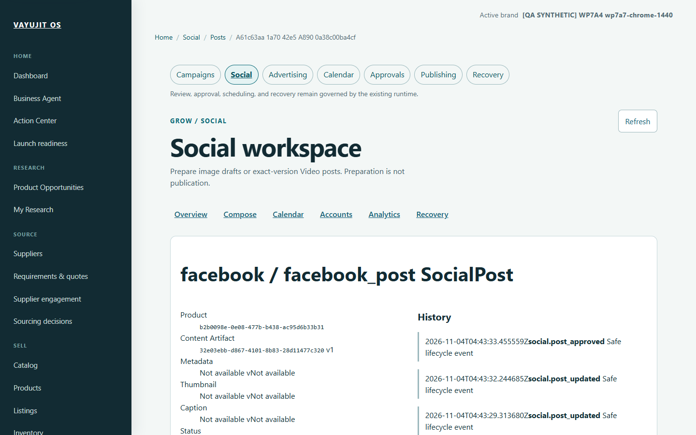

Figure 9. Synthetic social post history; preparation and local review are not remote publication. Genuine historical synthetic capture, 2026-11-04.

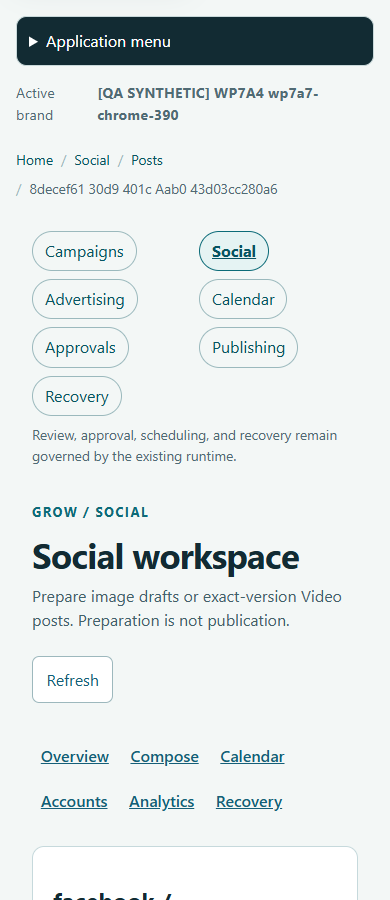

Figure 10. Historical mobile-width social workspace. Viewport emulation is not a physical mobile-device test. Genuine historical synthetic capture, 2026-11-04.

### E. What do I see on this page?

Source-defined sections: Social workspace; Dynamic label varies with the selected record; exact current text is unverified.; History; Image draft review; Image-only draft; Compose Video post; Product Channel - Social Video; Video Recovery; Accounts and diagnostics; Video analytics; Video publication readiness; Connected accounts; Platforms; Recent Video posts; Recoverable Video failures; Analytics Synthetic

Detected structures: 1 table declaration(s), 0 dialog declaration(s). Conditional/shared controls can appear only after valid context. Loading, empty, error and blocked conditions must be distinguished; their complete current runtime combinations are not verified in this edition.

| Action shown in source | Meaning and safety | Availability |
| --- | --- | --- |
| Refresh | Reloads the relevant view; exact data-source side effects still depend on that screen. | Conditional |
| Overview | Source-declared navigation/view control; exact destination/state UNVERIFIED. | Not statically disabled |
| Compose | Source-declared navigation/view control; exact destination/state UNVERIFIED. | Not statically disabled |
| Calendar | Source-declared navigation/view control; exact destination/state UNVERIFIED. | Not statically disabled |
| Accounts | Source-declared navigation/view control; exact destination/state UNVERIFIED. | Not statically disabled |
| Analytics | Source-declared navigation/view control; exact destination/state UNVERIFIED. | Not statically disabled |
| Recovery | Source-declared navigation/view control; exact destination/state UNVERIFIED. | Not statically disabled |
| Save draft caption | Effect UNVERIFIED; potentially changes data or invokes another workflow. Confirm prerequisites before acting. | Conditional |
| Preview image draft | Source-declared navigation/view control; exact destination/state UNVERIFIED. | Conditional |
| Approve image draft — do not publish | Effect UNVERIFIED; potentially changes data or invokes another workflow. Confirm prerequisites before acting. | Conditional |
| Save image-only draft | Effect UNVERIFIED; potentially changes data or invokes another workflow. Confirm prerequisites before acting. | Conditional |
| Preview exact post | Source-declared navigation/view control; exact destination/state UNVERIFIED. | Conditional |
| Save reviewed Video draft | Effect UNVERIFIED; potentially changes data or invokes another workflow. Confirm prerequisites before acting. | Conditional |
| Dynamic label varies with the selected record; exact current text is unverified. | Effect UNVERIFIED; potentially changes data or invokes another workflow. Confirm prerequisites before acting. | Conditional |
| Back | Source-declared navigation/view control; exact destination/state UNVERIFIED. | Conditional |
| Next | Source-declared navigation/view control; exact destination/state UNVERIFIED. | Conditional |
| Load channel | Source-declared navigation/view control; exact destination/state UNVERIFIED. | Not statically disabled |
| Preview Video Update | Source-declared navigation/view control; exact destination/state UNVERIFIED. | Conditional |
| Open SocialPost | Source-declared navigation/view control; exact destination/state UNVERIFIED. | Not statically disabled |
| Dynamic label varies with the selected record; exact current text is unverified. | Source-declared navigation/view control; exact destination/state UNVERIFIED. | Not statically disabled |
| Open details | Source-declared navigation/view control; exact destination/state UNVERIFIED. | Not statically disabled |

### F. Input-field guide

Field records below state type, purpose, requiredness, accepted values and examples. Unless a specific effect is described, the parent action’s save/provider effect is UNVERIFIED. Common rule: enter only genuine facts, preserve UNKNOWN and units, and obey backend validation; no blank or unchecked prerequisite is permission to proceed. Complete per-field maintenance records retain these explicit limitations.

| Field | Type requiredness and accepted values | Purpose example and effect |
| --- | --- | --- |
| Draft caption [social-workspace-F001] | textarea. Requiredness is not established by the template; do not assume optional. Exact API limits/accepted vocabulary are not fully verified. | Provides the stated input to this page’s supported workflow. Example: Use the actual business fact; no invented value is supplied. Effect unverified; common field rules apply. |
| I reviewed this exact image, caption, content version and destination account. [social-workspace-F002] | checkbox. Requiredness is not established by the template; do not assume optional. Checked or unchecked; confirm only truthful statements. | Records the specific choice or confirmation stated by its label. Example: Leave unchecked unless the statement is true. Effect unverified; common field rules apply. |
| Image post account [social-workspace-F003] | select. Requiredness is not established by the template; do not assume optional. Select account Additional choices depend on saved records/current context and are UNVERIFIED. | Chooses the relevant saved context or supported option. Example: Choose only a relevant legitimate saved option. Effect unverified; common field rules apply. |
| Exact content version [social-workspace-F004] | number. Requiredness is not established by the template; do not assume optional. min 1 | Provides the stated input to this page’s supported workflow. Example: Use the genuine measured amount/quantity; units must be established. Effect unverified; common field rules apply. |
| Owned image Media Asset ID [social-workspace-F005] | text. Requiredness is not established by the template; do not assume optional. Exact API limits/accepted vocabulary are not fully verified. | Provides the stated input to this page’s supported workflow. Example: Use the actual business fact; no invented value is supplied. Effect unverified; common field rules apply. |
| Image draft caption [social-workspace-F006] | textarea. Requiredness is not established by the template; do not assume optional. Exact API limits/accepted vocabulary are not fully verified. | Provides the stated input to this page’s supported workflow. Example: Use the actual business fact; no invented value is supplied. Effect unverified; common field rules apply. |
| Platform [social-workspace-F007] | select. Requiredness is not established by the template; do not assume optional. YouTube; Instagram; Facebook | Chooses the relevant saved context or supported option. Example: Choose only a relevant legitimate saved option. Effect unverified; common field rules apply. |
| Format [social-workspace-F008] | select. Requiredness is not established by the template; do not assume optional. Select Additional choices depend on saved records/current context and are UNVERIFIED. | Chooses the relevant saved context or supported option. Example: Choose only a relevant legitimate saved option. Effect unverified; common field rules apply. |
| Approved Video selector [social-workspace-F009] | select. Requiredness is not established by the template; do not assume optional. Select an approved Video Additional choices depend on saved records/current context and are UNVERIFIED. | Chooses the relevant saved context or supported option. Example: Choose only a relevant legitimate saved option. Effect unverified; common field rules apply. |
| Video generation ID [social-workspace-F010] | text. Requiredness is not established by the template; do not assume optional. Exact API limits/accepted vocabulary are not fully verified. | Provides the stated input to this page’s supported workflow. Example: Use the actual business fact; no invented value is supplied. Effect unverified; common field rules apply. |
| Image Output ID [social-workspace-F011] | text. Requiredness is not established by the template; do not assume optional. Exact API limits/accepted vocabulary are not fully verified. | Provides the stated input to this page’s supported workflow. Example: Use the actual business fact; no invented value is supplied. Effect unverified; common field rules apply. |
| Thumbnail version [social-workspace-F012] | number. Requiredness is not established by the template; do not assume optional. min 1 | Provides the stated input to this page’s supported workflow. Example: Use the genuine measured amount/quantity; units must be established. Effect unverified; common field rules apply. |
| Track ID [social-workspace-F013] | text. Requiredness is not established by the template; do not assume optional. Exact API limits/accepted vocabulary are not fully verified. | Provides the stated input to this page’s supported workflow. Example: Use the actual business fact; no invented value is supplied. Effect unverified; common field rules apply. |
| Caption version [social-workspace-F014] | number. Requiredness is not established by the template; do not assume optional. min 1 | Provides the stated input to this page’s supported workflow. Example: Use the genuine measured amount/quantity; units must be established. Effect unverified; common field rules apply. |
| Account [social-workspace-F015] | select. Requiredness is not established by the template; do not assume optional. Select enabled validated account Additional choices depend on saved records/current context and are UNVERIFIED. | Chooses the relevant saved context or supported option. Example: Choose only a relevant legitimate saved option. Effect unverified; common field rules apply. |
| Mode [social-workspace-F016] | select. Requiredness is not established by the template; do not assume optional. Publish now; Future schedule | Chooses the relevant saved context or supported option. Example: Choose only a relevant legitimate saved option. Effect unverified; common field rules apply. |
| Date and time [social-workspace-F017] | datetime-local. Requiredness is not established by the template; do not assume optional. Exact API limits/accepted vocabulary are not fully verified. | Provides the stated input to this page’s supported workflow. Example: Use the actual business fact; no invented value is supplied. Effect unverified; common field rules apply. |
| IANA timezone [social-workspace-F018] | text. Requiredness is not established by the template; do not assume optional. Exact API limits/accepted vocabulary are not fully verified. | Provides the stated input to this page’s supported workflow. Example: Use the actual business fact; no invented value is supplied. Effect unverified; common field rules apply. |

### G. Step-by-step usage

1. Open the intended owned context using the navigation/route above. Verify the brand and any Product, opportunity, supplier, listing or artifact identity before continuing.

2. Content/image identity and HUMAN confirmation matter. A local draft or preview is not a remote post.

3. Read current warnings and input guidance. Use only an action whose purpose and authority you understand. Stop before unapproved provider, commercial or permanent-data effects.

### H. Worked example

Illustrative task: Prepare or inspect supported local social posts, accounts, channel data and recovery views. Use a genuine selected record in your own authorized workspace; a synthetic screenshot is a learning example only. The field examples above illustrate the type of input, not prescribed business values.

### I. How to interpret the results

Inspect identity, source/provenance, date/freshness, included assumptions and missing information. A local status, score or successful fake workflow is not proof of real external completion. UNKNOWN, blocked, stale and not-comparable results must retain their actual meaning.

### J. What should I do next?

Review the exact artifact/version and canonical prerequisites before any authorized delivery.

### K. Troubleshooting

If context is missing/invalid, use the appropriate collection or saved record link. If a request fails, retain the safe correlation reference and inspect current state before retrying. A 401 needs normal authentication; a 500 is not an empty successful result. Do not force-enable disabled actions or insert synthetic facts.

### L. Availability and limitations

DOCUMENTED BUT NOT CURRENTLY VERIFIED: current template and source inspected; no fresh authenticated session or complete per-control execution performed. Historical synthetic screenshot/functional evidence illustrates only its recorded state. Content/image identity and HUMAN confirmation matter. A local draft or preview is not a remote post. The entire module is not certified by the presence of a route.

### M. Documentation evidence

Current source: apps/web/src/app/social/social-workspace.component.ts. Source and template hashes are in source/ui-inventory.json; exact field/action declarations in inventory/field-register.md and source/control-inventory.md. Screenshot evidence: docs/product-handbook/screenshots/social/01-local-post.png (Figure 9); docs/product-handbook/screenshots/social/02-mobile.png (Figure 10).

[Current UI source for Social workspace](../../../apps/web/src/app/social/social-workspace.component.ts)

## P035 Marketplace overview

### A. What is this page?

Choose a supported marketplace preparation area and inspect recorded account/data readiness.

### B. Why would someone use it?

Configuration is not real connectivity. Synthetic import data is not genuine seller activity.

### C. Where can I find it?

Contextual link from the relevant owned record, or the exact route below; not a separately verified primary-menu item.

Route: /marketplaces

### D. Screenshot

MISSING: no reviewed safe screenshot selected for this page family. The source-defined layout below is not a substitute for a real current capture.

### E. What do I see on this page?

Source-defined sections: Marketplace overview; Accounts; Listings; Inventory; Orders; Settlements; Profitability; Financial workspace; Channel health; Dynamic label varies with the selected record; exact current text is unverified.

Detected structures: 1 table declaration(s), 0 dialog declaration(s). Conditional/shared controls can appear only after valid context. Loading, empty, error and blocked conditions must be distinguished; their complete current runtime combinations are not verified in this edition.

| Action shown in source | Meaning and safety | Availability |
| --- | --- | --- |
| Accounts Connected accounts and validation status. | Source-declared navigation/view control; exact destination/state UNVERIFIED. | Not statically disabled |
| Listings Active, processing, and attention-required listings. | Source-declared navigation/view control; exact destination/state UNVERIFIED. | Not statically disabled |
| Inventory Explicit per-channel stock and synchronization. | Source-declared navigation/view control; exact destination/state UNVERIFIED. | Not statically disabled |
| Orders Normalized buyer-safe order lifecycle. | Source-declared navigation/view control; exact destination/state UNVERIFIED. | Not statically disabled |
| Settlements Normalized gross, refunds, fees, and net. | Source-declared navigation/view control; exact destination/state UNVERIFIED. | Not statically disabled |
| Profitability Contribution with explicit cost availability. | Source-declared navigation/view control; exact destination/state UNVERIFIED. | Not statically disabled |
| Financial workspace Sales facts, fee evidence, product costs, and settlement reconciliation. | Source-declared navigation/view control; exact destination/state UNVERIFIED. | Not statically disabled |
| Open channel | Source-declared navigation/view control; exact destination/state UNVERIFIED. | Not statically disabled |

### F. Input-field guide

No direct editable fields were extracted from this page template. Review controls inherited from shared components in the shared-field appendix. No missing form is invented.

### G. Step-by-step usage

1. Open the intended owned context using the navigation/route above. Verify the brand and any Product, opportunity, supplier, listing or artifact identity before continuing.

2. Configuration is not real connectivity. Synthetic import data is not genuine seller activity.

3. Read current warnings and input guidance. Use only an action whose purpose and authority you understand. Stop before unapproved provider, commercial or permanent-data effects.

### H. Worked example

Illustrative task: Choose a supported marketplace preparation area and inspect recorded account/data readiness. Use a genuine selected record in your own authorized workspace; a synthetic screenshot is a learning example only. The expected type of result is the relevant recorded view or a truthful empty/blocked state, not fabricated data.

### I. How to interpret the results

Inspect identity, source/provenance, date/freshness, included assumptions and missing information. A local status, score or successful fake workflow is not proof of real external completion. UNKNOWN, blocked, stale and not-comparable results must retain their actual meaning.

### J. What should I do next?

Open the intended marketplace or account/listing workspace.

### K. Troubleshooting

If context is missing/invalid, use the appropriate collection or saved record link. If a request fails, retain the safe correlation reference and inspect current state before retrying. A 401 needs normal authentication; a 500 is not an empty successful result. Do not force-enable disabled actions or insert synthetic facts.

### L. Availability and limitations

DOCUMENTED BUT NOT CURRENTLY VERIFIED: current template and source inspected; no fresh authenticated session or complete per-control execution performed. Screenshot coverage is BLOCKED pending an approved safe session. Configuration is not real connectivity. Synthetic import data is not genuine seller activity. The entire module is not certified by the presence of a route.

### M. Documentation evidence

Current source: apps/web/src/app/marketplaces/marketplace-home.component.ts. Source and template hashes are in source/ui-inventory.json; exact field/action declarations in inventory/field-register.md and source/control-inventory.md. Missing screenshot recorded in quality/documentation-gaps.md.

[Current UI source for Marketplace overview](../../../apps/web/src/app/marketplaces/marketplace-home.component.ts)

## P036 Marketplace video attachment

### A. What is this page?

Inspect supported video attachment and listing context.

### B. Why would someone use it?

Use eligible approved immutable video assets. Do not attach unrelated or unreviewed generated media.

### C. Where can I find it?

Contextual link from the relevant owned record, or the exact route below; not a separately verified primary-menu item.

Route: /marketplaces/video

### D. Screenshot

MISSING: no reviewed safe screenshot selected for this page family. The source-defined layout below is not a substitute for a real current capture.

### E. What do I see on this page?

Source-defined sections: Marketplace video attachment; Overview; Attachment workspace; Attachment preview; Target; Exact Video; Readiness; Video Attachments; Pending Operations & Recovery; Dynamic label varies with the selected record; exact current text is unverified.; Reconciliation; History; Diagnostics

Detected structures: 4 table declaration(s), 0 dialog declaration(s). Conditional/shared controls can appear only after valid context. Loading, empty, error and blocked conditions must be distinguished; their complete current runtime combinations are not verified in this edition.

| Action shown in source | Meaning and safety | Availability |
| --- | --- | --- |
| Refresh data | Source-declared navigation/view control; exact destination/state UNVERIFIED. | Conditional |
| Dynamic label varies with the selected record; exact current text is unverified. | Source-declared navigation/view control; exact destination/state UNVERIFIED. | Not statically disabled |
| Preview attachment | Source-declared navigation/view control; exact destination/state UNVERIFIED. | Conditional |
| Preview update | Source-declared navigation/view control; exact destination/state UNVERIFIED. | Conditional |
| Open listings | Source-declared navigation/view control; exact destination/state UNVERIFIED. | Not statically disabled |
| Dynamic label varies with the selected record; exact current text is unverified. | Effect UNVERIFIED; potentially changes data or invokes another workflow. Confirm prerequisites before acting. | Conditional |
| Close preview | Source-declared navigation/view control; exact destination/state UNVERIFIED. | Not statically disabled |
| Reconcile | Source-declared navigation/view control; exact destination/state UNVERIFIED. | Not statically disabled |
| Preview update | Source-declared navigation/view control; exact destination/state UNVERIFIED. | Not statically disabled |
| Open recovery | Source-declared navigation/view control; exact destination/state UNVERIFIED. | Not statically disabled |
| Dynamic label varies with the selected record; exact current text is unverified. | Source-declared navigation/view control; exact destination/state UNVERIFIED. | Not statically disabled |
| Reconcile authorized mappings | Source-declared navigation/view control; exact destination/state UNVERIFIED. | Conditional |

### F. Input-field guide

Field records below state type, purpose, requiredness, accepted values and examples. Unless a specific effect is described, the parent action’s save/provider effect is UNVERIFIED. Common rule: enter only genuine facts, preserve UNKNOWN and units, and obey backend validation; no blank or unchecked prerequisite is permission to proceed. Complete per-field maintenance records retain these explicit limitations.

| Field | Type requiredness and accepted values | Purpose example and effect |
| --- | --- | --- |
| Marketplace account [marketplace-video-F001] | select. Requiredness is not established by the template; do not assume optional. Select an account Additional choices depend on saved records/current context and are UNVERIFIED. | Chooses the relevant saved context or supported option. Example: Choose only a relevant legitimate saved option. Effect unverified; common field rules apply. |
| Listing [marketplace-video-F002] | select. Requiredness is not established by the template; do not assume optional. Select a Video-capable listing Additional choices depend on saved records/current context and are UNVERIFIED. | Chooses the relevant saved context or supported option. Example: Choose only a relevant legitimate saved option. Effect unverified; common field rules apply. |
| Approved Video Output [marketplace-video-F003] | select. Requiredness is not established by the template; do not assume optional. Select an exact approved Video Additional choices depend on saved records/current context and are UNVERIFIED. | Chooses the relevant saved context or supported option. Example: Choose only a relevant legitimate saved option. Effect unverified; common field rules apply. |

### G. Step-by-step usage

1. Open the intended owned context using the navigation/route above. Verify the brand and any Product, opportunity, supplier, listing or artifact identity before continuing.

2. Use eligible approved immutable video assets. Do not attach unrelated or unreviewed generated media.

3. Read current warnings and input guidance. Use only an action whose purpose and authority you understand. Stop before unapproved provider, commercial or permanent-data effects.

### H. Worked example

Illustrative task: Inspect supported video attachment and listing context. Use a genuine selected record in your own authorized workspace; a synthetic screenshot is a learning example only. The field examples above illustrate the type of input, not prescribed business values.

### I. How to interpret the results

Inspect identity, source/provenance, date/freshness, included assumptions and missing information. A local status, score or successful fake workflow is not proof of real external completion. UNKNOWN, blocked, stale and not-comparable results must retain their actual meaning.

### J. What should I do next?

Review the corresponding local listing and its current readiness.

### K. Troubleshooting

If context is missing/invalid, use the appropriate collection or saved record link. If a request fails, retain the safe correlation reference and inspect current state before retrying. A 401 needs normal authentication; a 500 is not an empty successful result. Do not force-enable disabled actions or insert synthetic facts.

### L. Availability and limitations

DOCUMENTED BUT NOT CURRENTLY VERIFIED: current template and source inspected; no fresh authenticated session or complete per-control execution performed. Screenshot coverage is BLOCKED pending an approved safe session. Use eligible approved immutable video assets. Do not attach unrelated or unreviewed generated media. The entire module is not certified by the presence of a route.

### M. Documentation evidence

Current source: apps/web/src/app/marketplaces/marketplace-video.component.ts. Source and template hashes are in source/ui-inventory.json; exact field/action declarations in inventory/field-register.md and source/control-inventory.md. Missing screenshot recorded in quality/documentation-gaps.md.

[Current UI source for Marketplace video attachment](../../../apps/web/src/app/marketplaces/marketplace-video.component.ts)

## P037 Flipkart workspace

### A. What is this page?

Prepare and review supported local Flipkart listing/account data.

### B. Why would someone use it?

Check current product, SKU, category, content/media and review/authorization boundaries. Fake transport is not live Flipkart certification.

### C. Where can I find it?

Contextual link from the relevant owned record, or the exact route below; not a separately verified primary-menu item.

Route: /marketplaces/flipkart

Route: /marketplaces/listings/:id/flipkart — replace a parameter only through a legitimate saved record link, not a guessed ID.

### D. Screenshot

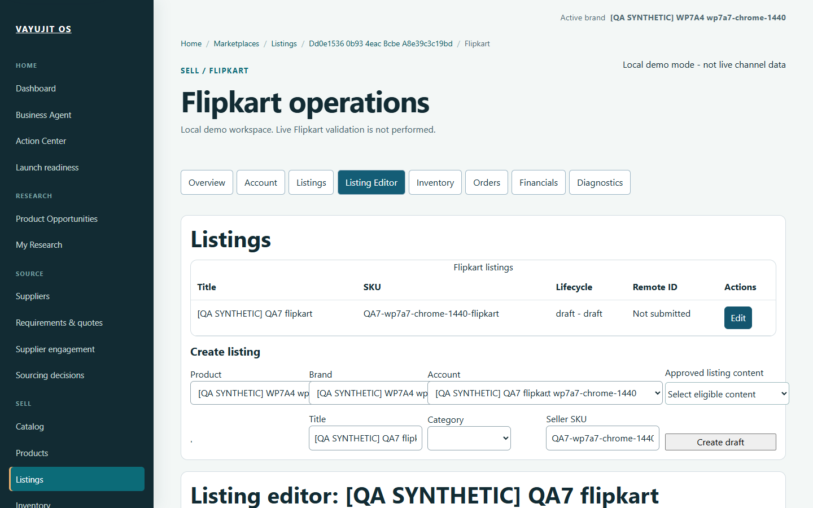

Figure 11. Synthetic Flipkart editor with missing prerequisites; a visible draft is not a submitted listing. Genuine historical synthetic capture, 2026-11-04.

### E. What do I see on this page?

Source-defined sections: Flipkart operations; Account; Listings; Create listing; Dynamic label varies with the selected record; exact current text is unverified.; Blocking issues; Warnings; Information; Orders and fulfilment; Financials and profitability; Diagnostics

Detected structures: 4 table declaration(s), 0 dialog declaration(s). Conditional/shared controls can appear only after valid context. Loading, empty, error and blocked conditions must be distinguished; their complete current runtime combinations are not verified in this edition.

| Action shown in source | Meaning and safety | Availability |
| --- | --- | --- |
| Dynamic label varies with the selected record; exact current text is unverified. | Source-declared navigation/view control; exact destination/state UNVERIFIED. | Not statically disabled |
| Configure | Source-declared navigation/view control; exact destination/state UNVERIFIED. | Not statically disabled |
| Validate | Invokes the page-specific validation contract. A provider validation can make a remote call; do not use without appropriate scope. | Not statically disabled |
| Revalidate | Source-declared navigation/view control; exact destination/state UNVERIFIED. | Not statically disabled |
| Dynamic label varies with the selected record; exact current text is unverified. | Effect UNVERIFIED; potentially changes data or invokes another workflow. Confirm prerequisites before acting. | Not statically disabled |
| Replace credential | Source-declared navigation/view control; exact destination/state UNVERIFIED. | Not statically disabled |
| Remove credential | Effect UNVERIFIED; potentially changes data or invokes another workflow. Confirm prerequisites before acting. | Not statically disabled |
| Edit | Opens the relevant edit state; saving is a separate action. | Not statically disabled |
| Create draft | Effect UNVERIFIED; potentially changes data or invokes another workflow. Confirm prerequisites before acting. | Not statically disabled |
| Dynamic label varies with the selected record; exact current text is unverified. | Source-declared navigation/view control; exact destination/state UNVERIFIED. | Not statically disabled |
| Build variant matrix | Source-declared navigation/view control; exact destination/state UNVERIFIED. | Not statically disabled |
| Remove | Effect UNVERIFIED; potentially changes data or invokes another workflow. Confirm prerequisites before acting. | Not statically disabled |
| Save variant matrix | Effect UNVERIFIED; potentially changes data or invokes another workflow. Confirm prerequisites before acting. | Conditional |
| Add media mapping | Source-declared navigation/view control; exact destination/state UNVERIFIED. | Not statically disabled |
| Review and confirm price | Effect UNVERIFIED; potentially changes data or invokes another workflow. Confirm prerequisites before acting. | Conditional |
| Preview and confirm inventory | Effect UNVERIFIED; potentially changes data or invokes another workflow. Confirm prerequisites before acting. | Not statically disabled |
| Refresh readiness | Retrieves/reassesses current prerequisites; it does not satisfy missing fields or authorize execution. | Not statically disabled |
| Review exact listing | Source-declared navigation/view control; exact destination/state UNVERIFIED. | Conditional |
| Authorize local execution | Source-declared navigation/view control; exact destination/state UNVERIFIED. | Conditional |
| Confirm and submit | Effect UNVERIFIED; potentially changes data or invokes another workflow. Confirm prerequisites before acting. | Conditional |
| Revoke authorization | Source-declared navigation/view control; exact destination/state UNVERIFIED. | Conditional |
| Refresh remote state | Source-declared navigation/view control; exact destination/state UNVERIFIED. | Not statically disabled |
| Review drift | Source-declared navigation/view control; exact destination/state UNVERIFIED. | Not statically disabled |
| Keep remote | Source-declared navigation/view control; exact destination/state UNVERIFIED. | Not statically disabled |
| Confirmed overwrite | Effect UNVERIFIED; potentially changes data or invokes another workflow. Confirm prerequisites before acting. | Not statically disabled |
| Import orders | Effect UNVERIFIED; potentially changes data or invokes another workflow. Confirm prerequisites before acting. | Not statically disabled |
| Import settlements | Effect UNVERIFIED; potentially changes data or invokes another workflow. Confirm prerequisites before acting. | Not statically disabled |
| Back to Marketplace overview | Source-declared navigation/view control; exact destination/state UNVERIFIED. | Not statically disabled |

### F. Input-field guide

Field records below state type, purpose, requiredness, accepted values and examples. Unless a specific effect is described, the parent action’s save/provider effect is UNVERIFIED. Common rule: enter only genuine facts, preserve UNKNOWN and units, and obey backend validation; no blank or unchecked prerequisite is permission to proceed. Complete per-field maintenance records retain these explicit limitations.

| Field | Type requiredness and accepted values | Purpose example and effect |
| --- | --- | --- |
| Display name [flipkart-workspace-F001] | text. Required in the template. Exact API limits/accepted vocabulary are not fully verified. | Provides the stated input to this page’s supported workflow. Example: Use the actual business fact; no invented value is supplied. Effect unverified; common field rules apply. |
| Seller/account ID [flipkart-workspace-F002] | text. Required in the template. Exact API limits/accepted vocabulary are not fully verified. | Provides the stated input to this page’s supported workflow. Example: Use the actual business fact; no invented value is supplied. Effect unverified; common field rules apply. |
| Credential (write only) [flipkart-workspace-F003] | password. Requiredness is not established by the template; do not assume optional. Exact API limits/accepted vocabulary are not fully verified. | Provides the stated input to this page’s supported workflow. Example: Use the actual business fact; no invented value is supplied. Effect unverified; common field rules apply. |
| Product [flipkart-workspace-F004] | select. Required in the template. Select Product Additional choices depend on saved records/current context and are UNVERIFIED. | Chooses the relevant saved context or supported option. Example: Choose only a relevant legitimate saved option. Effect unverified; common field rules apply. |
| Brand [flipkart-workspace-F005] | select. Required in the template. Select Brand Additional choices depend on saved records/current context and are UNVERIFIED. | Chooses the relevant saved context or supported option. Example: Choose only a relevant legitimate saved option. Effect unverified; common field rules apply. |
| Account [flipkart-workspace-F006] | select. Required in the template. Select account Additional choices depend on saved records/current context and are UNVERIFIED. | Chooses the relevant saved context or supported option. Example: Choose only a relevant legitimate saved option. Effect unverified; common field rules apply. |
| Title [flipkart-workspace-F007] | text. Required in the template. Exact API limits/accepted vocabulary are not fully verified. | Provides the stated input to this page’s supported workflow. Example: Use the actual business fact; no invented value is supplied. Effect unverified; common field rules apply. |
| Category [flipkart-workspace-F008] | select. Required in the template. Select category Additional choices depend on saved records/current context and are UNVERIFIED. | Chooses the relevant saved context or supported option. Example: Choose only a relevant legitimate saved option. Effect unverified; common field rules apply. |
| Seller SKU [flipkart-workspace-F009] | text. Required in the template. Exact API limits/accepted vocabulary are not fully verified. | Provides the stated input to this page’s supported workflow. Example: Use the actual business fact; no invented value is supplied. Effect unverified; common field rules apply. |
| Category [flipkart-workspace-F010] | select. Requiredness is not established by the template; do not assume optional. No fixed options enumerated in the template. Additional choices depend on saved records/current context and are UNVERIFIED. | Chooses the relevant saved context or supported option. Example: Choose only a relevant legitimate saved option. Effect unverified; common field rules apply. |
| Dynamic label varies with the selected record; exact current text is unverified. [flipkart-workspace-F011] | Conditional input type. Requiredness is not established by the template; do not assume optional. Exact API limits/accepted vocabulary are not fully verified. | Provides the stated input to this page’s supported workflow. Example: Use the actual business fact; no invented value is supplied. Effect unverified; common field rules apply. |
| Dimensions Use name=value\|value;name=value\|value. Maximum 100 combinations. [flipkart-workspace-F012] | text. Requiredness is not established by the template; do not assume optional. Exact API limits/accepted vocabulary are not fully verified. | Provides the stated input to this page’s supported workflow. Example: Use the actual business fact; no invented value is supplied. Effect unverified; common field rules apply. |
| Seller SKU [flipkart-workspace-F013] | text. Requiredness is not established by the template; do not assume optional. Exact API limits/accepted vocabulary are not fully verified. | Provides the stated input to this page’s supported workflow. Example: Use the actual business fact; no invented value is supplied. Effect unverified; common field rules apply. |
| Barcode [flipkart-workspace-F014] | text. Requiredness is not established by the template; do not assume optional. Exact API limits/accepted vocabulary are not fully verified. | Provides the stated input to this page’s supported workflow. Example: Use the actual business fact; no invented value is supplied. Effect unverified; common field rules apply. |
| MRP [flipkart-workspace-F015] | number. Requiredness is not established by the template; do not assume optional. Exact API limits/accepted vocabulary are not fully verified. | Provides the stated input to this page’s supported workflow. Example: Use the genuine measured amount/quantity; units must be established. Effect unverified; common field rules apply. |
| Selling price [flipkart-workspace-F016] | number. Requiredness is not established by the template; do not assume optional. Exact API limits/accepted vocabulary are not fully verified. | Provides the stated input to this page’s supported workflow. Example: Use the genuine measured amount/quantity; units must be established. Effect unverified; common field rules apply. |
| Quantity [flipkart-workspace-F017] | number. Requiredness is not established by the template; do not assume optional. min 0 | Provides the stated input to this page’s supported workflow. Example: Use the genuine measured amount/quantity; units must be established. Effect unverified; common field rules apply. |
| Alt/internal label [flipkart-workspace-F018] | text. Requiredness is not established by the template; do not assume optional. Exact API limits/accepted vocabulary are not fully verified. | Provides the stated input to this page’s supported workflow. Example: Use the actual business fact; no invented value is supplied. Effect unverified; common field rules apply. |
| Position [flipkart-workspace-F019] | number. Requiredness is not established by the template; do not assume optional. min 0 | Provides the stated input to this page’s supported workflow. Example: Use the genuine measured amount/quantity; units must be established. Effect unverified; common field rules apply. |
| Currency [flipkart-workspace-F020] | text. Requiredness is not established by the template; do not assume optional. maxlength 3 | Provides the stated input to this page’s supported workflow. Example: INR only if this is the genuine currency. Effect unverified; common field rules apply. |
| MRP/list price [flipkart-workspace-F021] | number. Requiredness is not established by the template; do not assume optional. min 0 | Provides the stated input to this page’s supported workflow. Example: Use the genuine measured amount/quantity; units must be established. Effect unverified; common field rules apply. |
| Selling price [flipkart-workspace-F022] | number. Required in the template. min 0 | Provides the stated input to this page’s supported workflow. Example: Use the genuine measured amount/quantity; units must be established. Effect unverified; common field rules apply. |
| Sale price [flipkart-workspace-F023] | number. Requiredness is not established by the template; do not assume optional. min 0 | Provides the stated input to this page’s supported workflow. Example: Use the genuine measured amount/quantity; units must be established. Effect unverified; common field rules apply. |
| Target quantity [flipkart-workspace-F024] | number. Required in the template. min 0 | Provides the stated input to this page’s supported workflow. Example: Use the genuine measured amount/quantity; units must be established. Effect unverified; common field rules apply. |

### G. Step-by-step usage

1. Open the intended owned context using the navigation/route above. Verify the brand and any Product, opportunity, supplier, listing or artifact identity before continuing.

2. Check current product, SKU, category, content/media and review/authorization boundaries. Fake transport is not live Flipkart certification.

3. Read current warnings and input guidance. Use only an action whose purpose and authority you understand. Stop before unapproved provider, commercial or permanent-data effects.

### H. Worked example

Illustrative task: Prepare and review supported local Flipkart listing/account data. Use a genuine selected record in your own authorized workspace; a synthetic screenshot is a learning example only. The field examples above illustrate the type of input, not prescribed business values.

### I. How to interpret the results

Inspect identity, source/provenance, date/freshness, included assumptions and missing information. A local status, score or successful fake workflow is not proof of real external completion. UNKNOWN, blocked, stale and not-comparable results must retain their actual meaning.

### J. What should I do next?

Correct missing local prerequisites; do not submit externally from a tutorial.

### K. Troubleshooting

If context is missing/invalid, use the appropriate collection or saved record link. If a request fails, retain the safe correlation reference and inspect current state before retrying. A 401 needs normal authentication; a 500 is not an empty successful result. Do not force-enable disabled actions or insert synthetic facts.

### L. Availability and limitations

DOCUMENTED BUT NOT CURRENTLY VERIFIED: current template and source inspected; no fresh authenticated session or complete per-control execution performed. Historical synthetic screenshot/functional evidence illustrates only its recorded state. Check current product, SKU, category, content/media and review/authorization boundaries. Fake transport is not live Flipkart certification. The entire module is not certified by the presence of a route.

### M. Documentation evidence

Current source: apps/web/src/app/marketplaces/flipkart-workspace.component.ts. Source and template hashes are in source/ui-inventory.json; exact field/action declarations in inventory/field-register.md and source/control-inventory.md. Screenshot evidence: docs/product-handbook/screenshots/marketplaces/03-flipkart-blocker.png (Figure 11).

[Current UI source for Flipkart workspace](../../../apps/web/src/app/marketplaces/flipkart-workspace.component.ts)

## P038 Meesho workspace

### A. What is this page?

Inspect supported local/manual Meesho listing preparation and editing.

### B. Why would someone use it?

Tabs/sections are editor panels, not proof of automatic marketplace dispatch. Pricing and inventory changes have their own supported limits.

### C. Where can I find it?

Contextual link from the relevant owned record, or the exact route below; not a separately verified primary-menu item.

Route: /marketplaces/meesho

Route: /marketplaces/listings/:id/meesho — replace a parameter only through a legitimate saved record link, not a guessed ID.

### D. Screenshot

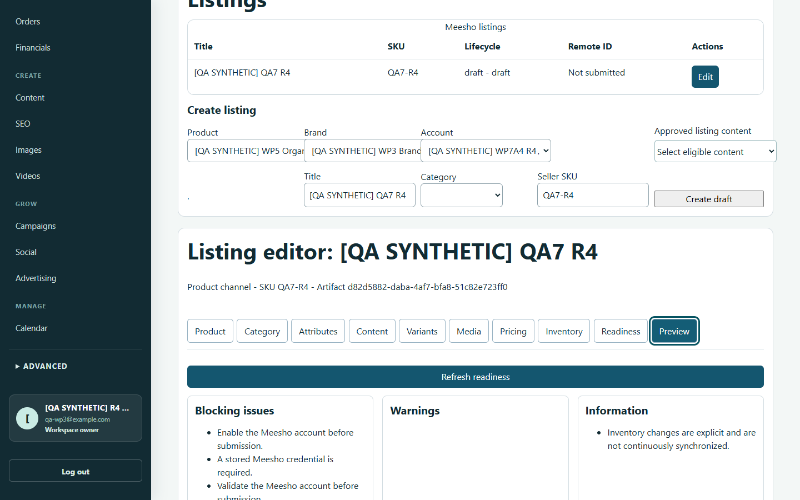

Figure 12. Synthetic Meesho section navigation and readiness blockers. Genuine historical synthetic capture, 2026-11-05.

### E. What do I see on this page?

Source-defined sections: Meesho operations; Account; Listings; Create listing; Dynamic label varies with the selected record; exact current text is unverified.; Blocking issues; Warnings; Information; Orders and fulfilment; Financials and profitability; Diagnostics

Detected structures: 4 table declaration(s), 0 dialog declaration(s). Conditional/shared controls can appear only after valid context. Loading, empty, error and blocked conditions must be distinguished; their complete current runtime combinations are not verified in this edition.

| Action shown in source | Meaning and safety | Availability |
| --- | --- | --- |
| Dynamic label varies with the selected record; exact current text is unverified. | Source-declared navigation/view control; exact destination/state UNVERIFIED. | Not statically disabled |
| Configure | Source-declared navigation/view control; exact destination/state UNVERIFIED. | Not statically disabled |
| Validate | Invokes the page-specific validation contract. A provider validation can make a remote call; do not use without appropriate scope. | Not statically disabled |
| Revalidate | Source-declared navigation/view control; exact destination/state UNVERIFIED. | Not statically disabled |
| Dynamic label varies with the selected record; exact current text is unverified. | Effect UNVERIFIED; potentially changes data or invokes another workflow. Confirm prerequisites before acting. | Not statically disabled |
| Replace credential | Source-declared navigation/view control; exact destination/state UNVERIFIED. | Not statically disabled |
| Remove credential | Effect UNVERIFIED; potentially changes data or invokes another workflow. Confirm prerequisites before acting. | Not statically disabled |
| Edit | Opens the relevant edit state; saving is a separate action. | Not statically disabled |
| Create draft | Effect UNVERIFIED; potentially changes data or invokes another workflow. Confirm prerequisites before acting. | Not statically disabled |
| Dynamic label varies with the selected record; exact current text is unverified. | Source-declared navigation/view control; exact destination/state UNVERIFIED. | Not statically disabled |
| Build variant matrix | Source-declared navigation/view control; exact destination/state UNVERIFIED. | Not statically disabled |
| Remove | Effect UNVERIFIED; potentially changes data or invokes another workflow. Confirm prerequisites before acting. | Not statically disabled |
| Save variant matrix | Effect UNVERIFIED; potentially changes data or invokes another workflow. Confirm prerequisites before acting. | Conditional |
| Add media mapping | Source-declared navigation/view control; exact destination/state UNVERIFIED. | Not statically disabled |
| Review and confirm price | Effect UNVERIFIED; potentially changes data or invokes another workflow. Confirm prerequisites before acting. | Conditional |
| Preview and confirm inventory | Effect UNVERIFIED; potentially changes data or invokes another workflow. Confirm prerequisites before acting. | Not statically disabled |
| Refresh readiness | Retrieves/reassesses current prerequisites; it does not satisfy missing fields or authorize execution. | Not statically disabled |
| Confirm and submit | Effect UNVERIFIED; potentially changes data or invokes another workflow. Confirm prerequisites before acting. | Conditional |
| Refresh remote state | Source-declared navigation/view control; exact destination/state UNVERIFIED. | Not statically disabled |
| Review drift | Source-declared navigation/view control; exact destination/state UNVERIFIED. | Not statically disabled |
| Keep remote | Source-declared navigation/view control; exact destination/state UNVERIFIED. | Not statically disabled |
| Confirmed overwrite | Effect UNVERIFIED; potentially changes data or invokes another workflow. Confirm prerequisites before acting. | Not statically disabled |
| Import orders | Effect UNVERIFIED; potentially changes data or invokes another workflow. Confirm prerequisites before acting. | Not statically disabled |
| Import settlements | Effect UNVERIFIED; potentially changes data or invokes another workflow. Confirm prerequisites before acting. | Not statically disabled |
| Back to Marketplace overview | Source-declared navigation/view control; exact destination/state UNVERIFIED. | Not statically disabled |

### F. Input-field guide

Field records below state type, purpose, requiredness, accepted values and examples. Unless a specific effect is described, the parent action’s save/provider effect is UNVERIFIED. Common rule: enter only genuine facts, preserve UNKNOWN and units, and obey backend validation; no blank or unchecked prerequisite is permission to proceed. Complete per-field maintenance records retain these explicit limitations.

| Field | Type requiredness and accepted values | Purpose example and effect |
| --- | --- | --- |
| Display name [meesho-workspace-F001] | text. Required in the template. Exact API limits/accepted vocabulary are not fully verified. | Provides the stated input to this page’s supported workflow. Example: Use the actual business fact; no invented value is supplied. Effect unverified; common field rules apply. |
| Seller/account ID [meesho-workspace-F002] | text. Required in the template. Exact API limits/accepted vocabulary are not fully verified. | Provides the stated input to this page’s supported workflow. Example: Use the actual business fact; no invented value is supplied. Effect unverified; common field rules apply. |
| Credential (write only) [meesho-workspace-F003] | password. Requiredness is not established by the template; do not assume optional. Exact API limits/accepted vocabulary are not fully verified. | Provides the stated input to this page’s supported workflow. Example: Use the actual business fact; no invented value is supplied. Effect unverified; common field rules apply. |
| Product [meesho-workspace-F004] | select. Required in the template. Select Product Additional choices depend on saved records/current context and are UNVERIFIED. | Chooses the relevant saved context or supported option. Example: Choose only a relevant legitimate saved option. Effect unverified; common field rules apply. |
| Brand [meesho-workspace-F005] | select. Required in the template. Select Brand Additional choices depend on saved records/current context and are UNVERIFIED. | Chooses the relevant saved context or supported option. Example: Choose only a relevant legitimate saved option. Effect unverified; common field rules apply. |
| Account [meesho-workspace-F006] | select. Required in the template. Select account Additional choices depend on saved records/current context and are UNVERIFIED. | Chooses the relevant saved context or supported option. Example: Choose only a relevant legitimate saved option. Effect unverified; common field rules apply. |
| Title [meesho-workspace-F007] | text. Required in the template. Exact API limits/accepted vocabulary are not fully verified. | Provides the stated input to this page’s supported workflow. Example: Use the actual business fact; no invented value is supplied. Effect unverified; common field rules apply. |
| Category [meesho-workspace-F008] | select. Required in the template. Select category Additional choices depend on saved records/current context and are UNVERIFIED. | Chooses the relevant saved context or supported option. Example: Choose only a relevant legitimate saved option. Effect unverified; common field rules apply. |
| Seller SKU [meesho-workspace-F009] | text. Required in the template. Exact API limits/accepted vocabulary are not fully verified. | Provides the stated input to this page’s supported workflow. Example: Use the actual business fact; no invented value is supplied. Effect unverified; common field rules apply. |
| Category [meesho-workspace-F010] | select. Requiredness is not established by the template; do not assume optional. No fixed options enumerated in the template. Additional choices depend on saved records/current context and are UNVERIFIED. | Chooses the relevant saved context or supported option. Example: Choose only a relevant legitimate saved option. Effect unverified; common field rules apply. |
| Dynamic label varies with the selected record; exact current text is unverified. [meesho-workspace-F011] | Conditional input type. Requiredness is not established by the template; do not assume optional. Exact API limits/accepted vocabulary are not fully verified. | Provides the stated input to this page’s supported workflow. Example: Use the actual business fact; no invented value is supplied. Effect unverified; common field rules apply. |
| Dimensions Use name=value\|value;name=value\|value. Maximum 100 combinations. [meesho-workspace-F012] | text. Requiredness is not established by the template; do not assume optional. Exact API limits/accepted vocabulary are not fully verified. | Provides the stated input to this page’s supported workflow. Example: Use the actual business fact; no invented value is supplied. Effect unverified; common field rules apply. |
| Seller SKU [meesho-workspace-F013] | text. Requiredness is not established by the template; do not assume optional. Exact API limits/accepted vocabulary are not fully verified. | Provides the stated input to this page’s supported workflow. Example: Use the actual business fact; no invented value is supplied. Effect unverified; common field rules apply. |
| Barcode [meesho-workspace-F014] | text. Requiredness is not established by the template; do not assume optional. Exact API limits/accepted vocabulary are not fully verified. | Provides the stated input to this page’s supported workflow. Example: Use the actual business fact; no invented value is supplied. Effect unverified; common field rules apply. |
| MRP [meesho-workspace-F015] | number. Requiredness is not established by the template; do not assume optional. Exact API limits/accepted vocabulary are not fully verified. | Provides the stated input to this page’s supported workflow. Example: Use the genuine measured amount/quantity; units must be established. Effect unverified; common field rules apply. |
| Selling price [meesho-workspace-F016] | number. Requiredness is not established by the template; do not assume optional. Exact API limits/accepted vocabulary are not fully verified. | Provides the stated input to this page’s supported workflow. Example: Use the genuine measured amount/quantity; units must be established. Effect unverified; common field rules apply. |
| Quantity [meesho-workspace-F017] | number. Requiredness is not established by the template; do not assume optional. min 0 | Provides the stated input to this page’s supported workflow. Example: Use the genuine measured amount/quantity; units must be established. Effect unverified; common field rules apply. |
| Alt/internal label [meesho-workspace-F018] | text. Requiredness is not established by the template; do not assume optional. Exact API limits/accepted vocabulary are not fully verified. | Provides the stated input to this page’s supported workflow. Example: Use the actual business fact; no invented value is supplied. Effect unverified; common field rules apply. |
| Position [meesho-workspace-F019] | number. Requiredness is not established by the template; do not assume optional. min 0 | Provides the stated input to this page’s supported workflow. Example: Use the genuine measured amount/quantity; units must be established. Effect unverified; common field rules apply. |
| Currency [meesho-workspace-F020] | text. Requiredness is not established by the template; do not assume optional. maxlength 3 | Provides the stated input to this page’s supported workflow. Example: INR only if this is the genuine currency. Effect unverified; common field rules apply. |
| MRP/list price [meesho-workspace-F021] | number. Requiredness is not established by the template; do not assume optional. min 0 | Provides the stated input to this page’s supported workflow. Example: Use the genuine measured amount/quantity; units must be established. Effect unverified; common field rules apply. |
| Selling price [meesho-workspace-F022] | number. Required in the template. min 0 | Provides the stated input to this page’s supported workflow. Example: Use the genuine measured amount/quantity; units must be established. Effect unverified; common field rules apply. |
| Sale price [meesho-workspace-F023] | number. Requiredness is not established by the template; do not assume optional. min 0 | Provides the stated input to this page’s supported workflow. Example: Use the genuine measured amount/quantity; units must be established. Effect unverified; common field rules apply. |
| Target quantity [meesho-workspace-F024] | number. Required in the template. min 0 | Provides the stated input to this page’s supported workflow. Example: Use the genuine measured amount/quantity; units must be established. Effect unverified; common field rules apply. |

### G. Step-by-step usage

1. Open the intended owned context using the navigation/route above. Verify the brand and any Product, opportunity, supplier, listing or artifact identity before continuing.

2. Tabs/sections are editor panels, not proof of automatic marketplace dispatch. Pricing and inventory changes have their own supported limits.

3. Read current warnings and input guidance. Use only an action whose purpose and authority you understand. Stop before unapproved provider, commercial or permanent-data effects.

### H. Worked example

Illustrative task: Inspect supported local/manual Meesho listing preparation and editing. Use a genuine selected record in your own authorized workspace; a synthetic screenshot is a learning example only. The field examples above illustrate the type of input, not prescribed business values.

### I. How to interpret the results

Inspect identity, source/provenance, date/freshness, included assumptions and missing information. A local status, score or successful fake workflow is not proof of real external completion. UNKNOWN, blocked, stale and not-comparable results must retain their actual meaning.

### J. What should I do next?

Review Readiness and exact local/manual next steps; no live submission is certified.

### K. Troubleshooting

If context is missing/invalid, use the appropriate collection or saved record link. If a request fails, retain the safe correlation reference and inspect current state before retrying. A 401 needs normal authentication; a 500 is not an empty successful result. Do not force-enable disabled actions or insert synthetic facts.

### L. Availability and limitations

DOCUMENTED BUT NOT CURRENTLY VERIFIED: current template and source inspected; no fresh authenticated session or complete per-control execution performed. Historical synthetic screenshot/functional evidence illustrates only its recorded state. Tabs/sections are editor panels, not proof of automatic marketplace dispatch. Pricing and inventory changes have their own supported limits. The entire module is not certified by the presence of a route.

### M. Documentation evidence

Current source: apps/web/src/app/marketplaces/meesho-workspace.component.ts. Source and template hashes are in source/ui-inventory.json; exact field/action declarations in inventory/field-register.md and source/control-inventory.md. Screenshot evidence: docs/product-handbook/screenshots/marketplaces/04-meesho-readiness.png (Figure 12).

[Current UI source for Meesho workspace](../../../apps/web/src/app/marketplaces/meesho-workspace.component.ts)

## P039 Amazon workspace

### A. What is this page?

Prepare and review a local Amazon India listing and connector/account state.

### B. Why would someone use it?

Inspect required data, current review fingerprint and separate single-use authorization. Account configured/valid in a fake transport is not real SP-API connectivity.

### C. Where can I find it?

Contextual link from the relevant owned record, or the exact route below; not a separately verified primary-menu item.

Route: /marketplaces/amazon

Route: /marketplaces/listings/:id/amazon — replace a parameter only through a legitimate saved record link, not a guessed ID.

### D. Screenshot

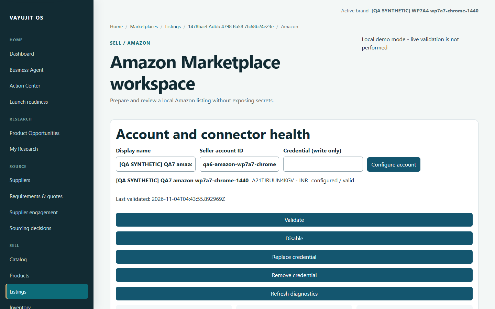

Figure 13. Synthetic Amazon local account workspace. Blank credential field is write-only; this is not real SP-API certification. Genuine historical synthetic capture, 2026-11-04.

### E. What do I see on this page?

Source-defined sections: Amazon Marketplace workspace; Account and connector health; Listing editor; Prepare unpublished Amazon draft; Dynamic label varies with the selected record; exact current text is unverified.; Blocking; Warnings; Informational; Variant editor and option matrix; Media editor; Orders and fulfilment; Returns and refunds; Settlement and profitability; Drift matrix and guarded overwrite

Disclosures: Lines. Open only the relevant section; expanded state does not mean its action ran.

Detected structures: 6 table declaration(s), 0 dialog declaration(s). Conditional/shared controls can appear only after valid context. Loading, empty, error and blocked conditions must be distinguished; their complete current runtime combinations are not verified in this edition.

| Action shown in source | Meaning and safety | Availability |
| --- | --- | --- |
| Configure account | Source-declared navigation/view control; exact destination/state UNVERIFIED. | Not statically disabled |
| Validate | Invokes the page-specific validation contract. A provider validation can make a remote call; do not use without appropriate scope. | Not statically disabled |
| Dynamic label varies with the selected record; exact current text is unverified. | Effect UNVERIFIED; potentially changes data or invokes another workflow. Confirm prerequisites before acting. | Not statically disabled |
| Replace credential | Source-declared navigation/view control; exact destination/state UNVERIFIED. | Not statically disabled |
| Remove credential | Effect UNVERIFIED; potentially changes data or invokes another workflow. Confirm prerequisites before acting. | Not statically disabled |
| Refresh diagnostics | Source-declared navigation/view control; exact destination/state UNVERIFIED. | Not statically disabled |
| Prepare local Amazon draft | Source-declared navigation/view control; exact destination/state UNVERIFIED. | Conditional |
| Preview readiness | Source-declared navigation/view control; exact destination/state UNVERIFIED. | Not statically disabled |
| Approve listing for controlled submission | Effect UNVERIFIED; potentially changes data or invokes another workflow. Confirm prerequisites before acting. | Conditional |
| Issue one-time execution authorization | Source-declared navigation/view control; exact destination/state UNVERIFIED. | Conditional |
| Submit approved listing | Effect UNVERIFIED; potentially changes data or invokes another workflow. Confirm prerequisites before acting. | Conditional |
| Reconcile remote status | Source-declared navigation/view control; exact destination/state UNVERIFIED. | Not statically disabled |
| Confirm price update | Effect UNVERIFIED; potentially changes data or invokes another workflow. Confirm prerequisites before acting. | Conditional |
| Confirm inventory update | Effect UNVERIFIED; potentially changes data or invokes another workflow. Confirm prerequisites before acting. | Not statically disabled |
| Revoke authorization | Source-declared navigation/view control; exact destination/state UNVERIFIED. | Not statically disabled |
| Build matrix | Source-declared navigation/view control; exact destination/state UNVERIFIED. | Not statically disabled |
| Add variant | Source-declared navigation/view control; exact destination/state UNVERIFIED. | Not statically disabled |
| Save variants | Effect UNVERIFIED; potentially changes data or invokes another workflow. Confirm prerequisites before acting. | Not statically disabled |
| Duplicate | Source-declared navigation/view control; exact destination/state UNVERIFIED. | Not statically disabled |
| Remove | Effect UNVERIFIED; potentially changes data or invokes another workflow. Confirm prerequisites before acting. | Not statically disabled |
| Preview local main image | Source-declared navigation/view control; exact destination/state UNVERIFIED. | Not statically disabled |
| Confirm exact local main image | Effect UNVERIFIED; potentially changes data or invokes another workflow. Confirm prerequisites before acting. | Conditional |
| Add media | Source-declared navigation/view control; exact destination/state UNVERIFIED. | Not statically disabled |
| Save ordered media | Effect UNVERIFIED; potentially changes data or invokes another workflow. Confirm prerequisites before acting. | Conditional |
| Move up | Source-declared navigation/view control; exact destination/state UNVERIFIED. | Conditional |
| Move down | Source-declared navigation/view control; exact destination/state UNVERIFIED. | Conditional |
| Remove | Effect UNVERIFIED; potentially changes data or invokes another workflow. Confirm prerequisites before acting. | Not statically disabled |
| Import orders | Effect UNVERIFIED; potentially changes data or invokes another workflow. Confirm prerequisites before acting. | Not statically disabled |
| Import return records | Effect UNVERIFIED; potentially changes data or invokes another workflow. Confirm prerequisites before acting. | Not statically disabled |
| Import settlements and fees | Effect UNVERIFIED; potentially changes data or invokes another workflow. Confirm prerequisites before acting. | Not statically disabled |
| Review drift | Source-declared navigation/view control; exact destination/state UNVERIFIED. | Not statically disabled |
| Keep remote | Source-declared navigation/view control; exact destination/state UNVERIFIED. | Not statically disabled |
| Overwrite remote (confirm) | Effect UNVERIFIED; potentially changes data or invokes another workflow. Confirm prerequisites before acting. | Not statically disabled |

### F. Input-field guide

Field records below state type, purpose, requiredness, accepted values and examples. Unless a specific effect is described, the parent action’s save/provider effect is UNVERIFIED. Common rule: enter only genuine facts, preserve UNKNOWN and units, and obey backend validation; no blank or unchecked prerequisite is permission to proceed. Complete per-field maintenance records retain these explicit limitations.

| Field | Type requiredness and accepted values | Purpose example and effect |
| --- | --- | --- |
| Display name [amazon-workspace-F001] | text. Required in the template. Exact API limits/accepted vocabulary are not fully verified. | Provides the stated input to this page’s supported workflow. Example: Use the actual business fact; no invented value is supplied. Effect unverified; common field rules apply. |
| Seller account ID [amazon-workspace-F002] | text. Required in the template. Exact API limits/accepted vocabulary are not fully verified. | Provides the stated input to this page’s supported workflow. Example: Use the actual business fact; no invented value is supplied. Effect unverified; common field rules apply. |
| Credential (write only) [amazon-workspace-F003] | password. Requiredness is not established by the template; do not assume optional. Exact API limits/accepted vocabulary are not fully verified. | Provides the stated input to this page’s supported workflow. Example: Use the actual business fact; no invented value is supplied. Effect unverified; common field rules apply. |
| Draft title [amazon-workspace-F004] | text. Requiredness is not established by the template; do not assume optional. Exact API limits/accepted vocabulary are not fully verified. | Provides the stated input to this page’s supported workflow. Example: Use the actual business fact; no invented value is supplied. Effect unverified; common field rules apply. |
| Draft seller SKU [amazon-workspace-F005] | text. Requiredness is not established by the template; do not assume optional. Exact API limits/accepted vocabulary are not fully verified. | Provides the stated input to this page’s supported workflow. Example: Use the actual business fact; no invented value is supplied. Effect unverified; common field rules apply. |
| Draft category [amazon-workspace-F006] | text. Requiredness is not established by the template; do not assume optional. Exact API limits/accepted vocabulary are not fully verified. | Provides the stated input to this page’s supported workflow. Example: Use the actual business fact; no invented value is supplied. Effect unverified; common field rules apply. |
| Product type [amazon-workspace-F007] | select. Requiredness is not established by the template; do not assume optional. PRODUCT; HOME; APPAREL | Chooses the relevant saved context or supported option. Example: Choose only a relevant legitimate saved option. Effect unverified; common field rules apply. |
| Title [amazon-workspace-F008] | text. Requiredness is not established by the template; do not assume optional. Exact API limits/accepted vocabulary are not fully verified. | Provides the stated input to this page’s supported workflow. Example: Use the actual business fact; no invented value is supplied. Effect unverified; common field rules apply. |
| List price [amazon-workspace-F009] | number. Requiredness is not established by the template; do not assume optional. min 0 | Provides the stated input to this page’s supported workflow. Example: Use the genuine measured amount/quantity; units must be established. Effect unverified; common field rules apply. |
| Selling price [amazon-workspace-F010] | number. Requiredness is not established by the template; do not assume optional. min 0 | Provides the stated input to this page’s supported workflow. Example: Use the genuine measured amount/quantity; units must be established. Effect unverified; common field rules apply. |
| Inventory target [amazon-workspace-F011] | number. Requiredness is not established by the template; do not assume optional. min 0 | Provides the stated input to this page’s supported workflow. Example: Use the genuine measured amount/quantity; units must be established. Effect unverified; common field rules apply. |
| Dynamic label varies with the selected record; exact current text is unverified. [amazon-workspace-F012] | text. Requiredness is not established by the template; do not assume optional. Exact API limits/accepted vocabulary are not fully verified. | Provides the stated input to this page’s supported workflow. Example: Use the actual business fact; no invented value is supplied. Effect unverified; common field rules apply. |
| Matrix dimensions [amazon-workspace-F013] | text. Requiredness is not established by the template; do not assume optional. Exact API limits/accepted vocabulary are not fully verified. | Provides the stated input to this page’s supported workflow. Example: Use the actual business fact; no invented value is supplied. Effect unverified; common field rules apply. |
| 'Variant key ' + (index + 1) [amazon-workspace-F014] | text. Requiredness is not established by the template; do not assume optional. Exact API limits/accepted vocabulary are not fully verified. | Provides the stated input to this page’s supported workflow. Example: Use the actual business fact; no invented value is supplied. Effect unverified; common field rules apply. |
| 'Variant SKU ' + (index + 1) [amazon-workspace-F015] | text. Requiredness is not established by the template; do not assume optional. Exact API limits/accepted vocabulary are not fully verified. | Provides the stated input to this page’s supported workflow. Example: Use the actual business fact; no invented value is supplied. Effect unverified; common field rules apply. |
| 'Variant theme ' + (index + 1) [amazon-workspace-F016] | text. Requiredness is not established by the template; do not assume optional. Exact API limits/accepted vocabulary are not fully verified. | Provides the stated input to this page’s supported workflow. Example: Use the actual business fact; no invented value is supplied. Effect unverified; common field rules apply. |
| 'Variant price ' + (index + 1) [amazon-workspace-F017] | number. Requiredness is not established by the template; do not assume optional. min 0 | Provides the stated input to this page’s supported workflow. Example: Use the genuine measured amount/quantity; units must be established. Effect unverified; common field rules apply. |
| 'Variant barcode ' + (index + 1) [amazon-workspace-F018] | text. Requiredness is not established by the template; do not assume optional. Exact API limits/accepted vocabulary are not fully verified. | Provides the stated input to this page’s supported workflow. Example: Use the actual business fact; no invented value is supplied. Effect unverified; common field rules apply. |
| Approved image Output ID [amazon-workspace-F019] | text. Requiredness is not established by the template; do not assume optional. Exact API limits/accepted vocabulary are not fully verified. | Provides the stated input to this page’s supported workflow. Example: Use the actual business fact; no invented value is supplied. Effect unverified; common field rules apply. |
| Media Asset ID [amazon-workspace-F020] | text. Requiredness is not established by the template; do not assume optional. Exact API limits/accepted vocabulary are not fully verified. | Provides the stated input to this page’s supported workflow. Example: Use the actual business fact; no invented value is supplied. Effect unverified; common field rules apply. |
| Alt text [amazon-workspace-F021] | text. Requiredness is not established by the template; do not assume optional. Exact API limits/accepted vocabulary are not fully verified. | Provides the stated input to this page’s supported workflow. Example: Use the actual business fact; no invented value is supplied. Effect unverified; common field rules apply. |
| 'Media alt text ' + (index + 1) [amazon-workspace-F022] | text. Requiredness is not established by the template; do not assume optional. Exact API limits/accepted vocabulary are not fully verified. | Provides the stated input to this page’s supported workflow. Example: Use the actual business fact; no invented value is supplied. Effect unverified; common field rules apply. |

### G. Step-by-step usage

1. Open the intended owned context using the navigation/route above. Verify the brand and any Product, opportunity, supplier, listing or artifact identity before continuing.

2. Inspect required data, current review fingerprint and separate single-use authorization. Account configured/valid in a fake transport is not real SP-API connectivity.

3. Read current warnings and input guidance. Use only an action whose purpose and authority you understand. Stop before unapproved provider, commercial or permanent-data effects.

### H. Worked example

Illustrative task: Prepare and review a local Amazon India listing and connector/account state. Use a genuine selected record in your own authorized workspace; a synthetic screenshot is a learning example only. The field examples above illustrate the type of input, not prescribed business values.

### I. How to interpret the results

Inspect identity, source/provenance, date/freshness, included assumptions and missing information. A local status, score or successful fake workflow is not proof of real external completion. UNKNOWN, blocked, stale and not-comparable results must retain their actual meaning.

### J. What should I do next?

Resolve genuine missing fields and obtain separate real-account/provider certification before submission.

### K. Troubleshooting

If context is missing/invalid, use the appropriate collection or saved record link. If a request fails, retain the safe correlation reference and inspect current state before retrying. A 401 needs normal authentication; a 500 is not an empty successful result. Do not force-enable disabled actions or insert synthetic facts.

### L. Availability and limitations

DOCUMENTED BUT NOT CURRENTLY VERIFIED: current template and source inspected; no fresh authenticated session or complete per-control execution performed. Historical synthetic screenshot/functional evidence illustrates only its recorded state. Inspect required data, current review fingerprint and separate single-use authorization. Account configured/valid in a fake transport is not real SP-API connectivity. The entire module is not certified by the presence of a route.

### M. Documentation evidence

Current source: apps/web/src/app/marketplaces/amazon-workspace.component.ts. Source and template hashes are in source/ui-inventory.json; exact field/action declarations in inventory/field-register.md and source/control-inventory.md. Screenshot evidence: docs/product-handbook/screenshots/marketplaces/02-amazon-local.png (Figure 13).

[Current UI source for Amazon workspace](../../../apps/web/src/app/marketplaces/amazon-workspace.component.ts)

## P040 Marketplace accounts

### A. What is this page?

Inspect local account configuration and read-only connectivity/import capabilities.

### B. Why would someone use it?

Credentials are write-only. Synthetic imports, real registration, API entitlement and live-read-only authorization are different.

### C. Where can I find it?

Contextual link from the relevant owned record, or the exact route below; not a separately verified primary-menu item.

Route: /marketplaces/accounts

### D. Screenshot

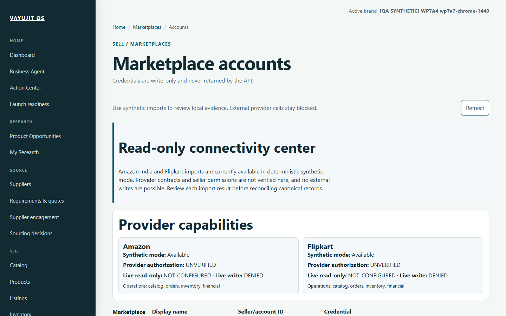

Figure 14. Synthetic import capability and explicit unverified live-provider authorization. Genuine historical synthetic capture, 2026-11-04.

### E. What do I see on this page?

Source-defined sections: Marketplace accounts; Read-only connectivity center; Provider capabilities; Dynamic label varies with the selected record; exact current text is unverified.

Detected structures: 2 table declaration(s), 0 dialog declaration(s). Conditional/shared controls can appear only after valid context. Loading, empty, error and blocked conditions must be distinguished; their complete current runtime combinations are not verified in this edition.

| Action shown in source | Meaning and safety | Availability |
| --- | --- | --- |
| Refresh | Reloads the relevant view; exact data-source side effects still depend on that screen. | Conditional |
| Add account | Source-declared navigation/view control; exact destination/state UNVERIFIED. | Not statically disabled |
| Validate | Invokes the page-specific validation contract. A provider validation can make a remote call; do not use without appropriate scope. | Not statically disabled |
| Dynamic label varies with the selected record; exact current text is unverified. | Effect UNVERIFIED; potentially changes data or invokes another workflow. Confirm prerequisites before acting. | Not statically disabled |
| Dynamic label varies with the selected record; exact current text is unverified. | Effect UNVERIFIED; potentially changes data or invokes another workflow. Confirm prerequisites before acting. | Conditional |

### F. Input-field guide

Field records below state type, purpose, requiredness, accepted values and examples. Unless a specific effect is described, the parent action’s save/provider effect is UNVERIFIED. Common rule: enter only genuine facts, preserve UNKNOWN and units, and obey backend validation; no blank or unchecked prerequisite is permission to proceed. Complete per-field maintenance records retain these explicit limitations.

| Field | Type requiredness and accepted values | Purpose example and effect |
| --- | --- | --- |
| Marketplace [marketplace-accounts-F001] | select. Requiredness is not established by the template; do not assume optional. amazon; flipkart; meesho; shopify | Chooses the relevant saved context or supported option. Example: Choose only a relevant legitimate saved option. Effect unverified; common field rules apply. |
| Display name [marketplace-accounts-F002] | text. Required in the template. Exact API limits/accepted vocabulary are not fully verified. | Provides the stated input to this page’s supported workflow. Example: Use the actual business fact; no invented value is supplied. Effect unverified; common field rules apply. |
| Seller/account ID [marketplace-accounts-F003] | text. Required in the template. Exact API limits/accepted vocabulary are not fully verified. | Provides the stated input to this page’s supported workflow. Example: Use the actual business fact; no invented value is supplied. Effect unverified; common field rules apply. |
| Credential [marketplace-accounts-F004] | password. Requiredness is not established by the template; do not assume optional. Exact API limits/accepted vocabulary are not fully verified. | Provides the stated input to this page’s supported workflow. Example: Use the actual business fact; no invented value is supplied. Effect unverified; common field rules apply. |

### G. Step-by-step usage

1. Open the intended owned context using the navigation/route above. Verify the brand and any Product, opportunity, supplier, listing or artifact identity before continuing.

2. Credentials are write-only. Synthetic imports, real registration, API entitlement and live-read-only authorization are different.

3. Read current warnings and input guidance. Use only an action whose purpose and authority you understand. Stop before unapproved provider, commercial or permanent-data effects.

### H. Worked example

Illustrative task: Inspect local account configuration and read-only connectivity/import capabilities. Use a genuine selected record in your own authorized workspace; a synthetic screenshot is a learning example only. The field examples above illustrate the type of input, not prescribed business values.

### I. How to interpret the results

Inspect identity, source/provenance, date/freshness, included assumptions and missing information. A local status, score or successful fake workflow is not proof of real external completion. UNKNOWN, blocked, stale and not-comparable results must retain their actual meaning.

### J. What should I do next?

Review the provider’s actual prerequisites without issuing an unauthorized import.

### K. Troubleshooting

If context is missing/invalid, use the appropriate collection or saved record link. If a request fails, retain the safe correlation reference and inspect current state before retrying. A 401 needs normal authentication; a 500 is not an empty successful result. Do not force-enable disabled actions or insert synthetic facts.

### L. Availability and limitations

DOCUMENTED BUT NOT CURRENTLY VERIFIED: current template and source inspected; no fresh authenticated session or complete per-control execution performed. Historical synthetic screenshot/functional evidence illustrates only its recorded state. Credentials are write-only. Synthetic imports, real registration, API entitlement and live-read-only authorization are different. The entire module is not certified by the presence of a route.

### M. Documentation evidence

Current source: apps/web/src/app/marketplaces/marketplace-accounts.component.ts. Source and template hashes are in source/ui-inventory.json; exact field/action declarations in inventory/field-register.md and source/control-inventory.md. Screenshot evidence: docs/product-handbook/screenshots/marketplaces/01-account-boundary.png (Figure 14).

[Current UI source for Marketplace accounts](../../../apps/web/src/app/marketplaces/marketplace-accounts.component.ts)

## P041 Marketplace listings

### A. What is this page?

Review the supported listing collection and navigate into the intended record/editor.

### B. Why would someone use it?

Keep listing identity distinct from Product and remote marketplace ID. An empty collection does not create a listing automatically.

### C. Where can I find it?

Sell → Listings → /marketplaces/listings

Route: /marketplaces/listings

### D. Screenshot

MISSING: no reviewed safe screenshot selected for this page family. The source-defined layout below is not a substitute for a real current capture.

### E. What do I see on this page?

Source-defined sections: Marketplace listings

Detected structures: 1 table declaration(s), 0 dialog declaration(s). Conditional/shared controls can appear only after valid context. Loading, empty, error and blocked conditions must be distinguished; their complete current runtime combinations are not verified in this edition.

No direct action buttons/links were extracted from this component; shared or dynamic controls may still exist.

### F. Input-field guide

No direct editable fields were extracted from this page template. Review controls inherited from shared components in the shared-field appendix. No missing form is invented.

### G. Step-by-step usage

1. Open the intended owned context using the navigation/route above. Verify the brand and any Product, opportunity, supplier, listing or artifact identity before continuing.

2. Keep listing identity distinct from Product and remote marketplace ID. An empty collection does not create a listing automatically.

3. Read current warnings and input guidance. Use only an action whose purpose and authority you understand. Stop before unapproved provider, commercial or permanent-data effects.

### H. Worked example

Illustrative task: Review the supported listing collection and navigate into the intended record/editor. Use a genuine selected record in your own authorized workspace; a synthetic screenshot is a learning example only. The expected type of result is the relevant recorded view or a truthful empty/blocked state, not fabricated data.

### I. How to interpret the results

Inspect identity, source/provenance, date/freshness, included assumptions and missing information. A local status, score or successful fake workflow is not proof of real external completion. UNKNOWN, blocked, stale and not-comparable results must retain their actual meaning.

### J. What should I do next?

Open the owned Catalog/Product path to prepare the relevant local draft.

### K. Troubleshooting

If context is missing/invalid, use the appropriate collection or saved record link. If a request fails, retain the safe correlation reference and inspect current state before retrying. A 401 needs normal authentication; a 500 is not an empty successful result. Do not force-enable disabled actions or insert synthetic facts.

### L. Availability and limitations

DOCUMENTED BUT NOT CURRENTLY VERIFIED: current template and source inspected; no fresh authenticated session or complete per-control execution performed. Screenshot coverage is BLOCKED pending an approved safe session. Keep listing identity distinct from Product and remote marketplace ID. An empty collection does not create a listing automatically. The entire module is not certified by the presence of a route.

### M. Documentation evidence

Current source: apps/web/src/app/marketplaces/marketplace-listings.component.ts. Source and template hashes are in source/ui-inventory.json; exact field/action declarations in inventory/field-register.md and source/control-inventory.md. Missing screenshot recorded in quality/documentation-gaps.md.

[Current UI source for Marketplace listings](../../../apps/web/src/app/marketplaces/marketplace-listings.component.ts)

## P042 Opening stock

### A. What is this page?

Record a genuinely counted starting quantity for the intended product/SKU/location.

### B. Why would someone use it?

Review Product, variant, Internal SKU, Location code, Unit, quantity and explicit count confirmation. An uncertain response requires the identical supported retry, not a new duplicate request.

### C. Where can I find it?

Contextual link from the relevant owned record, or the exact route below; not a separately verified primary-menu item.

Route: /marketplaces/inventory/opening

### D. Screenshot

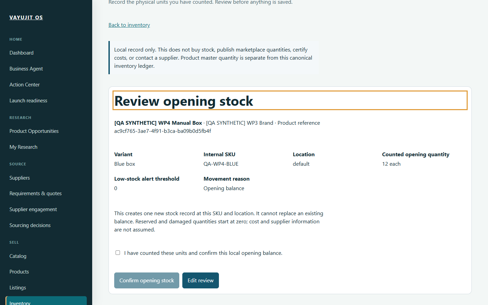

Figure 15. Synthetic opening-stock HUMAN review. The displayed 12 units are not real stock and must not be copied. Genuine historical synthetic capture, 2026-10-30.

### E. What do I see on this page?

Source-defined sections: Add opening stock; Opening stock needs attention; Opening stock recorded; What next?; Review opening stock; 1. Choose an existing product; Current canonical stock for this product; 2. Record your counted units

Detected structures: 0 table declaration(s), 0 dialog declaration(s). Conditional/shared controls can appear only after valid context. Loading, empty, error and blocked conditions must be distinguished; their complete current runtime combinations are not verified in this edition.

| Action shown in source | Meaning and safety | Availability |
| --- | --- | --- |
| Back to inventory | Source-declared navigation/view control; exact destination/state UNVERIFIED. | Not statically disabled |
| Return to inventory | Source-declared navigation/view control; exact destination/state UNVERIFIED. | Not statically disabled |
| Dynamic label varies with the selected record; exact current text is unverified. | Effect UNVERIFIED; potentially changes data or invokes another workflow. Confirm prerequisites before acting. | Conditional |
| Edit review | Source-declared navigation/view control; exact destination/state UNVERIFIED. | Conditional |
| Find products | Source-declared navigation/view control; exact destination/state UNVERIFIED. | Not statically disabled |
| Create a product | Effect UNVERIFIED; potentially changes data or invokes another workflow. Confirm prerequisites before acting. | Not statically disabled |
| Previous products | Source-declared navigation/view control; exact destination/state UNVERIFIED. | Conditional |
| Next products | Source-declared navigation/view control; exact destination/state UNVERIFIED. | Conditional |
| Review opening stock | Source-declared navigation/view control; exact destination/state UNVERIFIED. | Conditional |
| Cancel | Abandons the current local operation where supported; saved records or remote effects may remain. | Not statically disabled |

### F. Input-field guide

Field records below state type, purpose, requiredness, accepted values and examples. Unless a specific effect is described, the parent action’s save/provider effect is UNVERIFIED. Common rule: enter only genuine facts, preserve UNKNOWN and units, and obey backend validation; no blank or unchecked prerequisite is permission to proceed. Complete per-field maintenance records retain these explicit limitations.

| Field | Type requiredness and accepted values | Purpose example and effect |
| --- | --- | --- |
| I have counted these units and confirm this local opening balance. [opening-stock-F001] | checkbox. Required for the canonical confirmation step. Truthful confirmation only. Validation: Truthful confirmation only. | Explicitly confirms the physical count and local opening balance. Example: Check only after independently counting the intended units. Effect: Participates in the HUMAN confirmation boundary. Avoid: Ticking it merely to enable the button. |
| Find product by name or SKU [opening-stock-F002] | text. Requiredness is not established by the template; do not assume optional. Exact API limits/accepted vocabulary are not fully verified. | Provides the stated input to this page’s supported workflow. Example: Use the actual business fact; no invented value is supplied. Effect unverified; common field rules apply. |
| Catalog product [opening-stock-F003] | select. Requiredness is not established by the template; do not assume optional. Select a physical product Additional choices depend on saved records/current context and are UNVERIFIED. | Chooses the relevant saved context or supported option. Example: Choose only a relevant legitimate saved option. Effect unverified; common field rules apply. |
| Product variant [opening-stock-F004] | select. Requiredness is not established by the template; do not assume optional. Product-level stock (no variant) Additional choices depend on saved records/current context and are UNVERIFIED. | Chooses the relevant saved context or supported option. Example: Choose only a relevant legitimate saved option. Effect unverified; common field rules apply. |
| Internal SKU [opening-stock-F005] | text. Requiredness is not established by the template; do not assume optional. maxlength 100 | Provides the stated input to this page’s supported workflow. Example: Use the actual business fact; no invented value is supplied. Effect unverified; common field rules apply. |
| Location code [opening-stock-F006] | text. Requiredness is not established by the template; do not assume optional. maxlength 80 | Provides the stated input to this page’s supported workflow. Example: Use the actual business fact; no invented value is supplied. Effect unverified; common field rules apply. |
| Unit [opening-stock-F007] | text. Requiredness is not established by the template; do not assume optional. maxlength 24 | Provides the stated input to this page’s supported workflow. Example: Use the actual business fact; no invented value is supplied. Effect unverified; common field rules apply. |
| Opening quantity [opening-stock-F008] | number. A valid quantity is needed by the review flow. Whole number, template minimum 0, maximum 2000000000, step 1; applicable backend/workflow validation remains authoritative. Validation: Whole number, template minimum 0, maximum 2000000000, step 1; applicable backend/workflow validation remains authoritative. | Records actual counted starting units. Example: 25 only if 25 units were genuinely counted. Effect: Used in the reviewed opening-balance request for the selected SKU/location. Avoid: Copying synthetic example inventory or counting the same opening twice. |
| Low-stock alert threshold [opening-stock-F009] | number. Requiredness is not established by the template; do not assume optional. min 0; max 2000000000; step 1 | Provides the stated input to this page’s supported workflow. Example: Use the genuine measured amount/quantity; units must be established. Effect unverified; common field rules apply. |

### G. Step-by-step usage

1. Open the intended owned context using the navigation/route above. Verify the brand and any Product, opportunity, supplier, listing or artifact identity before continuing.

2. Review Product, variant, Internal SKU, Location code, Unit, quantity and explicit count confirmation. An uncertain response requires the identical supported retry, not a new duplicate request.

3. Read current warnings and input guidance. Use only an action whose purpose and authority you understand. Stop before unapproved provider, commercial or permanent-data effects.

### H. Worked example

Illustrative task: Record a genuinely counted starting quantity for the intended product/SKU/location. Use a genuine selected record in your own authorized workspace; a synthetic screenshot is a learning example only. The field examples above illustrate the type of input, not prescribed business values.

### I. How to interpret the results

Inspect identity, source/provenance, date/freshness, included assumptions and missing information. A local status, score or successful fake workflow is not proof of real external completion. UNKNOWN, blocked, stale and not-comparable results must retain their actual meaning.

### J. What should I do next?

Verify the saved stock ledger and exact quantity.

### K. Troubleshooting

If context is missing/invalid, use the appropriate collection or saved record link. If a request fails, retain the safe correlation reference and inspect current state before retrying. A 401 needs normal authentication; a 500 is not an empty successful result. Do not force-enable disabled actions or insert synthetic facts.

### L. Availability and limitations

DOCUMENTED BUT NOT CURRENTLY VERIFIED: current template and source inspected; no fresh authenticated session or complete per-control execution performed. Historical synthetic screenshot/functional evidence illustrates only its recorded state. Review Product, variant, Internal SKU, Location code, Unit, quantity and explicit count confirmation. An uncertain response requires the identical supported retry, not a new duplicate request. The entire module is not certified by the presence of a route.

### M. Documentation evidence

Current source: apps/web/src/app/marketplaces/opening-stock.component.ts. Source and template hashes are in source/ui-inventory.json; exact field/action declarations in inventory/field-register.md and source/control-inventory.md. Screenshot evidence: docs/product-handbook/screenshots/inventory/01-opening-review.png (Figure 15).

[Current UI source for Opening stock](../../../apps/web/src/app/marketplaces/opening-stock.component.ts)

## P043 Unified inventory

### A. What is this page?

Inspect stock positions, movements and marketplace mappings for the intended SKU.

### B. Why would someone use it?

Product master quantity is not this ledger. A stock adjustment is a real local data change and needs a truthful reason and correct scope.

### C. Where can I find it?

Sell → Inventory → /marketplaces/inventory

Route: /marketplaces/inventory

### D. Screenshot

MISSING: no reviewed safe screenshot selected for this page family. The source-defined layout below is not a substitute for a real current capture.

### E. What do I see on this page?

Source-defined sections: Unified inventory; Dynamic label varies with the selected record; exact current text is unverified.

Detected structures: 2 table declaration(s), 0 dialog declaration(s). Conditional/shared controls can appear only after valid context. Loading, empty, error and blocked conditions must be distinguished; their complete current runtime combinations are not verified in this edition.

| Action shown in source | Meaning and safety | Availability |
| --- | --- | --- |
| Add opening stock | Source-declared navigation/view control; exact destination/state UNVERIFIED. | Not statically disabled |
| Refresh | Reloads the relevant view; exact data-source side effects still depend on that screen. | Not statically disabled |
| Dynamic label varies with the selected record; exact current text is unverified. | Source-declared navigation/view control; exact destination/state UNVERIFIED. | Not statically disabled |
| Dynamic label varies with the selected record; exact current text is unverified. | Source-declared navigation/view control; exact destination/state UNVERIFIED. | Not statically disabled |
| Dynamic label varies with the selected record; exact current text is unverified. | Source-declared navigation/view control; exact destination/state UNVERIFIED. | Not statically disabled |
| Dynamic label varies with the selected record; exact current text is unverified. | Source-declared navigation/view control; exact destination/state UNVERIFIED. | Conditional |
| Dynamic label varies with the selected record; exact current text is unverified. | Effect UNVERIFIED; potentially changes data or invokes another workflow. Confirm prerequisites before acting. | Conditional |
| Cancel | Abandons the current local operation where supported; saved records or remote effects may remain. | Not statically disabled |

### F. Input-field guide

Field records below state type, purpose, requiredness, accepted values and examples. Unless a specific effect is described, the parent action’s save/provider effect is UNVERIFIED. Common rule: enter only genuine facts, preserve UNKNOWN and units, and obey backend validation; no blank or unchecked prerequisite is permission to proceed. Complete per-field maintenance records retain these explicit limitations.

| Field | Type requiredness and accepted values | Purpose example and effect |
| --- | --- | --- |
| SKU search [unified-inventory-F001] | text. Requiredness is not established by the template; do not assume optional. Exact API limits/accepted vocabulary are not fully verified. | Narrows the records shown for the stated context. Example: An existing product name or SKU. Effect unverified; common field rules apply. |
| Low stock only [unified-inventory-F002] | checkbox. Requiredness is not established by the template; do not assume optional. Checked or unchecked; confirm only truthful statements. | Records the specific choice or confirmation stated by its label. Example: Leave unchecked unless the statement is true. Effect unverified; common field rules apply. |
| Delta [unified-inventory-F003] | number. Required in the template. Exact API limits/accepted vocabulary are not fully verified. | Provides the stated input to this page’s supported workflow. Example: Use the genuine measured amount/quantity; units must be established. Effect unverified; common field rules apply. |
| Reason [unified-inventory-F004] | text. Required in the template. Exact API limits/accepted vocabulary are not fully verified. | Records your scoped explanation; keep it factual and free of secrets. Example: Use the actual business fact; no invented value is supplied. Effect unverified; common field rules apply. |
| Marketplace account [unified-inventory-F005] | select. Required in the template. Select an account Additional choices depend on saved records/current context and are UNVERIFIED. | Chooses the relevant saved context or supported option. Example: Choose only a relevant legitimate saved option. Effect unverified; common field rules apply. |
| External SKU [unified-inventory-F006] | text. Required in the template. maxlength 160 | Provides the stated input to this page’s supported workflow. Example: Use the actual business fact; no invented value is supplied. Effect unverified; common field rules apply. |

### G. Step-by-step usage

1. Open the intended owned context using the navigation/route above. Verify the brand and any Product, opportunity, supplier, listing or artifact identity before continuing.

2. Product master quantity is not this ledger. A stock adjustment is a real local data change and needs a truthful reason and correct scope.

3. Read current warnings and input guidance. Use only an action whose purpose and authority you understand. Stop before unapproved provider, commercial or permanent-data effects.

### H. Worked example

Illustrative task: Inspect stock positions, movements and marketplace mappings for the intended SKU. Use a genuine selected record in your own authorized workspace; a synthetic screenshot is a learning example only. The field examples above illustrate the type of input, not prescribed business values.

### I. How to interpret the results

Inspect identity, source/provenance, date/freshness, included assumptions and missing information. A local status, score or successful fake workflow is not proof of real external completion. UNKNOWN, blocked, stale and not-comparable results must retain their actual meaning.

### J. What should I do next?

Review related orders or counted stock evidence; do not fabricate inventory.

### K. Troubleshooting

If context is missing/invalid, use the appropriate collection or saved record link. If a request fails, retain the safe correlation reference and inspect current state before retrying. A 401 needs normal authentication; a 500 is not an empty successful result. Do not force-enable disabled actions or insert synthetic facts.

### L. Availability and limitations

DOCUMENTED BUT NOT CURRENTLY VERIFIED: current template and source inspected; no fresh authenticated session or complete per-control execution performed. Screenshot coverage is BLOCKED pending an approved safe session. Product master quantity is not this ledger. A stock adjustment is a real local data change and needs a truthful reason and correct scope. The entire module is not certified by the presence of a route.

### M. Documentation evidence

Current source: apps/web/src/app/marketplaces/unified-inventory.component.ts. Source and template hashes are in source/ui-inventory.json; exact field/action declarations in inventory/field-register.md and source/control-inventory.md. Missing screenshot recorded in quality/documentation-gaps.md.

[Current UI source for Unified inventory](../../../apps/web/src/app/marketplaces/unified-inventory.component.ts)

## P044 Unified orders

### A. What is this page?

Inspect recorded order states, provenance and product/inventory context.

### B. Why would someone use it?

Synthetic ingestion is not real seller activity. Check source identity and duplicate/stale behavior before any supported action.

### C. Where can I find it?

Sell → Orders → /marketplaces/orders

Route: /marketplaces/orders

### D. Screenshot

MISSING: no reviewed safe screenshot selected for this page family. The source-defined layout below is not a substitute for a real current capture.

### E. What do I see on this page?

Source-defined sections: Unified orders; Dynamic label varies with the selected record; exact current text is unverified.

Detected structures: 1 table declaration(s), 0 dialog declaration(s). Conditional/shared controls can appear only after valid context. Loading, empty, error and blocked conditions must be distinguished; their complete current runtime combinations are not verified in this edition.

| Action shown in source | Meaning and safety | Availability |
| --- | --- | --- |
| Review account prerequisites | Source-declared navigation/view control; exact destination/state UNVERIFIED. | Not statically disabled |
| Review inventory | Source-declared navigation/view control; exact destination/state UNVERIFIED. | Not statically disabled |
| Review financial evidence | Source-declared navigation/view control; exact destination/state UNVERIFIED. | Not statically disabled |
| Refresh | Reloads the relevant view; exact data-source side effects still depend on that screen. | Not statically disabled |
| Dynamic label varies with the selected record; exact current text is unverified. | Source-declared navigation/view control; exact destination/state UNVERIFIED. | Not statically disabled |
| Review this product | Source-declared navigation/view control; exact destination/state UNVERIFIED. | Not statically disabled |
| Review this product inventory | Source-declared navigation/view control; exact destination/state UNVERIFIED. | Not statically disabled |

### F. Input-field guide

Field records below state type, purpose, requiredness, accepted values and examples. Unless a specific effect is described, the parent action’s save/provider effect is UNVERIFIED. Common rule: enter only genuine facts, preserve UNKNOWN and units, and obey backend validation; no blank or unchecked prerequisite is permission to proceed. Complete per-field maintenance records retain these explicit limitations.

| Field | Type requiredness and accepted values | Purpose example and effect |
| --- | --- | --- |
| Marketplace [unified-orders-F001] | text. Requiredness is not established by the template; do not assume optional. Exact API limits/accepted vocabulary are not fully verified. | Provides the stated input to this page’s supported workflow. Example: Use the actual business fact; no invented value is supplied. Effect unverified; common field rules apply. |
| Status [unified-orders-F002] | text. Requiredness is not established by the template; do not assume optional. Exact API limits/accepted vocabulary are not fully verified. | Provides the stated input to this page’s supported workflow. Example: Use the actual business fact; no invented value is supplied. Effect unverified; common field rules apply. |

### G. Step-by-step usage

1. Open the intended owned context using the navigation/route above. Verify the brand and any Product, opportunity, supplier, listing or artifact identity before continuing.

2. Synthetic ingestion is not real seller activity. Check source identity and duplicate/stale behavior before any supported action.

3. Read current warnings and input guidance. Use only an action whose purpose and authority you understand. Stop before unapproved provider, commercial or permanent-data effects.

### H. Worked example

Illustrative task: Inspect recorded order states, provenance and product/inventory context. Use a genuine selected record in your own authorized workspace; a synthetic screenshot is a learning example only. The field examples above illustrate the type of input, not prescribed business values.

### I. How to interpret the results

Inspect identity, source/provenance, date/freshness, included assumptions and missing information. A local status, score or successful fake workflow is not proof of real external completion. UNKNOWN, blocked, stale and not-comparable results must retain their actual meaning.

### J. What should I do next?

Review stock implications and Finance source evidence.

### K. Troubleshooting

If context is missing/invalid, use the appropriate collection or saved record link. If a request fails, retain the safe correlation reference and inspect current state before retrying. A 401 needs normal authentication; a 500 is not an empty successful result. Do not force-enable disabled actions or insert synthetic facts.

### L. Availability and limitations

DOCUMENTED BUT NOT CURRENTLY VERIFIED: current template and source inspected; no fresh authenticated session or complete per-control execution performed. Screenshot coverage is BLOCKED pending an approved safe session. Synthetic ingestion is not real seller activity. Check source identity and duplicate/stale behavior before any supported action. The entire module is not certified by the presence of a route.

### M. Documentation evidence

Current source: apps/web/src/app/marketplaces/unified-orders.component.ts. Source and template hashes are in source/ui-inventory.json; exact field/action declarations in inventory/field-register.md and source/control-inventory.md. Missing screenshot recorded in quality/documentation-gaps.md.

[Current UI source for Unified orders](../../../apps/web/src/app/marketplaces/unified-orders.component.ts)

## P045 Marketplace settlements

### A. What is this page?

Inspect settlement-related records and supported filters.

### B. Why would someone use it?

An entered or synthetic settlement is not a bank-reconciled payment. Keep currency, source and evidence classification visible.

### C. Where can I find it?

Contextual link from the relevant owned record, or the exact route below; not a separately verified primary-menu item.

Route: /marketplaces/settlements

### D. Screenshot

MISSING: no reviewed safe screenshot selected for this page family. The source-defined layout below is not a substitute for a real current capture.

### E. What do I see on this page?

Source-defined sections: Marketplace settlements

Detected structures: 1 table declaration(s), 0 dialog declaration(s). Conditional/shared controls can appear only after valid context. Loading, empty, error and blocked conditions must be distinguished; their complete current runtime combinations are not verified in this edition.

No direct action buttons/links were extracted from this component; shared or dynamic controls may still exist.

### F. Input-field guide

Field records below state type, purpose, requiredness, accepted values and examples. Unless a specific effect is described, the parent action’s save/provider effect is UNVERIFIED. Common rule: enter only genuine facts, preserve UNKNOWN and units, and obey backend validation; no blank or unchecked prerequisite is permission to proceed. Complete per-field maintenance records retain these explicit limitations.

| Field | Type requiredness and accepted values | Purpose example and effect |
| --- | --- | --- |
| Marketplace [marketplace-settlements-F001] | select. Requiredness is not established by the template; do not assume optional. All Additional choices depend on saved records/current context and are UNVERIFIED. | Chooses the relevant saved context or supported option. Example: Choose only a relevant legitimate saved option. Effect unverified; common field rules apply. |
| Status [marketplace-settlements-F002] | text. Requiredness is not established by the template; do not assume optional. Exact API limits/accepted vocabulary are not fully verified. | Provides the stated input to this page’s supported workflow. Example: Use the actual business fact; no invented value is supplied. Effect unverified; common field rules apply. |
| Currency [marketplace-settlements-F003] | text. Requiredness is not established by the template; do not assume optional. maxlength 3 | Provides the stated input to this page’s supported workflow. Example: INR only if this is the genuine currency. Effect unverified; common field rules apply. |
| From [marketplace-settlements-F004] | date. Requiredness is not established by the template; do not assume optional. Exact API limits/accepted vocabulary are not fully verified. | Provides the stated input to this page’s supported workflow. Example: 2026-12-01, illustrative only; verify scheduling timezone. Effect unverified; common field rules apply. |
| To [marketplace-settlements-F005] | date. Requiredness is not established by the template; do not assume optional. Exact API limits/accepted vocabulary are not fully verified. | Provides the stated input to this page’s supported workflow. Example: 2026-12-01, illustrative only; verify scheduling timezone. Effect unverified; common field rules apply. |

### G. Step-by-step usage

1. Open the intended owned context using the navigation/route above. Verify the brand and any Product, opportunity, supplier, listing or artifact identity before continuing.

2. An entered or synthetic settlement is not a bank-reconciled payment. Keep currency, source and evidence classification visible.

3. Read current warnings and input guidance. Use only an action whose purpose and authority you understand. Stop before unapproved provider, commercial or permanent-data effects.

### H. Worked example

Illustrative task: Inspect settlement-related records and supported filters. Use a genuine selected record in your own authorized workspace; a synthetic screenshot is a learning example only. The field examples above illustrate the type of input, not prescribed business values.

### I. How to interpret the results

Inspect identity, source/provenance, date/freshness, included assumptions and missing information. A local status, score or successful fake workflow is not proof of real external completion. UNKNOWN, blocked, stale and not-comparable results must retain their actual meaning.

### J. What should I do next?

Review financial projections and genuine reconciliation prerequisites.

### K. Troubleshooting

If context is missing/invalid, use the appropriate collection or saved record link. If a request fails, retain the safe correlation reference and inspect current state before retrying. A 401 needs normal authentication; a 500 is not an empty successful result. Do not force-enable disabled actions or insert synthetic facts.

### L. Availability and limitations

DOCUMENTED BUT NOT CURRENTLY VERIFIED: current template and source inspected; no fresh authenticated session or complete per-control execution performed. Screenshot coverage is BLOCKED pending an approved safe session. An entered or synthetic settlement is not a bank-reconciled payment. Keep currency, source and evidence classification visible. The entire module is not certified by the presence of a route.

### M. Documentation evidence

Current source: apps/web/src/app/marketplaces/marketplace-settlements.component.ts. Source and template hashes are in source/ui-inventory.json; exact field/action declarations in inventory/field-register.md and source/control-inventory.md. Missing screenshot recorded in quality/documentation-gaps.md.

[Current UI source for Marketplace settlements](../../../apps/web/src/app/marketplaces/marketplace-settlements.component.ts)

## P046 Marketplace analytics

### A. What is this page?

Inspect supported recorded marketplace analytics.

### B. Why would someone use it?

A chart without real authorized imports is not evidence of actual marketplace sales.

### C. Where can I find it?

Contextual link from the relevant owned record, or the exact route below; not a separately verified primary-menu item.

Route: /marketplaces/analytics

### D. Screenshot

MISSING: no reviewed safe screenshot selected for this page family. The source-defined layout below is not a substitute for a real current capture.

### E. What do I see on this page?

Source-defined sections: Marketplace analytics

Detected structures: 1 table declaration(s), 0 dialog declaration(s). Conditional/shared controls can appear only after valid context. Loading, empty, error and blocked conditions must be distinguished; their complete current runtime combinations are not verified in this edition.

No direct action buttons/links were extracted from this component; shared or dynamic controls may still exist.

### F. Input-field guide

No direct editable fields were extracted from this page template. Review controls inherited from shared components in the shared-field appendix. No missing form is invented.

### G. Step-by-step usage

1. Open the intended owned context using the navigation/route above. Verify the brand and any Product, opportunity, supplier, listing or artifact identity before continuing.

2. A chart without real authorized imports is not evidence of actual marketplace sales.

3. Read current warnings and input guidance. Use only an action whose purpose and authority you understand. Stop before unapproved provider, commercial or permanent-data effects.

### H. Worked example

Illustrative task: Inspect supported recorded marketplace analytics. Use a genuine selected record in your own authorized workspace; a synthetic screenshot is a learning example only. The expected type of result is the relevant recorded view or a truthful empty/blocked state, not fabricated data.

### I. How to interpret the results

Inspect identity, source/provenance, date/freshness, included assumptions and missing information. A local status, score or successful fake workflow is not proof of real external completion. UNKNOWN, blocked, stale and not-comparable results must retain their actual meaning.

### J. What should I do next?

Inspect source records and date coverage before using an aggregate.

### K. Troubleshooting

If context is missing/invalid, use the appropriate collection or saved record link. If a request fails, retain the safe correlation reference and inspect current state before retrying. A 401 needs normal authentication; a 500 is not an empty successful result. Do not force-enable disabled actions or insert synthetic facts.

### L. Availability and limitations

DOCUMENTED BUT NOT CURRENTLY VERIFIED: current template and source inspected; no fresh authenticated session or complete per-control execution performed. Screenshot coverage is BLOCKED pending an approved safe session. A chart without real authorized imports is not evidence of actual marketplace sales. The entire module is not certified by the presence of a route.

### M. Documentation evidence

Current source: apps/web/src/app/marketplaces/marketplace-analytics.component.ts. Source and template hashes are in source/ui-inventory.json; exact field/action declarations in inventory/field-register.md and source/control-inventory.md. Missing screenshot recorded in quality/documentation-gaps.md.

[Current UI source for Marketplace analytics](../../../apps/web/src/app/marketplaces/marketplace-analytics.component.ts)

## P047 Sales and profitability

### A. What is this page?

Review recorded revenue/deductions/cost inputs and current financial projections.

### B. Why would someone use it?

Keep UNKNOWN costs, source precision and currency boundaries. Current same-version projections are mutable, not an immutable ledger.

### C. Where can I find it?

Sell → Financials → /marketplaces/financials

Route: /marketplaces/financials

### D. Screenshot

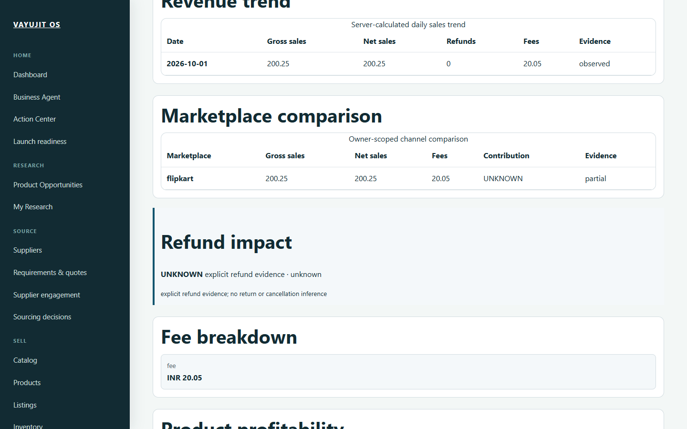

Figure 16. Synthetic financial table and UNKNOWN contribution. An observed label inside a synthetic fixture is not genuine marketplace evidence. Genuine historical synthetic capture, 2026-11-05.

### E. What do I see on this page?

Source-defined sections: Sales & profitability; Financial alerts; Revenue trend; Marketplace comparison; Refund impact; Fee breakdown; Product profitability; Settlement reconciliation; Business Agent guidance

Detected structures: 4 table declaration(s), 0 dialog declaration(s). Conditional/shared controls can appear only after valid context. Loading, empty, error and blocked conditions must be distinguished; their complete current runtime combinations are not verified in this edition.

| Action shown in source | Meaning and safety | Availability |
| --- | --- | --- |
| Review source orders | Source-declared navigation/view control; exact destination/state UNVERIFIED. | Not statically disabled |
| Review operational recommendations | Source-declared navigation/view control; exact destination/state UNVERIFIED. | Not statically disabled |
| Review product cost context | Source-declared navigation/view control; exact destination/state UNVERIFIED. | Not statically disabled |
| Refresh evidence | Source-declared navigation/view control; exact destination/state UNVERIFIED. | Not statically disabled |
| Dynamic label varies with the selected record; exact current text is unverified. | Source-declared navigation/view control; exact destination/state UNVERIFIED. | Not statically disabled |

### F. Input-field guide

Field records below state type, purpose, requiredness, accepted values and examples. Unless a specific effect is described, the parent action’s save/provider effect is UNVERIFIED. Common rule: enter only genuine facts, preserve UNKNOWN and units, and obey backend validation; no blank or unchecked prerequisite is permission to proceed. Complete per-field maintenance records retain these explicit limitations.

| Field | Type requiredness and accepted values | Purpose example and effect |
| --- | --- | --- |
| Marketplace [financial-workspace-F001] | select. Requiredness is not established by the template; do not assume optional. All marketplaces; Amazon; Flipkart | Chooses the relevant saved context or supported option. Example: Choose only a relevant legitimate saved option. Effect unverified; common field rules apply. |
| Date from [financial-workspace-F002] | date. Requiredness is not established by the template; do not assume optional. Exact API limits/accepted vocabulary are not fully verified. | Provides the stated input to this page’s supported workflow. Example: 2026-12-01, illustrative only; verify scheduling timezone. Effect unverified; common field rules apply. |
| Date to [financial-workspace-F003] | date. Requiredness is not established by the template; do not assume optional. Exact API limits/accepted vocabulary are not fully verified. | Provides the stated input to this page’s supported workflow. Example: 2026-12-01, illustrative only; verify scheduling timezone. Effect unverified; common field rules apply. |

### G. Step-by-step usage

1. Open the intended owned context using the navigation/route above. Verify the brand and any Product, opportunity, supplier, listing or artifact identity before continuing.

2. Keep UNKNOWN costs, source precision and currency boundaries. Current same-version projections are mutable, not an immutable ledger.

3. Read current warnings and input guidance. Use only an action whose purpose and authority you understand. Stop before unapproved provider, commercial or permanent-data effects.

### H. Worked example

Illustrative task: Review recorded revenue/deductions/cost inputs and current financial projections. Use a genuine selected record in your own authorized workspace; a synthetic screenshot is a learning example only. The field examples above illustrate the type of input, not prescribed business values.

### I. How to interpret the results

Inspect identity, source/provenance, date/freshness, included assumptions and missing information. A local status, score or successful fake workflow is not proof of real external completion. UNKNOWN, blocked, stale and not-comparable results must retain their actual meaning.

### J. What should I do next?

Review missing financial inputs and the separately chosen accounting authority.

### K. Troubleshooting

If context is missing/invalid, use the appropriate collection or saved record link. If a request fails, retain the safe correlation reference and inspect current state before retrying. A 401 needs normal authentication; a 500 is not an empty successful result. Do not force-enable disabled actions or insert synthetic facts.

### L. Availability and limitations

DOCUMENTED BUT NOT CURRENTLY VERIFIED: current template and source inspected; no fresh authenticated session or complete per-control execution performed. Historical synthetic screenshot/functional evidence illustrates only its recorded state. Keep UNKNOWN costs, source precision and currency boundaries. Current same-version projections are mutable, not an immutable ledger. The entire module is not certified by the presence of a route.

### M. Documentation evidence

Current source: apps/web/src/app/marketplaces/financial-workspace.component.ts. Source and template hashes are in source/ui-inventory.json; exact field/action declarations in inventory/field-register.md and source/control-inventory.md. Screenshot evidence: docs/product-handbook/screenshots/financials/01-unknown-profit.png (Figure 16).

[Current UI source for Sales and profitability](../../../apps/web/src/app/marketplaces/financial-workspace.component.ts)

## P048 Brands

### A. What is this page?

Find, filter and choose the appropriate owned brand.

### B. Why would someone use it?

Active brand affects subsequent context. Do not archive or change brand state while merely browsing a tutorial.

### C. Where can I find it?

Contextual link from the relevant owned record, or the exact route below; not a separately verified primary-menu item.

Route: /brands

### D. Screenshot

MISSING: no reviewed safe screenshot selected for this page family. The source-defined layout below is not a substitute for a real current capture.

### E. What do I see on this page?

Source-defined sections: Brands; Dynamic label varies with the selected record; exact current text is unverified.

Detected structures: 0 table declaration(s), 0 dialog declaration(s). Conditional/shared controls can appear only after valid context. Loading, empty, error and blocked conditions must be distinguished; their complete current runtime combinations are not verified in this edition.

| Action shown in source | Meaning and safety | Availability |
| --- | --- | --- |
| Create brand | Effect UNVERIFIED; potentially changes data or invokes another workflow. Confirm prerequisites before acting. | Not statically disabled |
| Apply | Source-declared navigation/view control; exact destination/state UNVERIFIED. | Not statically disabled |
| Dynamic label varies with the selected record; exact current text is unverified. | Source-declared navigation/view control; exact destination/state UNVERIFIED. | Not statically disabled |
| View | Source-declared navigation/view control; exact destination/state UNVERIFIED. | Not statically disabled |
| Edit | Opens the relevant edit state; saving is a separate action. | Not statically disabled |
| Activate | Effect UNVERIFIED; potentially changes data or invokes another workflow. Confirm prerequisites before acting. | Not statically disabled |
| Archive | Source-declared navigation/view control; exact destination/state UNVERIFIED. | Not statically disabled |
| Restore | Source-declared navigation/view control; exact destination/state UNVERIFIED. | Not statically disabled |
| Previous | Source-declared navigation/view control; exact destination/state UNVERIFIED. | Conditional |
| Next | Source-declared navigation/view control; exact destination/state UNVERIFIED. | Conditional |

### F. Input-field guide

Field records below state type, purpose, requiredness, accepted values and examples. Unless a specific effect is described, the parent action’s save/provider effect is UNVERIFIED. Common rule: enter only genuine facts, preserve UNKNOWN and units, and obey backend validation; no blank or unchecked prerequisite is permission to proceed. Complete per-field maintenance records retain these explicit limitations.

| Field | Type requiredness and accepted values | Purpose example and effect |
| --- | --- | --- |
| Search [brand-list-F001] | text. Requiredness is not established by the template; do not assume optional. Exact API limits/accepted vocabulary are not fully verified. | Narrows the records shown for the stated context. Example: An existing product name or SKU. Effect unverified; common field rules apply. |
| Status [brand-list-F002] | select. Requiredness is not established by the template; do not assume optional. All active; Active; Archived | Chooses the relevant saved context or supported option. Example: Choose only a relevant legitimate saved option. Effect unverified; common field rules apply. |
| Include archived [brand-list-F003] | checkbox. Requiredness is not established by the template; do not assume optional. Checked or unchecked; confirm only truthful statements. | Records the specific choice or confirmation stated by its label. Example: Leave unchecked unless the statement is true. Effect unverified; common field rules apply. |

### G. Step-by-step usage

1. Open the intended owned context using the navigation/route above. Verify the brand and any Product, opportunity, supplier, listing or artifact identity before continuing.

2. Active brand affects subsequent context. Do not archive or change brand state while merely browsing a tutorial.

3. Read current warnings and input guidance. Use only an action whose purpose and authority you understand. Stop before unapproved provider, commercial or permanent-data effects.

### H. Worked example

Illustrative task: Find, filter and choose the appropriate owned brand. Use a genuine selected record in your own authorized workspace; a synthetic screenshot is a learning example only. The field examples above illustrate the type of input, not prescribed business values.

### I. How to interpret the results

Inspect identity, source/provenance, date/freshness, included assumptions and missing information. A local status, score or successful fake workflow is not proof of real external completion. UNKNOWN, blocked, stale and not-comparable results must retain their actual meaning.

### J. What should I do next?

Open the chosen brand or its owned Products.

### K. Troubleshooting

If context is missing/invalid, use the appropriate collection or saved record link. If a request fails, retain the safe correlation reference and inspect current state before retrying. A 401 needs normal authentication; a 500 is not an empty successful result. Do not force-enable disabled actions or insert synthetic facts.

### L. Availability and limitations

DOCUMENTED BUT NOT CURRENTLY VERIFIED: current template and source inspected; no fresh authenticated session or complete per-control execution performed. Screenshot coverage is BLOCKED pending an approved safe session. Active brand affects subsequent context. Do not archive or change brand state while merely browsing a tutorial. The entire module is not certified by the presence of a route.

### M. Documentation evidence

Current source: apps/web/src/app/brands/brand-list.component.ts. Source and template hashes are in source/ui-inventory.json; exact field/action declarations in inventory/field-register.md and source/control-inventory.md. Missing screenshot recorded in quality/documentation-gaps.md.

[Current UI source for Brands](../../../apps/web/src/app/brands/brand-list.component.ts)

## P049 Create or edit brand

### A. What is this page?

Enter truthful brand identity and supported descriptive settings.

### B. Why would someone use it?

Do not fabricate legal registration, websites or brand claims. Review required validation before saving.

### C. Where can I find it?

Contextual link from the relevant owned record, or the exact route below; not a separately verified primary-menu item.

Route: /brands/new

Route: /brands/:id/edit — replace a parameter only through a legitimate saved record link, not a guessed ID.

### D. Screenshot

MISSING: no reviewed safe screenshot selected for this page family. The source-defined layout below is not a substitute for a real current capture.

### E. What do I see on this page?

Source-defined sections: Dynamic label varies with the selected record; exact current text is unverified.

Detected structures: 0 table declaration(s), 0 dialog declaration(s). Conditional/shared controls can appear only after valid context. Loading, empty, error and blocked conditions must be distinguished; their complete current runtime combinations are not verified in this edition.

| Action shown in source | Meaning and safety | Availability |
| --- | --- | --- |
| Cancel | Abandons the current local operation where supported; saved records or remote effects may remain. | Not statically disabled |
| Dynamic label varies with the selected record; exact current text is unverified. | Effect UNVERIFIED; potentially changes data or invokes another workflow. Confirm prerequisites before acting. | Conditional |

### F. Input-field guide

Field records below state type, purpose, requiredness, accepted values and examples. Unless a specific effect is described, the parent action’s save/provider effect is UNVERIFIED. Common rule: enter only genuine facts, preserve UNKNOWN and units, and obey backend validation; no blank or unchecked prerequisite is permission to proceed. Complete per-field maintenance records retain these explicit limitations.

| Field | Type requiredness and accepted values | Purpose example and effect |
| --- | --- | --- |
| Name * [brand-form-F001] | text. Requiredness is conditional/client-defined; review the current form. maxlength 120 | Provides the stated input to this page’s supported workflow. Example: Use the actual business fact; no invented value is supplied. Effect unverified; common field rules apply. |
| Slug override [brand-form-F002] | text. Requiredness is not established by the template; do not assume optional. maxlength 120 | Provides the stated input to this page’s supported workflow. Example: Use the actual business fact; no invented value is supplied. Effect unverified; common field rules apply. |
| Tagline [brand-form-F003] | text. Requiredness is not established by the template; do not assume optional. maxlength 240 | Provides the stated input to this page’s supported workflow. Example: Use the actual business fact; no invented value is supplied. Effect unverified; common field rules apply. |
| Description [brand-form-F004] | textarea. Requiredness is not established by the template; do not assume optional. maxlength 5000 | Provides the stated input to this page’s supported workflow. Example: Use the actual business fact; no invented value is supplied. Effect unverified; common field rules apply. |
| Website URL [brand-form-F005] | url. Requiredness is not established by the template; do not assume optional. Exact API limits/accepted vocabulary are not fully verified. | Provides the stated input to this page’s supported workflow. Example: Use the actual business fact; no invented value is supplied. Effect unverified; common field rules apply. |
| Primary color [brand-form-F006] | color. Requiredness is not established by the template; do not assume optional. Exact API limits/accepted vocabulary are not fully verified. | Provides the stated input to this page’s supported workflow. Example: Use the actual business fact; no invented value is supplied. Effect unverified; common field rules apply. |
| Secondary color [brand-form-F007] | color. Requiredness is not established by the template; do not assume optional. Exact API limits/accepted vocabulary are not fully verified. | Provides the stated input to this page’s supported workflow. Example: Use the actual business fact; no invented value is supplied. Effect unverified; common field rules apply. |

### G. Step-by-step usage

1. Open the intended owned context using the navigation/route above. Verify the brand and any Product, opportunity, supplier, listing or artifact identity before continuing.

2. Do not fabricate legal registration, websites or brand claims. Review required validation before saving.

3. Read current warnings and input guidance. Use only an action whose purpose and authority you understand. Stop before unapproved provider, commercial or permanent-data effects.

### H. Worked example

Illustrative task: Enter truthful brand identity and supported descriptive settings. Use a genuine selected record in your own authorized workspace; a synthetic screenshot is a learning example only. The field examples above illustrate the type of input, not prescribed business values.

### I. How to interpret the results

Inspect identity, source/provenance, date/freshness, included assumptions and missing information. A local status, score or successful fake workflow is not proof of real external completion. UNKNOWN, blocked, stale and not-comparable results must retain their actual meaning.

### J. What should I do next?

Choose the intended active brand and create/review its Product.

### K. Troubleshooting

If context is missing/invalid, use the appropriate collection or saved record link. If a request fails, retain the safe correlation reference and inspect current state before retrying. A 401 needs normal authentication; a 500 is not an empty successful result. Do not force-enable disabled actions or insert synthetic facts.

### L. Availability and limitations

DOCUMENTED BUT NOT CURRENTLY VERIFIED: current template and source inspected; no fresh authenticated session or complete per-control execution performed. Screenshot coverage is BLOCKED pending an approved safe session. Do not fabricate legal registration, websites or brand claims. Review required validation before saving. The entire module is not certified by the presence of a route.

### M. Documentation evidence

Current source: apps/web/src/app/brands/brand-form.component.ts. Source and template hashes are in source/ui-inventory.json; exact field/action declarations in inventory/field-register.md and source/control-inventory.md. Missing screenshot recorded in quality/documentation-gaps.md.

[Current UI source for Create or edit brand](../../../apps/web/src/app/brands/brand-form.component.ts)

## P050 Brand detail

### A. What is this page?

Inspect one owned brand and its related supported operations.

### B. Why would someone use it?

Confirm identity before following product/content links.

### C. Where can I find it?

Contextual link from the relevant owned record, or the exact route below; not a separately verified primary-menu item.

Route: /brands/:id — replace a parameter only through a legitimate saved record link, not a guessed ID.

### D. Screenshot

MISSING: no reviewed safe screenshot selected for this page family. The source-defined layout below is not a substitute for a real current capture.

### E. What do I see on this page?

Source-defined sections: Dynamic label varies with the selected record; exact current text is unverified.; Recent activity

Detected structures: 0 table declaration(s), 0 dialog declaration(s). Conditional/shared controls can appear only after valid context. Loading, empty, error and blocked conditions must be distinguished; their complete current runtime combinations are not verified in this edition.

| Action shown in source | Meaning and safety | Availability |
| --- | --- | --- |
| Back | Source-declared navigation/view control; exact destination/state UNVERIFIED. | Not statically disabled |
| Edit | Opens the relevant edit state; saving is a separate action. | Not statically disabled |
| Set active | Source-declared navigation/view control; exact destination/state UNVERIFIED. | Not statically disabled |
| Archive | Source-declared navigation/view control; exact destination/state UNVERIFIED. | Not statically disabled |
| Restore | Source-declared navigation/view control; exact destination/state UNVERIFIED. | Not statically disabled |

### F. Input-field guide

No direct editable fields were extracted from this page template. Review controls inherited from shared components in the shared-field appendix. No missing form is invented.

### G. Step-by-step usage

1. Open the intended owned context using the navigation/route above. Verify the brand and any Product, opportunity, supplier, listing or artifact identity before continuing.

2. Confirm identity before following product/content links.

3. Read current warnings and input guidance. Use only an action whose purpose and authority you understand. Stop before unapproved provider, commercial or permanent-data effects.

### H. Worked example

Illustrative task: Inspect one owned brand and its related supported operations. Use a genuine selected record in your own authorized workspace; a synthetic screenshot is a learning example only. The expected type of result is the relevant recorded view or a truthful empty/blocked state, not fabricated data.

### I. How to interpret the results

Inspect identity, source/provenance, date/freshness, included assumptions and missing information. A local status, score or successful fake workflow is not proof of real external completion. UNKNOWN, blocked, stale and not-comparable results must retain their actual meaning.

### J. What should I do next?

Review Products, content or supported brand settings.

### K. Troubleshooting

If context is missing/invalid, use the appropriate collection or saved record link. If a request fails, retain the safe correlation reference and inspect current state before retrying. A 401 needs normal authentication; a 500 is not an empty successful result. Do not force-enable disabled actions or insert synthetic facts.

### L. Availability and limitations

DOCUMENTED BUT NOT CURRENTLY VERIFIED: current template and source inspected; no fresh authenticated session or complete per-control execution performed. Screenshot coverage is BLOCKED pending an approved safe session. Confirm identity before following product/content links. The entire module is not certified by the presence of a route.

### M. Documentation evidence

Current source: apps/web/src/app/brands/brand-details.component.ts. Source and template hashes are in source/ui-inventory.json; exact field/action declarations in inventory/field-register.md and source/control-inventory.md. Missing screenshot recorded in quality/documentation-gaps.md.

[Current UI source for Brand detail](../../../apps/web/src/app/brands/brand-details.component.ts)

## P051 Products

### A. What is this page?

Find and manage the seller-owned product master collection.

### B. Why would someone use it?

Filters and lifecycle distinguish eligible active products from drafts; a draft is not a nonexistent product.

### C. Where can I find it?

Sell → Products → /products

Route: /products

### D. Screenshot

MISSING: no reviewed safe screenshot selected for this page family. The source-defined layout below is not a substitute for a real current capture.

### E. What do I see on this page?

Source-defined sections: Products; Dynamic label varies with the selected record; exact current text is unverified.

Detected structures: 0 table declaration(s), 0 dialog declaration(s). Conditional/shared controls can appear only after valid context. Loading, empty, error and blocked conditions must be distinguished; their complete current runtime combinations are not verified in this edition.

| Action shown in source | Meaning and safety | Availability |
| --- | --- | --- |
| Create product | Effect UNVERIFIED; potentially changes data or invokes another workflow. Confirm prerequisites before acting. | Not statically disabled |
| Apply | Source-declared navigation/view control; exact destination/state UNVERIFIED. | Not statically disabled |
| Manage brands | Source-declared navigation/view control; exact destination/state UNVERIFIED. | Not statically disabled |
| Dynamic label varies with the selected record; exact current text is unverified. | Source-declared navigation/view control; exact destination/state UNVERIFIED. | Not statically disabled |
| View | Source-declared navigation/view control; exact destination/state UNVERIFIED. | Not statically disabled |
| Edit | Opens the relevant edit state; saving is a separate action. | Not statically disabled |
| Activate | Effect UNVERIFIED; potentially changes data or invokes another workflow. Confirm prerequisites before acting. | Not statically disabled |
| Move to draft | Source-declared navigation/view control; exact destination/state UNVERIFIED. | Not statically disabled |
| Archive | Source-declared navigation/view control; exact destination/state UNVERIFIED. | Not statically disabled |
| Restore | Source-declared navigation/view control; exact destination/state UNVERIFIED. | Not statically disabled |
| Previous | Source-declared navigation/view control; exact destination/state UNVERIFIED. | Conditional |
| Next | Source-declared navigation/view control; exact destination/state UNVERIFIED. | Conditional |

### F. Input-field guide

Field records below state type, purpose, requiredness, accepted values and examples. Unless a specific effect is described, the parent action’s save/provider effect is UNVERIFIED. Common rule: enter only genuine facts, preserve UNKNOWN and units, and obey backend validation; no blank or unchecked prerequisite is permission to proceed. Complete per-field maintenance records retain these explicit limitations.

| Field | Type requiredness and accepted values | Purpose example and effect |
| --- | --- | --- |
| Brand [product-list-F001] | select. Requiredness is not established by the template; do not assume optional. Active brand; All owned brands Additional choices depend on saved records/current context and are UNVERIFIED. | Chooses the relevant saved context or supported option. Example: Choose only a relevant legitimate saved option. Effect unverified; common field rules apply. |
| Search [product-list-F002] | text. Requiredness is not established by the template; do not assume optional. Exact API limits/accepted vocabulary are not fully verified. | Narrows the records shown for the stated context. Example: An existing product name or SKU. Effect unverified; common field rules apply. |
| Status [product-list-F003] | select. Requiredness is not established by the template; do not assume optional. Draft and active; Draft; Active; Archived | Chooses the relevant saved context or supported option. Example: Choose only a relevant legitimate saved option. Effect unverified; common field rules apply. |
| Type [product-list-F004] | select. Requiredness is not established by the template; do not assume optional. All types; Physical; Digital; Service; Affiliate | Chooses the relevant saved context or supported option. Example: Choose only a relevant legitimate saved option. Effect unverified; common field rules apply. |
| Category [product-list-F005] | text. Requiredness is not established by the template; do not assume optional. Exact API limits/accepted vocabulary are not fully verified. | Provides the stated input to this page’s supported workflow. Example: Use the actual business fact; no invented value is supplied. Effect unverified; common field rules apply. |
| Featured [product-list-F006] | select. Requiredness is not established by the template; do not assume optional. Any; Featured; Not featured | Chooses the relevant saved context or supported option. Example: Choose only a relevant legitimate saved option. Effect unverified; common field rules apply. |
| Sort [product-list-F007] | select. Requiredness is not established by the template; do not assume optional. Name; Updated; Created; Price; Inventory | Chooses the relevant saved context or supported option. Example: Choose only a relevant legitimate saved option. Effect unverified; common field rules apply. |
| Direction [product-list-F008] | select. Requiredness is not established by the template; do not assume optional. Ascending; Descending | Chooses the relevant saved context or supported option. Example: Choose only a relevant legitimate saved option. Effect unverified; common field rules apply. |
| Include archived [product-list-F009] | checkbox. Requiredness is not established by the template; do not assume optional. Checked or unchecked; confirm only truthful statements. | Records the specific choice or confirmation stated by its label. Example: Leave unchecked unless the statement is true. Effect unverified; common field rules apply. |

### G. Step-by-step usage

1. Open the intended owned context using the navigation/route above. Verify the brand and any Product, opportunity, supplier, listing or artifact identity before continuing.

2. Filters and lifecycle distinguish eligible active products from drafts; a draft is not a nonexistent product.

3. Read current warnings and input guidance. Use only an action whose purpose and authority you understand. Stop before unapproved provider, commercial or permanent-data effects.

### H. Worked example

Illustrative task: Find and manage the seller-owned product master collection. Use a genuine selected record in your own authorized workspace; a synthetic screenshot is a learning example only. The field examples above illustrate the type of input, not prescribed business values.

### I. How to interpret the results

Inspect identity, source/provenance, date/freshness, included assumptions and missing information. A local status, score or successful fake workflow is not proof of real external completion. UNKNOWN, blocked, stale and not-comparable results must retain their actual meaning.

### J. What should I do next?

Open Catalog, Product details or the actual create/edit form.

### K. Troubleshooting

If context is missing/invalid, use the appropriate collection or saved record link. If a request fails, retain the safe correlation reference and inspect current state before retrying. A 401 needs normal authentication; a 500 is not an empty successful result. Do not force-enable disabled actions or insert synthetic facts.

### L. Availability and limitations

DOCUMENTED BUT NOT CURRENTLY VERIFIED: current template and source inspected; no fresh authenticated session or complete per-control execution performed. Screenshot coverage is BLOCKED pending an approved safe session. Filters and lifecycle distinguish eligible active products from drafts; a draft is not a nonexistent product. The entire module is not certified by the presence of a route.

### M. Documentation evidence

Current source: apps/web/src/app/products/product-list.component.ts. Source and template hashes are in source/ui-inventory.json; exact field/action declarations in inventory/field-register.md and source/control-inventory.md. Missing screenshot recorded in quality/documentation-gaps.md.

[Current UI source for Products](../../../apps/web/src/app/products/product-list.component.ts)

## P052 Catalog

### A. What is this page?

Prepare one Product’s variants, private media, local costs, lineage and listing drafts, or review the collection.

### B. Why would someone use it?

Use exact Product context. Keep missing facts unknown; stale edits require reload/review. Preparation only does not publish.

### C. Where can I find it?

Sell → Catalog → /catalog

Route: /catalog

Route: /catalog/:id — replace a parameter only through a legitimate saved record link, not a guessed ID.

### D. Screenshot

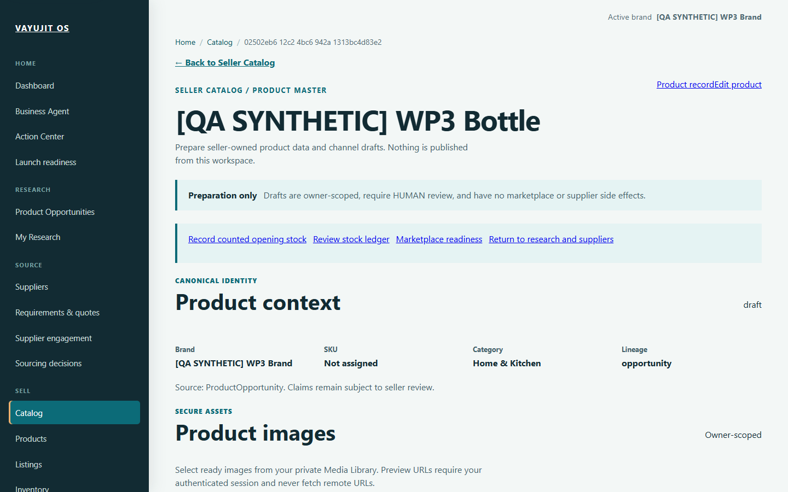

Figure 17. Synthetic Catalog product and research lineage. The viewport does not show every variant/media control. Genuine historical synthetic capture, 2026-10-30.

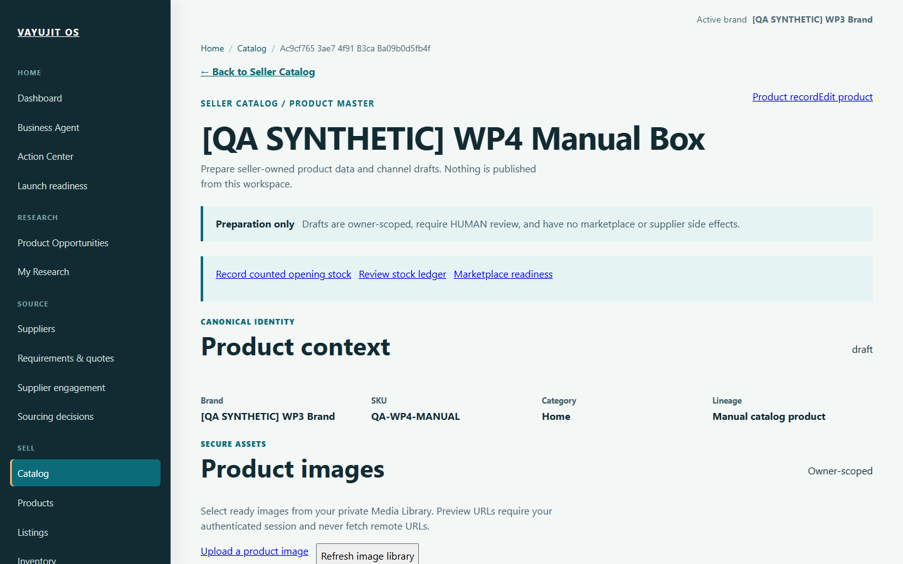

Figure 18. Catalog private-image section and upload entry after a synthetic media workflow. Not a close-up of the upload dialog. Genuine historical synthetic capture, 2026-10-30.

### E. What do I see on this page?

Source-defined sections: Catalog product; Dynamic label varies with the selected record; exact current text is unverified.; Change not completed; Product context; Product images; Economics readiness; Supplier and quotation context; Business Agent guidance; Listing drafts; Variants; Product master & listing preparation

Detected structures: 0 table declaration(s), 0 dialog declaration(s). Conditional/shared controls can appear only after valid context. Loading, empty, error and blocked conditions must be distinguished; their complete current runtime combinations are not verified in this edition.

| Action shown in source | Meaning and safety | Availability |
| --- | --- | --- |
| ← Back to Seller Catalog | Source-declared navigation/view control; exact destination/state UNVERIFIED. | Not statically disabled |
| Product record | Source-declared navigation/view control; exact destination/state UNVERIFIED. | Not statically disabled |
| Edit product | Source-declared navigation/view control; exact destination/state UNVERIFIED. | Not statically disabled |
| Reload saved product | Effect UNVERIFIED; potentially changes data or invokes another workflow. Confirm prerequisites before acting. | Not statically disabled |
| Record counted opening stock | Source-declared navigation/view control; exact destination/state UNVERIFIED. | Not statically disabled |
| Review stock ledger | Source-declared navigation/view control; exact destination/state UNVERIFIED. | Not statically disabled |
| Marketplace readiness | Source-declared navigation/view control; exact destination/state UNVERIFIED. | Not statically disabled |
| Return to research and suppliers | Source-declared navigation/view control; exact destination/state UNVERIFIED. | Not statically disabled |
| Upload a product image | Effect UNVERIFIED; potentially changes data or invokes another workflow. Confirm prerequisites before acting. | Not statically disabled |
| Refresh image library | Source-declared navigation/view control; exact destination/state UNVERIFIED. | Conditional |
| Dynamic label varies with the selected record; exact current text is unverified. | Source-declared navigation/view control; exact destination/state UNVERIFIED. | Conditional |
| Set primary | Source-declared navigation/view control; exact destination/state UNVERIFIED. | Conditional |
| Remove | Effect UNVERIFIED; potentially changes data or invokes another workflow. Confirm prerequisites before acting. | Not statically disabled |
| Prepare this product's economics | Source-declared navigation/view control; exact destination/state UNVERIFIED. | Not statically disabled |
| Review this product's economics | Source-declared navigation/view control; exact destination/state UNVERIFIED. | Not statically disabled |
| Review this product's suppliers | Source-declared navigation/view control; exact destination/state UNVERIFIED. | Not statically disabled |
| Review local requirements and quotations | Source-declared navigation/view control; exact destination/state UNVERIFIED. | Not statically disabled |
| Open Business Agent | Source-declared navigation/view control; exact destination/state UNVERIFIED. | Not statically disabled |
| Use primary product image | Source-declared navigation/view control; exact destination/state UNVERIFIED. | Conditional |
| Dynamic label varies with the selected record; exact current text is unverified. | Effect UNVERIFIED; potentially changes data or invokes another workflow. Confirm prerequisites before acting. | Conditional |
| Approve as HUMAN | Effect UNVERIFIED; potentially changes data or invokes another workflow. Confirm prerequisites before acting. | Conditional |
| Dynamic label varies with the selected record; exact current text is unverified. | Effect UNVERIFIED; potentially changes data or invokes another workflow. Confirm prerequisites before acting. | Conditional |
| Dynamic label varies with the selected record; exact current text is unverified. | Source-declared navigation/view control; exact destination/state UNVERIFIED. | Conditional |
| Dynamic label varies with the selected record; exact current text is unverified. | Effect UNVERIFIED; potentially changes data or invokes another workflow. Confirm prerequisites before acting. | Conditional |
| Archive | Source-declared navigation/view control; exact destination/state UNVERIFIED. | Not statically disabled |
| Dynamic label varies with the selected record; exact current text is unverified. | Source-declared navigation/view control; exact destination/state UNVERIFIED. | Not statically disabled |
| Create product | Effect UNVERIFIED; potentially changes data or invokes another workflow. Confirm prerequisites before acting. | Not statically disabled |
| Create a product | Effect UNVERIFIED; potentially changes data or invokes another workflow. Confirm prerequisites before acting. | Not statically disabled |
| Review opportunities | Source-declared navigation/view control; exact destination/state UNVERIFIED. | Not statically disabled |
| Open catalog workspace | Source-declared navigation/view control; exact destination/state UNVERIFIED. | Not statically disabled |
| View product | Source-declared navigation/view control; exact destination/state UNVERIFIED. | Not statically disabled |

### F. Input-field guide

Field records below state type, purpose, requiredness, accepted values and examples. Unless a specific effect is described, the parent action’s save/provider effect is UNVERIFIED. Common rule: enter only genuine facts, preserve UNKNOWN and units, and obey backend validation; no blank or unchecked prerequisite is permission to proceed. Complete per-field maintenance records retain these explicit limitations.

| Field | Type requiredness and accepted values | Purpose example and effect |
| --- | --- | --- |
| Choose a ready media asset [catalog-workspace-F001] | select. Requiredness is not established by the template; do not assume optional. Select an image… Additional choices depend on saved records/current context and are UNVERIFIED. | Chooses the relevant saved context or supported option. Example: Choose only a relevant legitimate saved option. Effect unverified; common field rules apply. |
| Alt text (recommended) [catalog-workspace-F002] | text. Requiredness is not established by the template; do not assume optional. maxlength 500 | Provides the stated input to this page’s supported workflow. Example: Use the actual business fact; no invented value is supplied. Effect unverified; common field rules apply. |
| Make primary [catalog-workspace-F003] | checkbox. Requiredness is not established by the template; do not assume optional. Checked or unchecked; confirm only truthful statements. | Records the specific choice or confirmation stated by its label. Example: Leave unchecked unless the statement is true. Effect unverified; common field rules apply. |
| Alt text [catalog-workspace-F004] | text. Requiredness is not established by the template; do not assume optional. maxlength 500 | Provides the stated input to this page’s supported workflow. Example: Use the actual business fact; no invented value is supplied. Effect unverified; common field rules apply. |
| Title [catalog-workspace-F005] | text. Required in the template. maxlength 500 | Provides the stated input to this page’s supported workflow. Example: Use the actual business fact; no invented value is supplied. Effect unverified; common field rules apply. |
| Description [catalog-workspace-F006] | textarea. Requiredness is not established by the template; do not assume optional. maxlength 20000 | Provides the stated input to this page’s supported workflow. Example: Use the actual business fact; no invented value is supplied. Effect unverified; common field rules apply. |
| Category [catalog-workspace-F007] | text. Requiredness is not established by the template; do not assume optional. maxlength 240 | Provides the stated input to this page’s supported workflow. Example: Use the actual business fact; no invented value is supplied. Effect unverified; common field rules apply. |
| Image reference (private product preview) [catalog-workspace-F008] | text. Requiredness is not established by the template; do not assume optional. maxlength 500 | Provides the stated input to this page’s supported workflow. Example: Use the actual business fact; no invented value is supplied. Effect unverified; common field rules apply. |
| Intended price (estimate, not profit) [catalog-workspace-F009] | text. Requiredness is not established by the template; do not assume optional. Exact API limits/accepted vocabulary are not fully verified. | Provides the stated input to this page’s supported workflow. Example: Use the actual business fact; no invented value is supplied. Effect unverified; common field rules apply. |
| Currency (for example INR) [catalog-workspace-F010] | text. Requiredness is not established by the template; do not assume optional. maxlength 3 | Provides the stated input to this page’s supported workflow. Example: INR only if this is the genuine currency. Effect unverified; common field rules apply. |
| Compliance JSON [catalog-workspace-F011] | textarea. Requiredness is not established by the template; do not assume optional. Exact API limits/accepted vocabulary are not fully verified. | Provides the stated input to this page’s supported workflow. Example: Use the actual business fact; no invented value is supplied. Effect unverified; common field rules apply. |
| Variant key [catalog-workspace-F012] | text. Required in the template. maxlength 120 | Provides the stated input to this page’s supported workflow. Example: Use the actual business fact; no invented value is supplied. Effect unverified; common field rules apply. |
| Title [catalog-workspace-F013] | text. Requiredness is not established by the template; do not assume optional. maxlength 160 | Provides the stated input to this page’s supported workflow. Example: Use the actual business fact; no invented value is supplied. Effect unverified; common field rules apply. |
| SKU [catalog-workspace-F014] | text. Requiredness is not established by the template; do not assume optional. maxlength 100 | Provides the stated input to this page’s supported workflow. Example: Use the actual business fact; no invented value is supplied. Effect unverified; common field rules apply. |
| Options JSON [catalog-workspace-F015] | text. Requiredness is not established by the template; do not assume optional. Exact API limits/accepted vocabulary are not fully verified. | Provides the stated input to this page’s supported workflow. Example: Use the actual business fact; no invented value is supplied. Effect unverified; common field rules apply. |
| Exact visible label not established [catalog-workspace-F016] | text. Requiredness is not established by the template; do not assume optional. maxlength 160 | Provides the stated input to this page’s supported workflow. Example: Use the actual business fact; no invented value is supplied. Effect unverified; common field rules apply. |
| Variant SKU [catalog-workspace-F017] | text. Requiredness is not established by the template; do not assume optional. maxlength 100 | Provides the stated input to this page’s supported workflow. Example: Use the actual business fact; no invented value is supplied. Effect unverified; common field rules apply. |
| Variant price (optional) [catalog-workspace-F018] | text. Requiredness is not established by the template; do not assume optional. Exact API limits/accepted vocabulary are not fully verified. | Provides the stated input to this page’s supported workflow. Example: Use the actual business fact; no invented value is supplied. Effect unverified; common field rules apply. |
| Variant currency [catalog-workspace-F019] | text. Requiredness is not established by the template; do not assume optional. maxlength 3 | Provides the stated input to this page’s supported workflow. Example: INR only if this is the genuine currency. Effect unverified; common field rules apply. |
| Search products [catalog-workspace-F020] | search. Requiredness is not established by the template; do not assume optional. Exact API limits/accepted vocabulary are not fully verified. | Narrows the records shown for the stated context. Example: An existing product name or SKU. Effect unverified; common field rules apply. |
| Status [catalog-workspace-F021] | select. Requiredness is not established by the template; do not assume optional. All statuses; Draft; Active; Archived | Chooses the relevant saved context or supported option. Example: Choose only a relevant legitimate saved option. Effect unverified; common field rules apply. |

### G. Step-by-step usage

1. Open the intended owned context using the navigation/route above. Verify the brand and any Product, opportunity, supplier, listing or artifact identity before continuing.

2. Use exact Product context. Keep missing facts unknown; stale edits require reload/review. Preparation only does not publish.

3. Read current warnings and input guidance. Use only an action whose purpose and authority you understand. Stop before unapproved provider, commercial or permanent-data effects.

### H. Worked example

Illustrative task: Prepare one Product’s variants, private media, local costs, lineage and listing drafts, or review the collection. Use a genuine selected record in your own authorized workspace; a synthetic screenshot is a learning example only. The field examples above illustrate the type of input, not prescribed business values.

### I. How to interpret the results

Inspect identity, source/provenance, date/freshness, included assumptions and missing information. A local status, score or successful fake workflow is not proof of real external completion. UNKNOWN, blocked, stale and not-comparable results must retain their actual meaning.

### J. What should I do next?

Record counted stock or open Product marketplace preparation when appropriate.

### K. Troubleshooting

If context is missing/invalid, use the appropriate collection or saved record link. If a request fails, retain the safe correlation reference and inspect current state before retrying. A 401 needs normal authentication; a 500 is not an empty successful result. Do not force-enable disabled actions or insert synthetic facts.

### L. Availability and limitations

DOCUMENTED BUT NOT CURRENTLY VERIFIED: current template and source inspected; no fresh authenticated session or complete per-control execution performed. Historical synthetic screenshot/functional evidence illustrates only its recorded state. Use exact Product context. Keep missing facts unknown; stale edits require reload/review. Preparation only does not publish. The entire module is not certified by the presence of a route.

### M. Documentation evidence

Current source: apps/web/src/app/catalog/catalog-workspace.component.ts. Source and template hashes are in source/ui-inventory.json; exact field/action declarations in inventory/field-register.md and source/control-inventory.md. Screenshot evidence: docs/product-handbook/screenshots/catalog/01-lineage.png (Figure 17); docs/product-handbook/screenshots/catalog/02-private-image-entry.png (Figure 18).

[Current UI source for Catalog](../../../apps/web/src/app/catalog/catalog-workspace.component.ts)

## P053 Create or edit product

### A. What is this page?

Enter the product master used by content, Catalog and supported seller operations.

### B. Why would someone use it?

Choose Brand *, Name * and actual Product type *. Explicitly verify INR pricing, distinct master cost and stock-ledger boundary.

### C. Where can I find it?

Contextual link from the relevant owned record, or the exact route below; not a separately verified primary-menu item.

Route: /products/new

Route: /products/:id/edit — replace a parameter only through a legitimate saved record link, not a guessed ID.

### D. Screenshot

MISSING: no reviewed safe screenshot selected for this page family. The source-defined layout below is not a substitute for a real current capture.

### E. What do I see on this page?

Source-defined sections: Dynamic label varies with the selected record; exact current text is unverified.

Detected structures: 0 table declaration(s), 0 dialog declaration(s). Conditional/shared controls can appear only after valid context. Loading, empty, error and blocked conditions must be distinguished; their complete current runtime combinations are not verified in this edition.

| Action shown in source | Meaning and safety | Availability |
| --- | --- | --- |
| Create brand | Effect UNVERIFIED; potentially changes data or invokes another workflow. Confirm prerequisites before acting. | Not statically disabled |
| Cancel | Abandons the current local operation where supported; saved records or remote effects may remain. | Not statically disabled |
| Dynamic label varies with the selected record; exact current text is unverified. | Effect UNVERIFIED; potentially changes data or invokes another workflow. Confirm prerequisites before acting. | Conditional |

### F. Input-field guide

Field records below state type, purpose, requiredness, accepted values and examples. Unless a specific effect is described, the parent action’s save/provider effect is UNVERIFIED. Common rule: enter only genuine facts, preserve UNKNOWN and units, and obey backend validation; no blank or unchecked prerequisite is permission to proceed. Complete per-field maintenance records retain these explicit limitations.

| Field | Type requiredness and accepted values | Purpose example and effect |
| --- | --- | --- |
| Brand * [product-form-F001] | select. Required by the current client. Choose an existing eligible owned brand from the dynamic list. Validation: Choose an existing eligible owned brand from the dynamic list. | Associates the Product with an owned brand. Example: Your actual brand; QA SYNTHETIC is not business data. Effect: Preserves brand ownership/context. Avoid: Creating a fake brand to bypass missing prerequisites. |
| Name * [product-form-F002] | text. Required. Up to 160 characters in the current client. Validation: Up to 160 characters in the current client. | Names the actual seller-owned Product. Example: Illustrative cotton drawstring storage bag Effect: Identifies the Product in Catalog and related tasks. Avoid: Adding unverified claims or making a product candidate sound approved. |
| Slug [product-form-F003] | text. Not required by the reviewed client validator. Lowercase letters/digits separated by single hyphens; at most 160 characters. Validation: Lowercase letters/digits separated by single hyphens; at most 160 characters. | Provides a URL-friendly Product name where supported. Example: cotton-storage-bag Effect: Stored Product slug, distinct from SKU. Avoid: Using spaces, uppercase letters or a supplier URL. |
| Product type * [product-form-F004] | select. Requiredness is not established by the template; do not assume optional. Physical; Digital; Service; Affiliate | Chooses the relevant saved context or supported option. Example: Choose only a relevant legitimate saved option. Effect unverified; common field rules apply. |
| Category [product-form-F005] | text. Requiredness is not established by the template; do not assume optional. maxlength 120 | Provides the stated input to this page’s supported workflow. Example: Use the actual business fact; no invented value is supplied. Effect unverified; common field rules apply. |
| Tags [product-form-F006] | text. Requiredness is not established by the template; do not assume optional. Exact API limits/accepted vocabulary are not fully verified. | Provides the stated input to this page’s supported workflow. Example: Use the actual business fact; no invented value is supplied. Effect unverified; common field rules apply. |
| Featured [product-form-F007] | checkbox. Requiredness is not established by the template; do not assume optional. Checked or unchecked; confirm only truthful statements. | Records the specific choice or confirmation stated by its label. Example: Leave unchecked unless the statement is true. Effect unverified; common field rules apply. |
| Short description [product-form-F008] | textarea. Requiredness is not established by the template; do not assume optional. maxlength 500 | Provides the stated input to this page’s supported workflow. Example: Use the actual business fact; no invented value is supplied. Effect unverified; common field rules apply. |
| Description [product-form-F009] | textarea. Requiredness is not established by the template; do not assume optional. maxlength 10000 | Provides the stated input to this page’s supported workflow. Example: Use the actual business fact; no invented value is supplied. Effect unverified; common field rules apply. |
| Price [product-form-F010] | text. Optional in the reviewed client; downstream readiness may require it. Nonnegative decimal text, up to 10 integer digits and 2 fractional digits; no commas/currency symbol. Validation: Nonnegative decimal text, up to 10 integer digits and 2 fractional digits; no commas/currency symbol. | Records the Product master price, not verified profitability. Example: 499.00 Effect: Pairs with Currency; not a landed-cost calculation. Avoid: Entering ₹499 or assuming price proves profit. |
| Currency [product-form-F011] | text. Client defaults to INR; downstream context still matters. Three alphabetic characters in the current client. Validation: Three alphabetic characters in the current client. | Specifies the price currency. Example: INR Effect: Identifies units for the amount; does not convert currencies. Avoid: Adding incompatible INR and USD amounts. |
| Compare-at price [product-form-F012] | text. Requiredness is not established by the template; do not assume optional. Exact API limits/accepted vocabulary are not fully verified. | Provides the stated input to this page’s supported workflow. Example: Use the actual business fact; no invented value is supplied. Effect unverified; common field rules apply. |
| Product master cost (optional) [product-form-F013] | text. Optional as labelled. Same nonnegative two-place amount pattern as Product price. Validation: Same nonnegative two-place amount pattern as Product price. | Optional Product master acquisition-cost estimate. Example: 210.00 only if a genuine known/explicitly assumed basis exists. Effect: Not automatically supplier-verified or a complete landed cost. Avoid: Entering zero when cost is unknown. |
| Tax code [product-form-F014] | text. Requiredness is not established by the template; do not assume optional. maxlength 50 | Provides the stated input to this page’s supported workflow. Example: Use the actual business fact; no invented value is supplied. Effect unverified; common field rules apply. |
| SKU [product-form-F015] | text. Requiredness is not established by the template; do not assume optional. maxlength 100 | Provides the stated input to this page’s supported workflow. Example: Use the actual business fact; no invented value is supplied. Effect unverified; common field rules apply. |
| Barcode [product-form-F016] | text. Requiredness is not established by the template; do not assume optional. maxlength 100 | Provides the stated input to this page’s supported workflow. Example: Use the actual business fact; no invented value is supplied. Effect unverified; common field rules apply. |
| Track inventory [product-form-F017] | checkbox. Requiredness is not established by the template; do not assume optional. Checked or unchecked; confirm only truthful statements. | Records the specific choice or confirmation stated by its label. Example: Leave unchecked unless the statement is true. Effect unverified; common field rules apply. |
| Product master quantity (not stock ledger) [product-form-F018] | number. Client numeric value with nonnegative bounds. Current client 0–2000000000; do not use it as opening-stock authority. Validation: Current client 0–2000000000; do not use it as opening-stock authority. | Stores a Product master quantity, explicitly not the stock ledger. Example: Use the separate counted opening-stock workflow for actual stock. Effect: Does not substitute for the canonical inventory movement ledger. Avoid: Thinking editing this quantity records stock ownership/movements. |
| Low-stock threshold [product-form-F019] | number. Requiredness is not established by the template; do not assume optional. min 0 | Provides the stated input to this page’s supported workflow. Example: Use the genuine measured amount/quantity; units must be established. Effect unverified; common field rules apply. |
| Weight [product-form-F020] | text. Optional in the reviewed client. Nonnegative decimal text, up to 9 integer digits and 3 fractional digits. Validation: Nonnegative decimal text, up to 9 integer digits and 3 fractional digits. | Records physical weight with its explicit unit. Example: 250 with g, only if measured. Effect: Describes the Product; not a freight quote. Avoid: Entering a number without checking its unit. |
| Weight unit [product-form-F021] | select. Requiredness is not established by the template; do not assume optional. None; g; kg; oz; lb | Chooses the relevant saved context or supported option. Example: Choose only a relevant legitimate saved option. Effect unverified; common field rules apply. |

### G. Step-by-step usage

1. Open the intended owned context using the navigation/route above. Verify the brand and any Product, opportunity, supplier, listing or artifact identity before continuing.

2. Choose Brand *, Name * and actual Product type *. Explicitly verify INR pricing, distinct master cost and stock-ledger boundary.

3. Read current warnings and input guidance. Use only an action whose purpose and authority you understand. Stop before unapproved provider, commercial or permanent-data effects.

### H. Worked example

Illustrative task: Enter the product master used by content, Catalog and supported seller operations. Use a genuine selected record in your own authorized workspace; a synthetic screenshot is a learning example only. The field examples above illustrate the type of input, not prescribed business values.

### I. How to interpret the results

Inspect identity, source/provenance, date/freshness, included assumptions and missing information. A local status, score or successful fake workflow is not proof of real external completion. UNKNOWN, blocked, stale and not-comparable results must retain their actual meaning.

### J. What should I do next?

Review Catalog, private media and truthful counted inventory.

### K. Troubleshooting

If context is missing/invalid, use the appropriate collection or saved record link. If a request fails, retain the safe correlation reference and inspect current state before retrying. A 401 needs normal authentication; a 500 is not an empty successful result. Do not force-enable disabled actions or insert synthetic facts.

### L. Availability and limitations

DOCUMENTED BUT NOT CURRENTLY VERIFIED: current template and source inspected; no fresh authenticated session or complete per-control execution performed. Screenshot coverage is BLOCKED pending an approved safe session. Choose Brand *, Name * and actual Product type *. Explicitly verify INR pricing, distinct master cost and stock-ledger boundary. The entire module is not certified by the presence of a route.

### M. Documentation evidence

Current source: apps/web/src/app/products/product-form.component.ts. Source and template hashes are in source/ui-inventory.json; exact field/action declarations in inventory/field-register.md and source/control-inventory.md. Missing screenshot recorded in quality/documentation-gaps.md.

[Current UI source for Create or edit product](../../../apps/web/src/app/products/product-form.component.ts)

## P054 Product marketplace preparation

### A. What is this page?

Review the same Product’s local destination/account/listing readiness.

### B. Why would someone use it?

Sales channels, publishing destinations and verified remote evidence are different. Missing price/cost/order evidence must not become invented performance.

### C. Where can I find it?

Contextual link from the relevant owned record, or the exact route below; not a separately verified primary-menu item.

Route: /products/:id/channels — replace a parameter only through a legitimate saved record link, not a guessed ID.

### D. Screenshot

MISSING: no reviewed safe screenshot selected for this page family. The source-defined layout below is not a substitute for a real current capture.

### E. What do I see on this page?

Source-defined sections: Dynamic label varies with the selected record; exact current text is unverified.; Other content destinations — not seller accounts; Marketplace Video

Detected structures: 1 table declaration(s), 0 dialog declaration(s). Conditional/shared controls can appear only after valid context. Loading, empty, error and blocked conditions must be distinguished; their complete current runtime combinations are not verified in this edition.

| Action shown in source | Meaning and safety | Availability |
| --- | --- | --- |
| Return to this Catalog product | Source-declared navigation/view control; exact destination/state UNVERIFIED. | Not statically disabled |
| Review seller-account prerequisites | Source-declared navigation/view control; exact destination/state UNVERIFIED. | Not statically disabled |
| Record counted opening stock | Source-declared navigation/view control; exact destination/state UNVERIFIED. | Not statically disabled |
| Prepare local draft | Source-declared navigation/view control; exact destination/state UNVERIFIED. | Not statically disabled |
| Review saved listing | Effect UNVERIFIED; potentially changes data or invokes another workflow. Confirm prerequisites before acting. | Not statically disabled |
| Dynamic label varies with the selected record; exact current text is unverified. | Source-declared navigation/view control; exact destination/state UNVERIFIED. | Not statically disabled |

### F. Input-field guide

No direct editable fields were extracted from this page template. Review controls inherited from shared components in the shared-field appendix. No missing form is invented.

### G. Step-by-step usage

1. Open the intended owned context using the navigation/route above. Verify the brand and any Product, opportunity, supplier, listing or artifact identity before continuing.

2. Sales channels, publishing destinations and verified remote evidence are different. Missing price/cost/order evidence must not become invented performance.

3. Read current warnings and input guidance. Use only an action whose purpose and authority you understand. Stop before unapproved provider, commercial or permanent-data effects.

### H. Worked example

Illustrative task: Review the same Product’s local destination/account/listing readiness. Use a genuine selected record in your own authorized workspace; a synthetic screenshot is a learning example only. The expected type of result is the relevant recorded view or a truthful empty/blocked state, not fabricated data.

### I. How to interpret the results

Inspect identity, source/provenance, date/freshness, included assumptions and missing information. A local status, score or successful fake workflow is not proof of real external completion. UNKNOWN, blocked, stale and not-comparable results must retain their actual meaning.

### J. What should I do next?

Open the intended marketplace draft/editor.

### K. Troubleshooting

If context is missing/invalid, use the appropriate collection or saved record link. If a request fails, retain the safe correlation reference and inspect current state before retrying. A 401 needs normal authentication; a 500 is not an empty successful result. Do not force-enable disabled actions or insert synthetic facts.

### L. Availability and limitations

DOCUMENTED BUT NOT CURRENTLY VERIFIED: current template and source inspected; no fresh authenticated session or complete per-control execution performed. Screenshot coverage is BLOCKED pending an approved safe session. Sales channels, publishing destinations and verified remote evidence are different. Missing price/cost/order evidence must not become invented performance. The entire module is not certified by the presence of a route.

### M. Documentation evidence

Current source: apps/web/src/app/marketplaces/product-channel-view.component.ts. Source and template hashes are in source/ui-inventory.json; exact field/action declarations in inventory/field-register.md and source/control-inventory.md. Missing screenshot recorded in quality/documentation-gaps.md.

[Current UI source for Product marketplace preparation](../../../apps/web/src/app/marketplaces/product-channel-view.component.ts)

## P055 Product image and video usage

### A. What is this page?

Inspect media usage associated with the exact Product.

### B. Why would someone use it?

Asset existence does not grant rights, content approval or publishing authorization.

### C. Where can I find it?

Contextual link from the relevant owned record, or the exact route below; not a separately verified primary-menu item.

Route: /products/:id/media — replace a parameter only through a legitimate saved record link, not a guessed ID.

### D. Screenshot

MISSING: no reviewed safe screenshot selected for this page family. The source-defined layout below is not a substitute for a real current capture.

### E. What do I see on this page?

Source-defined sections: Image and video usage; Dynamic label varies with the selected record; exact current text is unverified.

Detected structures: 0 table declaration(s), 0 dialog declaration(s). Conditional/shared controls can appear only after valid context. Loading, empty, error and blocked conditions must be distinguished; their complete current runtime combinations are not verified in this edition.

| Action shown in source | Meaning and safety | Availability |
| --- | --- | --- |
| Back to product | Source-declared navigation/view control; exact destination/state UNVERIFIED. | Not statically disabled |
| Open Video workspace | Source-declared navigation/view control; exact destination/state UNVERIFIED. | Not statically disabled |
| Review | Source-declared navigation/view control; exact destination/state UNVERIFIED. | Not statically disabled |

### F. Input-field guide

No direct editable fields were extracted from this page template. Review controls inherited from shared components in the shared-field appendix. No missing form is invented.

### G. Step-by-step usage

1. Open the intended owned context using the navigation/route above. Verify the brand and any Product, opportunity, supplier, listing or artifact identity before continuing.

2. Asset existence does not grant rights, content approval or publishing authorization.

3. Read current warnings and input guidance. Use only an action whose purpose and authority you understand. Stop before unapproved provider, commercial or permanent-data effects.

### H. Worked example

Illustrative task: Inspect media usage associated with the exact Product. Use a genuine selected record in your own authorized workspace; a synthetic screenshot is a learning example only. The expected type of result is the relevant recorded view or a truthful empty/blocked state, not fabricated data.

### I. How to interpret the results

Inspect identity, source/provenance, date/freshness, included assumptions and missing information. A local status, score or successful fake workflow is not proof of real external completion. UNKNOWN, blocked, stale and not-comparable results must retain their actual meaning.

### J. What should I do next?

Review eligible media and its canonical output/version.

### K. Troubleshooting

If context is missing/invalid, use the appropriate collection or saved record link. If a request fails, retain the safe correlation reference and inspect current state before retrying. A 401 needs normal authentication; a 500 is not an empty successful result. Do not force-enable disabled actions or insert synthetic facts.

### L. Availability and limitations

DOCUMENTED BUT NOT CURRENTLY VERIFIED: current template and source inspected; no fresh authenticated session or complete per-control execution performed. Screenshot coverage is BLOCKED pending an approved safe session. Asset existence does not grant rights, content approval or publishing authorization. The entire module is not certified by the presence of a route.

### M. Documentation evidence

Current source: apps/web/src/app/products/product-media.component.ts. Source and template hashes are in source/ui-inventory.json; exact field/action declarations in inventory/field-register.md and source/control-inventory.md. Missing screenshot recorded in quality/documentation-gaps.md.

[Current UI source for Product image and video usage](../../../apps/web/src/app/products/product-media.component.ts)

## P056 Product detail

### A. What is this page?

Inspect one seller-authored Product before editing or following preparation links.

### B. Why would someone use it?

Confirm brand, SKU, type and lifecycle. Product data is not automatically supplier/economics evidence.

### C. Where can I find it?

Contextual link from the relevant owned record, or the exact route below; not a separately verified primary-menu item.

Route: /products/:id — replace a parameter only through a legitimate saved record link, not a guessed ID.

### D. Screenshot

MISSING: no reviewed safe screenshot selected for this page family. The source-defined layout below is not a substitute for a real current capture.

### E. What do I see on this page?

Source-defined sections: Product details; Dynamic label varies with the selected record; exact current text is unverified.; Commerce and creation context; Content; Pricing; Inventory and shipping; Recent activity

Detected structures: 0 table declaration(s), 0 dialog declaration(s). Conditional/shared controls can appear only after valid context. Loading, empty, error and blocked conditions must be distinguished; their complete current runtime combinations are not verified in this edition.

| Action shown in source | Meaning and safety | Availability |
| --- | --- | --- |
| Back | Source-declared navigation/view control; exact destination/state UNVERIFIED. | Not statically disabled |
| Open catalog workspace | Source-declared navigation/view control; exact destination/state UNVERIFIED. | Not statically disabled |
| Edit | Opens the relevant edit state; saving is a separate action. | Not statically disabled |
| View Product Channels | Source-declared navigation/view control; exact destination/state UNVERIFIED. | Not statically disabled |
| View Product Media | Source-declared navigation/view control; exact destination/state UNVERIFIED. | Not statically disabled |
| Marketplace Listings | Source-declared navigation/view control; exact destination/state UNVERIFIED. | Not statically disabled |
| Activate | Effect UNVERIFIED; potentially changes data or invokes another workflow. Confirm prerequisites before acting. | Not statically disabled |
| Move to draft | Source-declared navigation/view control; exact destination/state UNVERIFIED. | Not statically disabled |
| Archive | Source-declared navigation/view control; exact destination/state UNVERIFIED. | Not statically disabled |
| Restore to draft | Source-declared navigation/view control; exact destination/state UNVERIFIED. | Not statically disabled |

### F. Input-field guide

No direct editable fields were extracted from this page template. Review controls inherited from shared components in the shared-field appendix. No missing form is invented.

### G. Step-by-step usage

1. Open the intended owned context using the navigation/route above. Verify the brand and any Product, opportunity, supplier, listing or artifact identity before continuing.

2. Confirm brand, SKU, type and lifecycle. Product data is not automatically supplier/economics evidence.

3. Read current warnings and input guidance. Use only an action whose purpose and authority you understand. Stop before unapproved provider, commercial or permanent-data effects.

### H. Worked example

Illustrative task: Inspect one seller-authored Product before editing or following preparation links. Use a genuine selected record in your own authorized workspace; a synthetic screenshot is a learning example only. The expected type of result is the relevant recorded view or a truthful empty/blocked state, not fabricated data.

### I. How to interpret the results

Inspect identity, source/provenance, date/freshness, included assumptions and missing information. A local status, score or successful fake workflow is not proof of real external completion. UNKNOWN, blocked, stale and not-comparable results must retain their actual meaning.

### J. What should I do next?

Use Catalog, edit, media or marketplace preparation for the same Product.

### K. Troubleshooting

If context is missing/invalid, use the appropriate collection or saved record link. If a request fails, retain the safe correlation reference and inspect current state before retrying. A 401 needs normal authentication; a 500 is not an empty successful result. Do not force-enable disabled actions or insert synthetic facts.

### L. Availability and limitations

DOCUMENTED BUT NOT CURRENTLY VERIFIED: current template and source inspected; no fresh authenticated session or complete per-control execution performed. Screenshot coverage is BLOCKED pending an approved safe session. Confirm brand, SKU, type and lifecycle. Product data is not automatically supplier/economics evidence. The entire module is not certified by the presence of a route.

### M. Documentation evidence

Current source: apps/web/src/app/products/product-details.component.ts. Source and template hashes are in source/ui-inventory.json; exact field/action declarations in inventory/field-register.md and source/control-inventory.md. Missing screenshot recorded in quality/documentation-gaps.md.

[Current UI source for Product detail](../../../apps/web/src/app/products/product-details.component.ts)

## P057 AI content home

### A. What is this page?

Choose the appropriate supported content-generation or review tool.

### B. Why would someone use it?

Configured AI access is separate from a successful generation; do not send confidential facts to a provider without permission.

### C. Where can I find it?

Contextual link from the relevant owned record, or the exact route below; not a separately verified primary-menu item.

Route: /ai

### D. Screenshot

MISSING: no reviewed safe screenshot selected for this page family. The source-defined layout below is not a substitute for a real current capture.

### E. What do I see on this page?

Source-defined sections: AI content studio; Provider; Generation history; Provider settings; Recent requests

Detected structures: 0 table declaration(s), 0 dialog declaration(s). Conditional/shared controls can appear only after valid context. Loading, empty, error and blocked conditions must be distinguished; their complete current runtime combinations are not verified in this edition.

| Action shown in source | Meaning and safety | Availability |
| --- | --- | --- |
| Generate content | Effect UNVERIFIED; potentially changes data or invokes another workflow. Confirm prerequisites before acting. | Not statically disabled |
| View history | Source-declared navigation/view control; exact destination/state UNVERIFIED. | Not statically disabled |
| View usage | Source-declared navigation/view control; exact destination/state UNVERIFIED. | Not statically disabled |
| Configure and validate real provider | Source-declared navigation/view control; exact destination/state UNVERIFIED. | Not statically disabled |
| Dynamic label varies with the selected record; exact current text is unverified. | Source-declared navigation/view control; exact destination/state UNVERIFIED. | Not statically disabled |

### F. Input-field guide

No direct editable fields were extracted from this page template. Review controls inherited from shared components in the shared-field appendix. No missing form is invented.

### G. Step-by-step usage

1. Open the intended owned context using the navigation/route above. Verify the brand and any Product, opportunity, supplier, listing or artifact identity before continuing.

2. Configured AI access is separate from a successful generation; do not send confidential facts to a provider without permission.

3. Read current warnings and input guidance. Use only an action whose purpose and authority you understand. Stop before unapproved provider, commercial or permanent-data effects.

### H. Worked example

Illustrative task: Choose the appropriate supported content-generation or review tool. Use a genuine selected record in your own authorized workspace; a synthetic screenshot is a learning example only. The expected type of result is the relevant recorded view or a truthful empty/blocked state, not fabricated data.

### I. How to interpret the results

Inspect identity, source/provenance, date/freshness, included assumptions and missing information. A local status, score or successful fake workflow is not proof of real external completion. UNKNOWN, blocked, stale and not-comparable results must retain their actual meaning.

### J. What should I do next?

Use Content, SEO, Images or Videos with a selected Product.

### K. Troubleshooting

If context is missing/invalid, use the appropriate collection or saved record link. If a request fails, retain the safe correlation reference and inspect current state before retrying. A 401 needs normal authentication; a 500 is not an empty successful result. Do not force-enable disabled actions or insert synthetic facts.

### L. Availability and limitations

DOCUMENTED BUT NOT CURRENTLY VERIFIED: current template and source inspected; no fresh authenticated session or complete per-control execution performed. Screenshot coverage is BLOCKED pending an approved safe session. Configured AI access is separate from a successful generation; do not send confidential facts to a provider without permission. The entire module is not certified by the presence of a route.

### M. Documentation evidence

Current source: apps/web/src/app/ai/ai-home.component.ts. Source and template hashes are in source/ui-inventory.json; exact field/action declarations in inventory/field-register.md and source/control-inventory.md. Missing screenshot recorded in quality/documentation-gaps.md.

[Current UI source for AI content home](../../../apps/web/src/app/ai/ai-home.component.ts)

## P058 Generate product content

### A. What is this page?

Prepare a supported content request grounded in an owned Product.

### B. Why would someone use it?

Review output type, provider/mode and facts; generation can invoke a configured provider.

### C. Where can I find it?

Contextual link from the relevant owned record, or the exact route below; not a separately verified primary-menu item.

Route: /ai/generate

### D. Screenshot

MISSING: no reviewed safe screenshot selected for this page family. The source-defined layout below is not a substitute for a real current capture.

### E. What do I see on this page?

Source-defined sections: Generate product content; Generation summary

Detected structures: 0 table declaration(s), 0 dialog declaration(s). Conditional/shared controls can appear only after valid context. Loading, empty, error and blocked conditions must be distinguished; their complete current runtime combinations are not verified in this edition.

| Action shown in source | Meaning and safety | Availability |
| --- | --- | --- |
| Back | Source-declared navigation/view control; exact destination/state UNVERIFIED. | Not statically disabled |
| Open provider settings | Source-declared navigation/view control; exact destination/state UNVERIFIED. | Not statically disabled |
| Dynamic label varies with the selected record; exact current text is unverified. | Effect UNVERIFIED; potentially changes data or invokes another workflow. Confirm prerequisites before acting. | Conditional |

### F. Input-field guide

Field records below state type, purpose, requiredness, accepted values and examples. Unless a specific effect is described, the parent action’s save/provider effect is UNVERIFIED. Common rule: enter only genuine facts, preserve UNKNOWN and units, and obey backend validation; no blank or unchecked prerequisite is permission to proceed. Complete per-field maintenance records retain these explicit limitations.

| Field | Type requiredness and accepted values | Purpose example and effect |
| --- | --- | --- |
| Product [ai-generate-F001] | select. Required in the template. Select a product Additional choices depend on saved records/current context and are UNVERIFIED. | Chooses the relevant saved context or supported option. Example: Choose only a relevant legitimate saved option. Effect unverified; common field rules apply. |
| Template [ai-generate-F002] | select. Requiredness is not established by the template; do not assume optional. No fixed options enumerated in the template. Additional choices depend on saved records/current context and are UNVERIFIED. | Chooses the relevant saved context or supported option. Example: Choose only a relevant legitimate saved option. Effect unverified; common field rules apply. |
| Provider [ai-generate-F003] | select. Requiredness is not established by the template; do not assume optional. No fixed options enumerated in the template. Additional choices depend on saved records/current context and are UNVERIFIED. | Chooses the relevant saved context or supported option. Example: Choose only a relevant legitimate saved option. Effect unverified; common field rules apply. |
| Model [ai-generate-F004] | text. Required in the template. maxlength 120 | Provides the stated input to this page’s supported workflow. Example: Use the actual business fact; no invented value is supplied. Effect unverified; common field rules apply. |
| Allow explicit fallback to deterministic mock [ai-generate-F005] | checkbox. Requiredness is not established by the template; do not assume optional. Checked or unchecked; confirm only truthful statements. | Records the specific choice or confirmation stated by its label. Example: Leave unchecked unless the statement is true. Effect unverified; common field rules apply. |
| Additional instructions [ai-generate-F006] | textarea. Requiredness is not established by the template; do not assume optional. maxlength 2000 | Provides the stated input to this page’s supported workflow. Example: Use the actual business fact; no invented value is supplied. Effect unverified; common field rules apply. |

### G. Step-by-step usage

1. Open the intended owned context using the navigation/route above. Verify the brand and any Product, opportunity, supplier, listing or artifact identity before continuing.

2. Review output type, provider/mode and facts; generation can invoke a configured provider.

3. Read current warnings and input guidance. Use only an action whose purpose and authority you understand. Stop before unapproved provider, commercial or permanent-data effects.

### H. Worked example

Illustrative task: Prepare a supported content request grounded in an owned Product. Use a genuine selected record in your own authorized workspace; a synthetic screenshot is a learning example only. The field examples above illustrate the type of input, not prescribed business values.

### I. How to interpret the results

Inspect identity, source/provenance, date/freshness, included assumptions and missing information. A local status, score or successful fake workflow is not proof of real external completion. UNKNOWN, blocked, stale and not-comparable results must retain their actual meaning.

### J. What should I do next?

Review the resulting artifact/version, if legitimately generated.

### K. Troubleshooting

If context is missing/invalid, use the appropriate collection or saved record link. If a request fails, retain the safe correlation reference and inspect current state before retrying. A 401 needs normal authentication; a 500 is not an empty successful result. Do not force-enable disabled actions or insert synthetic facts.

### L. Availability and limitations

DOCUMENTED BUT NOT CURRENTLY VERIFIED: current template and source inspected; no fresh authenticated session or complete per-control execution performed. Screenshot coverage is BLOCKED pending an approved safe session. Review output type, provider/mode and facts; generation can invoke a configured provider. The entire module is not certified by the presence of a route.

### M. Documentation evidence

Current source: apps/web/src/app/ai/ai-generate.component.ts. Source and template hashes are in source/ui-inventory.json; exact field/action declarations in inventory/field-register.md and source/control-inventory.md. Missing screenshot recorded in quality/documentation-gaps.md.

[Current UI source for Generate product content](../../../apps/web/src/app/ai/ai-generate.component.ts)

## P059 Content studio

### A. What is this page?

Prepare and review supported Product content artifacts and their workflow.

### B. Why would someone use it?

Do not convert uncertain supplier/product statements into marketing claims. Review exact versions before approval.

### C. Where can I find it?

Create → Content → /ai/studio

Route: /ai/studio

### D. Screenshot

MISSING: no reviewed safe screenshot selected for this page family. The source-defined layout below is not a substitute for a real current capture.

### E. What do I see on this page?

Source-defined sections: AI Product Content + SEO Studio; Generate content; Latest artifacts; SEO Studio; Brand Voice; Diagnostics

Detected structures: 0 table declaration(s), 0 dialog declaration(s). Conditional/shared controls can appear only after valid context. Loading, empty, error and blocked conditions must be distinguished; their complete current runtime combinations are not verified in this edition.

| Action shown in source | Meaning and safety | Availability |
| --- | --- | --- |
| SEO & keywords | Source-declared navigation/view control; exact destination/state UNVERIFIED. | Not statically disabled |
| Bulk generation | Source-declared navigation/view control; exact destination/state UNVERIFIED. | Not statically disabled |
| AI overview | Source-declared navigation/view control; exact destination/state UNVERIFIED. | Not statically disabled |
| Generate | Effect UNVERIFIED; potentially changes data or invokes another workflow. Confirm prerequisites before acting. | Not statically disabled |
| Artifacts | Source-declared navigation/view control; exact destination/state UNVERIFIED. | Not statically disabled |
| SEO Studio | Source-declared navigation/view control; exact destination/state UNVERIFIED. | Not statically disabled |
| Brand Voice | Source-declared navigation/view control; exact destination/state UNVERIFIED. | Not statically disabled |
| Diagnostics | Source-declared navigation/view control; exact destination/state UNVERIFIED. | Not statically disabled |
| Dynamic label varies with the selected record; exact current text is unverified. | Effect UNVERIFIED; potentially changes data or invokes another workflow. Confirm prerequisites before acting. | Conditional |
| Refresh generation status | Source-declared navigation/view control; exact destination/state UNVERIFIED. | Conditional |
| Retry failed content | Effect UNVERIFIED; potentially changes data or invokes another workflow. Confirm prerequisites before acting. | Conditional |
| Refresh artifacts | Source-declared navigation/view control; exact destination/state UNVERIFIED. | Not statically disabled |
| Review | Source-declared navigation/view control; exact destination/state UNVERIFIED. | Not statically disabled |
| Analyze SEO | Source-declared navigation/view control; exact destination/state UNVERIFIED. | Conditional |
| Manage Brand Voices | Source-declared navigation/view control; exact destination/state UNVERIFIED. | Not statically disabled |
| Manage Presets | Source-declared navigation/view control; exact destination/state UNVERIFIED. | Not statically disabled |
| View Usage | Source-declared navigation/view control; exact destination/state UNVERIFIED. | Not statically disabled |
| Provider settings | Source-declared navigation/view control; exact destination/state UNVERIFIED. | Not statically disabled |

### F. Input-field guide

Field records below state type, purpose, requiredness, accepted values and examples. Unless a specific effect is described, the parent action’s save/provider effect is UNVERIFIED. Common rule: enter only genuine facts, preserve UNKNOWN and units, and obey backend validation; no blank or unchecked prerequisite is permission to proceed. Complete per-field maintenance records retain these explicit limitations.

| Field | Type requiredness and accepted values | Purpose example and effect |
| --- | --- | --- |
| Content types [ai-studio-F001] | select. Requiredness is not established by the template; do not assume optional. No fixed options enumerated in the template. Additional choices depend on saved records/current context and are UNVERIFIED. | Chooses the relevant saved context or supported option. Example: Choose only a relevant legitimate saved option. Effect unverified; common field rules apply. |
| Instructions [ai-studio-F002] | textarea. Requiredness is not established by the template; do not assume optional. maxlength 2000 | Provides the stated input to this page’s supported workflow. Example: Use the actual business fact; no invented value is supplied. Effect unverified; common field rules apply. |

### G. Step-by-step usage

1. Open the intended owned context using the navigation/route above. Verify the brand and any Product, opportunity, supplier, listing or artifact identity before continuing.

2. Do not convert uncertain supplier/product statements into marketing claims. Review exact versions before approval.

3. Read current warnings and input guidance. Use only an action whose purpose and authority you understand. Stop before unapproved provider, commercial or permanent-data effects.

### H. Worked example

Illustrative task: Prepare and review supported Product content artifacts and their workflow. Use a genuine selected record in your own authorized workspace; a synthetic screenshot is a learning example only. The field examples above illustrate the type of input, not prescribed business values.

### I. How to interpret the results

Inspect identity, source/provenance, date/freshness, included assumptions and missing information. A local status, score or successful fake workflow is not proof of real external completion. UNKNOWN, blocked, stale and not-comparable results must retain their actual meaning.

### J. What should I do next?

Open artifact review, SEO or the relevant local listing/campaign.

### K. Troubleshooting

If context is missing/invalid, use the appropriate collection or saved record link. If a request fails, retain the safe correlation reference and inspect current state before retrying. A 401 needs normal authentication; a 500 is not an empty successful result. Do not force-enable disabled actions or insert synthetic facts.

### L. Availability and limitations

DOCUMENTED BUT NOT CURRENTLY VERIFIED: current template and source inspected; no fresh authenticated session or complete per-control execution performed. Screenshot coverage is BLOCKED pending an approved safe session. Do not convert uncertain supplier/product statements into marketing claims. Review exact versions before approval. The entire module is not certified by the presence of a route.

### M. Documentation evidence

Current source: apps/web/src/app/ai/ai-studio.component.ts. Source and template hashes are in source/ui-inventory.json; exact field/action declarations in inventory/field-register.md and source/control-inventory.md. Missing screenshot recorded in quality/documentation-gaps.md.

[Current UI source for Content studio](../../../apps/web/src/app/ai/ai-studio.component.ts)

## P060 Image review

### A. What is this page?

Inspect a specific generated Output image and supported review actions.

### B. Why would someone use it?

Review actual pixels, Product identity, rights and immutable output identity. Approval of this image does not approve every later use.

### C. Where can I find it?

Contextual link from the relevant owned record, or the exact route below; not a separately verified primary-menu item.

Route: /ai/images/assets/:outputId — replace a parameter only through a legitimate saved record link, not a guessed ID.

### D. Screenshot

MISSING: no reviewed safe screenshot selected for this page family. The source-defined layout below is not a substitute for a real current capture.

### E. What do I see on this page?

Source-defined sections: Image review; Generated image; Lineage; Readiness and classification; Comparison and history

Detected structures: 0 table declaration(s), 0 dialog declaration(s). Conditional/shared controls can appear only after valid context. Loading, empty, error and blocked conditions must be distinguished; their complete current runtime combinations are not verified in this edition.

| Action shown in source | Meaning and safety | Availability |
| --- | --- | --- |
| Back to Images | Source-declared navigation/view control; exact destination/state UNVERIFIED. | Not statically disabled |
| Approve exact output | Effect UNVERIFIED; potentially changes data or invokes another workflow. Confirm prerequisites before acting. | Conditional |
| Reject with feedback | Source-declared navigation/view control; exact destination/state UNVERIFIED. | Conditional |
| Regenerate | Effect UNVERIFIED; potentially changes data or invokes another workflow. Confirm prerequisites before acting. | Conditional |
| Refresh exact output | Source-declared navigation/view control; exact destination/state UNVERIFIED. | Conditional |
| Retry exact image job | Effect UNVERIFIED; potentially changes data or invokes another workflow. Confirm prerequisites before acting. | Conditional |
| Compare exact versions | Source-declared navigation/view control; exact destination/state UNVERIFIED. | Conditional |
| Show history | Source-declared navigation/view control; exact destination/state UNVERIFIED. | Conditional |

### F. Input-field guide

No direct editable fields were extracted from this page template. Review controls inherited from shared components in the shared-field appendix. No missing form is invented.

### G. Step-by-step usage

1. Open the intended owned context using the navigation/route above. Verify the brand and any Product, opportunity, supplier, listing or artifact identity before continuing.

2. Review actual pixels, Product identity, rights and immutable output identity. Approval of this image does not approve every later use.

3. Read current warnings and input guidance. Use only an action whose purpose and authority you understand. Stop before unapproved provider, commercial or permanent-data effects.

### H. Worked example

Illustrative task: Inspect a specific generated Output image and supported review actions. Use a genuine selected record in your own authorized workspace; a synthetic screenshot is a learning example only. The expected type of result is the relevant recorded view or a truthful empty/blocked state, not fabricated data.

### I. How to interpret the results

Inspect identity, source/provenance, date/freshness, included assumptions and missing information. A local status, score or successful fake workflow is not proof of real external completion. UNKNOWN, blocked, stale and not-comparable results must retain their actual meaning.

### J. What should I do next?

Return to the correct Product, draft or content workflow.

### K. Troubleshooting

If context is missing/invalid, use the appropriate collection or saved record link. If a request fails, retain the safe correlation reference and inspect current state before retrying. A 401 needs normal authentication; a 500 is not an empty successful result. Do not force-enable disabled actions or insert synthetic facts.

### L. Availability and limitations

DOCUMENTED BUT NOT CURRENTLY VERIFIED: current template and source inspected; no fresh authenticated session or complete per-control execution performed. Screenshot coverage is BLOCKED pending an approved safe session. Review actual pixels, Product identity, rights and immutable output identity. Approval of this image does not approve every later use. The entire module is not certified by the presence of a route.

### M. Documentation evidence

Current source: apps/web/src/app/ai/ai-image-review.component.ts. Source and template hashes are in source/ui-inventory.json; exact field/action declarations in inventory/field-register.md and source/control-inventory.md. Missing screenshot recorded in quality/documentation-gaps.md.

[Current UI source for Image review](../../../apps/web/src/app/ai/ai-image-review.component.ts)

## P061 Bulk video studio

### A. What is this page?

Inspect supported batch video preparation and job evidence.

### B. Why would someone use it?

Batching multiplies mistakes and potential provider cost. Do not start a batch from an example.

### C. Where can I find it?

Contextual link from the relevant owned record, or the exact route below; not a separately verified primary-menu item.

Route: /ai/video/bulk

### D. Screenshot

MISSING: no reviewed safe screenshot selected for this page family. The source-defined layout below is not a substitute for a real current capture.

### E. What do I see on this page?

Source-defined sections: Bulk Video Studio; Reopen saved operation; 1. Plan; 2. Review and confirm; Dynamic label varies with the selected record; exact current text is unverified.; Persisted recovery history

Detected structures: 0 table declaration(s), 0 dialog declaration(s). Conditional/shared controls can appear only after valid context. Loading, empty, error and blocked conditions must be distinguished; their complete current runtime combinations are not verified in this edition.

| Action shown in source | Meaning and safety | Availability |
| --- | --- | --- |
| ← AI Video Studio | Source-declared navigation/view control; exact destination/state UNVERIFIED. | Not statically disabled |
| Open operation | Source-declared navigation/view control; exact destination/state UNVERIFIED. | Conditional |
| Preview plan | Source-declared navigation/view control; exact destination/state UNVERIFIED. | Conditional |
| Confirm and queue | Effect UNVERIFIED; potentially changes data or invokes another workflow. Confirm prerequisites before acting. | Conditional |
| Refresh status | Source-declared navigation/view control; exact destination/state UNVERIFIED. | Conditional |
| Retry failed children | Effect UNVERIFIED; potentially changes data or invokes another workflow. Confirm prerequisites before acting. | Conditional |
| Cancel remaining children | Effect UNVERIFIED; potentially changes data or invokes another workflow. Confirm prerequisites before acting. | Conditional |
| Review child Video job | Source-declared navigation/view control; exact destination/state UNVERIFIED. | Not statically disabled |

### F. Input-field guide

Field records below state type, purpose, requiredness, accepted values and examples. Unless a specific effect is described, the parent action’s save/provider effect is UNVERIFIED. Common rule: enter only genuine facts, preserve UNKNOWN and units, and obey backend validation; no blank or unchecked prerequisite is permission to proceed. Complete per-field maintenance records retain these explicit limitations.

| Field | Type requiredness and accepted values | Purpose example and effect |
| --- | --- | --- |
| Operation ID [ai-video-bulk-F001] | text. Requiredness is not established by the template; do not assume optional. Exact API limits/accepted vocabulary are not fully verified. | Provides the stated input to this page’s supported workflow. Example: Use the actual business fact; no invented value is supplied. Effect unverified; common field rules apply. |
| Video types [ai-video-bulk-F002] | text. Requiredness is not established by the template; do not assume optional. Exact API limits/accepted vocabulary are not fully verified. | Provides the stated input to this page’s supported workflow. Example: Use the actual business fact; no invented value is supplied. Effect unverified; common field rules apply. |
| Targets [ai-video-bulk-F003] | text. Requiredness is not established by the template; do not assume optional. Exact API limits/accepted vocabulary are not fully verified. | Provides the stated input to this page’s supported workflow. Example: Use the actual business fact; no invented value is supplied. Effect unverified; common field rules apply. |
| Duration [ai-video-bulk-F004] | number. Requiredness is not established by the template; do not assume optional. min 1; max 60 | Provides the stated input to this page’s supported workflow. Example: Use the genuine measured amount/quantity; units must be established. Effect unverified; common field rules apply. |

### G. Step-by-step usage

1. Open the intended owned context using the navigation/route above. Verify the brand and any Product, opportunity, supplier, listing or artifact identity before continuing.

2. Batching multiplies mistakes and potential provider cost. Do not start a batch from an example.

3. Read current warnings and input guidance. Use only an action whose purpose and authority you understand. Stop before unapproved provider, commercial or permanent-data effects.

### H. Worked example

Illustrative task: Inspect supported batch video preparation and job evidence. Use a genuine selected record in your own authorized workspace; a synthetic screenshot is a learning example only. The field examples above illustrate the type of input, not prescribed business values.

### I. How to interpret the results

Inspect identity, source/provenance, date/freshness, included assumptions and missing information. A local status, score or successful fake workflow is not proof of real external completion. UNKNOWN, blocked, stale and not-comparable results must retain their actual meaning.

### J. What should I do next?

Use a bounded single-item review before any separately approved batch.

### K. Troubleshooting

If context is missing/invalid, use the appropriate collection or saved record link. If a request fails, retain the safe correlation reference and inspect current state before retrying. A 401 needs normal authentication; a 500 is not an empty successful result. Do not force-enable disabled actions or insert synthetic facts.

### L. Availability and limitations

DOCUMENTED BUT NOT CURRENTLY VERIFIED: current template and source inspected; no fresh authenticated session or complete per-control execution performed. Screenshot coverage is BLOCKED pending an approved safe session. Batching multiplies mistakes and potential provider cost. Do not start a batch from an example. The entire module is not certified by the presence of a route.

### M. Documentation evidence

Current source: apps/web/src/app/ai/ai-video-bulk.component.ts. Source and template hashes are in source/ui-inventory.json; exact field/action declarations in inventory/field-register.md and source/control-inventory.md. Missing screenshot recorded in quality/documentation-gaps.md.

[Current UI source for Bulk video studio](../../../apps/web/src/app/ai/ai-video-bulk.component.ts)

## P062 Video studio

### A. What is this page?

Prepare supported storyboards, captions, render requests and review states.

### B. Why would someone use it?

A storyboard, generated render, reviewed media and published video are distinct. External rendering is provider-dependent.

### C. Where can I find it?

Create → Videos → /ai/video

Route: /ai/video

### D. Screenshot

MISSING: no reviewed safe screenshot selected for this page family. The source-defined layout below is not a substitute for a real current capture.

### E. What do I see on this page?

Source-defined sections: AI video studio; Video Projects; Generate Video; Videos; Scripts; Dynamic label varies with the selected record; exact current text is unverified.; Storyboards; Review Videos; Safe player; Lineage & readiness; Presets & Styles; Captions; History & Recovery; Recovery projection; Usage; Diagnostics

Disclosures: Advanced source media reference. Open only the relevant section; expanded state does not mean its action ran.

Detected structures: 1 table declaration(s), 0 dialog declaration(s). Conditional/shared controls can appear only after valid context. Loading, empty, error and blocked conditions must be distinguished; their complete current runtime combinations are not verified in this edition.

| Action shown in source | Meaning and safety | Availability |
| --- | --- | --- |
| Dynamic label varies with the selected record; exact current text is unverified. | Source-declared navigation/view control; exact destination/state UNVERIFIED. | Not statically disabled |
| Refresh | Reloads the relevant view; exact data-source side effects still depend on that screen. | Not statically disabled |
| Bulk Video | Source-declared navigation/view control; exact destination/state UNVERIFIED. | Not statically disabled |
| Create Video | Effect UNVERIFIED; potentially changes data or invokes another workflow. Confirm prerequisites before acting. | Not statically disabled |
| Open Storyboards | Source-declared navigation/view control; exact destination/state UNVERIFIED. | Not statically disabled |
| Review Videos | Source-declared navigation/view control; exact destination/state UNVERIFIED. | Not statically disabled |
| Manage Presets | Source-declared navigation/view control; exact destination/state UNVERIFIED. | Not statically disabled |
| View Diagnostics | Source-declared navigation/view control; exact destination/state UNVERIFIED. | Not statically disabled |
| Back | Source-declared navigation/view control; exact destination/state UNVERIFIED. | Conditional |
| Next | Source-declared navigation/view control; exact destination/state UNVERIFIED. | Conditional |
| Dynamic label varies with the selected record; exact current text is unverified. | Source-declared navigation/view control; exact destination/state UNVERIFIED. | Conditional |
| Open review | Source-declared navigation/view control; exact destination/state UNVERIFIED. | Not statically disabled |
| Refresh | Reloads the relevant view; exact data-source side effects still depend on that screen. | Not statically disabled |
| Open / edit | Source-declared navigation/view control; exact destination/state UNVERIFIED. | Not statically disabled |
| Approve | Effect UNVERIFIED; potentially changes data or invokes another workflow. Confirm prerequisites before acting. | Not statically disabled |
| Reject | Source-declared navigation/view control; exact destination/state UNVERIFIED. | Not statically disabled |
| Regenerate | Effect UNVERIFIED; potentially changes data or invokes another workflow. Confirm prerequisites before acting. | Not statically disabled |
| Compare | Source-declared navigation/view control; exact destination/state UNVERIFIED. | Not statically disabled |
| History | Source-declared navigation/view control; exact destination/state UNVERIFIED. | Not statically disabled |
| Refresh | Reloads the relevant view; exact data-source side effects still depend on that screen. | Not statically disabled |
| Open editor | Source-declared navigation/view control; exact destination/state UNVERIFIED. | Not statically disabled |
| Duplicate | Source-declared navigation/view control; exact destination/state UNVERIFIED. | Not statically disabled |
| Remove | Effect UNVERIFIED; potentially changes data or invokes another workflow. Confirm prerequisites before acting. | Not statically disabled |
| Move up | Source-declared navigation/view control; exact destination/state UNVERIFIED. | Conditional |
| Move down | Source-declared navigation/view control; exact destination/state UNVERIFIED. | Conditional |
| Add scene | Source-declared navigation/view control; exact destination/state UNVERIFIED. | Not statically disabled |
| Save | Effect UNVERIFIED; potentially changes data or invokes another workflow. Confirm prerequisites before acting. | Not statically disabled |
| Validate | Invokes the page-specific validation contract. A provider validation can make a remote call; do not use without appropriate scope. | Not statically disabled |
| Preview | Opens the supported preview; no confirmation or execution should be inferred. | Not statically disabled |
| Approve | Effect UNVERIFIED; potentially changes data or invokes another workflow. Confirm prerequisites before acting. | Not statically disabled |
| Approve | Effect UNVERIFIED; potentially changes data or invokes another workflow. Confirm prerequisites before acting. | Not statically disabled |
| Reject | Source-declared navigation/view control; exact destination/state UNVERIFIED. | Not statically disabled |
| Compare | Source-declared navigation/view control; exact destination/state UNVERIFIED. | Not statically disabled |
| Recovery | Source-declared navigation/view control; exact destination/state UNVERIFIED. | Not statically disabled |
| Refresh | Reloads the relevant view; exact data-source side effects still depend on that screen. | Not statically disabled |
| Preview | Opens the supported preview; no confirmation or execution should be inferred. | Not statically disabled |
| Set default | Source-declared navigation/view control; exact destination/state UNVERIFIED. | Not statically disabled |
| Dynamic label varies with the selected record; exact current text is unverified. | Source-declared navigation/view control; exact destination/state UNVERIFIED. | Not statically disabled |
| Duplicate | Source-declared navigation/view control; exact destination/state UNVERIFIED. | Not statically disabled |
| Preview | Opens the supported preview; no confirmation or execution should be inferred. | Not statically disabled |
| Dynamic label varies with the selected record; exact current text is unverified. | Source-declared navigation/view control; exact destination/state UNVERIFIED. | Not statically disabled |
| Duplicate | Source-declared navigation/view control; exact destination/state UNVERIFIED. | Not statically disabled |
| Add track | Source-declared navigation/view control; exact destination/state UNVERIFIED. | Conditional |
| Refresh tracks | Source-declared navigation/view control; exact destination/state UNVERIFIED. | Conditional |
| Approve | Effect UNVERIFIED; potentially changes data or invokes another workflow. Confirm prerequisites before acting. | Not statically disabled |
| Export WebVTT | Source-declared navigation/view control; exact destination/state UNVERIFIED. | Not statically disabled |
| Refresh | Reloads the relevant view; exact data-source side effects still depend on that screen. | Conditional |
| Retry failed Video | Effect UNVERIFIED; potentially changes data or invokes another workflow. Confirm prerequisites before acting. | Conditional |
| Refresh | Reloads the relevant view; exact data-source side effects still depend on that screen. | Not statically disabled |

### F. Input-field guide

Field records below state type, purpose, requiredness, accepted values and examples. Unless a specific effect is described, the parent action’s save/provider effect is UNVERIFIED. Common rule: enter only genuine facts, preserve UNKNOWN and units, and obey backend validation; no blank or unchecked prerequisite is permission to proceed. Complete per-field maintenance records retain these explicit limitations.

| Field | Type requiredness and accepted values | Purpose example and effect |
| --- | --- | --- |
| Video type [ai-video-F001] | select. Requiredness is not established by the template; do not assume optional. product_showcase; slideshow; instagram_reel; youtube_short; promotional_video | Chooses the relevant saved context or supported option. Example: Choose only a relevant legitimate saved option. Effect unverified; common field rules apply. |
| Target channel [ai-video-F002] | text. Requiredness is not established by the template; do not assume optional. Exact API limits/accepted vocabulary are not fully verified. | Provides the stated input to this page’s supported workflow. Example: Use the actual business fact; no invented value is supplied. Effect unverified; common field rules apply. |
| Resolution [ai-video-F003] | select. Requiredness is not established by the template; do not assume optional. 1280x720; 1080x1920; 1920x1080; 320x240 | Chooses the relevant saved context or supported option. Example: Choose only a relevant legitimate saved option. Effect unverified; common field rules apply. |
| Duration (seconds) [ai-video-F004] | number. Requiredness is not established by the template; do not assume optional. min 1; max 60 | Provides the stated input to this page’s supported workflow. Example: Use the genuine measured amount/quantity; units must be established. Effect unverified; common field rules apply. |
| Script version [ai-video-F005] | text. Requiredness is not established by the template; do not assume optional. Exact API limits/accepted vocabulary are not fully verified. | Provides the stated input to this page’s supported workflow. Example: Use the actual business fact; no invented value is supplied. Effect unverified; common field rules apply. |
| Storyboard version [ai-video-F006] | text. Requiredness is not established by the template; do not assume optional. Exact API limits/accepted vocabulary are not fully verified. | Provides the stated input to this page’s supported workflow. Example: Use the actual business fact; no invented value is supplied. Effect unverified; common field rules apply. |
| Audio [ai-video-F007] | select. Requiredness is not established by the template; do not assume optional. None; Uploaded Audio; Background Music; Deterministic Narration Placeholder | Chooses the relevant saved context or supported option. Example: Choose only a relevant legitimate saved option. Effect unverified; common field rules apply. |
| Captions [ai-video-F008] | select. Requiredness is not established by the template; do not assume optional. No captions; en-IN; hi-IN; te-IN | Chooses the relevant saved context or supported option. Example: Choose only a relevant legitimate saved option. Effect unverified; common field rules apply. |
| Search videos [ai-video-F009] | text. Requiredness is not established by the template; do not assume optional. Exact API limits/accepted vocabulary are not fully verified. | Narrows the records shown for the stated context. Example: An existing product name or SKU. Effect unverified; common field rules apply. |
| Source media reference [ai-video-F010] | text. Requiredness is not established by the template; do not assume optional. Exact API limits/accepted vocabulary are not fully verified. | Provides the stated input to this page’s supported workflow. Example: Use the actual business fact; no invented value is supplied. Effect unverified; common field rules apply. |
| Duration (seconds) [ai-video-F011] | number. Requiredness is not established by the template; do not assume optional. min 1 | Provides the stated input to this page’s supported workflow. Example: Use the genuine measured amount/quantity; units must be established. Effect unverified; common field rules apply. |
| Narration [ai-video-F012] | textarea. Requiredness is not established by the template; do not assume optional. Exact API limits/accepted vocabulary are not fully verified. | Provides the stated input to this page’s supported workflow. Example: Use the actual business fact; no invented value is supplied. Effect unverified; common field rules apply. |
| On-screen text [ai-video-F013] | textarea. Requiredness is not established by the template; do not assume optional. Exact API limits/accepted vocabulary are not fully verified. | Provides the stated input to this page’s supported workflow. Example: Use the actual business fact; no invented value is supplied. Effect unverified; common field rules apply. |
| Transition [ai-video-F014] | text. Requiredness is not established by the template; do not assume optional. Exact API limits/accepted vocabulary are not fully verified. | Provides the stated input to this page’s supported workflow. Example: Use the actual business fact; no invented value is supplied. Effect unverified; common field rules apply. |
| CTA [ai-video-F015] | text. Requiredness is not established by the template; do not assume optional. Exact API limits/accepted vocabulary are not fully verified. | Provides the stated input to this page’s supported workflow. Example: Use the actual business fact; no invented value is supplied. Effect unverified; common field rules apply. |
| Locale [ai-video-F016] | select. Requiredness is not established by the template; do not assume optional. en-IN; hi-IN; te-IN | Chooses the relevant saved context or supported option. Example: Choose only a relevant legitimate saved option. Effect unverified; common field rules apply. |
| Caption text [ai-video-F017] | textarea. Requiredness is not established by the template; do not assume optional. maxlength 10000 | Provides the stated input to this page’s supported workflow. Example: Use the actual business fact; no invented value is supplied. Effect unverified; common field rules apply. |

### G. Step-by-step usage

1. Open the intended owned context using the navigation/route above. Verify the brand and any Product, opportunity, supplier, listing or artifact identity before continuing.

2. A storyboard, generated render, reviewed media and published video are distinct. External rendering is provider-dependent.

3. Read current warnings and input guidance. Use only an action whose purpose and authority you understand. Stop before unapproved provider, commercial or permanent-data effects.

### H. Worked example

Illustrative task: Prepare supported storyboards, captions, render requests and review states. Use a genuine selected record in your own authorized workspace; a synthetic screenshot is a learning example only. The field examples above illustrate the type of input, not prescribed business values.

### I. How to interpret the results

Inspect identity, source/provenance, date/freshness, included assumptions and missing information. A local status, score or successful fake workflow is not proof of real external completion. UNKNOWN, blocked, stale and not-comparable results must retain their actual meaning.

### J. What should I do next?

Review exact media/assets and unmet prerequisites; do not queue unsupported work.

### K. Troubleshooting

If context is missing/invalid, use the appropriate collection or saved record link. If a request fails, retain the safe correlation reference and inspect current state before retrying. A 401 needs normal authentication; a 500 is not an empty successful result. Do not force-enable disabled actions or insert synthetic facts.

### L. Availability and limitations

DOCUMENTED BUT NOT CURRENTLY VERIFIED: current template and source inspected; no fresh authenticated session or complete per-control execution performed. Screenshot coverage is BLOCKED pending an approved safe session. A storyboard, generated render, reviewed media and published video are distinct. External rendering is provider-dependent. The entire module is not certified by the presence of a route.

### M. Documentation evidence

Current source: apps/web/src/app/ai/ai-video.component.ts. Source and template hashes are in source/ui-inventory.json; exact field/action declarations in inventory/field-register.md and source/control-inventory.md. Missing screenshot recorded in quality/documentation-gaps.md.

[Current UI source for Video studio](../../../apps/web/src/app/ai/ai-video.component.ts)

## P063 Bulk image generation

### A. What is this page?

Inspect supported multi-item image preparation.

### B. Why would someone use it?

No batch provider call is authorized by this handbook. Confirm the actual eligible product/assets and limits first.

### C. Where can I find it?

Contextual link from the relevant owned record, or the exact route below; not a separately verified primary-menu item.

Route: /ai/images/bulk

### D. Screenshot

MISSING: no reviewed safe screenshot selected for this page family. The source-defined layout below is not a substitute for a real current capture.

### E. What do I see on this page?

Source-defined sections: Bulk image generation; New bulk generation; 10. Review plan; Dynamic label varies with the selected record; exact current text is unverified.

Detected structures: 1 table declaration(s), 0 dialog declaration(s). Conditional/shared controls can appear only after valid context. Loading, empty, error and blocked conditions must be distinguished; their complete current runtime combinations are not verified in this edition.

| Action shown in source | Meaning and safety | Availability |
| --- | --- | --- |
| Single image | Source-declared navigation/view control; exact destination/state UNVERIFIED. | Not statically disabled |
| Dynamic label varies with the selected record; exact current text is unverified. | Source-declared navigation/view control; exact destination/state UNVERIFIED. | Conditional |
| Queue bulk generation | Source-declared navigation/view control; exact destination/state UNVERIFIED. | Conditional |
| Refresh operation status | Source-declared navigation/view control; exact destination/state UNVERIFIED. | Conditional |
| Review | Source-declared navigation/view control; exact destination/state UNVERIFIED. | Not statically disabled |
| Retry | Retries the eligible operation; first inspect current state and whether its outcome is known. | Not statically disabled |

### F. Input-field guide

Field records below state type, purpose, requiredness, accepted values and examples. Unless a specific effect is described, the parent action’s save/provider effect is UNVERIFIED. Common rule: enter only genuine facts, preserve UNKNOWN and units, and obey backend validation; no blank or unchecked prerequisite is permission to proceed. Complete per-field maintenance records retain these explicit limitations.

| Field | Type requiredness and accepted values | Purpose example and effect |
| --- | --- | --- |
| Dynamic label varies with the selected record; exact current text is unverified. [ai-image-bulk-F001] | checkbox. Requiredness is not established by the template; do not assume optional. Checked or unchecked; confirm only truthful statements. | Records the specific choice or confirmation stated by its label. Example: Leave unchecked unless the statement is true. Effect unverified; common field rules apply. |
| 2. Source media strategy [ai-image-bulk-F002] | select. Requiredness is not established by the template; do not assume optional. Selected source Media; Primary original image; First eligible original image | Chooses the relevant saved context or supported option. Example: Choose only a relevant legitimate saved option. Effect unverified; common field rules apply. |
| 3. Image operation [ai-image-bulk-F003] | select. Requiredness is not established by the template; do not assume optional. Marketplace main image; Marketplace gallery image; White background; Resize; Crop; Thumbnail; Banner; Promotional creative | Chooses the relevant saved context or supported option. Example: Choose only a relevant legitimate saved option. Effect unverified; common field rules apply. |
| Dynamic label varies with the selected record; exact current text is unverified. [ai-image-bulk-F004] | checkbox. Requiredness is not established by the template; do not assume optional. Checked or unchecked; confirm only truthful statements. | Records the specific choice or confirmation stated by its label. Example: Leave unchecked unless the statement is true. Effect unverified; common field rules apply. |
| 7. Width [ai-image-bulk-F005] | number. Requiredness is not established by the template; do not assume optional. min 64; max 4096 | Provides the stated input to this page’s supported workflow. Example: Use the genuine measured amount/quantity; units must be established. Effect unverified; common field rules apply. |
| Height [ai-image-bulk-F006] | number. Requiredness is not established by the template; do not assume optional. min 64; max 4096 | Provides the stated input to this page’s supported workflow. Example: Use the genuine measured amount/quantity; units must be established. Effect unverified; common field rules apply. |
| Outputs/Product [ai-image-bulk-F007] | number. Requiredness is not established by the template; do not assume optional. min 1; max 8 | Provides the stated input to this page’s supported workflow. Example: Use the genuine measured amount/quantity; units must be established. Effect unverified; common field rules apply. |

### G. Step-by-step usage

1. Open the intended owned context using the navigation/route above. Verify the brand and any Product, opportunity, supplier, listing or artifact identity before continuing.

2. No batch provider call is authorized by this handbook. Confirm the actual eligible product/assets and limits first.

3. Read current warnings and input guidance. Use only an action whose purpose and authority you understand. Stop before unapproved provider, commercial or permanent-data effects.

### H. Worked example

Illustrative task: Inspect supported multi-item image preparation. Use a genuine selected record in your own authorized workspace; a synthetic screenshot is a learning example only. The field examples above illustrate the type of input, not prescribed business values.

### I. How to interpret the results

Inspect identity, source/provenance, date/freshness, included assumptions and missing information. A local status, score or successful fake workflow is not proof of real external completion. UNKNOWN, blocked, stale and not-comparable results must retain their actual meaning.

### J. What should I do next?

Review a supported single-item path and authorization.

### K. Troubleshooting

If context is missing/invalid, use the appropriate collection or saved record link. If a request fails, retain the safe correlation reference and inspect current state before retrying. A 401 needs normal authentication; a 500 is not an empty successful result. Do not force-enable disabled actions or insert synthetic facts.

### L. Availability and limitations

DOCUMENTED BUT NOT CURRENTLY VERIFIED: current template and source inspected; no fresh authenticated session or complete per-control execution performed. Screenshot coverage is BLOCKED pending an approved safe session. No batch provider call is authorized by this handbook. Confirm the actual eligible product/assets and limits first. The entire module is not certified by the presence of a route.

### M. Documentation evidence

Current source: apps/web/src/app/ai/ai-image-bulk.component.ts. Source and template hashes are in source/ui-inventory.json; exact field/action declarations in inventory/field-register.md and source/control-inventory.md. Missing screenshot recorded in quality/documentation-gaps.md.

[Current UI source for Bulk image generation](../../../apps/web/src/app/ai/ai-image-bulk.component.ts)

## P064 Image studio

### A. What is this page?

Choose Product context and inspect supported image-generation preparation.

### B. Why would someone use it?

No image generation is performed for handbook screenshots. Reference assets must be authorized and product-accurate.

### C. Where can I find it?

Create → Images → /ai/images

Route: /ai/images

### D. Screenshot

MISSING: no reviewed safe screenshot selected for this page family. The source-defined layout below is not a substitute for a real current capture.

### E. What do I see on this page?

Source-defined sections: AI image studio; Generate image; Dynamic label varies with the selected record; exact current text is unverified.; Safety and readiness

Detected structures: 0 table declaration(s), 0 dialog declaration(s). Conditional/shared controls can appear only after valid context. Loading, empty, error and blocked conditions must be distinguished; their complete current runtime combinations are not verified in this edition.

| Action shown in source | Meaning and safety | Availability |
| --- | --- | --- |
| Bulk images | Source-declared navigation/view control; exact destination/state UNVERIFIED. | Not statically disabled |
| Content studio | Source-declared navigation/view control; exact destination/state UNVERIFIED. | Not statically disabled |
| Media library | Source-declared navigation/view control; exact destination/state UNVERIFIED. | Not statically disabled |
| Dynamic label varies with the selected record; exact current text is unverified. | Source-declared navigation/view control; exact destination/state UNVERIFIED. | Conditional |
| Review output | Source-declared navigation/view control; exact destination/state UNVERIFIED. | Not statically disabled |

### F. Input-field guide

Field records below state type, purpose, requiredness, accepted values and examples. Unless a specific effect is described, the parent action’s save/provider effect is UNVERIFIED. Common rule: enter only genuine facts, preserve UNKNOWN and units, and obey backend validation; no blank or unchecked prerequisite is permission to proceed. Complete per-field maintenance records retain these explicit limitations.

| Field | Type requiredness and accepted values | Purpose example and effect |
| --- | --- | --- |
| Operation [ai-image-studio-F001] | select. Requiredness is not established by the template; do not assume optional. Generate product image; White background; Lifestyle scene; Remove background; Marketplace main image; Thumbnail | Chooses the relevant saved context or supported option. Example: Choose only a relevant legitimate saved option. Effect unverified; common field rules apply. |

### G. Step-by-step usage

1. Open the intended owned context using the navigation/route above. Verify the brand and any Product, opportunity, supplier, listing or artifact identity before continuing.

2. No image generation is performed for handbook screenshots. Reference assets must be authorized and product-accurate.

3. Read current warnings and input guidance. Use only an action whose purpose and authority you understand. Stop before unapproved provider, commercial or permanent-data effects.

### H. Worked example

Illustrative task: Choose Product context and inspect supported image-generation preparation. Use a genuine selected record in your own authorized workspace; a synthetic screenshot is a learning example only. The field examples above illustrate the type of input, not prescribed business values.

### I. How to interpret the results

Inspect identity, source/provenance, date/freshness, included assumptions and missing information. A local status, score or successful fake workflow is not proof of real external completion. UNKNOWN, blocked, stale and not-comparable results must retain their actual meaning.

### J. What should I do next?

Review the resulting Output only if legitimately generated.

### K. Troubleshooting

If context is missing/invalid, use the appropriate collection or saved record link. If a request fails, retain the safe correlation reference and inspect current state before retrying. A 401 needs normal authentication; a 500 is not an empty successful result. Do not force-enable disabled actions or insert synthetic facts.

### L. Availability and limitations

DOCUMENTED BUT NOT CURRENTLY VERIFIED: current template and source inspected; no fresh authenticated session or complete per-control execution performed. Screenshot coverage is BLOCKED pending an approved safe session. No image generation is performed for handbook screenshots. Reference assets must be authorized and product-accurate. The entire module is not certified by the presence of a route.

### M. Documentation evidence

Current source: apps/web/src/app/ai/ai-image-studio.component.ts. Source and template hashes are in source/ui-inventory.json; exact field/action declarations in inventory/field-register.md and source/control-inventory.md. Missing screenshot recorded in quality/documentation-gaps.md.

[Current UI source for Image studio](../../../apps/web/src/app/ai/ai-image-studio.component.ts)

## P065 SEO and content intelligence

### A. What is this page?

Prepare and inspect supported SEO content and evidence.

### B. Why would someone use it?

Keyword suggestions are not verified search volume, rankings or a guarantee of traffic.

### C. Where can I find it?

Create → SEO → /ai/studio/seo

Route: /ai/studio/seo

### D. Screenshot

MISSING: no reviewed safe screenshot selected for this page family. The source-defined layout below is not a substitute for a real current capture.

### E. What do I see on this page?

Source-defined sections: SEO and content intelligence; Dynamic label varies with the selected record; exact current text is unverified.; Findings; Keyword Sets; Tags; Analysis History

Detected structures: 0 table declaration(s), 0 dialog declaration(s). Conditional/shared controls can appear only after valid context. Loading, empty, error and blocked conditions must be distinguished; their complete current runtime combinations are not verified in this edition.

| Action shown in source | Meaning and safety | Availability |
| --- | --- | --- |
| Bulk generation | Source-declared navigation/view control; exact destination/state UNVERIFIED. | Not statically disabled |
| Overview | Source-declared navigation/view control; exact destination/state UNVERIFIED. | Not statically disabled |
| Website SEO | Source-declared navigation/view control; exact destination/state UNVERIFIED. | Not statically disabled |
| Marketplace Search | Source-declared navigation/view control; exact destination/state UNVERIFIED. | Not statically disabled |
| Keywords | Source-declared navigation/view control; exact destination/state UNVERIFIED. | Not statically disabled |
| Tags | Source-declared navigation/view control; exact destination/state UNVERIFIED. | Not statically disabled |
| Analysis History | Source-declared navigation/view control; exact destination/state UNVERIFIED. | Not statically disabled |
| Dynamic label varies with the selected record; exact current text is unverified. | Source-declared navigation/view control; exact destination/state UNVERIFIED. | Conditional |
| Edit | Opens the relevant edit state; saving is a separate action. | Not statically disabled |
| Regenerate | Effect UNVERIFIED; potentially changes data or invokes another workflow. Confirm prerequisites before acting. | Not statically disabled |
| Re-analyze | Source-declared navigation/view control; exact destination/state UNVERIFIED. | Not statically disabled |
| Open keywords | Source-declared navigation/view control; exact destination/state UNVERIFIED. | Not statically disabled |
| Save Keyword Set | Effect UNVERIFIED; potentially changes data or invokes another workflow. Confirm prerequisites before acting. | Conditional |
| AI Suggestions | Source-declared navigation/view control; exact destination/state UNVERIFIED. | Not statically disabled |
| Refresh saved metadata | Effect UNVERIFIED; potentially changes data or invokes another workflow. Confirm prerequisites before acting. | Not statically disabled |
| Dynamic label varies with the selected record; exact current text is unverified. | Source-declared navigation/view control; exact destination/state UNVERIFIED. | Not statically disabled |
| Save tags | Effect UNVERIFIED; potentially changes data or invokes another workflow. Confirm prerequisites before acting. | Conditional |
| Refresh saved metadata | Effect UNVERIFIED; potentially changes data or invokes another workflow. Confirm prerequisites before acting. | Not statically disabled |
| Dynamic label varies with the selected record; exact current text is unverified. | Source-declared navigation/view control; exact destination/state UNVERIFIED. | Not statically disabled |
| Refresh history | Source-declared navigation/view control; exact destination/state UNVERIFIED. | Not statically disabled |
| Open saved analysis | Effect UNVERIFIED; potentially changes data or invokes another workflow. Confirm prerequisites before acting. | Not statically disabled |
| Re-analyze saved snapshot | Effect UNVERIFIED; potentially changes data or invokes another workflow. Confirm prerequisites before acting. | Not statically disabled |
| Review analyzed artifact | Source-declared navigation/view control; exact destination/state UNVERIFIED. | Not statically disabled |

### F. Input-field guide

Field records below state type, purpose, requiredness, accepted values and examples. Unless a specific effect is described, the parent action’s save/provider effect is UNVERIFIED. Common rule: enter only genuine facts, preserve UNKNOWN and units, and obey backend validation; no blank or unchecked prerequisite is permission to proceed. Complete per-field maintenance records retain these explicit limitations.

| Field | Type requiredness and accepted values | Purpose example and effect |
| --- | --- | --- |
| Locale [ai-seo-F001] | select. Requiredness is not established by the template; do not assume optional. en-IN; hi-IN; te-IN | Chooses the relevant saved context or supported option. Example: Choose only a relevant legitimate saved option. Effect unverified; common field rules apply. |
| Channel [ai-seo-F002] | select. Requiredness is not established by the template; do not assume optional. Website / canonical; WordPress; Shopify; Amazon; Flipkart; Meesho | Chooses the relevant saved context or supported option. Example: Choose only a relevant legitimate saved option. Effect unverified; common field rules apply. |
| Saved keyword set [ai-seo-F003] | select. Requiredness is not established by the template; do not assume optional. No saved set Additional choices depend on saved records/current context and are UNVERIFIED. | Chooses the relevant saved context or supported option. Example: Choose only a relevant legitimate saved option. Effect unverified; common field rules apply. |
| Primary keyword [ai-seo-F004] | text. Requiredness is not established by the template; do not assume optional. Exact API limits/accepted vocabulary are not fully verified. | Provides the stated input to this page’s supported workflow. Example: Use the actual business fact; no invented value is supplied. Effect unverified; common field rules apply. |
| Name [ai-seo-F005] | text. Requiredness is not established by the template; do not assume optional. Exact API limits/accepted vocabulary are not fully verified. | Provides the stated input to this page’s supported workflow. Example: Use the actual business fact; no invented value is supplied. Effect unverified; common field rules apply. |
| Locale [ai-seo-F006] | select. Requiredness is not established by the template; do not assume optional. en-IN; hi-IN; te-IN | Chooses the relevant saved context or supported option. Example: Choose only a relevant legitimate saved option. Effect unverified; common field rules apply. |
| Paste keywords [ai-seo-F007] | textarea. Requiredness is not established by the template; do not assume optional. Exact API limits/accepted vocabulary are not fully verified. | Provides the stated input to this page’s supported workflow. Example: Use the actual business fact; no invented value is supplied. Effect unverified; common field rules apply. |
| Tag set name [ai-seo-F008] | text. Requiredness is not established by the template; do not assume optional. Exact API limits/accepted vocabulary are not fully verified. | Provides the stated input to this page’s supported workflow. Example: Use the actual business fact; no invented value is supplied. Effect unverified; common field rules apply. |
| Tags [ai-seo-F009] | textarea. Requiredness is not established by the template; do not assume optional. Exact API limits/accepted vocabulary are not fully verified. | Provides the stated input to this page’s supported workflow. Example: Use the actual business fact; no invented value is supplied. Effect unverified; common field rules apply. |

### G. Step-by-step usage

1. Open the intended owned context using the navigation/route above. Verify the brand and any Product, opportunity, supplier, listing or artifact identity before continuing.

2. Keyword suggestions are not verified search volume, rankings or a guarantee of traffic.

3. Read current warnings and input guidance. Use only an action whose purpose and authority you understand. Stop before unapproved provider, commercial or permanent-data effects.

### H. Worked example

Illustrative task: Prepare and inspect supported SEO content and evidence. Use a genuine selected record in your own authorized workspace; a synthetic screenshot is a learning example only. The field examples above illustrate the type of input, not prescribed business values.

### I. How to interpret the results

Inspect identity, source/provenance, date/freshness, included assumptions and missing information. A local status, score or successful fake workflow is not proof of real external completion. UNKNOWN, blocked, stale and not-comparable results must retain their actual meaning.

### J. What should I do next?

Review accurate copy and metadata in the local draft.

### K. Troubleshooting

If context is missing/invalid, use the appropriate collection or saved record link. If a request fails, retain the safe correlation reference and inspect current state before retrying. A 401 needs normal authentication; a 500 is not an empty successful result. Do not force-enable disabled actions or insert synthetic facts.

### L. Availability and limitations

DOCUMENTED BUT NOT CURRENTLY VERIFIED: current template and source inspected; no fresh authenticated session or complete per-control execution performed. Screenshot coverage is BLOCKED pending an approved safe session. Keyword suggestions are not verified search volume, rankings or a guarantee of traffic. The entire module is not certified by the presence of a route.

### M. Documentation evidence

Current source: apps/web/src/app/ai/ai-seo.component.ts. Source and template hashes are in source/ui-inventory.json; exact field/action declarations in inventory/field-register.md and source/control-inventory.md. Missing screenshot recorded in quality/documentation-gaps.md.

[Current UI source for SEO and content intelligence](../../../apps/web/src/app/ai/ai-seo.component.ts)

## P066 Bulk content generation

### A. What is this page?

Inspect supported multi-product or multi-type generation preparation.

### B. Why would someone use it?

Review scope and provider cost before batching; do not multiply unsupported product claims.

### C. Where can I find it?

Contextual link from the relevant owned record, or the exact route below; not a separately verified primary-menu item.

Route: /ai/studio/bulk

### D. Screenshot

MISSING: no reviewed safe screenshot selected for this page family. The source-defined layout below is not a substitute for a real current capture.

### E. What do I see on this page?

Source-defined sections: Bulk generation; New bulk generation; Plan review; Bulk operations; Operation details

Detected structures: 1 table declaration(s), 0 dialog declaration(s). Conditional/shared controls can appear only after valid context. Loading, empty, error and blocked conditions must be distinguished; their complete current runtime combinations are not verified in this edition.

| Action shown in source | Meaning and safety | Availability |
| --- | --- | --- |
| AI Studio | Source-declared navigation/view control; exact destination/state UNVERIFIED. | Not statically disabled |
| Review plan | Source-declared navigation/view control; exact destination/state UNVERIFIED. | Conditional |
| Dynamic label varies with the selected record; exact current text is unverified. | Source-declared navigation/view control; exact destination/state UNVERIFIED. | Conditional |
| Refresh history | Source-declared navigation/view control; exact destination/state UNVERIFIED. | Not statically disabled |
| Open details | Source-declared navigation/view control; exact destination/state UNVERIFIED. | Not statically disabled |
| Cancel remaining | Effect UNVERIFIED; potentially changes data or invokes another workflow. Confirm prerequisites before acting. | Conditional |
| Retry failed | Effect UNVERIFIED; potentially changes data or invokes another workflow. Confirm prerequisites before acting. | Conditional |
| Review | Source-declared navigation/view control; exact destination/state UNVERIFIED. | Not statically disabled |
| Retry | Retries the eligible operation; first inspect current state and whether its outcome is known. | Not statically disabled |
| Cancel | Abandons the current local operation where supported; saved records or remote effects may remain. | Not statically disabled |

### F. Input-field guide

Field records below state type, purpose, requiredness, accepted values and examples. Unless a specific effect is described, the parent action’s save/provider effect is UNVERIFIED. Common rule: enter only genuine facts, preserve UNKNOWN and units, and obey backend validation; no blank or unchecked prerequisite is permission to proceed. Complete per-field maintenance records retain these explicit limitations.

| Field | Type requiredness and accepted values | Purpose example and effect |
| --- | --- | --- |
| Search products [ai-bulk-F001] | text. Requiredness is not established by the template; do not assume optional. Exact API limits/accepted vocabulary are not fully verified. | Narrows the records shown for the stated context. Example: An existing product name or SKU. Effect unverified; common field rules apply. |
| Dynamic label varies with the selected record; exact current text is unverified. [ai-bulk-F002] | checkbox. Requiredness is not established by the template; do not assume optional. Checked or unchecked; confirm only truthful statements. | Records the specific choice or confirmation stated by its label. Example: Leave unchecked unless the statement is true. Effect unverified; common field rules apply. |
| Dynamic label varies with the selected record; exact current text is unverified. [ai-bulk-F003] | checkbox. Requiredness is not established by the template; do not assume optional. Checked or unchecked; confirm only truthful statements. | Records the specific choice or confirmation stated by its label. Example: Leave unchecked unless the statement is true. Effect unverified; common field rules apply. |
| Dynamic label varies with the selected record; exact current text is unverified. [ai-bulk-F004] | checkbox. Requiredness is not established by the template; do not assume optional. Checked or unchecked; confirm only truthful statements. | Records the specific choice or confirmation stated by its label. Example: Leave unchecked unless the statement is true. Effect unverified; common field rules apply. |
| Locale [ai-bulk-F005] | text. Requiredness is not established by the template; do not assume optional. maxlength 16 | Provides the stated input to this page’s supported workflow. Example: Use the actual business fact; no invented value is supplied. Effect unverified; common field rules apply. |
| Instructions [ai-bulk-F006] | textarea. Requiredness is not established by the template; do not assume optional. maxlength 2000 | Provides the stated input to this page’s supported workflow. Example: Use the actual business fact; no invented value is supplied. Effect unverified; common field rules apply. |

### G. Step-by-step usage

1. Open the intended owned context using the navigation/route above. Verify the brand and any Product, opportunity, supplier, listing or artifact identity before continuing.

2. Review scope and provider cost before batching; do not multiply unsupported product claims.

3. Read current warnings and input guidance. Use only an action whose purpose and authority you understand. Stop before unapproved provider, commercial or permanent-data effects.

### H. Worked example

Illustrative task: Inspect supported multi-product or multi-type generation preparation. Use a genuine selected record in your own authorized workspace; a synthetic screenshot is a learning example only. The field examples above illustrate the type of input, not prescribed business values.

### I. How to interpret the results

Inspect identity, source/provenance, date/freshness, included assumptions and missing information. A local status, score or successful fake workflow is not proof of real external completion. UNKNOWN, blocked, stale and not-comparable results must retain their actual meaning.

### J. What should I do next?

Review each exact artifact through its normal approval path.

### K. Troubleshooting

If context is missing/invalid, use the appropriate collection or saved record link. If a request fails, retain the safe correlation reference and inspect current state before retrying. A 401 needs normal authentication; a 500 is not an empty successful result. Do not force-enable disabled actions or insert synthetic facts.

### L. Availability and limitations

DOCUMENTED BUT NOT CURRENTLY VERIFIED: current template and source inspected; no fresh authenticated session or complete per-control execution performed. Screenshot coverage is BLOCKED pending an approved safe session. Review scope and provider cost before batching; do not multiply unsupported product claims. The entire module is not certified by the presence of a route.

### M. Documentation evidence

Current source: apps/web/src/app/ai/ai-bulk.component.ts. Source and template hashes are in source/ui-inventory.json; exact field/action declarations in inventory/field-register.md and source/control-inventory.md. Missing screenshot recorded in quality/documentation-gaps.md.

[Current UI source for Bulk content generation](../../../apps/web/src/app/ai/ai-bulk.component.ts)

## P067 Content review and comparison

### A. What is this page?

Inspect a content artifact, version differences and supported HUMAN review.

### B. Why would someone use it?

Approval must match the exact version and purpose. Editing can make earlier approvals stale; approval is not automatic publishing.

### C. Where can I find it?

Contextual link from the relevant owned record, or the exact route below; not a separately verified primary-menu item.

Route: /ai/studio/artifacts/:id/compare — replace a parameter only through a legitimate saved record link, not a guessed ID.

Route: /ai/artifacts/:id — replace a parameter only through a legitimate saved record link, not a guessed ID.

Route: /approvals/:id — replace a parameter only through a legitimate saved record link, not a guessed ID.

### D. Screenshot

MISSING: no reviewed safe screenshot selected for this page family. The source-defined layout below is not a substitute for a real current capture.

### E. What do I see on this page?

Source-defined sections: Content review; Compare versions; Dynamic label varies with the selected record; exact current text is unverified.; Locale actions; Channel-specific content; Key features; SEO; Social caption; Edit structured content; Approved handoff

Detected structures: 0 table declaration(s), 0 dialog declaration(s). Conditional/shared controls can appear only after valid context. Loading, empty, error and blocked conditions must be distinguished; their complete current runtime combinations are not verified in this edition.

| Action shown in source | Meaning and safety | Availability |
| --- | --- | --- |
| History | Source-declared navigation/view control; exact destination/state UNVERIFIED. | Not statically disabled |
| Back to Workflow | Source-declared navigation/view control; exact destination/state UNVERIFIED. | Not statically disabled |
| Workflow | Source-declared navigation/view control; exact destination/state UNVERIFIED. | Not statically disabled |
| Translate exact Artifact | Source-declared navigation/view control; exact destination/state UNVERIFIED. | Conditional |
| Save as new version | Effect UNVERIFIED; potentially changes data or invokes another workflow. Confirm prerequisites before acting. | Conditional |
| Cancel | Abandons the current local operation where supported; saved records or remote effects may remain. | Not statically disabled |
| Edit structured content | Source-declared navigation/view control; exact destination/state UNVERIFIED. | Not statically disabled |
| Use in Marketplace Listing | Source-declared navigation/view control; exact destination/state UNVERIFIED. | Conditional |
| Use in Campaign | Source-declared navigation/view control; exact destination/state UNVERIFIED. | Conditional |
| Approve | Effect UNVERIFIED; potentially changes data or invokes another workflow. Confirm prerequisites before acting. | Conditional |
| Regenerate selected current version | Effect UNVERIFIED; potentially changes data or invokes another workflow. Confirm prerequisites before acting. | Conditional |
| Reject | Source-declared navigation/view control; exact destination/state UNVERIFIED. | Conditional |
| Open full Artifact details | Source-declared navigation/view control; exact destination/state UNVERIFIED. | Not statically disabled |
| Return to approval queue | Source-declared navigation/view control; exact destination/state UNVERIFIED. | Not statically disabled |

### F. Input-field guide

Field records below state type, purpose, requiredness, accepted values and examples. Unless a specific effect is described, the parent action’s save/provider effect is UNVERIFIED. Common rule: enter only genuine facts, preserve UNKNOWN and units, and obey backend validation; no blank or unchecked prerequisite is permission to proceed. Complete per-field maintenance records retain these explicit limitations.

| Field | Type requiredness and accepted values | Purpose example and effect |
| --- | --- | --- |
| Previous version [ai-artifact-F001] | select. Requiredness is not established by the template; do not assume optional. No fixed options enumerated in the template. Additional choices depend on saved records/current context and are UNVERIFIED. | Chooses the relevant saved context or supported option. Example: Choose only a relevant legitimate saved option. Effect unverified; common field rules apply. |
| Current version [ai-artifact-F002] | select. Requiredness is not established by the template; do not assume optional. No fixed options enumerated in the template. Additional choices depend on saved records/current context and are UNVERIFIED. | Chooses the relevant saved context or supported option. Example: Choose only a relevant legitimate saved option. Effect unverified; common field rules apply. |
| Target locale [ai-artifact-F003] | select. Requiredness is not established by the template; do not assume optional. en-IN; hi-IN; te-IN | Chooses the relevant saved context or supported option. Example: Choose only a relevant legitimate saved option. Effect unverified; common field rules apply. |
| Title [ai-artifact-F004] | text. Requiredness is not established by the template; do not assume optional. Exact API limits/accepted vocabulary are not fully verified. | Provides the stated input to this page’s supported workflow. Example: Use the actual business fact; no invented value is supplied. Effect unverified; common field rules apply. |
| Description [ai-artifact-F005] | textarea. Requiredness is not established by the template; do not assume optional. Exact API limits/accepted vocabulary are not fully verified. | Provides the stated input to this page’s supported workflow. Example: Use the actual business fact; no invented value is supplied. Effect unverified; common field rules apply. |
| Bullets / highlights [ai-artifact-F006] | textarea. Requiredness is not established by the template; do not assume optional. Exact API limits/accepted vocabulary are not fully verified. | Provides the stated input to this page’s supported workflow. Example: Use the actual business fact; no invented value is supplied. Effect unverified; common field rules apply. |
| Rejection reason [ai-artifact-F007] | textarea. Requiredness is not established by the template; do not assume optional. Exact API limits/accepted vocabulary are not fully verified. | Records your scoped explanation; keep it factual and free of secrets. Example: Use the actual business fact; no invented value is supplied. Effect unverified; common field rules apply. |

### G. Step-by-step usage

1. Open the intended owned context using the navigation/route above. Verify the brand and any Product, opportunity, supplier, listing or artifact identity before continuing.

2. Approval must match the exact version and purpose. Editing can make earlier approvals stale; approval is not automatic publishing.

3. Read current warnings and input guidance. Use only an action whose purpose and authority you understand. Stop before unapproved provider, commercial or permanent-data effects.

### H. Worked example

Illustrative task: Inspect a content artifact, version differences and supported HUMAN review. Use a genuine selected record in your own authorized workspace; a synthetic screenshot is a learning example only. The field examples above illustrate the type of input, not prescribed business values.

### I. How to interpret the results

Inspect identity, source/provenance, date/freshness, included assumptions and missing information. A local status, score or successful fake workflow is not proof of real external completion. UNKNOWN, blocked, stale and not-comparable results must retain their actual meaning.

### J. What should I do next?

Use the correct local destination/workflow and its separate execution gate.

### K. Troubleshooting

If context is missing/invalid, use the appropriate collection or saved record link. If a request fails, retain the safe correlation reference and inspect current state before retrying. A 401 needs normal authentication; a 500 is not an empty successful result. Do not force-enable disabled actions or insert synthetic facts.

### L. Availability and limitations

DOCUMENTED BUT NOT CURRENTLY VERIFIED: current template and source inspected; no fresh authenticated session or complete per-control execution performed. Screenshot coverage is BLOCKED pending an approved safe session. Approval must match the exact version and purpose. Editing can make earlier approvals stale; approval is not automatic publishing. The entire module is not certified by the presence of a route.

### M. Documentation evidence

Current source: apps/web/src/app/ai/ai-artifact.component.ts. Source and template hashes are in source/ui-inventory.json; exact field/action declarations in inventory/field-register.md and source/control-inventory.md. Missing screenshot recorded in quality/documentation-gaps.md.

[Current UI source for Content review and comparison](../../../apps/web/src/app/ai/ai-artifact.component.ts)

## P068 Generation history

### A. What is this page?

Find prior generation requests/results and reopen the relevant artifact.

### B. Why would someone use it?

A previous completed request does not mean the output is approved, current or delivered.

### C. Where can I find it?

Contextual link from the relevant owned record, or the exact route below; not a separately verified primary-menu item.

Route: /ai/history

### D. Screenshot

MISSING: no reviewed safe screenshot selected for this page family. The source-defined layout below is not a substitute for a real current capture.

### E. What do I see on this page?

Source-defined sections: AI generation history

Detected structures: 1 table declaration(s), 0 dialog declaration(s). Conditional/shared controls can appear only after valid context. Loading, empty, error and blocked conditions must be distinguished; their complete current runtime combinations are not verified in this edition.

| Action shown in source | Meaning and safety | Availability |
| --- | --- | --- |
| Generate | Effect UNVERIFIED; potentially changes data or invokes another workflow. Confirm prerequisites before acting. | Not statically disabled |
| Filter | Source-declared navigation/view control; exact destination/state UNVERIFIED. | Not statically disabled |
| Open | Source-declared navigation/view control; exact destination/state UNVERIFIED. | Not statically disabled |
| Previous | Source-declared navigation/view control; exact destination/state UNVERIFIED. | Conditional |
| Next | Source-declared navigation/view control; exact destination/state UNVERIFIED. | Conditional |

### F. Input-field guide

Field records below state type, purpose, requiredness, accepted values and examples. Unless a specific effect is described, the parent action’s save/provider effect is UNVERIFIED. Common rule: enter only genuine facts, preserve UNKNOWN and units, and obey backend validation; no blank or unchecked prerequisite is permission to proceed. Complete per-field maintenance records retain these explicit limitations.

| Field | Type requiredness and accepted values | Purpose example and effect |
| --- | --- | --- |
| Request status [ai-history-F001] | select. Requiredness is not established by the template; do not assume optional. All request statuses Additional choices depend on saved records/current context and are UNVERIFIED. | Chooses the relevant saved context or supported option. Example: Choose only a relevant legitimate saved option. Effect unverified; common field rules apply. |
| Review status [ai-history-F002] | select. Requiredness is not established by the template; do not assume optional. All review statuses Additional choices depend on saved records/current context and are UNVERIFIED. | Chooses the relevant saved context or supported option. Example: Choose only a relevant legitimate saved option. Effect unverified; common field rules apply. |
| Date from [ai-history-F003] | date. Requiredness is not established by the template; do not assume optional. Exact API limits/accepted vocabulary are not fully verified. | Provides the stated input to this page’s supported workflow. Example: 2026-12-01, illustrative only; verify scheduling timezone. Effect unverified; common field rules apply. |
| Date to [ai-history-F004] | date. Requiredness is not established by the template; do not assume optional. Exact API limits/accepted vocabulary are not fully verified. | Provides the stated input to this page’s supported workflow. Example: 2026-12-01, illustrative only; verify scheduling timezone. Effect unverified; common field rules apply. |

### G. Step-by-step usage

1. Open the intended owned context using the navigation/route above. Verify the brand and any Product, opportunity, supplier, listing or artifact identity before continuing.

2. A previous completed request does not mean the output is approved, current or delivered.

3. Read current warnings and input guidance. Use only an action whose purpose and authority you understand. Stop before unapproved provider, commercial or permanent-data effects.

### H. Worked example

Illustrative task: Find prior generation requests/results and reopen the relevant artifact. Use a genuine selected record in your own authorized workspace; a synthetic screenshot is a learning example only. The field examples above illustrate the type of input, not prescribed business values.

### I. How to interpret the results

Inspect identity, source/provenance, date/freshness, included assumptions and missing information. A local status, score or successful fake workflow is not proof of real external completion. UNKNOWN, blocked, stale and not-comparable results must retain their actual meaning.

### J. What should I do next?

Review the exact saved artifact and Product context.

### K. Troubleshooting

If context is missing/invalid, use the appropriate collection or saved record link. If a request fails, retain the safe correlation reference and inspect current state before retrying. A 401 needs normal authentication; a 500 is not an empty successful result. Do not force-enable disabled actions or insert synthetic facts.

### L. Availability and limitations

DOCUMENTED BUT NOT CURRENTLY VERIFIED: current template and source inspected; no fresh authenticated session or complete per-control execution performed. Screenshot coverage is BLOCKED pending an approved safe session. A previous completed request does not mean the output is approved, current or delivered. The entire module is not certified by the presence of a route.

### M. Documentation evidence

Current source: apps/web/src/app/ai/ai-history.component.ts. Source and template hashes are in source/ui-inventory.json; exact field/action declarations in inventory/field-register.md and source/control-inventory.md. Missing screenshot recorded in quality/documentation-gaps.md.

[Current UI source for Generation history](../../../apps/web/src/app/ai/ai-history.component.ts)

## P069 Brand Voices

### A. What is this page?

Prepare supported writing-style guidance for the intended brand.

### B. Why would someone use it?

A voice describes tone, not permission to invent experience, certifications or product facts.

### C. Where can I find it?

Contextual link from the relevant owned record, or the exact route below; not a separately verified primary-menu item.

Route: /ai/brand-voices

### D. Screenshot

MISSING: no reviewed safe screenshot selected for this page family. The source-defined layout below is not a substitute for a real current capture.

### E. What do I see on this page?

Source-defined sections: Brand Voices

Detected structures: 0 table declaration(s), 0 dialog declaration(s). Conditional/shared controls can appear only after valid context. Loading, empty, error and blocked conditions must be distinguished; their complete current runtime combinations are not verified in this edition.

| Action shown in source | Meaning and safety | Availability |
| --- | --- | --- |
| Dynamic label varies with the selected record; exact current text is unverified. | Effect UNVERIFIED; potentially changes data or invokes another workflow. Confirm prerequisites before acting. | Not statically disabled |
| Edit | Opens the relevant edit state; saving is a separate action. | Not statically disabled |
| Duplicate | Source-declared navigation/view control; exact destination/state UNVERIFIED. | Not statically disabled |
| Set default | Source-declared navigation/view control; exact destination/state UNVERIFIED. | Not statically disabled |
| Preview | Opens the supported preview; no confirmation or execution should be inferred. | Not statically disabled |
| Archive | Source-declared navigation/view control; exact destination/state UNVERIFIED. | Not statically disabled |

### F. Input-field guide

Field records below state type, purpose, requiredness, accepted values and examples. Unless a specific effect is described, the parent action’s save/provider effect is UNVERIFIED. Common rule: enter only genuine facts, preserve UNKNOWN and units, and obey backend validation; no blank or unchecked prerequisite is permission to proceed. Complete per-field maintenance records retain these explicit limitations.

| Field | Type requiredness and accepted values | Purpose example and effect |
| --- | --- | --- |
| Name [brand-voice-workspace-F001] | text. Required in the template. maxlength 160 | Provides the stated input to this page’s supported workflow. Example: Use the actual business fact; no invented value is supplied. Effect unverified; common field rules apply. |
| Description [brand-voice-workspace-F002] | text. Requiredness is not established by the template; do not assume optional. Exact API limits/accepted vocabulary are not fully verified. | Provides the stated input to this page’s supported workflow. Example: Use the actual business fact; no invented value is supplied. Effect unverified; common field rules apply. |
| Locale [brand-voice-workspace-F003] | text. Requiredness is not established by the template; do not assume optional. Exact API limits/accepted vocabulary are not fully verified. | Provides the stated input to this page’s supported workflow. Example: Use the actual business fact; no invented value is supplied. Effect unverified; common field rules apply. |
| Tone [brand-voice-workspace-F004] | text. Requiredness is not established by the template; do not assume optional. Exact API limits/accepted vocabulary are not fully verified. | Provides the stated input to this page’s supported workflow. Example: Use the actual business fact; no invented value is supplied. Effect unverified; common field rules apply. |
| Personality [brand-voice-workspace-F005] | textarea. Requiredness is not established by the template; do not assume optional. Exact API limits/accepted vocabulary are not fully verified. | Provides the stated input to this page’s supported workflow. Example: Use the actual business fact; no invented value is supplied. Effect unverified; common field rules apply. |
| Preferred phrases [brand-voice-workspace-F006] | text. Requiredness is not established by the template; do not assume optional. Exact API limits/accepted vocabulary are not fully verified. | Provides the stated input to this page’s supported workflow. Example: Use the actual business fact; no invented value is supplied. Effect unverified; common field rules apply. |
| Prohibited phrases [brand-voice-workspace-F007] | text. Requiredness is not established by the template; do not assume optional. Exact API limits/accepted vocabulary are not fully verified. | Provides the stated input to this page’s supported workflow. Example: Use the actual business fact; no invented value is supplied. Effect unverified; common field rules apply. |
| Custom guidance [brand-voice-workspace-F008] | textarea. Requiredness is not established by the template; do not assume optional. Exact API limits/accepted vocabulary are not fully verified. | Provides the stated input to this page’s supported workflow. Example: Use the actual business fact; no invented value is supplied. Effect unverified; common field rules apply. |

### G. Step-by-step usage

1. Open the intended owned context using the navigation/route above. Verify the brand and any Product, opportunity, supplier, listing or artifact identity before continuing.

2. A voice describes tone, not permission to invent experience, certifications or product facts.

3. Read current warnings and input guidance. Use only an action whose purpose and authority you understand. Stop before unapproved provider, commercial or permanent-data effects.

### H. Worked example

Illustrative task: Prepare supported writing-style guidance for the intended brand. Use a genuine selected record in your own authorized workspace; a synthetic screenshot is a learning example only. The field examples above illustrate the type of input, not prescribed business values.

### I. How to interpret the results

Inspect identity, source/provenance, date/freshness, included assumptions and missing information. A local status, score or successful fake workflow is not proof of real external completion. UNKNOWN, blocked, stale and not-comparable results must retain their actual meaning.

### J. What should I do next?

Use the selected voice in a supported content request and review output.

### K. Troubleshooting

If context is missing/invalid, use the appropriate collection or saved record link. If a request fails, retain the safe correlation reference and inspect current state before retrying. A 401 needs normal authentication; a 500 is not an empty successful result. Do not force-enable disabled actions or insert synthetic facts.

### L. Availability and limitations

DOCUMENTED BUT NOT CURRENTLY VERIFIED: current template and source inspected; no fresh authenticated session or complete per-control execution performed. Screenshot coverage is BLOCKED pending an approved safe session. A voice describes tone, not permission to invent experience, certifications or product facts. The entire module is not certified by the presence of a route.

### M. Documentation evidence

Current source: apps/web/src/app/ai/brand-voice-workspace.component.ts. Source and template hashes are in source/ui-inventory.json; exact field/action declarations in inventory/field-register.md and source/control-inventory.md. Missing screenshot recorded in quality/documentation-gaps.md.

[Current UI source for Brand Voices](../../../apps/web/src/app/ai/brand-voice-workspace.component.ts)

## P070 Generation Presets

### A. What is this page?

Inspect supported reusable generation choices.

### B. Why would someone use it?

A preset can carry assumptions; verify current Product and provider settings rather than accepting it blindly.

### C. Where can I find it?

Contextual link from the relevant owned record, or the exact route below; not a separately verified primary-menu item.

Route: /ai/presets

### D. Screenshot

MISSING: no reviewed safe screenshot selected for this page family. The source-defined layout below is not a substitute for a real current capture.

### E. What do I see on this page?

Source-defined sections: Generation Presets

Detected structures: 0 table declaration(s), 0 dialog declaration(s). Conditional/shared controls can appear only after valid context. Loading, empty, error and blocked conditions must be distinguished; their complete current runtime combinations are not verified in this edition.

| Action shown in source | Meaning and safety | Availability |
| --- | --- | --- |
| Create preset | Effect UNVERIFIED; potentially changes data or invokes another workflow. Confirm prerequisites before acting. | Not statically disabled |
| Duplicate | Source-declared navigation/view control; exact destination/state UNVERIFIED. | Not statically disabled |
| Set default | Source-declared navigation/view control; exact destination/state UNVERIFIED. | Not statically disabled |
| Archive | Source-declared navigation/view control; exact destination/state UNVERIFIED. | Not statically disabled |

### F. Input-field guide

Field records below state type, purpose, requiredness, accepted values and examples. Unless a specific effect is described, the parent action’s save/provider effect is UNVERIFIED. Common rule: enter only genuine facts, preserve UNKNOWN and units, and obey backend validation; no blank or unchecked prerequisite is permission to proceed. Complete per-field maintenance records retain these explicit limitations.

| Field | Type requiredness and accepted values | Purpose example and effect |
| --- | --- | --- |
| Name [preset-workspace-F001] | text. Required in the template. Exact API limits/accepted vocabulary are not fully verified. | Provides the stated input to this page’s supported workflow. Example: Use the actual business fact; no invented value is supplied. Effect unverified; common field rules apply. |
| Description [preset-workspace-F002] | text. Requiredness is not established by the template; do not assume optional. Exact API limits/accepted vocabulary are not fully verified. | Provides the stated input to this page’s supported workflow. Example: Use the actual business fact; no invented value is supplied. Effect unverified; common field rules apply. |
| Channels [preset-workspace-F003] | text. Requiredness is not established by the template; do not assume optional. Exact API limits/accepted vocabulary are not fully verified. | Provides the stated input to this page’s supported workflow. Example: Use the actual business fact; no invented value is supplied. Effect unverified; common field rules apply. |
| Content types [preset-workspace-F004] | text. Requiredness is not established by the template; do not assume optional. Exact API limits/accepted vocabulary are not fully verified. | Provides the stated input to this page’s supported workflow. Example: Use the actual business fact; no invented value is supplied. Effect unverified; common field rules apply. |
| Guidance [preset-workspace-F005] | textarea. Requiredness is not established by the template; do not assume optional. Exact API limits/accepted vocabulary are not fully verified. | Provides the stated input to this page’s supported workflow. Example: Use the actual business fact; no invented value is supplied. Effect unverified; common field rules apply. |

### G. Step-by-step usage

1. Open the intended owned context using the navigation/route above. Verify the brand and any Product, opportunity, supplier, listing or artifact identity before continuing.

2. A preset can carry assumptions; verify current Product and provider settings rather than accepting it blindly.

3. Read current warnings and input guidance. Use only an action whose purpose and authority you understand. Stop before unapproved provider, commercial or permanent-data effects.

### H. Worked example

Illustrative task: Inspect supported reusable generation choices. Use a genuine selected record in your own authorized workspace; a synthetic screenshot is a learning example only. The field examples above illustrate the type of input, not prescribed business values.

### I. How to interpret the results

Inspect identity, source/provenance, date/freshness, included assumptions and missing information. A local status, score or successful fake workflow is not proof of real external completion. UNKNOWN, blocked, stale and not-comparable results must retain their actual meaning.

### J. What should I do next?

Review a concrete request before generation.

### K. Troubleshooting

If context is missing/invalid, use the appropriate collection or saved record link. If a request fails, retain the safe correlation reference and inspect current state before retrying. A 401 needs normal authentication; a 500 is not an empty successful result. Do not force-enable disabled actions or insert synthetic facts.

### L. Availability and limitations

DOCUMENTED BUT NOT CURRENTLY VERIFIED: current template and source inspected; no fresh authenticated session or complete per-control execution performed. Screenshot coverage is BLOCKED pending an approved safe session. A preset can carry assumptions; verify current Product and provider settings rather than accepting it blindly. The entire module is not certified by the presence of a route.

### M. Documentation evidence

Current source: apps/web/src/app/ai/preset-workspace.component.ts. Source and template hashes are in source/ui-inventory.json; exact field/action declarations in inventory/field-register.md and source/control-inventory.md. Missing screenshot recorded in quality/documentation-gaps.md.

[Current UI source for Generation Presets](../../../apps/web/src/app/ai/preset-workspace.component.ts)

## P071 AI usage

### A. What is this page?

Inspect recorded AI usage and supported date/context filters.

### B. Why would someone use it?

Recorded usage is not necessarily a provider invoice or remaining quota guarantee.

### C. Where can I find it?

Contextual link from the relevant owned record, or the exact route below; not a separately verified primary-menu item.

Route: /ai/usage

### D. Screenshot

MISSING: no reviewed safe screenshot selected for this page family. The source-defined layout below is not a substitute for a real current capture.

### E. What do I see on this page?

Source-defined sections: AI usage; Requests; Successful / failed; Retries; Tokens; Estimated cost; Usage history

Detected structures: 0 table declaration(s), 0 dialog declaration(s). Conditional/shared controls can appear only after valid context. Loading, empty, error and blocked conditions must be distinguished; their complete current runtime combinations are not verified in this edition.

| Action shown in source | Meaning and safety | Availability |
| --- | --- | --- |
| Back | Source-declared navigation/view control; exact destination/state UNVERIFIED. | Not statically disabled |
| Export last 31 days | Source-declared navigation/view control; exact destination/state UNVERIFIED. | Not statically disabled |

### F. Input-field guide

Field records below state type, purpose, requiredness, accepted values and examples. Unless a specific effect is described, the parent action’s save/provider effect is UNVERIFIED. Common rule: enter only genuine facts, preserve UNKNOWN and units, and obey backend validation; no blank or unchecked prerequisite is permission to proceed. Complete per-field maintenance records retain these explicit limitations.

| Field | Type requiredness and accepted values | Purpose example and effect |
| --- | --- | --- |
| Provider [ai-usage-F001] | select. Requiredness is not established by the template; do not assume optional. All providers; OpenAI-compatible; Deterministic mock | Chooses the relevant saved context or supported option. Example: Choose only a relevant legitimate saved option. Effect unverified; common field rules apply. |

### G. Step-by-step usage

1. Open the intended owned context using the navigation/route above. Verify the brand and any Product, opportunity, supplier, listing or artifact identity before continuing.

2. Recorded usage is not necessarily a provider invoice or remaining quota guarantee.

3. Read current warnings and input guidance. Use only an action whose purpose and authority you understand. Stop before unapproved provider, commercial or permanent-data effects.

### H. Worked example

Illustrative task: Inspect recorded AI usage and supported date/context filters. Use a genuine selected record in your own authorized workspace; a synthetic screenshot is a learning example only. The field examples above illustrate the type of input, not prescribed business values.

### I. How to interpret the results

Inspect identity, source/provenance, date/freshness, included assumptions and missing information. A local status, score or successful fake workflow is not proof of real external completion. UNKNOWN, blocked, stale and not-comparable results must retain their actual meaning.

### J. What should I do next?

Review the actual provider status and safe budget controls.

### K. Troubleshooting

If context is missing/invalid, use the appropriate collection or saved record link. If a request fails, retain the safe correlation reference and inspect current state before retrying. A 401 needs normal authentication; a 500 is not an empty successful result. Do not force-enable disabled actions or insert synthetic facts.

### L. Availability and limitations

DOCUMENTED BUT NOT CURRENTLY VERIFIED: current template and source inspected; no fresh authenticated session or complete per-control execution performed. Screenshot coverage is BLOCKED pending an approved safe session. Recorded usage is not necessarily a provider invoice or remaining quota guarantee. The entire module is not certified by the presence of a route.

### M. Documentation evidence

Current source: apps/web/src/app/ai/ai-usage.component.ts. Source and template hashes are in source/ui-inventory.json; exact field/action declarations in inventory/field-register.md and source/control-inventory.md. Missing screenshot recorded in quality/documentation-gaps.md.

[Current UI source for AI usage](../../../apps/web/src/app/ai/ai-usage.component.ts)

## P072 AI provider settings

### A. What is this page?

Inspect OpenAI-compatible provider configuration and diagnostic controls.

### B. Why would someone use it?

Endpoint, model, mode and write-only credentials are advanced settings; do not enter real secrets or invoke a provider as a learning exercise.

### C. Where can I find it?

Advanced → Configuration → AI Providers → /settings/ai/providers

Route: /settings/ai/providers

Route: /settings/ai/providers/openai-compatible

### D. Screenshot

MISSING: no reviewed safe screenshot selected for this page family. The source-defined layout below is not a substitute for a real current capture.

### E. What do I see on this page?

Source-defined sections: OpenAI-compatible provider; Dynamic label varies with the selected record; exact current text is unverified.

Detected structures: 0 table declaration(s), 0 dialog declaration(s). Conditional/shared controls can appear only after valid context. Loading, empty, error and blocked conditions must be distinguished; their complete current runtime combinations are not verified in this edition.

| Action shown in source | Meaning and safety | Availability |
| --- | --- | --- |
| Back to settings | Source-declared navigation/view control; exact destination/state UNVERIFIED. | Not statically disabled |
| Save configuration | Effect UNVERIFIED; potentially changes data or invokes another workflow. Confirm prerequisites before acting. | Conditional |
| Validate configuration | Source-declared navigation/view control; exact destination/state UNVERIFIED. | Conditional |
| Discover models | Effect UNVERIFIED; potentially changes data or invokes another workflow. Confirm prerequisites before acting. | Conditional |
| Remove saved key | Effect UNVERIFIED; potentially changes data or invokes another workflow. Confirm prerequisites before acting. | Conditional |

### F. Input-field guide

Field records below state type, purpose, requiredness, accepted values and examples. Unless a specific effect is described, the parent action’s save/provider effect is UNVERIFIED. Common rule: enter only genuine facts, preserve UNKNOWN and units, and obey backend validation; no blank or unchecked prerequisite is permission to proceed. Complete per-field maintenance records retain these explicit limitations.

| Field | Type requiredness and accepted values | Purpose example and effect |
| --- | --- | --- |
| API key [ai-provider-settings-F001] | password. Requiredness is not established by the template; do not assume optional. maxlength 4096 | Provides the stated input to this page’s supported workflow. Example: Use the actual business fact; no invented value is supplied. Effect unverified; common field rules apply. |
| Base URL [ai-provider-settings-F002] | text. Required in the template. maxlength 500 | Provides the stated input to this page’s supported workflow. Example: Use the actual business fact; no invented value is supplied. Effect unverified; common field rules apply. |
| Default model [ai-provider-settings-F003] | text. Required in the template. maxlength 120 | Provides the stated input to this page’s supported workflow. Example: Use the actual business fact; no invented value is supplied. Effect unverified; common field rules apply. |
| Timeout (seconds) [ai-provider-settings-F004] | number. Requiredness is not established by the template; do not assume optional. min 10; max 120 | Provides the stated input to this page’s supported workflow. Example: Use the genuine measured amount/quantity; units must be established. Effect unverified; common field rules apply. |
| Maximum attempts [ai-provider-settings-F005] | number. Requiredness is not established by the template; do not assume optional. min 1; max 5 | Provides the stated input to this page’s supported workflow. Example: Use the genuine measured amount/quantity; units must be established. Effect unverified; common field rules apply. |
| Permit an explicitly entered model when discovery is unavailable [ai-provider-settings-F006] | checkbox. Requiredness is not established by the template; do not assume optional. Checked or unchecked; confirm only truthful statements. | Records the specific choice or confirmation stated by its label. Example: Leave unchecked unless the statement is true. Effect unverified; common field rules apply. |
| Enable real provider [ai-provider-settings-F007] | checkbox. Requiredness is not established by the template; do not assume optional. Checked or unchecked; confirm only truthful statements. | Records the specific choice or confirmation stated by its label. Example: Leave unchecked unless the statement is true. Effect unverified; common field rules apply. |
| Explicitly allow fallback to deterministic mock [ai-provider-settings-F008] | checkbox. Requiredness is not established by the template; do not assume optional. Checked or unchecked; confirm only truthful statements. | Records the specific choice or confirmation stated by its label. Example: Leave unchecked unless the statement is true. Effect unverified; common field rules apply. |

### G. Step-by-step usage

1. Open the intended owned context using the navigation/route above. Verify the brand and any Product, opportunity, supplier, listing or artifact identity before continuing.

2. Endpoint, model, mode and write-only credentials are advanced settings; do not enter real secrets or invoke a provider as a learning exercise.

3. Read current warnings and input guidance. Use only an action whose purpose and authority you understand. Stop before unapproved provider, commercial or permanent-data effects.

### H. Worked example

Illustrative task: Inspect OpenAI-compatible provider configuration and diagnostic controls. Use a genuine selected record in your own authorized workspace; a synthetic screenshot is a learning example only. The field examples above illustrate the type of input, not prescribed business values.

### I. How to interpret the results

Inspect identity, source/provenance, date/freshness, included assumptions and missing information. A local status, score or successful fake workflow is not proof of real external completion. UNKNOWN, blocked, stale and not-comparable results must retain their actual meaning.

### J. What should I do next?

Ask the owner/operator to verify permitted configuration separately.

### K. Troubleshooting

If context is missing/invalid, use the appropriate collection or saved record link. If a request fails, retain the safe correlation reference and inspect current state before retrying. A 401 needs normal authentication; a 500 is not an empty successful result. Do not force-enable disabled actions or insert synthetic facts.

### L. Availability and limitations

DOCUMENTED BUT NOT CURRENTLY VERIFIED: current template and source inspected; no fresh authenticated session or complete per-control execution performed. Screenshot coverage is BLOCKED pending an approved safe session. Endpoint, model, mode and write-only credentials are advanced settings; do not enter real secrets or invoke a provider as a learning exercise. The entire module is not certified by the presence of a route.

### M. Documentation evidence

Current source: apps/web/src/app/ai/ai-provider-settings.component.ts. Source and template hashes are in source/ui-inventory.json; exact field/action declarations in inventory/field-register.md and source/control-inventory.md. Missing screenshot recorded in quality/documentation-gaps.md.

[Current UI source for AI provider settings](../../../apps/web/src/app/ai/ai-provider-settings.component.ts)

## P073 WordPress integration

### A. What is this page?

Inspect the supported WordPress connector configuration.

### B. Why would someone use it?

Changing credentials or validating a real endpoint can involve an external service. Local tests do not certify your live site.

### C. Where can I find it?

Contextual link from the relevant owned record, or the exact route below; not a separately verified primary-menu item.

Route: /settings/publishing/connectors/wordpress

### D. Screenshot

MISSING: no reviewed safe screenshot selected for this page family. The source-defined layout below is not a substitute for a real current capture.

### E. What do I see on this page?

Source-defined sections: WordPress; Connection state

Detected structures: 0 table declaration(s), 0 dialog declaration(s). Conditional/shared controls can appear only after valid context. Loading, empty, error and blocked conditions must be distinguished; their complete current runtime combinations are not verified in this edition.

| Action shown in source | Meaning and safety | Availability |
| --- | --- | --- |
| Back to Publishing | Effect UNVERIFIED; potentially changes data or invokes another workflow. Confirm prerequisites before acting. | Not statically disabled |
| Save configuration | Effect UNVERIFIED; potentially changes data or invokes another workflow. Confirm prerequisites before acting. | Conditional |
| Validate | Invokes the page-specific validation contract. A provider validation can make a remote call; do not use without appropriate scope. | Conditional |
| Dynamic label varies with the selected record; exact current text is unverified. | Effect UNVERIFIED; potentially changes data or invokes another workflow. Confirm prerequisites before acting. | Conditional |
| Remove application credential | Effect UNVERIFIED; potentially changes data or invokes another workflow. Confirm prerequisites before acting. | Conditional |

### F. Input-field guide

Field records below state type, purpose, requiredness, accepted values and examples. Unless a specific effect is described, the parent action’s save/provider effect is UNVERIFIED. Common rule: enter only genuine facts, preserve UNKNOWN and units, and obey backend validation; no blank or unchecked prerequisite is permission to proceed. Complete per-field maintenance records retain these explicit limitations.

| Field | Type requiredness and accepted values | Purpose example and effect |
| --- | --- | --- |
| Site URL [wordpress-settings-F001] | text. Required in the template. Exact API limits/accepted vocabulary are not fully verified. | Provides the stated input to this page’s supported workflow. Example: Use the actual business fact; no invented value is supplied. Effect unverified; common field rules apply. |
| Username [wordpress-settings-F002] | text. Required in the template. Exact API limits/accepted vocabulary are not fully verified. | Provides the stated input to this page’s supported workflow. Example: Use the actual business fact; no invented value is supplied. Effect unverified; common field rules apply. |
| Application password [wordpress-settings-F003] | password. Requiredness is not established by the template; do not assume optional. Exact API limits/accepted vocabulary are not fully verified. | Provides the stated input to this page’s supported workflow. Example: Use the actual business fact; no invented value is supplied. Effect unverified; common field rules apply. |
| Default post status [wordpress-settings-F004] | select. Requiredness is not established by the template; do not assume optional. Draft; Publish | Chooses the relevant saved context or supported option. Example: Choose only a relevant legitimate saved option. Effect unverified; common field rules apply. |
| Request timeout (seconds) [wordpress-settings-F005] | number. Requiredness is not established by the template; do not assume optional. min 10; max 120 | Provides the stated input to this page’s supported workflow. Example: Use the genuine measured amount/quantity; units must be established. Effect unverified; common field rules apply. |
| Retry attempts [wordpress-settings-F006] | number. Requiredness is not established by the template; do not assume optional. min 1; max 5 | Provides the stated input to this page’s supported workflow. Example: Use the genuine measured amount/quantity; units must be established. Effect unverified; common field rules apply. |

### G. Step-by-step usage

1. Open the intended owned context using the navigation/route above. Verify the brand and any Product, opportunity, supplier, listing or artifact identity before continuing.

2. Changing credentials or validating a real endpoint can involve an external service. Local tests do not certify your live site.

3. Read current warnings and input guidance. Use only an action whose purpose and authority you understand. Stop before unapproved provider, commercial or permanent-data effects.

### H. Worked example

Illustrative task: Inspect the supported WordPress connector configuration. Use a genuine selected record in your own authorized workspace; a synthetic screenshot is a learning example only. The field examples above illustrate the type of input, not prescribed business values.

### I. How to interpret the results

Inspect identity, source/provenance, date/freshness, included assumptions and missing information. A local status, score or successful fake workflow is not proof of real external completion. UNKNOWN, blocked, stale and not-comparable results must retain their actual meaning.

### J. What should I do next?

Use separate provider-specific authorization before connectivity or publishing.

### K. Troubleshooting

If context is missing/invalid, use the appropriate collection or saved record link. If a request fails, retain the safe correlation reference and inspect current state before retrying. A 401 needs normal authentication; a 500 is not an empty successful result. Do not force-enable disabled actions or insert synthetic facts.

### L. Availability and limitations

DOCUMENTED BUT NOT CURRENTLY VERIFIED: current template and source inspected; no fresh authenticated session or complete per-control execution performed. Screenshot coverage is BLOCKED pending an approved safe session. Changing credentials or validating a real endpoint can involve an external service. Local tests do not certify your live site. The entire module is not certified by the presence of a route.

### M. Documentation evidence

Current source: apps/web/src/app/publishing/wordpress-settings.component.ts. Source and template hashes are in source/ui-inventory.json; exact field/action declarations in inventory/field-register.md and source/control-inventory.md. Missing screenshot recorded in quality/documentation-gaps.md.

[Current UI source for WordPress integration](../../../apps/web/src/app/publishing/wordpress-settings.component.ts)

## P074 Shopify integration

### A. What is this page?

Inspect supported Shopify connector configuration and limits.

### B. Why would someone use it?

A destination is not an Amazon/Flipkart seller account. Do not create credentials or perform live mutations from a handbook example.

### C. Where can I find it?

Contextual link from the relevant owned record, or the exact route below; not a separately verified primary-menu item.

Route: /settings/publishing/connectors/shopify

### D. Screenshot

MISSING: no reviewed safe screenshot selected for this page family. The source-defined layout below is not a substitute for a real current capture.

### E. What do I see on this page?

Source-defined sections: Shopify; Connection state; Remote discovery; Collections; Publications

Detected structures: 0 table declaration(s), 0 dialog declaration(s). Conditional/shared controls can appear only after valid context. Loading, empty, error and blocked conditions must be distinguished; their complete current runtime combinations are not verified in this edition.

| Action shown in source | Meaning and safety | Availability |
| --- | --- | --- |
| Back to Publishing | Effect UNVERIFIED; potentially changes data or invokes another workflow. Confirm prerequisites before acting. | Not statically disabled |
| Save configuration | Effect UNVERIFIED; potentially changes data or invokes another workflow. Confirm prerequisites before acting. | Conditional |
| Validate | Invokes the page-specific validation contract. A provider validation can make a remote call; do not use without appropriate scope. | Conditional |
| Dynamic label varies with the selected record; exact current text is unverified. | Effect UNVERIFIED; potentially changes data or invokes another workflow. Confirm prerequisites before acting. | Conditional |
| Remove stored token | Effect UNVERIFIED; potentially changes data or invokes another workflow. Confirm prerequisites before acting. | Conditional |
| Refresh | Reloads the relevant view; exact data-source side effects still depend on that screen. | Conditional |

### F. Input-field guide

Field records below state type, purpose, requiredness, accepted values and examples. Unless a specific effect is described, the parent action’s save/provider effect is UNVERIFIED. Common rule: enter only genuine facts, preserve UNKNOWN and units, and obey backend validation; no blank or unchecked prerequisite is permission to proceed. Complete per-field maintenance records retain these explicit limitations.

| Field | Type requiredness and accepted values | Purpose example and effect |
| --- | --- | --- |
| Shopify store domain Enter only the myshopify.com domain—never a full API URL. [shopify-settings-F001] | text. Required in the template. Exact API limits/accepted vocabulary are not fully verified. | Provides the stated input to this page’s supported workflow. Example: Use the actual business fact; no invented value is supplied. Effect unverified; common field rules apply. |
| Admin API access token [shopify-settings-F002] | password. Requiredness is not established by the template; do not assume optional. Exact API limits/accepted vocabulary are not fully verified. | Provides the stated input to this page’s supported workflow. Example: Use the actual business fact; no invented value is supplied. Effect unverified; common field rules apply. |
| Admin API version [shopify-settings-F003] | text. Required in the template. pattern 20[0-9]{2}-(01\|04\|07\|10) | Provides the stated input to this page’s supported workflow. Example: Use the actual business fact; no invented value is supplied. Effect unverified; common field rules apply. |
| Default product status [shopify-settings-F004] | select. Requiredness is not established by the template; do not assume optional. Draft—recommended; Allow explicit activation | Chooses the relevant saved context or supported option. Example: Choose only a relevant legitimate saved option. Effect unverified; common field rules apply. |
| Inventory policy [shopify-settings-F005] | select. Requiredness is not established by the template; do not assume optional. Do not write inventory quantities; Track without quantity | Chooses the relevant saved context or supported option. Example: Choose only a relevant legitimate saved option. Effect unverified; common field rules apply. |
| Variant policy [shopify-settings-F006] | select. Requiredness is not established by the template; do not assume optional. One default variant; Use existing structured variants | Chooses the relevant saved context or supported option. Example: Choose only a relevant legitimate saved option. Effect unverified; common field rules apply. |
| Media failure policy [shopify-settings-F007] | select. Requiredness is not established by the template; do not assume optional. Fail safely; Create draft without media; Create degraded recovery item | Chooses the relevant saved context or supported option. Example: Choose only a relevant legitimate saved option. Effect unverified; common field rules apply. |
| Request timeout (seconds) [shopify-settings-F008] | number. Requiredness is not established by the template; do not assume optional. min 10; max 120 | Provides the stated input to this page’s supported workflow. Example: Use the genuine measured amount/quantity; units must be established. Effect unverified; common field rules apply. |
| Retry attempts [shopify-settings-F009] | number. Requiredness is not established by the template; do not assume optional. min 1; max 5 | Provides the stated input to this page’s supported workflow. Example: Use the genuine measured amount/quantity; units must be established. Effect unverified; common field rules apply. |
| Search collections [shopify-settings-F010] | text. Requiredness is not established by the template; do not assume optional. Exact API limits/accepted vocabulary are not fully verified. | Narrows the records shown for the stated context. Example: An existing product name or SKU. Effect unverified; common field rules apply. |

### G. Step-by-step usage

1. Open the intended owned context using the navigation/route above. Verify the brand and any Product, opportunity, supplier, listing or artifact identity before continuing.

2. A destination is not an Amazon/Flipkart seller account. Do not create credentials or perform live mutations from a handbook example.

3. Read current warnings and input guidance. Use only an action whose purpose and authority you understand. Stop before unapproved provider, commercial or permanent-data effects.

### H. Worked example

Illustrative task: Inspect supported Shopify connector configuration and limits. Use a genuine selected record in your own authorized workspace; a synthetic screenshot is a learning example only. The field examples above illustrate the type of input, not prescribed business values.

### I. How to interpret the results

Inspect identity, source/provenance, date/freshness, included assumptions and missing information. A local status, score or successful fake workflow is not proof of real external completion. UNKNOWN, blocked, stale and not-comparable results must retain their actual meaning.

### J. What should I do next?

Obtain the exact provider contract/consent and controlled certification.

### K. Troubleshooting

If context is missing/invalid, use the appropriate collection or saved record link. If a request fails, retain the safe correlation reference and inspect current state before retrying. A 401 needs normal authentication; a 500 is not an empty successful result. Do not force-enable disabled actions or insert synthetic facts.

### L. Availability and limitations

DOCUMENTED BUT NOT CURRENTLY VERIFIED: current template and source inspected; no fresh authenticated session or complete per-control execution performed. Screenshot coverage is BLOCKED pending an approved safe session. A destination is not an Amazon/Flipkart seller account. Do not create credentials or perform live mutations from a handbook example. The entire module is not certified by the presence of a route.

### M. Documentation evidence

Current source: apps/web/src/app/publishing/shopify-settings.component.ts. Source and template hashes are in source/ui-inventory.json; exact field/action declarations in inventory/field-register.md and source/control-inventory.md. Missing screenshot recorded in quality/documentation-gaps.md.

[Current UI source for Shopify integration](../../../apps/web/src/app/publishing/shopify-settings.component.ts)

## P075 Media Library

### A. What is this page?

Find existing private media and inspect supported filters/previews.

### B. Why would someone use it?

File availability does not establish rights or Product association. Protect private assets and avoid secrets in filenames.

### C. Where can I find it?

Contextual link from the relevant owned record, or the exact route below; not a separately verified primary-menu item.

Route: /media

### D. Screenshot

MISSING: no reviewed safe screenshot selected for this page family. The source-defined layout below is not a substitute for a real current capture.

### E. What do I see on this page?

Source-defined sections: Media Library; No media found; Dynamic label varies with the selected record; exact current text is unverified.

Detected structures: 0 table declaration(s), 0 dialog declaration(s). Conditional/shared controls can appear only after valid context. Loading, empty, error and blocked conditions must be distinguished; their complete current runtime combinations are not verified in this edition.

| Action shown in source | Meaning and safety | Availability |
| --- | --- | --- |
| Upload image | Effect UNVERIFIED; potentially changes data or invokes another workflow. Confirm prerequisites before acting. | Not statically disabled |
| Apply | Source-declared navigation/view control; exact destination/state UNVERIFIED. | Not statically disabled |
| Dynamic label varies with the selected record; exact current text is unverified. | Source-declared navigation/view control; exact destination/state UNVERIFIED. | Not statically disabled |
| Dynamic label varies with the selected record; exact current text is unverified. | Source-declared navigation/view control; exact destination/state UNVERIFIED. | Not statically disabled |
| Previous | Source-declared navigation/view control; exact destination/state UNVERIFIED. | Conditional |
| Next | Source-declared navigation/view control; exact destination/state UNVERIFIED. | Conditional |

### F. Input-field guide

Field records below state type, purpose, requiredness, accepted values and examples. Unless a specific effect is described, the parent action’s save/provider effect is UNVERIFIED. Common rule: enter only genuine facts, preserve UNKNOWN and units, and obey backend validation; no blank or unchecked prerequisite is permission to proceed. Complete per-field maintenance records retain these explicit limitations.

| Field | Type requiredness and accepted values | Purpose example and effect |
| --- | --- | --- |
| Search [media-list-F001] | text. Requiredness is not established by the template; do not assume optional. Exact API limits/accepted vocabulary are not fully verified. | Narrows the records shown for the stated context. Example: An existing product name or SKU. Effect unverified; common field rules apply. |
| MIME type [media-list-F002] | select. Requiredness is not established by the template; do not assume optional. All; JPEG; PNG; WebP | Chooses the relevant saved context or supported option. Example: Choose only a relevant legitimate saved option. Effect unverified; common field rules apply. |
| Archived [media-list-F003] | checkbox. Requiredness is not established by the template; do not assume optional. Checked or unchecked; confirm only truthful statements. | Records the specific choice or confirmation stated by its label. Example: Leave unchecked unless the statement is true. Effect unverified; common field rules apply. |
| Sort [media-list-F004] | select. Requiredness is not established by the template; do not assume optional. Newest; Oldest; Name; Size | Chooses the relevant saved context or supported option. Example: Choose only a relevant legitimate saved option. Effect unverified; common field rules apply. |

### G. Step-by-step usage

1. Open the intended owned context using the navigation/route above. Verify the brand and any Product, opportunity, supplier, listing or artifact identity before continuing.

2. File availability does not establish rights or Product association. Protect private assets and avoid secrets in filenames.

3. Read current warnings and input guidance. Use only an action whose purpose and authority you understand. Stop before unapproved provider, commercial or permanent-data effects.

### H. Worked example

Illustrative task: Find existing private media and inspect supported filters/previews. Use a genuine selected record in your own authorized workspace; a synthetic screenshot is a learning example only. The field examples above illustrate the type of input, not prescribed business values.

### I. How to interpret the results

Inspect identity, source/provenance, date/freshness, included assumptions and missing information. A local status, score or successful fake workflow is not proof of real external completion. UNKNOWN, blocked, stale and not-comparable results must retain their actual meaning.

### J. What should I do next?

Open media details or use the intended Product image picker.

### K. Troubleshooting

If context is missing/invalid, use the appropriate collection or saved record link. If a request fails, retain the safe correlation reference and inspect current state before retrying. A 401 needs normal authentication; a 500 is not an empty successful result. Do not force-enable disabled actions or insert synthetic facts.

### L. Availability and limitations

DOCUMENTED BUT NOT CURRENTLY VERIFIED: current template and source inspected; no fresh authenticated session or complete per-control execution performed. Screenshot coverage is BLOCKED pending an approved safe session. File availability does not establish rights or Product association. Protect private assets and avoid secrets in filenames. The entire module is not certified by the presence of a route.

### M. Documentation evidence

Current source: apps/web/src/app/media/media-list.component.ts. Source and template hashes are in source/ui-inventory.json; exact field/action declarations in inventory/field-register.md and source/control-inventory.md. Missing screenshot recorded in quality/documentation-gaps.md.

[Current UI source for Media Library](../../../apps/web/src/app/media/media-list.component.ts)

## P076 Upload image

### A. What is this page?

Store an authorized local product image through the supported secure upload.

### B. Why would someone use it?

Current UI permits JPEG, PNG or WebP up to 10 MB; backend validation remains authoritative. Uploading real content changes local business data and is not performed here.

### C. Where can I find it?

Contextual link from the relevant owned record, or the exact route below; not a separately verified primary-menu item.

Route: /media/upload

### D. Screenshot

MISSING: no reviewed safe screenshot selected for this page family. The source-defined layout below is not a substitute for a real current capture.

### E. What do I see on this page?

Source-defined sections: Upload image; Dynamic label varies with the selected record; exact current text is unverified.

Detected structures: 0 table declaration(s), 0 dialog declaration(s). Conditional/shared controls can appear only after valid context. Loading, empty, error and blocked conditions must be distinguished; their complete current runtime combinations are not verified in this edition.

| Action shown in source | Meaning and safety | Availability |
| --- | --- | --- |
| Back to product images | Source-declared navigation/view control; exact destination/state UNVERIFIED. | Not statically disabled |
| Back to library | Source-declared navigation/view control; exact destination/state UNVERIFIED. | Not statically disabled |
| Dynamic label varies with the selected record; exact current text is unverified. | Effect UNVERIFIED; potentially changes data or invokes another workflow. Confirm prerequisites before acting. | Conditional |
| Cancel selection | Clears the current local file selection, not an external publication. | Conditional |
| View media details | Source-declared navigation/view control; exact destination/state UNVERIFIED. | Not statically disabled |

### F. Input-field guide

Field records below state type, purpose, requiredness, accepted values and examples. Unless a specific effect is described, the parent action’s save/provider effect is UNVERIFIED. Common rule: enter only genuine facts, preserve UNKNOWN and units, and obey backend validation; no blank or unchecked prerequisite is permission to proceed. Complete per-field maintenance records retain these explicit limitations.

| Field | Type requiredness and accepted values | Purpose example and effect |
| --- | --- | --- |
| Choose local image [media-upload-F001] | file. A supported file is needed before upload. JPEG, PNG or WebP; current UI says up to 10 MB. Backend checks remain authoritative. Validation: JPEG, PNG or WebP; current UI says up to 10 MB. Backend checks remain authoritative. | Selects an authorized local Product image. Example: A genuine product photograph owned/licensed by you. Effect: Preview first, then Upload securely validates/stores it; duplicate reuse may be shown. Avoid: Uploading secrets, unrelated customer images or a fabricated product. |

### G. Step-by-step usage

1. Open the intended owned context using the navigation/route above. Verify the brand and any Product, opportunity, supplier, listing or artifact identity before continuing.

2. Current UI permits JPEG, PNG or WebP up to 10 MB; backend validation remains authoritative. Uploading real content changes local business data and is not performed here.

3. Read current warnings and input guidance. Use only an action whose purpose and authority you understand. Stop before unapproved provider, commercial or permanent-data effects.

### H. Worked example

Illustrative task: Store an authorized local product image through the supported secure upload. Use a genuine selected record in your own authorized workspace; a synthetic screenshot is a learning example only. The field examples above illustrate the type of input, not prescribed business values.

### I. How to interpret the results

Inspect identity, source/provenance, date/freshness, included assumptions and missing information. A local status, score or successful fake workflow is not proof of real external completion. UNKNOWN, blocked, stale and not-comparable results must retain their actual meaning.

### J. What should I do next?

Review the saved media and attach it only to the intended Product/draft.

### K. Troubleshooting

If context is missing/invalid, use the appropriate collection or saved record link. If a request fails, retain the safe correlation reference and inspect current state before retrying. A 401 needs normal authentication; a 500 is not an empty successful result. Do not force-enable disabled actions or insert synthetic facts.

### L. Availability and limitations

DOCUMENTED BUT NOT CURRENTLY VERIFIED: current template and source inspected; no fresh authenticated session or complete per-control execution performed. Screenshot coverage is BLOCKED pending an approved safe session. Current UI permits JPEG, PNG or WebP up to 10 MB; backend validation remains authoritative. Uploading real content changes local business data and is not performed here. The entire module is not certified by the presence of a route.

### M. Documentation evidence

Current source: apps/web/src/app/media/media-upload.component.ts. Source and template hashes are in source/ui-inventory.json; exact field/action declarations in inventory/field-register.md and source/control-inventory.md. Missing screenshot recorded in quality/documentation-gaps.md.

[Current UI source for Upload image](../../../apps/web/src/app/media/media-upload.component.ts)

## P077 Media details

### A. What is this page?

Inspect metadata and permitted preview of a stored media record.

### B. Why would someone use it?

A preview must remain authorized; do not share private links as public product assets.

### C. Where can I find it?

Contextual link from the relevant owned record, or the exact route below; not a separately verified primary-menu item.

Route: /media/:id — replace a parameter only through a legitimate saved record link, not a guessed ID.

### D. Screenshot

MISSING: no reviewed safe screenshot selected for this page family. The source-defined layout below is not a substitute for a real current capture.

### E. What do I see on this page?

Source-defined sections: Media details; Dynamic label varies with the selected record; exact current text is unverified.

Detected structures: 0 table declaration(s), 0 dialog declaration(s). Conditional/shared controls can appear only after valid context. Loading, empty, error and blocked conditions must be distinguished; their complete current runtime combinations are not verified in this edition.

| Action shown in source | Meaning and safety | Availability |
| --- | --- | --- |
| Back to library | Source-declared navigation/view control; exact destination/state UNVERIFIED. | Not statically disabled |
| Dynamic label varies with the selected record; exact current text is unverified. | Source-declared navigation/view control; exact destination/state UNVERIFIED. | Not statically disabled |

### F. Input-field guide

No direct editable fields were extracted from this page template. Review controls inherited from shared components in the shared-field appendix. No missing form is invented.

### G. Step-by-step usage

1. Open the intended owned context using the navigation/route above. Verify the brand and any Product, opportunity, supplier, listing or artifact identity before continuing.

2. A preview must remain authorized; do not share private links as public product assets.

3. Read current warnings and input guidance. Use only an action whose purpose and authority you understand. Stop before unapproved provider, commercial or permanent-data effects.

### H. Worked example

Illustrative task: Inspect metadata and permitted preview of a stored media record. Use a genuine selected record in your own authorized workspace; a synthetic screenshot is a learning example only. The expected type of result is the relevant recorded view or a truthful empty/blocked state, not fabricated data.

### I. How to interpret the results

Inspect identity, source/provenance, date/freshness, included assumptions and missing information. A local status, score or successful fake workflow is not proof of real external completion. UNKNOWN, blocked, stale and not-comparable results must retain their actual meaning.

### J. What should I do next?

Return to Media Library or the correct Product.

### K. Troubleshooting

If context is missing/invalid, use the appropriate collection or saved record link. If a request fails, retain the safe correlation reference and inspect current state before retrying. A 401 needs normal authentication; a 500 is not an empty successful result. Do not force-enable disabled actions or insert synthetic facts.

### L. Availability and limitations

DOCUMENTED BUT NOT CURRENTLY VERIFIED: current template and source inspected; no fresh authenticated session or complete per-control execution performed. Screenshot coverage is BLOCKED pending an approved safe session. A preview must remain authorized; do not share private links as public product assets. The entire module is not certified by the presence of a route.

### M. Documentation evidence

Current source: apps/web/src/app/media/media-details.component.ts. Source and template hashes are in source/ui-inventory.json; exact field/action declarations in inventory/field-register.md and source/control-inventory.md. Missing screenshot recorded in quality/documentation-gaps.md.

[Current UI source for Media details](../../../apps/web/src/app/media/media-details.component.ts)

## P078 Mock publishing

### A. What is this page?

Inspect the explicitly mock publishing entry point and supported preparation/history.

### B. Why would someone use it?

Mock is not a remote publication. Do not treat a successful fake execution as live delivery evidence.

### C. Where can I find it?

Contextual link from the relevant owned record, or the exact route below; not a separately verified primary-menu item.

Route: /publishing

### D. Screenshot

MISSING: no reviewed safe screenshot selected for this page family. The source-defined layout below is not a substitute for a real current capture.

### E. What do I see on this page?

Source-defined sections: Mock Publishing; Active Brand; Connector; Active destinations; Approved, unpublished; Successful; Failed / retryable; Recent executions

Detected structures: 0 table declaration(s), 0 dialog declaration(s). Conditional/shared controls can appear only after valid context. Loading, empty, error and blocked conditions must be distinguished; their complete current runtime combinations are not verified in this edition.

| Action shown in source | Meaning and safety | Availability |
| --- | --- | --- |
| Publish approved content | Effect UNVERIFIED; potentially changes data or invokes another workflow. Confirm prerequisites before acting. | Not statically disabled |
| Create destination | Effect UNVERIFIED; potentially changes data or invokes another workflow. Confirm prerequisites before acting. | Not statically disabled |
| Manage Brands | Source-declared navigation/view control; exact destination/state UNVERIFIED. | Not statically disabled |
| View all history | Source-declared navigation/view control; exact destination/state UNVERIFIED. | Not statically disabled |
| Dynamic label varies with the selected record; exact current text is unverified. | Source-declared navigation/view control; exact destination/state UNVERIFIED. | Not statically disabled |

### F. Input-field guide

No direct editable fields were extracted from this page template. Review controls inherited from shared components in the shared-field appendix. No missing form is invented.

### G. Step-by-step usage

1. Open the intended owned context using the navigation/route above. Verify the brand and any Product, opportunity, supplier, listing or artifact identity before continuing.

2. Mock is not a remote publication. Do not treat a successful fake execution as live delivery evidence.

3. Read current warnings and input guidance. Use only an action whose purpose and authority you understand. Stop before unapproved provider, commercial or permanent-data effects.

### H. Worked example

Illustrative task: Inspect the explicitly mock publishing entry point and supported preparation/history. Use a genuine selected record in your own authorized workspace; a synthetic screenshot is a learning example only. The expected type of result is the relevant recorded view or a truthful empty/blocked state, not fabricated data.

### I. How to interpret the results

Inspect identity, source/provenance, date/freshness, included assumptions and missing information. A local status, score or successful fake workflow is not proof of real external completion. UNKNOWN, blocked, stale and not-comparable results must retain their actual meaning.

### J. What should I do next?

Review a controlled draft or existing execution record.

### K. Troubleshooting

If context is missing/invalid, use the appropriate collection or saved record link. If a request fails, retain the safe correlation reference and inspect current state before retrying. A 401 needs normal authentication; a 500 is not an empty successful result. Do not force-enable disabled actions or insert synthetic facts.

### L. Availability and limitations

DOCUMENTED BUT NOT CURRENTLY VERIFIED: current template and source inspected; no fresh authenticated session or complete per-control execution performed. Screenshot coverage is BLOCKED pending an approved safe session. Mock is not a remote publication. Do not treat a successful fake execution as live delivery evidence. The entire module is not certified by the presence of a route.

### M. Documentation evidence

Current source: apps/web/src/app/publishing/publishing-dashboard.component.ts. Source and template hashes are in source/ui-inventory.json; exact field/action declarations in inventory/field-register.md and source/control-inventory.md. Missing screenshot recorded in quality/documentation-gaps.md.

[Current UI source for Mock publishing](../../../apps/web/src/app/publishing/publishing-dashboard.component.ts)

## P079 Publishing destinations

### A. What is this page?

Review configured content destinations, not sales-channel registration.

### B. Why would someone use it?

Each connector has its own mode, credentials and safety restrictions. Archiving/enabling changes configuration.

### C. Where can I find it?

Contextual link from the relevant owned record, or the exact route below; not a separately verified primary-menu item.

Route: /publishing/destinations

### D. Screenshot

MISSING: no reviewed safe screenshot selected for this page family. The source-defined layout below is not a substitute for a real current capture.

### E. What do I see on this page?

Source-defined sections: Publishing destinations; No destinations found

Detected structures: 1 table declaration(s), 0 dialog declaration(s). Conditional/shared controls can appear only after valid context. Loading, empty, error and blocked conditions must be distinguished; their complete current runtime combinations are not verified in this edition.

| Action shown in source | Meaning and safety | Availability |
| --- | --- | --- |
| Create destination | Effect UNVERIFIED; potentially changes data or invokes another workflow. Confirm prerequisites before acting. | Not statically disabled |
| Apply filters | Source-declared navigation/view control; exact destination/state UNVERIFIED. | Not statically disabled |
| View | Source-declared navigation/view control; exact destination/state UNVERIFIED. | Not statically disabled |
| Edit | Opens the relevant edit state; saving is a separate action. | Not statically disabled |
| Disable | Effect UNVERIFIED; potentially changes data or invokes another workflow. Confirm prerequisites before acting. | Not statically disabled |
| Enable | Effect UNVERIFIED; potentially changes data or invokes another workflow. Confirm prerequisites before acting. | Not statically disabled |
| Previous | Source-declared navigation/view control; exact destination/state UNVERIFIED. | Conditional |
| Next | Source-declared navigation/view control; exact destination/state UNVERIFIED. | Conditional |

### F. Input-field guide

Field records below state type, purpose, requiredness, accepted values and examples. Unless a specific effect is described, the parent action’s save/provider effect is UNVERIFIED. Common rule: enter only genuine facts, preserve UNKNOWN and units, and obey backend validation; no blank or unchecked prerequisite is permission to proceed. Complete per-field maintenance records retain these explicit limitations.

| Field | Type requiredness and accepted values | Purpose example and effect |
| --- | --- | --- |
| Search [destination-list-F001] | text. Requiredness is not established by the template; do not assume optional. Exact API limits/accepted vocabulary are not fully verified. | Narrows the records shown for the stated context. Example: An existing product name or SKU. Effect unverified; common field rules apply. |
| Brand [destination-list-F002] | select. Requiredness is not established by the template; do not assume optional. All Brands Additional choices depend on saved records/current context and are UNVERIFIED. | Chooses the relevant saved context or supported option. Example: Choose only a relevant legitimate saved option. Effect unverified; common field rules apply. |
| Status [destination-list-F003] | select. Requiredness is not established by the template; do not assume optional. All statuses; Active; Disabled | Chooses the relevant saved context or supported option. Example: Choose only a relevant legitimate saved option. Effect unverified; common field rules apply. |
| Connector [destination-list-F004] | select. Requiredness is not established by the template; do not assume optional. All connectors; Local mock | Chooses the relevant saved context or supported option. Example: Choose only a relevant legitimate saved option. Effect unverified; common field rules apply. |

### G. Step-by-step usage

1. Open the intended owned context using the navigation/route above. Verify the brand and any Product, opportunity, supplier, listing or artifact identity before continuing.

2. Each connector has its own mode, credentials and safety restrictions. Archiving/enabling changes configuration.

3. Read current warnings and input guidance. Use only an action whose purpose and authority you understand. Stop before unapproved provider, commercial or permanent-data effects.

### H. Worked example

Illustrative task: Review configured content destinations, not sales-channel registration. Use a genuine selected record in your own authorized workspace; a synthetic screenshot is a learning example only. The field examples above illustrate the type of input, not prescribed business values.

### I. How to interpret the results

Inspect identity, source/provenance, date/freshness, included assumptions and missing information. A local status, score or successful fake workflow is not proof of real external completion. UNKNOWN, blocked, stale and not-comparable results must retain their actual meaning.

### J. What should I do next?

Open destination details or a separately approved configuration task.

### K. Troubleshooting

If context is missing/invalid, use the appropriate collection or saved record link. If a request fails, retain the safe correlation reference and inspect current state before retrying. A 401 needs normal authentication; a 500 is not an empty successful result. Do not force-enable disabled actions or insert synthetic facts.

### L. Availability and limitations

DOCUMENTED BUT NOT CURRENTLY VERIFIED: current template and source inspected; no fresh authenticated session or complete per-control execution performed. Screenshot coverage is BLOCKED pending an approved safe session. Each connector has its own mode, credentials and safety restrictions. Archiving/enabling changes configuration. The entire module is not certified by the presence of a route.

### M. Documentation evidence

Current source: apps/web/src/app/publishing/destination-list.component.ts. Source and template hashes are in source/ui-inventory.json; exact field/action declarations in inventory/field-register.md and source/control-inventory.md. Missing screenshot recorded in quality/documentation-gaps.md.

[Current UI source for Publishing destinations](../../../apps/web/src/app/publishing/destination-list.component.ts)

## P080 Create or edit destination

### A. What is this page?

Prepare supported destination configuration for a specific connector.

### B. Why would someone use it?

Real URLs/credentials can enable external effects. Do not populate a business destination with fake data or call Validate without scope.

### C. Where can I find it?

Contextual link from the relevant owned record, or the exact route below; not a separately verified primary-menu item.

Route: /publishing/destinations/new

Route: /publishing/destinations/:id/edit — replace a parameter only through a legitimate saved record link, not a guessed ID.

### D. Screenshot

MISSING: no reviewed safe screenshot selected for this page family. The source-defined layout below is not a substitute for a real current capture.

### E. What do I see on this page?

Source-defined sections: Dynamic label varies with the selected record; exact current text is unverified.

Disclosures: Development testing. Open only the relevant section; expanded state does not mean its action ran.

Detected structures: 0 table declaration(s), 0 dialog declaration(s). Conditional/shared controls can appear only after valid context. Loading, empty, error and blocked conditions must be distinguished; their complete current runtime combinations are not verified in this edition.

| Action shown in source | Meaning and safety | Availability |
| --- | --- | --- |
| Search | Source-declared navigation/view control; exact destination/state UNVERIFIED. | Not statically disabled |
| Refresh | Reloads the relevant view; exact data-source side effects still depend on that screen. | Not statically disabled |
| Search | Source-declared navigation/view control; exact destination/state UNVERIFIED. | Not statically disabled |
| Refresh | Reloads the relevant view; exact data-source side effects still depend on that screen. | Not statically disabled |
| Refresh authors | Source-declared navigation/view control; exact destination/state UNVERIFIED. | Not statically disabled |
| Configure WordPress credentials | Source-declared navigation/view control; exact destination/state UNVERIFIED. | Not statically disabled |
| Search | Source-declared navigation/view control; exact destination/state UNVERIFIED. | Not statically disabled |
| Refresh | Reloads the relevant view; exact data-source side effects still depend on that screen. | Not statically disabled |
| Refresh publications | Source-declared navigation/view control; exact destination/state UNVERIFIED. | Not statically disabled |
| Configure Shopify credentials | Source-declared navigation/view control; exact destination/state UNVERIFIED. | Not statically disabled |
| Dynamic label varies with the selected record; exact current text is unverified. | Effect UNVERIFIED; potentially changes data or invokes another workflow. Confirm prerequisites before acting. | Conditional |
| Cancel | Abandons the current local operation where supported; saved records or remote effects may remain. | Not statically disabled |

### F. Input-field guide

Field records below state type, purpose, requiredness, accepted values and examples. Unless a specific effect is described, the parent action’s save/provider effect is UNVERIFIED. Common rule: enter only genuine facts, preserve UNKNOWN and units, and obey backend validation; no blank or unchecked prerequisite is permission to proceed. Complete per-field maintenance records retain these explicit limitations.

| Field | Type requiredness and accepted values | Purpose example and effect |
| --- | --- | --- |
| Destination name [destination-form-F001] | text. Requiredness is conditional/client-defined; review the current form. maxlength 160 | Provides the stated input to this page’s supported workflow. Example: Use the actual business fact; no invented value is supplied. Effect unverified; common field rules apply. |
| Connector [destination-form-F002] | select. Requiredness is conditional/client-defined; review the current form. Deterministic local mock; WordPress; Shopify | Chooses the relevant saved context or supported option. Example: Choose only a relevant legitimate saved option. Effect unverified; common field rules apply. |
| Brand scope [destination-form-F003] | select. Requiredness is not established by the template; do not assume optional. All Brands Additional choices depend on saved records/current context and are UNVERIFIED. | Chooses the relevant saved context or supported option. Example: Choose only a relevant legitimate saved option. Effect unverified; common field rules apply. |
| Channel name [destination-form-F004] | text. Requiredness is conditional/client-defined; review the current form. maxlength 100 | Provides the stated input to this page’s supported workflow. Example: Use the actual business fact; no invented value is supplied. Effect unverified; common field rules apply. |
| Publication prefix 1–20 letters, numbers, hyphens, or underscores. [destination-form-F005] | text. Requiredness is conditional/client-defined; review the current form. maxlength 20 | Provides the stated input to this page’s supported workflow. Example: Use the actual business fact; no invented value is supplied. Effect unverified; common field rules apply. |
| Simulate failure [destination-form-F006] | checkbox. Requiredness is not established by the template; do not assume optional. Checked or unchecked; confirm only truthful statements. | Records the specific choice or confirmation stated by its label. Example: Leave unchecked unless the statement is true. Effect unverified; common field rules apply. |
| Failure type [destination-form-F007] | select. Requiredness is not established by the template; do not assume optional. Retryable; Permanent | Chooses the relevant saved context or supported option. Example: Choose only a relevant legitimate saved option. Effect unverified; common field rules apply. |
| Post status [destination-form-F008] | select. Requiredness is not established by the template; do not assume optional. Draft; Publish | Chooses the relevant saved context or supported option. Example: Choose only a relevant legitimate saved option. Effect unverified; common field rules apply. |
| Search categories [destination-form-F009] | text. Requiredness is not established by the template; do not assume optional. Exact API limits/accepted vocabulary are not fully verified. | Narrows the records shown for the stated context. Example: An existing product name or SKU. Effect unverified; common field rules apply. |
| Dynamic label varies with the selected record; exact current text is unverified. [destination-form-F010] | checkbox. Requiredness is not established by the template; do not assume optional. Checked or unchecked; confirm only truthful statements. | Records the specific choice or confirmation stated by its label. Example: Leave unchecked unless the statement is true. Effect unverified; common field rules apply. |
| Search tags [destination-form-F011] | text. Requiredness is not established by the template; do not assume optional. Exact API limits/accepted vocabulary are not fully verified. | Narrows the records shown for the stated context. Example: An existing product name or SKU. Effect unverified; common field rules apply. |
| Dynamic label varies with the selected record; exact current text is unverified. [destination-form-F012] | checkbox. Requiredness is not established by the template; do not assume optional. Checked or unchecked; confirm only truthful statements. | Records the specific choice or confirmation stated by its label. Example: Leave unchecked unless the statement is true. Effect unverified; common field rules apply. |
| Author [destination-form-F013] | select. Requiredness is not established by the template; do not assume optional. Use WordPress default Additional choices depend on saved records/current context and are UNVERIFIED. | Chooses the relevant saved context or supported option. Example: Choose only a relevant legitimate saved option. Effect unverified; common field rules apply. |
| Featured-image policy [destination-form-F014] | select. Requiredness is not established by the template; do not assume optional. No featured image; Optional image; Required image | Chooses the relevant saved context or supported option. Example: Choose only a relevant legitimate saved option. Effect unverified; common field rules apply. |
| Default media [destination-form-F015] | select. Requiredness is not established by the template; do not assume optional. No default media Additional choices depend on saved records/current context and are UNVERIFIED. | Chooses the relevant saved context or supported option. Example: Choose only a relevant legitimate saved option. Effect unverified; common field rules apply. |
| Default product status [destination-form-F016] | select. Requiredness is not established by the template; do not assume optional. Draft; Allow explicit activation | Chooses the relevant saved context or supported option. Example: Choose only a relevant legitimate saved option. Effect unverified; common field rules apply. |
| Default vendor [destination-form-F017] | text. Requiredness is not established by the template; do not assume optional. maxlength 255 | Provides the stated input to this page’s supported workflow. Example: Use the actual business fact; no invented value is supplied. Effect unverified; common field rules apply. |
| Default product type [destination-form-F018] | text. Requiredness is not established by the template; do not assume optional. maxlength 255 | Provides the stated input to this page’s supported workflow. Example: Use the actual business fact; no invented value is supplied. Effect unverified; common field rules apply. |
| Default tags [destination-form-F019] | text. Requiredness is not established by the template; do not assume optional. maxlength 2000 | Provides the stated input to this page’s supported workflow. Example: Use the actual business fact; no invented value is supplied. Effect unverified; common field rules apply. |
| Search collections [destination-form-F020] | text. Requiredness is not established by the template; do not assume optional. Exact API limits/accepted vocabulary are not fully verified. | Narrows the records shown for the stated context. Example: An existing product name or SKU. Effect unverified; common field rules apply. |
| Dynamic label varies with the selected record; exact current text is unverified. [destination-form-F021] | checkbox. Requiredness is not established by the template; do not assume optional. Checked or unchecked; confirm only truthful statements. | Records the specific choice or confirmation stated by its label. Example: Leave unchecked unless the statement is true. Effect unverified; common field rules apply. |
| Dynamic label varies with the selected record; exact current text is unverified. [destination-form-F022] | checkbox. Requiredness is not established by the template; do not assume optional. Checked or unchecked; confirm only truthful statements. | Records the specific choice or confirmation stated by its label. Example: Leave unchecked unless the statement is true. Effect unverified; common field rules apply. |
| Media policy [destination-form-F023] | select. Requiredness is not established by the template; do not assume optional. Fail safely; Create draft without media; Create degraded recovery item | Chooses the relevant saved context or supported option. Example: Choose only a relevant legitimate saved option. Effect unverified; common field rules apply. |

### G. Step-by-step usage

1. Open the intended owned context using the navigation/route above. Verify the brand and any Product, opportunity, supplier, listing or artifact identity before continuing.

2. Real URLs/credentials can enable external effects. Do not populate a business destination with fake data or call Validate without scope.

3. Read current warnings and input guidance. Use only an action whose purpose and authority you understand. Stop before unapproved provider, commercial or permanent-data effects.

### H. Worked example

Illustrative task: Prepare supported destination configuration for a specific connector. Use a genuine selected record in your own authorized workspace; a synthetic screenshot is a learning example only. The field examples above illustrate the type of input, not prescribed business values.

### I. How to interpret the results

Inspect identity, source/provenance, date/freshness, included assumptions and missing information. A local status, score or successful fake workflow is not proof of real external completion. UNKNOWN, blocked, stale and not-comparable results must retain their actual meaning.

### J. What should I do next?

Review mode/health under separate controlled authorization.

### K. Troubleshooting

If context is missing/invalid, use the appropriate collection or saved record link. If a request fails, retain the safe correlation reference and inspect current state before retrying. A 401 needs normal authentication; a 500 is not an empty successful result. Do not force-enable disabled actions or insert synthetic facts.

### L. Availability and limitations

DOCUMENTED BUT NOT CURRENTLY VERIFIED: current template and source inspected; no fresh authenticated session or complete per-control execution performed. Screenshot coverage is BLOCKED pending an approved safe session. Real URLs/credentials can enable external effects. Do not populate a business destination with fake data or call Validate without scope. The entire module is not certified by the presence of a route.

### M. Documentation evidence

Current source: apps/web/src/app/publishing/destination-form.component.ts. Source and template hashes are in source/ui-inventory.json; exact field/action declarations in inventory/field-register.md and source/control-inventory.md. Missing screenshot recorded in quality/documentation-gaps.md.

[Current UI source for Create or edit destination](../../../apps/web/src/app/publishing/destination-form.component.ts)

## P081 Destination details

### A. What is this page?

Inspect one content publishing destination and its current configuration/health.

### B. Why would someone use it?

Health does not replace approval of a content artifact or external execution.

### C. Where can I find it?

Contextual link from the relevant owned record, or the exact route below; not a separately verified primary-menu item.

Route: /publishing/destinations/:id — replace a parameter only through a legitimate saved record link, not a guessed ID.

### D. Screenshot

MISSING: no reviewed safe screenshot selected for this page family. The source-defined layout below is not a substitute for a real current capture.

### E. What do I see on this page?

Source-defined sections: Destination details; Dynamic label varies with the selected record; exact current text is unverified.; Recent executions

Detected structures: 0 table declaration(s), 0 dialog declaration(s). Conditional/shared controls can appear only after valid context. Loading, empty, error and blocked conditions must be distinguished; their complete current runtime combinations are not verified in this edition.

| Action shown in source | Meaning and safety | Availability |
| --- | --- | --- |
| Back to destinations | Source-declared navigation/view control; exact destination/state UNVERIFIED. | Not statically disabled |
| Edit | Opens the relevant edit state; saving is a separate action. | Not statically disabled |
| Disable | Effect UNVERIFIED; potentially changes data or invokes another workflow. Confirm prerequisites before acting. | Not statically disabled |
| Enable | Effect UNVERIFIED; potentially changes data or invokes another workflow. Confirm prerequisites before acting. | Not statically disabled |
| Publish approved content here | Effect UNVERIFIED; potentially changes data or invokes another workflow. Confirm prerequisites before acting. | Not statically disabled |
| Dynamic label varies with the selected record; exact current text is unverified. | Source-declared navigation/view control; exact destination/state UNVERIFIED. | Not statically disabled |

### F. Input-field guide

No direct editable fields were extracted from this page template. Review controls inherited from shared components in the shared-field appendix. No missing form is invented.

### G. Step-by-step usage

1. Open the intended owned context using the navigation/route above. Verify the brand and any Product, opportunity, supplier, listing or artifact identity before continuing.

2. Health does not replace approval of a content artifact or external execution.

3. Read current warnings and input guidance. Use only an action whose purpose and authority you understand. Stop before unapproved provider, commercial or permanent-data effects.

### H. Worked example

Illustrative task: Inspect one content publishing destination and its current configuration/health. Use a genuine selected record in your own authorized workspace; a synthetic screenshot is a learning example only. The expected type of result is the relevant recorded view or a truthful empty/blocked state, not fabricated data.

### I. How to interpret the results

Inspect identity, source/provenance, date/freshness, included assumptions and missing information. A local status, score or successful fake workflow is not proof of real external completion. UNKNOWN, blocked, stale and not-comparable results must retain their actual meaning.

### J. What should I do next?

Review the relevant execution prerequisites.

### K. Troubleshooting

If context is missing/invalid, use the appropriate collection or saved record link. If a request fails, retain the safe correlation reference and inspect current state before retrying. A 401 needs normal authentication; a 500 is not an empty successful result. Do not force-enable disabled actions or insert synthetic facts.

### L. Availability and limitations

DOCUMENTED BUT NOT CURRENTLY VERIFIED: current template and source inspected; no fresh authenticated session or complete per-control execution performed. Screenshot coverage is BLOCKED pending an approved safe session. Health does not replace approval of a content artifact or external execution. The entire module is not certified by the presence of a route.

### M. Documentation evidence

Current source: apps/web/src/app/publishing/destination-details.component.ts. Source and template hashes are in source/ui-inventory.json; exact field/action declarations in inventory/field-register.md and source/control-inventory.md. Missing screenshot recorded in quality/documentation-gaps.md.

[Current UI source for Destination details](../../../apps/web/src/app/publishing/destination-details.component.ts)

## P082 Publish approved content

### A. What is this page?

Review the supported publication-preparation form and its safeguards.

### B. Why would someone use it?

This is a potentially consequential workflow. Do not press dispatch/publish/confirm based on a tutorial.

### C. Where can I find it?

Contextual link from the relevant owned record, or the exact route below; not a separately verified primary-menu item.

Route: /publishing/new

### D. Screenshot

MISSING: no reviewed safe screenshot selected for this page family. The source-defined layout below is not a substitute for a real current capture.

### E. What do I see on this page?

Source-defined sections: Publish approved content; WordPress mapped preview; Original generated text; Sanitized WordPress output; Shopify mapped preview; Sanitized Shopify description

Detected structures: 0 table declaration(s), 0 dialog declaration(s). Conditional/shared controls can appear only after valid context. Loading, empty, error and blocked conditions must be distinguished; their complete current runtime combinations are not verified in this edition.

| Action shown in source | Meaning and safety | Availability |
| --- | --- | --- |
| Upload a new image | Effect UNVERIFIED; potentially changes data or invokes another workflow. Confirm prerequisites before acting. | Not statically disabled |
| Upload a new image | Effect UNVERIFIED; potentially changes data or invokes another workflow. Confirm prerequisites before acting. | Not statically disabled |
| Remove value | Effect UNVERIFIED; potentially changes data or invokes another workflow. Confirm prerequisites before acting. | Not statically disabled |
| Add value | Source-declared navigation/view control; exact destination/state UNVERIFIED. | Not statically disabled |
| Remove option | Effect UNVERIFIED; potentially changes data or invokes another workflow. Confirm prerequisites before acting. | Not statically disabled |
| Add option | Source-declared navigation/view control; exact destination/state UNVERIFIED. | Conditional |
| Generate variant matrix | Effect UNVERIFIED; potentially changes data or invokes another workflow. Confirm prerequisites before acting. | Not statically disabled |
| Remove variant | Effect UNVERIFIED; potentially changes data or invokes another workflow. Confirm prerequisites before acting. | Not statically disabled |
| Add structured variant | Source-declared navigation/view control; exact destination/state UNVERIFIED. | Not statically disabled |
| Generate content | Effect UNVERIFIED; potentially changes data or invokes another workflow. Confirm prerequisites before acting. | Not statically disabled |
| Create destination | Effect UNVERIFIED; potentially changes data or invokes another workflow. Confirm prerequisites before acting. | Not statically disabled |
| Dynamic label varies with the selected record; exact current text is unverified. | Effect UNVERIFIED; potentially changes data or invokes another workflow. Confirm prerequisites before acting. | Conditional |

### F. Input-field guide

Field records below state type, purpose, requiredness, accepted values and examples. Unless a specific effect is described, the parent action’s save/provider effect is UNVERIFIED. Common rule: enter only genuine facts, preserve UNKNOWN and units, and obey backend validation; no blank or unchecked prerequisite is permission to proceed. Complete per-field maintenance records retain these explicit limitations.

| Field | Type requiredness and accepted values | Purpose example and effect |
| --- | --- | --- |
| 1. Brand [publish-new-F001] | select. Requiredness is not established by the template; do not assume optional. Select Brand Additional choices depend on saved records/current context and are UNVERIFIED. | Chooses the relevant saved context or supported option. Example: Choose only a relevant legitimate saved option. Effect unverified; common field rules apply. |
| 2. Product [publish-new-F002] | select. Requiredness is not established by the template; do not assume optional. Select Product Additional choices depend on saved records/current context and are UNVERIFIED. | Chooses the relevant saved context or supported option. Example: Choose only a relevant legitimate saved option. Effect unverified; common field rules apply. |
| 3. Approved artifact [publish-new-F003] | select. Requiredness is not established by the template; do not assume optional. Select approved version Additional choices depend on saved records/current context and are UNVERIFIED. | Chooses the relevant saved context or supported option. Example: Choose only a relevant legitimate saved option. Effect unverified; common field rules apply. |
| 4. Action [publish-new-F004] | select. Requiredness is not established by the template; do not assume optional. Create draft; Activate product—with confirmation; Update existing Shopify product; Publish; Update existing WordPress post | Chooses the relevant saved context or supported option. Example: Choose only a relevant legitimate saved option. Effect unverified; common field rules apply. |
| 5. Compatible destination [publish-new-F005] | select. Requiredness is not established by the template; do not assume optional. Select destination Additional choices depend on saved records/current context and are UNVERIFIED. | Chooses the relevant saved context or supported option. Example: Choose only a relevant legitimate saved option. Effect unverified; common field rules apply. |
| 6. Featured image [publish-new-F006] | select. Requiredness is not established by the template; do not assume optional. No product image Additional choices depend on saved records/current context and are UNVERIFIED. | Chooses the relevant saved context or supported option. Example: Choose only a relevant legitimate saved option. Effect unverified; common field rules apply. |
| Dynamic label varies with the selected record; exact current text is unverified. [publish-new-F007] | checkbox. Requiredness is not established by the template; do not assume optional. Checked or unchecked; confirm only truthful statements. | Records the specific choice or confirmation stated by its label. Example: Leave unchecked unless the statement is true. Effect unverified; common field rules apply. |
| Dynamic label varies with the selected record; exact current text is unverified. [publish-new-F008] | text. Requiredness is not established by the template; do not assume optional. Exact API limits/accepted vocabulary are not fully verified. | Provides the stated input to this page’s supported workflow. Example: Use the actual business fact; no invented value is supplied. Effect unverified; common field rules apply. |
| Dynamic label varies with the selected record; exact current text is unverified. [publish-new-F009] | text. Requiredness is not established by the template; do not assume optional. Exact API limits/accepted vocabulary are not fully verified. | Provides the stated input to this page’s supported workflow. Example: Use the actual business fact; no invented value is supplied. Effect unverified; common field rules apply. |
| Key [publish-new-F010] | text. Requiredness is not established by the template; do not assume optional. Exact API limits/accepted vocabulary are not fully verified. | Provides the stated input to this page’s supported workflow. Example: Use the actual business fact; no invented value is supplied. Effect unverified; common field rules apply. |
| Option name [publish-new-F011] | text. Requiredness is not established by the template; do not assume optional. Exact API limits/accepted vocabulary are not fully verified. | Provides the stated input to this page’s supported workflow. Example: Use the actual business fact; no invented value is supplied. Effect unverified; common field rules apply. |
| Option value [publish-new-F012] | text. Requiredness is not established by the template; do not assume optional. Exact API limits/accepted vocabulary are not fully verified. | Provides the stated input to this page’s supported workflow. Example: Use the actual business fact; no invented value is supplied. Effect unverified; common field rules apply. |
| SKU [publish-new-F013] | text. Requiredness is not established by the template; do not assume optional. Exact API limits/accepted vocabulary are not fully verified. | Provides the stated input to this page’s supported workflow. Example: Use the actual business fact; no invented value is supplied. Effect unverified; common field rules apply. |
| Price [publish-new-F014] | text. Requiredness is not established by the template; do not assume optional. Exact API limits/accepted vocabulary are not fully verified. | Provides the stated input to this page’s supported workflow. Example: Use the actual business fact; no invented value is supplied. Effect unverified; common field rules apply. |
| Compare-at price [publish-new-F015] | text. Requiredness is not established by the template; do not assume optional. Exact API limits/accepted vocabulary are not fully verified. | Provides the stated input to this page’s supported workflow. Example: Use the actual business fact; no invented value is supplied. Effect unverified; common field rules apply. |
| Barcode [publish-new-F016] | text. Requiredness is not established by the template; do not assume optional. Exact API limits/accepted vocabulary are not fully verified. | Provides the stated input to this page’s supported workflow. Example: Use the actual business fact; no invented value is supplied. Effect unverified; common field rules apply. |
| I confirm this intentional publishing action. [publish-new-F017] | checkbox. Requiredness is not established by the template; do not assume optional. Checked or unchecked; confirm only truthful statements. | Records the specific choice or confirmation stated by its label. Example: Leave unchecked unless the statement is true. Effect unverified; common field rules apply. |

### G. Step-by-step usage

1. Open the intended owned context using the navigation/route above. Verify the brand and any Product, opportunity, supplier, listing or artifact identity before continuing.

2. This is a potentially consequential workflow. Do not press dispatch/publish/confirm based on a tutorial.

3. Read current warnings and input guidance. Use only an action whose purpose and authority you understand. Stop before unapproved provider, commercial or permanent-data effects.

### H. Worked example

Illustrative task: Review the supported publication-preparation form and its safeguards. Use a genuine selected record in your own authorized workspace; a synthetic screenshot is a learning example only. The field examples above illustrate the type of input, not prescribed business values.

### I. How to interpret the results

Inspect identity, source/provenance, date/freshness, included assumptions and missing information. A local status, score or successful fake workflow is not proof of real external completion. UNKNOWN, blocked, stale and not-comparable results must retain their actual meaning.

### J. What should I do next?

Stop at preview/readiness unless the exact external action is separately authorized.

### K. Troubleshooting

If context is missing/invalid, use the appropriate collection or saved record link. If a request fails, retain the safe correlation reference and inspect current state before retrying. A 401 needs normal authentication; a 500 is not an empty successful result. Do not force-enable disabled actions or insert synthetic facts.

### L. Availability and limitations

DOCUMENTED BUT NOT CURRENTLY VERIFIED: current template and source inspected; no fresh authenticated session or complete per-control execution performed. Screenshot coverage is BLOCKED pending an approved safe session. This is a potentially consequential workflow. Do not press dispatch/publish/confirm based on a tutorial. The entire module is not certified by the presence of a route.

### M. Documentation evidence

Current source: apps/web/src/app/publishing/publish-new.component.ts. Source and template hashes are in source/ui-inventory.json; exact field/action declarations in inventory/field-register.md and source/control-inventory.md. Missing screenshot recorded in quality/documentation-gaps.md.

[Current UI source for Publish approved content](../../../apps/web/src/app/publishing/publish-new.component.ts)

## P083 Publishing execution history

### A. What is this page?

Find recorded publication attempts and inspect their actual states.

### B. Why would someone use it?

A queued/failed/local attempt is not remote delivery. Unknown outcomes need canonical reconciliation before retry.

### C. Where can I find it?

Contextual link from the relevant owned record, or the exact route below; not a separately verified primary-menu item.

Route: /publishing/executions

### D. Screenshot

MISSING: no reviewed safe screenshot selected for this page family. The source-defined layout below is not a substitute for a real current capture.

### E. What do I see on this page?

Source-defined sections: Publishing execution history; No executions found

Disclosures: Advanced. Open only the relevant section; expanded state does not mean its action ran.

Detected structures: 1 table declaration(s), 0 dialog declaration(s). Conditional/shared controls can appear only after valid context. Loading, empty, error and blocked conditions must be distinguished; their complete current runtime combinations are not verified in this edition.

| Action shown in source | Meaning and safety | Availability |
| --- | --- | --- |
| Publish content | Effect UNVERIFIED; potentially changes data or invokes another workflow. Confirm prerequisites before acting. | Not statically disabled |
| Apply | Source-declared navigation/view control; exact destination/state UNVERIFIED. | Not statically disabled |
| Reset | Source-declared navigation/view control; exact destination/state UNVERIFIED. | Not statically disabled |
| View details | Source-declared navigation/view control; exact destination/state UNVERIFIED. | Not statically disabled |
| Previous | Source-declared navigation/view control; exact destination/state UNVERIFIED. | Conditional |
| Next | Source-declared navigation/view control; exact destination/state UNVERIFIED. | Conditional |

### F. Input-field guide

Field records below state type, purpose, requiredness, accepted values and examples. Unless a specific effect is described, the parent action’s save/provider effect is UNVERIFIED. Common rule: enter only genuine facts, preserve UNKNOWN and units, and obey backend validation; no blank or unchecked prerequisite is permission to proceed. Complete per-field maintenance records retain these explicit limitations.

| Field | Type requiredness and accepted values | Purpose example and effect |
| --- | --- | --- |
| Brand [execution-list-F001] | select. Requiredness is not established by the template; do not assume optional. All Brands Additional choices depend on saved records/current context and are UNVERIFIED. | Chooses the relevant saved context or supported option. Example: Choose only a relevant legitimate saved option. Effect unverified; common field rules apply. |
| Product [execution-list-F002] | select. Requiredness is not established by the template; do not assume optional. All Products Additional choices depend on saved records/current context and are UNVERIFIED. | Chooses the relevant saved context or supported option. Example: Choose only a relevant legitimate saved option. Effect unverified; common field rules apply. |
| Destination [execution-list-F003] | select. Requiredness is not established by the template; do not assume optional. All destinations Additional choices depend on saved records/current context and are UNVERIFIED. | Chooses the relevant saved context or supported option. Example: Choose only a relevant legitimate saved option. Effect unverified; common field rules apply. |
| Status [execution-list-F004] | select. Requiredness is not established by the template; do not assume optional. All statuses; Succeeded; Failed | Chooses the relevant saved context or supported option. Example: Choose only a relevant legitimate saved option. Effect unverified; common field rules apply. |
| Retryable [execution-list-F005] | select. Requiredness is not established by the template; do not assume optional. Any; Yes; No | Chooses the relevant saved context or supported option. Example: Choose only a relevant legitimate saved option. Effect unverified; common field rules apply. |
| From [execution-list-F006] | date. Requiredness is not established by the template; do not assume optional. Exact API limits/accepted vocabulary are not fully verified. | Provides the stated input to this page’s supported workflow. Example: 2026-12-01, illustrative only; verify scheduling timezone. Effect unverified; common field rules apply. |
| To [execution-list-F007] | date. Requiredness is not established by the template; do not assume optional. Exact API limits/accepted vocabulary are not fully verified. | Provides the stated input to this page’s supported workflow. Example: 2026-12-01, illustrative only; verify scheduling timezone. Effect unverified; common field rules apply. |
| Artifact ID [execution-list-F008] | text. Requiredness is not established by the template; do not assume optional. Exact API limits/accepted vocabulary are not fully verified. | Provides the stated input to this page’s supported workflow. Example: Use the actual business fact; no invented value is supplied. Effect unverified; common field rules apply. |

### G. Step-by-step usage

1. Open the intended owned context using the navigation/route above. Verify the brand and any Product, opportunity, supplier, listing or artifact identity before continuing.

2. A queued/failed/local attempt is not remote delivery. Unknown outcomes need canonical reconciliation before retry.

3. Read current warnings and input guidance. Use only an action whose purpose and authority you understand. Stop before unapproved provider, commercial or permanent-data effects.

### H. Worked example

Illustrative task: Find recorded publication attempts and inspect their actual states. Use a genuine selected record in your own authorized workspace; a synthetic screenshot is a learning example only. The field examples above illustrate the type of input, not prescribed business values.

### I. How to interpret the results

Inspect identity, source/provenance, date/freshness, included assumptions and missing information. A local status, score or successful fake workflow is not proof of real external completion. UNKNOWN, blocked, stale and not-comparable results must retain their actual meaning.

### J. What should I do next?

Open one execution and inspect audit/recovery evidence.

### K. Troubleshooting

If context is missing/invalid, use the appropriate collection or saved record link. If a request fails, retain the safe correlation reference and inspect current state before retrying. A 401 needs normal authentication; a 500 is not an empty successful result. Do not force-enable disabled actions or insert synthetic facts.

### L. Availability and limitations

DOCUMENTED BUT NOT CURRENTLY VERIFIED: current template and source inspected; no fresh authenticated session or complete per-control execution performed. Screenshot coverage is BLOCKED pending an approved safe session. A queued/failed/local attempt is not remote delivery. Unknown outcomes need canonical reconciliation before retry. The entire module is not certified by the presence of a route.

### M. Documentation evidence

Current source: apps/web/src/app/publishing/execution-list.component.ts. Source and template hashes are in source/ui-inventory.json; exact field/action declarations in inventory/field-register.md and source/control-inventory.md. Missing screenshot recorded in quality/documentation-gaps.md.

[Current UI source for Publishing execution history](../../../apps/web/src/app/publishing/execution-list.component.ts)

## P084 Publishing execution detail

### A. What is this page?

Inspect one attempt, state transitions and eligible recovery options.

### B. Why would someone use it?

Check destination, artifact/version and outcome. Retrying an uncertain remote result may duplicate effects.

### C. Where can I find it?

Contextual link from the relevant owned record, or the exact route below; not a separately verified primary-menu item.

Route: /publishing/executions/:id — replace a parameter only through a legitimate saved record link, not a guessed ID.

### D. Screenshot

MISSING: no reviewed safe screenshot selected for this page family. The source-defined layout below is not a substitute for a real current capture.

### E. What do I see on this page?

Source-defined sections: Publishing execution; Dynamic label varies with the selected record; exact current text is unverified.; Shopify media processing; Remote drift comparison; Explicit assignment resolution; Content snapshot; Key features; SEO and social; Attempt timeline

Disclosures: Show complete immutable snapshot. Open only the relevant section; expanded state does not mean its action ran.

Detected structures: 1 table declaration(s), 0 dialog declaration(s). Conditional/shared controls can appear only after valid context. Loading, empty, error and blocked conditions must be distinguished; their complete current runtime combinations are not verified in this edition.

| Action shown in source | Meaning and safety | Availability |
| --- | --- | --- |
| Back to history | Source-declared navigation/view control; exact destination/state UNVERIFIED. | Not statically disabled |
| Dynamic label varies with the selected record; exact current text is unverified. | Effect UNVERIFIED; potentially changes data or invokes another workflow. Confirm prerequisites before acting. | Conditional |
| Refresh remote state | Source-declared navigation/view control; exact destination/state UNVERIFIED. | Conditional |
| View Product | Source-declared navigation/view control; exact destination/state UNVERIFIED. | Not statically disabled |
| View source Artifact | Source-declared navigation/view control; exact destination/state UNVERIFIED. | Not statically disabled |
| View destination | Source-declared navigation/view control; exact destination/state UNVERIFIED. | Not statically disabled |
| Move remote post to draft | Source-declared navigation/view control; exact destination/state UNVERIFIED. | Conditional |
| Keep remote changes | Source-declared navigation/view control; exact destination/state UNVERIFIED. | Conditional |
| Update remote from approved Artifact | Effect UNVERIFIED; potentially changes data or invokes another workflow. Confirm prerequisites before acting. | Conditional |
| Create a new draft | Effect UNVERIFIED; potentially changes data or invokes another workflow. Confirm prerequisites before acting. | Not statically disabled |
| Open destination settings | Source-declared navigation/view control; exact destination/state UNVERIFIED. | Not statically disabled |
| Review collection removal | Source-declared navigation/view control; exact destination/state UNVERIFIED. | Conditional |
| Review publication removal | Source-declared navigation/view control; exact destination/state UNVERIFIED. | Conditional |
| Confirm selected removal | Effect UNVERIFIED; potentially changes data or invokes another workflow. Confirm prerequisites before acting. | Conditional |

### F. Input-field guide

Field records below state type, purpose, requiredness, accepted values and examples. Unless a specific effect is described, the parent action’s save/provider effect is UNVERIFIED. Common rule: enter only genuine facts, preserve UNKNOWN and units, and obey backend validation; no blank or unchecked prerequisite is permission to proceed. Complete per-field maintenance records retain these explicit limitations.

| Field | Type requiredness and accepted values | Purpose example and effect |
| --- | --- | --- |
| Dynamic label varies with the selected record; exact current text is unverified. [execution-details-F001] | checkbox. Requiredness is not established by the template; do not assume optional. Checked or unchecked; confirm only truthful statements. | Records the specific choice or confirmation stated by its label. Example: Leave unchecked unless the statement is true. Effect unverified; common field rules apply. |

### G. Step-by-step usage

1. Open the intended owned context using the navigation/route above. Verify the brand and any Product, opportunity, supplier, listing or artifact identity before continuing.

2. Check destination, artifact/version and outcome. Retrying an uncertain remote result may duplicate effects.

3. Read current warnings and input guidance. Use only an action whose purpose and authority you understand. Stop before unapproved provider, commercial or permanent-data effects.

### H. Worked example

Illustrative task: Inspect one attempt, state transitions and eligible recovery options. Use a genuine selected record in your own authorized workspace; a synthetic screenshot is a learning example only. The field examples above illustrate the type of input, not prescribed business values.

### I. How to interpret the results

Inspect identity, source/provenance, date/freshness, included assumptions and missing information. A local status, score or successful fake workflow is not proof of real external completion. UNKNOWN, blocked, stale and not-comparable results must retain their actual meaning.

### J. What should I do next?

Use only the applicable controlled recovery workflow with separate authority.

### K. Troubleshooting

If context is missing/invalid, use the appropriate collection or saved record link. If a request fails, retain the safe correlation reference and inspect current state before retrying. A 401 needs normal authentication; a 500 is not an empty successful result. Do not force-enable disabled actions or insert synthetic facts.

### L. Availability and limitations

DOCUMENTED BUT NOT CURRENTLY VERIFIED: current template and source inspected; no fresh authenticated session or complete per-control execution performed. Screenshot coverage is BLOCKED pending an approved safe session. Check destination, artifact/version and outcome. Retrying an uncertain remote result may duplicate effects. The entire module is not certified by the presence of a route.

### M. Documentation evidence

Current source: apps/web/src/app/publishing/execution-details.component.ts. Source and template hashes are in source/ui-inventory.json; exact field/action declarations in inventory/field-register.md and source/control-inventory.md. Missing screenshot recorded in quality/documentation-gaps.md.

[Current UI source for Publishing execution detail](../../../apps/web/src/app/publishing/execution-details.component.ts)

## P085 Schedules

### A. What is this page?

Inspect or prepare supported local schedules and their time context.

### B. Why would someone use it?

Saving/enabling a schedule can queue future effects. Do not create an automatic job while following an example.

### C. Where can I find it?

Advanced → Operations → Schedules → /publishing/schedules

Route: /publishing/schedules

Route: /publishing/schedules/new

### D. Screenshot

MISSING: no reviewed safe screenshot selected for this page family. The source-defined layout below is not a substitute for a real current capture.

### E. What do I see on this page?

Source-defined sections: Schedules; Schedule approved content; Next occurrences

Detected structures: 1 table declaration(s), 0 dialog declaration(s). Conditional/shared controls can appear only after valid context. Loading, empty, error and blocked conditions must be distinguished; their complete current runtime combinations are not verified in this edition.

| Action shown in source | Meaning and safety | Availability |
| --- | --- | --- |
| Preview occurrences | Source-declared navigation/view control; exact destination/state UNVERIFIED. | Not statically disabled |
| Create schedule | Effect UNVERIFIED; potentially changes data or invokes another workflow. Confirm prerequisites before acting. | Conditional |
| Resume | Source-declared navigation/view control; exact destination/state UNVERIFIED. | Not statically disabled |
| Pause | Source-declared navigation/view control; exact destination/state UNVERIFIED. | Not statically disabled |
| Details | Source-declared navigation/view control; exact destination/state UNVERIFIED. | Not statically disabled |

### F. Input-field guide

Field records below state type, purpose, requiredness, accepted values and examples. Unless a specific effect is described, the parent action’s save/provider effect is UNVERIFIED. Common rule: enter only genuine facts, preserve UNKNOWN and units, and obey backend validation; no blank or unchecked prerequisite is permission to proceed. Complete per-field maintenance records retain these explicit limitations.

| Field | Type requiredness and accepted values | Purpose example and effect |
| --- | --- | --- |
| Name [schedules-F001] | text. Required in the template. Exact API limits/accepted vocabulary are not fully verified. | Provides the stated input to this page’s supported workflow. Example: Use the actual business fact; no invented value is supplied. Effect unverified; common field rules apply. |
| Approved Artifact ID [schedules-F002] | text. Required in the template. Exact API limits/accepted vocabulary are not fully verified. | Provides the stated input to this page’s supported workflow. Example: Use the actual business fact; no invented value is supplied. Effect unverified; common field rules apply. |
| Destination ID [schedules-F003] | text. Required in the template. Exact API limits/accepted vocabulary are not fully verified. | Provides the stated input to this page’s supported workflow. Example: Use the actual business fact; no invented value is supplied. Effect unverified; common field rules apply. |
| Action [schedules-F004] | select. Requiredness is not established by the template; do not assume optional. Create draft; Publish; Update WordPress; Update Shopify Product; Activate Shopify Product; Archive Shopify Product | Chooses the relevant saved context or supported option. Example: Choose only a relevant legitimate saved option. Effect unverified; common field rules apply. |
| Schedule type [schedules-F005] | select. Requiredness is not established by the template; do not assume optional. One time; Recurring | Chooses the relevant saved context or supported option. Example: Choose only a relevant legitimate saved option. Effect unverified; common field rules apply. |
| Local date and time [schedules-F006] | datetime-local. Required in the template. Exact API limits/accepted vocabulary are not fully verified. | Provides the stated input to this page’s supported workflow. Example: Use the actual business fact; no invented value is supplied. Effect unverified; common field rules apply. |
| IANA timezone [schedules-F007] | text. Required in the template. Exact API limits/accepted vocabulary are not fully verified. | Provides the stated input to this page’s supported workflow. Example: Use the actual business fact; no invented value is supplied. Effect unverified; common field rules apply. |
| Recurrence [schedules-F008] | select. Requiredness is not established by the template; do not assume optional. Daily; Weekly / selected weekdays; Monthly | Chooses the relevant saved context or supported option. Example: Choose only a relevant legitimate saved option. Effect unverified; common field rules apply. |
| Dynamic label varies with the selected record; exact current text is unverified. [schedules-F009] | checkbox. Requiredness is not established by the template; do not assume optional. Checked or unchecked; confirm only truthful statements. | Records the specific choice or confirmation stated by its label. Example: Leave unchecked unless the statement is true. Effect unverified; common field rules apply. |
| Monthly day [schedules-F010] | number. Requiredness is not established by the template; do not assume optional. min 1; max 31 | Provides the stated input to this page’s supported workflow. Example: Use the genuine measured amount/quantity; units must be established. Effect unverified; common field rules apply. |
| Recurrence end [schedules-F011] | datetime-local. Requiredness is not established by the template; do not assume optional. Exact API limits/accepted vocabulary are not fully verified. | Provides the stated input to this page’s supported workflow. Example: Use the actual business fact; no invented value is supplied. Effect unverified; common field rules apply. |
| Maximum occurrences [schedules-F012] | number. Requiredness is not established by the template; do not assume optional. min 1; max 1000 | Provides the stated input to this page’s supported workflow. Example: Use the genuine measured amount/quantity; units must be established. Effect unverified; common field rules apply. |
| Missed policy [schedules-F013] | select. Requiredness is not established by the template; do not assume optional. Skip missed; Next occurrence; Create one catch-up | Chooses the relevant saved context or supported option. Example: Choose only a relevant legitimate saved option. Effect unverified; common field rules apply. |

### G. Step-by-step usage

1. Open the intended owned context using the navigation/route above. Verify the brand and any Product, opportunity, supplier, listing or artifact identity before continuing.

2. Saving/enabling a schedule can queue future effects. Do not create an automatic job while following an example.

3. Read current warnings and input guidance. Use only an action whose purpose and authority you understand. Stop before unapproved provider, commercial or permanent-data effects.

### H. Worked example

Illustrative task: Inspect or prepare supported local schedules and their time context. Use a genuine selected record in your own authorized workspace; a synthetic screenshot is a learning example only. The field examples above illustrate the type of input, not prescribed business values.

### I. How to interpret the results

Inspect identity, source/provenance, date/freshness, included assumptions and missing information. A local status, score or successful fake workflow is not proof of real external completion. UNKNOWN, blocked, stale and not-comparable results must retain their actual meaning.

### J. What should I do next?

Review the exact schedule/activity and separate activation prerequisites.

### K. Troubleshooting

If context is missing/invalid, use the appropriate collection or saved record link. If a request fails, retain the safe correlation reference and inspect current state before retrying. A 401 needs normal authentication; a 500 is not an empty successful result. Do not force-enable disabled actions or insert synthetic facts.

### L. Availability and limitations

DOCUMENTED BUT NOT CURRENTLY VERIFIED: current template and source inspected; no fresh authenticated session or complete per-control execution performed. Screenshot coverage is BLOCKED pending an approved safe session. Saving/enabling a schedule can queue future effects. Do not create an automatic job while following an example. The entire module is not certified by the presence of a route.

### M. Documentation evidence

Current source: apps/web/src/app/publishing/schedules.component.ts. Source and template hashes are in source/ui-inventory.json; exact field/action declarations in inventory/field-register.md and source/control-inventory.md. Missing screenshot recorded in quality/documentation-gaps.md.

[Current UI source for Schedules](../../../apps/web/src/app/publishing/schedules.component.ts)

## P086 Schedule detail

### A. What is this page?

Inspect one saved schedule and related supported execution information.

### B. Why would someone use it?

A schedule record is not proof that its due job ran or published.

### C. Where can I find it?

Contextual link from the relevant owned record, or the exact route below; not a separately verified primary-menu item.

Route: /publishing/schedules/:id — replace a parameter only through a legitimate saved record link, not a guessed ID.

### D. Screenshot

MISSING: no reviewed safe screenshot selected for this page family. The source-defined layout below is not a substitute for a real current capture.

### E. What do I see on this page?

Source-defined sections: Dynamic label varies with the selected record; exact current text is unverified.

Detected structures: 0 table declaration(s), 0 dialog declaration(s). Conditional/shared controls can appear only after valid context. Loading, empty, error and blocked conditions must be distinguished; their complete current runtime combinations are not verified in this edition.

| Action shown in source | Meaning and safety | Availability |
| --- | --- | --- |
| View jobs | Source-declared navigation/view control; exact destination/state UNVERIFIED. | Not statically disabled |

### F. Input-field guide

No direct editable fields were extracted from this page template. Review controls inherited from shared components in the shared-field appendix. No missing form is invented.

### G. Step-by-step usage

1. Open the intended owned context using the navigation/route above. Verify the brand and any Product, opportunity, supplier, listing or artifact identity before continuing.

2. A schedule record is not proof that its due job ran or published.

3. Read current warnings and input guidance. Use only an action whose purpose and authority you understand. Stop before unapproved provider, commercial or permanent-data effects.

### H. Worked example

Illustrative task: Inspect one saved schedule and related supported execution information. Use a genuine selected record in your own authorized workspace; a synthetic screenshot is a learning example only. The expected type of result is the relevant recorded view or a truthful empty/blocked state, not fabricated data.

### I. How to interpret the results

Inspect identity, source/provenance, date/freshness, included assumptions and missing information. A local status, score or successful fake workflow is not proof of real external completion. UNKNOWN, blocked, stale and not-comparable results must retain their actual meaning.

### J. What should I do next?

Review Jobs/Execution History for the actual outcome.

### K. Troubleshooting

If context is missing/invalid, use the appropriate collection or saved record link. If a request fails, retain the safe correlation reference and inspect current state before retrying. A 401 needs normal authentication; a 500 is not an empty successful result. Do not force-enable disabled actions or insert synthetic facts.

### L. Availability and limitations

DOCUMENTED BUT NOT CURRENTLY VERIFIED: current template and source inspected; no fresh authenticated session or complete per-control execution performed. Screenshot coverage is BLOCKED pending an approved safe session. A schedule record is not proof that its due job ran or published. The entire module is not certified by the presence of a route.

### M. Documentation evidence

Current source: apps/web/src/app/publishing/schedule-details.component.ts. Source and template hashes are in source/ui-inventory.json; exact field/action declarations in inventory/field-register.md and source/control-inventory.md. Missing screenshot recorded in quality/documentation-gaps.md.

[Current UI source for Schedule detail](../../../apps/web/src/app/publishing/schedule-details.component.ts)

## P087 Jobs

### A. What is this page?

Filter recorded background work and inspect failures/retries.

### B. Why would someone use it?

Job lifecycle differs from the business transaction outcome. No blanket retry or forced success.

### C. Where can I find it?

Advanced → Operations → Jobs → /publishing/jobs

Route: /publishing/jobs

### D. Screenshot

MISSING: no reviewed safe screenshot selected for this page family. The source-defined layout below is not a substitute for a real current capture.

### E. What do I see on this page?

Source-defined sections: Jobs

Detected structures: 1 table declaration(s), 0 dialog declaration(s). Conditional/shared controls can appear only after valid context. Loading, empty, error and blocked conditions must be distinguished; their complete current runtime combinations are not verified in this edition.

| Action shown in source | Meaning and safety | Availability |
| --- | --- | --- |
| Timeline | Source-declared navigation/view control; exact destination/state UNVERIFIED. | Not statically disabled |
| Retry | Retries the eligible operation; first inspect current state and whether its outcome is known. | Not statically disabled |
| Cancel | Abandons the current local operation where supported; saved records or remote effects may remain. | Not statically disabled |

### F. Input-field guide

Field records below state type, purpose, requiredness, accepted values and examples. Unless a specific effect is described, the parent action’s save/provider effect is UNVERIFIED. Common rule: enter only genuine facts, preserve UNKNOWN and units, and obey backend validation; no blank or unchecked prerequisite is permission to proceed. Complete per-field maintenance records retain these explicit limitations.

| Field | Type requiredness and accepted values | Purpose example and effect |
| --- | --- | --- |
| State [jobs-F001] | text. Requiredness is not established by the template; do not assume optional. Exact API limits/accepted vocabulary are not fully verified. | Provides the stated input to this page’s supported workflow. Example: Use the actual business fact; no invented value is supplied. Effect unverified; common field rules apply. |
| Connector [jobs-F002] | select. Requiredness is not established by the template; do not assume optional. All; WordPress; Shopify | Chooses the relevant saved context or supported option. Example: Choose only a relevant legitimate saved option. Effect unverified; common field rules apply. |
| Overdue [jobs-F003] | checkbox. Requiredness is not established by the template; do not assume optional. Checked or unchecked; confirm only truthful statements. | Records the specific choice or confirmation stated by its label. Example: Leave unchecked unless the statement is true. Effect unverified; common field rules apply. |
| Retryable [jobs-F004] | checkbox. Requiredness is not established by the template; do not assume optional. Checked or unchecked; confirm only truthful statements. | Records the specific choice or confirmation stated by its label. Example: Leave unchecked unless the statement is true. Effect unverified; common field rules apply. |

### G. Step-by-step usage

1. Open the intended owned context using the navigation/route above. Verify the brand and any Product, opportunity, supplier, listing or artifact identity before continuing.

2. Job lifecycle differs from the business transaction outcome. No blanket retry or forced success.

3. Read current warnings and input guidance. Use only an action whose purpose and authority you understand. Stop before unapproved provider, commercial or permanent-data effects.

### H. Worked example

Illustrative task: Filter recorded background work and inspect failures/retries. Use a genuine selected record in your own authorized workspace; a synthetic screenshot is a learning example only. The field examples above illustrate the type of input, not prescribed business values.

### I. How to interpret the results

Inspect identity, source/provenance, date/freshness, included assumptions and missing information. A local status, score or successful fake workflow is not proof of real external completion. UNKNOWN, blocked, stale and not-comparable results must retain their actual meaning.

### J. What should I do next?

Open the exact job timeline and safe recovery options.

### K. Troubleshooting

If context is missing/invalid, use the appropriate collection or saved record link. If a request fails, retain the safe correlation reference and inspect current state before retrying. A 401 needs normal authentication; a 500 is not an empty successful result. Do not force-enable disabled actions or insert synthetic facts.

### L. Availability and limitations

DOCUMENTED BUT NOT CURRENTLY VERIFIED: current template and source inspected; no fresh authenticated session or complete per-control execution performed. Screenshot coverage is BLOCKED pending an approved safe session. Job lifecycle differs from the business transaction outcome. No blanket retry or forced success. The entire module is not certified by the presence of a route.

### M. Documentation evidence

Current source: apps/web/src/app/publishing/jobs.component.ts. Source and template hashes are in source/ui-inventory.json; exact field/action declarations in inventory/field-register.md and source/control-inventory.md. Missing screenshot recorded in quality/documentation-gaps.md.

[Current UI source for Jobs](../../../apps/web/src/app/publishing/jobs.component.ts)

## P088 Job timeline

### A. What is this page?

Inspect one background job’s execution history and state.

### B. Why would someone use it?

Read original failure and current canonical outcome before retrying.

### C. Where can I find it?

Contextual link from the relevant owned record, or the exact route below; not a separately verified primary-menu item.

Route: /publishing/jobs/:id — replace a parameter only through a legitimate saved record link, not a guessed ID.

### D. Screenshot

MISSING: no reviewed safe screenshot selected for this page family. The source-defined layout below is not a substitute for a real current capture.

### E. What do I see on this page?

Source-defined sections: Execution timeline; Dynamic label varies with the selected record; exact current text is unverified.

Detected structures: 0 table declaration(s), 0 dialog declaration(s). Conditional/shared controls can appear only after valid context. Loading, empty, error and blocked conditions must be distinguished; their complete current runtime combinations are not verified in this edition.

| Action shown in source | Meaning and safety | Availability |
| --- | --- | --- |
| Schedule | Source-declared navigation/view control; exact destination/state UNVERIFIED. | Not statically disabled |
| Product | Source-declared navigation/view control; exact destination/state UNVERIFIED. | Not statically disabled |
| Dynamic label varies with the selected record; exact current text is unverified. | Source-declared navigation/view control; exact destination/state UNVERIFIED. | Not statically disabled |
| Publishing execution | Effect UNVERIFIED; potentially changes data or invokes another workflow. Confirm prerequisites before acting. | Not statically disabled |

### F. Input-field guide

No direct editable fields were extracted from this page template. Review controls inherited from shared components in the shared-field appendix. No missing form is invented.

### G. Step-by-step usage

1. Open the intended owned context using the navigation/route above. Verify the brand and any Product, opportunity, supplier, listing or artifact identity before continuing.

2. Read original failure and current canonical outcome before retrying.

3. Read current warnings and input guidance. Use only an action whose purpose and authority you understand. Stop before unapproved provider, commercial or permanent-data effects.

### H. Worked example

Illustrative task: Inspect one background job’s execution history and state. Use a genuine selected record in your own authorized workspace; a synthetic screenshot is a learning example only. The expected type of result is the relevant recorded view or a truthful empty/blocked state, not fabricated data.

### I. How to interpret the results

Inspect identity, source/provenance, date/freshness, included assumptions and missing information. A local status, score or successful fake workflow is not proof of real external completion. UNKNOWN, blocked, stale and not-comparable results must retain their actual meaning.

### J. What should I do next?

Review the owning workflow/execution; ask support if outcome remains unknown.

### K. Troubleshooting

If context is missing/invalid, use the appropriate collection or saved record link. If a request fails, retain the safe correlation reference and inspect current state before retrying. A 401 needs normal authentication; a 500 is not an empty successful result. Do not force-enable disabled actions or insert synthetic facts.

### L. Availability and limitations

DOCUMENTED BUT NOT CURRENTLY VERIFIED: current template and source inspected; no fresh authenticated session or complete per-control execution performed. Screenshot coverage is BLOCKED pending an approved safe session. Read original failure and current canonical outcome before retrying. The entire module is not certified by the presence of a route.

### M. Documentation evidence

Current source: apps/web/src/app/publishing/job-details.component.ts. Source and template hashes are in source/ui-inventory.json; exact field/action declarations in inventory/field-register.md and source/control-inventory.md. Missing screenshot recorded in quality/documentation-gaps.md.

[Current UI source for Job timeline](../../../apps/web/src/app/publishing/job-details.component.ts)

## P089 Publishing workers

### A. What is this page?

Inspect background worker status and heartbeat information.

### B. Why would someone use it?

A stale heartbeat can be an operational problem; do not terminate/restart unrelated processes.

### C. Where can I find it?

Contextual link from the relevant owned record, or the exact route below; not a separately verified primary-menu item.

Route: /operations/workers

### D. Screenshot

MISSING: no reviewed safe screenshot selected for this page family. The source-defined layout below is not a substitute for a real current capture.

### E. What do I see on this page?

Source-defined sections: Publishing workers

Detected structures: 1 table declaration(s), 0 dialog declaration(s). Conditional/shared controls can appear only after valid context. Loading, empty, error and blocked conditions must be distinguished; their complete current runtime combinations are not verified in this edition.

| Action shown in source | Meaning and safety | Availability |
| --- | --- | --- |
| Dynamic label varies with the selected record; exact current text is unverified. | Source-declared navigation/view control; exact destination/state UNVERIFIED. | Not statically disabled |

### F. Input-field guide

No direct editable fields were extracted from this page template. Review controls inherited from shared components in the shared-field appendix. No missing form is invented.

### G. Step-by-step usage

1. Open the intended owned context using the navigation/route above. Verify the brand and any Product, opportunity, supplier, listing or artifact identity before continuing.

2. A stale heartbeat can be an operational problem; do not terminate/restart unrelated processes.

3. Read current warnings and input guidance. Use only an action whose purpose and authority you understand. Stop before unapproved provider, commercial or permanent-data effects.

### H. Worked example

Illustrative task: Inspect background worker status and heartbeat information. Use a genuine selected record in your own authorized workspace; a synthetic screenshot is a learning example only. The expected type of result is the relevant recorded view or a truthful empty/blocked state, not fabricated data.

### I. How to interpret the results

Inspect identity, source/provenance, date/freshness, included assumptions and missing information. A local status, score or successful fake workflow is not proof of real external completion. UNKNOWN, blocked, stale and not-comparable results must retain their actual meaning.

### J. What should I do next?

Use System Doctor/support for an authorized runtime recovery.

### K. Troubleshooting

If context is missing/invalid, use the appropriate collection or saved record link. If a request fails, retain the safe correlation reference and inspect current state before retrying. A 401 needs normal authentication; a 500 is not an empty successful result. Do not force-enable disabled actions or insert synthetic facts.

### L. Availability and limitations

DOCUMENTED BUT NOT CURRENTLY VERIFIED: current template and source inspected; no fresh authenticated session or complete per-control execution performed. Screenshot coverage is BLOCKED pending an approved safe session. A stale heartbeat can be an operational problem; do not terminate/restart unrelated processes. The entire module is not certified by the presence of a route.

### M. Documentation evidence

Current source: apps/web/src/app/publishing/workers.component.ts. Source and template hashes are in source/ui-inventory.json; exact field/action declarations in inventory/field-register.md and source/control-inventory.md. Missing screenshot recorded in quality/documentation-gaps.md.

[Current UI source for Publishing workers](../../../apps/web/src/app/publishing/workers.component.ts)

## P090 Worker detail

### A. What is this page?

Inspect a specific worker’s recorded status.

### B. Why would someone use it?

Worker identity/status is not proof all queued work is delivered.

### C. Where can I find it?

Contextual link from the relevant owned record, or the exact route below; not a separately verified primary-menu item.

Route: /operations/workers/:id — replace a parameter only through a legitimate saved record link, not a guessed ID.

### D. Screenshot

MISSING: no reviewed safe screenshot selected for this page family. The source-defined layout below is not a substitute for a real current capture.

### E. What do I see on this page?

Source-defined sections: Dynamic label varies with the selected record; exact current text is unverified.; Recent leased jobs

Detected structures: 0 table declaration(s), 0 dialog declaration(s). Conditional/shared controls can appear only after valid context. Loading, empty, error and blocked conditions must be distinguished; their complete current runtime combinations are not verified in this edition.

| Action shown in source | Meaning and safety | Availability |
| --- | --- | --- |
| Dynamic label varies with the selected record; exact current text is unverified. | Source-declared navigation/view control; exact destination/state UNVERIFIED. | Not statically disabled |

### F. Input-field guide

No direct editable fields were extracted from this page template. Review controls inherited from shared components in the shared-field appendix. No missing form is invented.

### G. Step-by-step usage

1. Open the intended owned context using the navigation/route above. Verify the brand and any Product, opportunity, supplier, listing or artifact identity before continuing.

2. Worker identity/status is not proof all queued work is delivered.

3. Read current warnings and input guidance. Use only an action whose purpose and authority you understand. Stop before unapproved provider, commercial or permanent-data effects.

### H. Worked example

Illustrative task: Inspect a specific worker’s recorded status. Use a genuine selected record in your own authorized workspace; a synthetic screenshot is a learning example only. The expected type of result is the relevant recorded view or a truthful empty/blocked state, not fabricated data.

### I. How to interpret the results

Inspect identity, source/provenance, date/freshness, included assumptions and missing information. A local status, score or successful fake workflow is not proof of real external completion. UNKNOWN, blocked, stale and not-comparable results must retain their actual meaning.

### J. What should I do next?

Review the related jobs and authorized operational diagnostics.

### K. Troubleshooting

If context is missing/invalid, use the appropriate collection or saved record link. If a request fails, retain the safe correlation reference and inspect current state before retrying. A 401 needs normal authentication; a 500 is not an empty successful result. Do not force-enable disabled actions or insert synthetic facts.

### L. Availability and limitations

DOCUMENTED BUT NOT CURRENTLY VERIFIED: current template and source inspected; no fresh authenticated session or complete per-control execution performed. Screenshot coverage is BLOCKED pending an approved safe session. Worker identity/status is not proof all queued work is delivered. The entire module is not certified by the presence of a route.

### M. Documentation evidence

Current source: apps/web/src/app/publishing/worker-details.component.ts. Source and template hashes are in source/ui-inventory.json; exact field/action declarations in inventory/field-register.md and source/control-inventory.md. Missing screenshot recorded in quality/documentation-gaps.md.

[Current UI source for Worker detail](../../../apps/web/src/app/publishing/worker-details.component.ts)

## P091 Workflows

### A. What is this page?

Find supported workflow records and their states.

### B. Why would someone use it?

A workflow coordinates canonical tasks; creating or resuming one may generate work.

### C. Where can I find it?

Advanced → Operations → Workflows → /workflows

Route: /workflows

### D. Screenshot

MISSING: no reviewed safe screenshot selected for this page family. The source-defined layout below is not a substitute for a real current capture.

### E. What do I see on this page?

Source-defined sections: Workflows; No active Brand; Total; Waiting approval; Completed; Failed / retryable; No Workflows found

Detected structures: 1 table declaration(s), 0 dialog declaration(s). Conditional/shared controls can appear only after valid context. Loading, empty, error and blocked conditions must be distinguished; their complete current runtime combinations are not verified in this edition.

| Action shown in source | Meaning and safety | Availability |
| --- | --- | --- |
| Create Workflow | Effect UNVERIFIED; potentially changes data or invokes another workflow. Confirm prerequisites before acting. | Not statically disabled |
| Manage Brands | Source-declared navigation/view control; exact destination/state UNVERIFIED. | Not statically disabled |
| Apply | Source-declared navigation/view control; exact destination/state UNVERIFIED. | Not statically disabled |
| Reset | Source-declared navigation/view control; exact destination/state UNVERIFIED. | Not statically disabled |
| View | Source-declared navigation/view control; exact destination/state UNVERIFIED. | Not statically disabled |
| Previous | Source-declared navigation/view control; exact destination/state UNVERIFIED. | Conditional |
| Next | Source-declared navigation/view control; exact destination/state UNVERIFIED. | Conditional |

### F. Input-field guide

Field records below state type, purpose, requiredness, accepted values and examples. Unless a specific effect is described, the parent action’s save/provider effect is UNVERIFIED. Common rule: enter only genuine facts, preserve UNKNOWN and units, and obey backend validation; no blank or unchecked prerequisite is permission to proceed. Complete per-field maintenance records retain these explicit limitations.

| Field | Type requiredness and accepted values | Purpose example and effect |
| --- | --- | --- |
| Brand [workflow-list-F001] | select. Requiredness is not established by the template; do not assume optional. All Brands Additional choices depend on saved records/current context and are UNVERIFIED. | Chooses the relevant saved context or supported option. Example: Choose only a relevant legitimate saved option. Effect unverified; common field rules apply. |
| Product [workflow-list-F002] | select. Requiredness is not established by the template; do not assume optional. All Products Additional choices depend on saved records/current context and are UNVERIFIED. | Chooses the relevant saved context or supported option. Example: Choose only a relevant legitimate saved option. Effect unverified; common field rules apply. |
| Destination [workflow-list-F003] | select. Requiredness is not established by the template; do not assume optional. All destinations Additional choices depend on saved records/current context and are UNVERIFIED. | Chooses the relevant saved context or supported option. Example: Choose only a relevant legitimate saved option. Effect unverified; common field rules apply. |
| Status [workflow-list-F004] | select. Requiredness is not established by the template; do not assume optional. All statuses Additional choices depend on saved records/current context and are UNVERIFIED. | Chooses the relevant saved context or supported option. Example: Choose only a relevant legitimate saved option. Effect unverified; common field rules apply. |
| Step [workflow-list-F005] | select. Requiredness is not established by the template; do not assume optional. Any step; Generate content; Human approval; Publish | Chooses the relevant saved context or supported option. Example: Choose only a relevant legitimate saved option. Effect unverified; common field rules apply. |
| Retryable [workflow-list-F006] | select. Requiredness is not established by the template; do not assume optional. Any; Yes; No | Chooses the relevant saved context or supported option. Example: Choose only a relevant legitimate saved option. Effect unverified; common field rules apply. |
| From [workflow-list-F007] | date. Requiredness is not established by the template; do not assume optional. Exact API limits/accepted vocabulary are not fully verified. | Provides the stated input to this page’s supported workflow. Example: 2026-12-01, illustrative only; verify scheduling timezone. Effect unverified; common field rules apply. |
| To [workflow-list-F008] | date. Requiredness is not established by the template; do not assume optional. Exact API limits/accepted vocabulary are not fully verified. | Provides the stated input to this page’s supported workflow. Example: 2026-12-01, illustrative only; verify scheduling timezone. Effect unverified; common field rules apply. |

### G. Step-by-step usage

1. Open the intended owned context using the navigation/route above. Verify the brand and any Product, opportunity, supplier, listing or artifact identity before continuing.

2. A workflow coordinates canonical tasks; creating or resuming one may generate work.

3. Read current warnings and input guidance. Use only an action whose purpose and authority you understand. Stop before unapproved provider, commercial or permanent-data effects.

### H. Worked example

Illustrative task: Find supported workflow records and their states. Use a genuine selected record in your own authorized workspace; a synthetic screenshot is a learning example only. The field examples above illustrate the type of input, not prescribed business values.

### I. How to interpret the results

Inspect identity, source/provenance, date/freshness, included assumptions and missing information. A local status, score or successful fake workflow is not proof of real external completion. UNKNOWN, blocked, stale and not-comparable results must retain their actual meaning.

### J. What should I do next?

Open one owned workflow and inspect its prerequisites.

### K. Troubleshooting

If context is missing/invalid, use the appropriate collection or saved record link. If a request fails, retain the safe correlation reference and inspect current state before retrying. A 401 needs normal authentication; a 500 is not an empty successful result. Do not force-enable disabled actions or insert synthetic facts.

### L. Availability and limitations

DOCUMENTED BUT NOT CURRENTLY VERIFIED: current template and source inspected; no fresh authenticated session or complete per-control execution performed. Screenshot coverage is BLOCKED pending an approved safe session. A workflow coordinates canonical tasks; creating or resuming one may generate work. The entire module is not certified by the presence of a route.

### M. Documentation evidence

Current source: apps/web/src/app/workflows/workflow-list.component.ts. Source and template hashes are in source/ui-inventory.json; exact field/action declarations in inventory/field-register.md and source/control-inventory.md. Missing screenshot recorded in quality/documentation-gaps.md.

[Current UI source for Workflows](../../../apps/web/src/app/workflows/workflow-list.component.ts)

## P092 Create Product Content Workflow

### A. What is this page?

Prepare the supported Product-content workflow input.

### B. Why would someone use it?

Confirm exact Product, output/destination scope and provider permissions before starting.

### C. Where can I find it?

Contextual link from the relevant owned record, or the exact route below; not a separately verified primary-menu item.

Route: /workflows/new

### D. Screenshot

MISSING: no reviewed safe screenshot selected for this page family. The source-defined layout below is not a substitute for a real current capture.

### E. What do I see on this page?

Source-defined sections: Create Product Content Workflow; Three durable steps

Detected structures: 0 table declaration(s), 0 dialog declaration(s). Conditional/shared controls can appear only after valid context. Loading, empty, error and blocked conditions must be distinguished; their complete current runtime combinations are not verified in this edition.

| Action shown in source | Meaning and safety | Availability |
| --- | --- | --- |
| Create Product | Effect UNVERIFIED; potentially changes data or invokes another workflow. Confirm prerequisites before acting. | Not statically disabled |
| Create destination | Effect UNVERIFIED; potentially changes data or invokes another workflow. Confirm prerequisites before acting. | Not statically disabled |
| Dynamic label varies with the selected record; exact current text is unverified. | Effect UNVERIFIED; potentially changes data or invokes another workflow. Confirm prerequisites before acting. | Conditional |
| Cancel | Abandons the current local operation where supported; saved records or remote effects may remain. | Not statically disabled |

### F. Input-field guide

Field records below state type, purpose, requiredness, accepted values and examples. Unless a specific effect is described, the parent action’s save/provider effect is UNVERIFIED. Common rule: enter only genuine facts, preserve UNKNOWN and units, and obey backend validation; no blank or unchecked prerequisite is permission to proceed. Complete per-field maintenance records retain these explicit limitations.

| Field | Type requiredness and accepted values | Purpose example and effect |
| --- | --- | --- |
| 1. Brand [workflow-new-F001] | select. Required in the template. Select Brand Additional choices depend on saved records/current context and are UNVERIFIED. | Chooses the relevant saved context or supported option. Example: Choose only a relevant legitimate saved option. Effect unverified; common field rules apply. |
| Shopify Workflow action [workflow-new-F002] | select. Requiredness is not established by the template; do not assume optional. Create draft; Update mapped product; Activate and publish; Archive mapped product | Chooses the relevant saved context or supported option. Example: Choose only a relevant legitimate saved option. Effect unverified; common field rules apply. |
| 2. Active Product [workflow-new-F003] | select. Required in the template. Select Product Additional choices depend on saved records/current context and are UNVERIFIED. | Chooses the relevant saved context or supported option. Example: Choose only a relevant legitimate saved option. Effect unverified; common field rules apply. |
| 3. Compatible destination [workflow-new-F004] | select. Required in the template. Select destination Additional choices depend on saved records/current context and are UNVERIFIED. | Chooses the relevant saved context or supported option. Example: Choose only a relevant legitimate saved option. Effect unverified; common field rules apply. |
| 4. System Workflow template [workflow-new-F005] | select. Required in the template. No fixed options enumerated in the template. Additional choices depend on saved records/current context and are UNVERIFIED. | Chooses the relevant saved context or supported option. Example: Choose only a relevant legitimate saved option. Effect unverified; common field rules apply. |
| 5. Optional AI instructions These instructions are bounded input and are not shown in audit history. [workflow-new-F006] | textarea. Requiredness is not established by the template; do not assume optional. maxlength 2000 | Provides the stated input to this page’s supported workflow. Example: Use the actual business fact; no invented value is supplied. Effect unverified; common field rules apply. |
| Create and immediately start this Workflow. [workflow-new-F007] | checkbox. Requiredness is not established by the template; do not assume optional. Checked or unchecked; confirm only truthful statements. | Records the specific choice or confirmation stated by its label. Example: Leave unchecked unless the statement is true. Effect unverified; common field rules apply. |

### G. Step-by-step usage

1. Open the intended owned context using the navigation/route above. Verify the brand and any Product, opportunity, supplier, listing or artifact identity before continuing.

2. Confirm exact Product, output/destination scope and provider permissions before starting.

3. Read current warnings and input guidance. Use only an action whose purpose and authority you understand. Stop before unapproved provider, commercial or permanent-data effects.

### H. Worked example

Illustrative task: Prepare the supported Product-content workflow input. Use a genuine selected record in your own authorized workspace; a synthetic screenshot is a learning example only. The field examples above illustrate the type of input, not prescribed business values.

### I. How to interpret the results

Inspect identity, source/provenance, date/freshness, included assumptions and missing information. A local status, score or successful fake workflow is not proof of real external completion. UNKNOWN, blocked, stale and not-comparable results must retain their actual meaning.

### J. What should I do next?

Review the created workflow through its normal controlled stages.

### K. Troubleshooting

If context is missing/invalid, use the appropriate collection or saved record link. If a request fails, retain the safe correlation reference and inspect current state before retrying. A 401 needs normal authentication; a 500 is not an empty successful result. Do not force-enable disabled actions or insert synthetic facts.

### L. Availability and limitations

DOCUMENTED BUT NOT CURRENTLY VERIFIED: current template and source inspected; no fresh authenticated session or complete per-control execution performed. Screenshot coverage is BLOCKED pending an approved safe session. Confirm exact Product, output/destination scope and provider permissions before starting. The entire module is not certified by the presence of a route.

### M. Documentation evidence

Current source: apps/web/src/app/workflows/workflow-new.component.ts. Source and template hashes are in source/ui-inventory.json; exact field/action declarations in inventory/field-register.md and source/control-inventory.md. Missing screenshot recorded in quality/documentation-gaps.md.

[Current UI source for Create Product Content Workflow](../../../apps/web/src/app/workflows/workflow-new.component.ts)

## P093 Workflow detail

### A. What is this page?

Inspect one workflow’s steps, artifacts, approvals and recovery state.

### B. Why would someone use it?

A failed stage cannot be bypassed by marking the whole workflow done. Preserve artifact identity and idempotency.

### C. Where can I find it?

Contextual link from the relevant owned record, or the exact route below; not a separately verified primary-menu item.

Route: /workflows/:id — replace a parameter only through a legitimate saved record link, not a guessed ID.

### D. Screenshot

MISSING: no reviewed safe screenshot selected for this page family. The source-defined layout below is not a substitute for a real current capture.

### E. What do I see on this page?

Source-defined sections: Dynamic label varies with the selected record; exact current text is unverified.; Current state; Human approval required; Step attempts

Detected structures: 0 table declaration(s), 0 dialog declaration(s). Conditional/shared controls can appear only after valid context. Loading, empty, error and blocked conditions must be distinguished; their complete current runtime combinations are not verified in this edition.

| Action shown in source | Meaning and safety | Availability |
| --- | --- | --- |
| ← Workflows | Source-declared navigation/view control; exact destination/state UNVERIFIED. | Not statically disabled |
| Refresh | Reloads the relevant view; exact data-source side effects still depend on that screen. | Conditional |
| Dynamic label varies with the selected record; exact current text is unverified. | Source-declared navigation/view control; exact destination/state UNVERIFIED. | Not statically disabled |
| Dynamic label varies with the selected record; exact current text is unverified. | Source-declared navigation/view control; exact destination/state UNVERIFIED. | Not statically disabled |
| Dynamic label varies with the selected record; exact current text is unverified. | Source-declared navigation/view control; exact destination/state UNVERIFIED. | Not statically disabled |
| Start | Effect UNVERIFIED; potentially changes data or invokes another workflow. Confirm prerequisites before acting. | Conditional |
| Review Artifact | Source-declared navigation/view control; exact destination/state UNVERIFIED. | Not statically disabled |
| Continue after review | Source-declared navigation/view control; exact destination/state UNVERIFIED. | Conditional |
| Retry failed step | Effect UNVERIFIED; potentially changes data or invokes another workflow. Confirm prerequisites before acting. | Conditional |
| Cancel Workflow | Effect UNVERIFIED; potentially changes data or invokes another workflow. Confirm prerequisites before acting. | Conditional |

### F. Input-field guide

No direct editable fields were extracted from this page template. Review controls inherited from shared components in the shared-field appendix. No missing form is invented.

### G. Step-by-step usage

1. Open the intended owned context using the navigation/route above. Verify the brand and any Product, opportunity, supplier, listing or artifact identity before continuing.

2. A failed stage cannot be bypassed by marking the whole workflow done. Preserve artifact identity and idempotency.

3. Read current warnings and input guidance. Use only an action whose purpose and authority you understand. Stop before unapproved provider, commercial or permanent-data effects.

### H. Worked example

Illustrative task: Inspect one workflow’s steps, artifacts, approvals and recovery state. Use a genuine selected record in your own authorized workspace; a synthetic screenshot is a learning example only. The expected type of result is the relevant recorded view or a truthful empty/blocked state, not fabricated data.

### I. How to interpret the results

Inspect identity, source/provenance, date/freshness, included assumptions and missing information. A local status, score or successful fake workflow is not proof of real external completion. UNKNOWN, blocked, stale and not-comparable results must retain their actual meaning.

### J. What should I do next?

Use only the eligible stage action under its actual approval contract.

### K. Troubleshooting

If context is missing/invalid, use the appropriate collection or saved record link. If a request fails, retain the safe correlation reference and inspect current state before retrying. A 401 needs normal authentication; a 500 is not an empty successful result. Do not force-enable disabled actions or insert synthetic facts.

### L. Availability and limitations

DOCUMENTED BUT NOT CURRENTLY VERIFIED: current template and source inspected; no fresh authenticated session or complete per-control execution performed. Screenshot coverage is BLOCKED pending an approved safe session. A failed stage cannot be bypassed by marking the whole workflow done. Preserve artifact identity and idempotency. The entire module is not certified by the presence of a route.

### M. Documentation evidence

Current source: apps/web/src/app/workflows/workflow-details.component.ts. Source and template hashes are in source/ui-inventory.json; exact field/action declarations in inventory/field-register.md and source/control-inventory.md. Missing screenshot recorded in quality/documentation-gaps.md.

[Current UI source for Workflow detail](../../../apps/web/src/app/workflows/workflow-details.component.ts)

## P094 Approvals

### A. What is this page?

Find items waiting for supported HUMAN review.

### B. Why would someone use it?

Approval is specific to artifact/version and purpose; not a general release of commercial activity.

### C. Where can I find it?

Advanced → Operations → Approvals → /approvals

Route: /approvals

### D. Screenshot

MISSING: no reviewed safe screenshot selected for this page family. The source-defined layout below is not a substitute for a real current capture.

### E. What do I see on this page?

Source-defined sections: Approvals

Detected structures: 1 table declaration(s), 0 dialog declaration(s). Conditional/shared controls can appear only after valid context. Loading, empty, error and blocked conditions must be distinguished; their complete current runtime combinations are not verified in this edition.

| Action shown in source | Meaning and safety | Availability |
| --- | --- | --- |
| Dynamic label varies with the selected record; exact current text is unverified. | Source-declared navigation/view control; exact destination/state UNVERIFIED. | Not statically disabled |
| Apply | Source-declared navigation/view control; exact destination/state UNVERIFIED. | Not statically disabled |
| Review | Source-declared navigation/view control; exact destination/state UNVERIFIED. | Not statically disabled |
| Previous | Source-declared navigation/view control; exact destination/state UNVERIFIED. | Conditional |
| Next | Source-declared navigation/view control; exact destination/state UNVERIFIED. | Conditional |

### F. Input-field guide

Field records below state type, purpose, requiredness, accepted values and examples. Unless a specific effect is described, the parent action’s save/provider effect is UNVERIFIED. Common rule: enter only genuine facts, preserve UNKNOWN and units, and obey backend validation; no blank or unchecked prerequisite is permission to proceed. Complete per-field maintenance records retain these explicit limitations.

| Field | Type requiredness and accepted values | Purpose example and effect |
| --- | --- | --- |
| Brand [approvals-F001] | select. Requiredness is not established by the template; do not assume optional. All Brands Additional choices depend on saved records/current context and are UNVERIFIED. | Chooses the relevant saved context or supported option. Example: Choose only a relevant legitimate saved option. Effect unverified; common field rules apply. |
| Product [approvals-F002] | select. Requiredness is not established by the template; do not assume optional. All Products Additional choices depend on saved records/current context and are UNVERIFIED. | Chooses the relevant saved context or supported option. Example: Choose only a relevant legitimate saved option. Effect unverified; common field rules apply. |
| Search [approvals-F003] | text. Requiredness is not established by the template; do not assume optional. maxlength 120 | Narrows the records shown for the stated context. Example: An existing product name or SKU. Effect unverified; common field rules apply. |

### G. Step-by-step usage

1. Open the intended owned context using the navigation/route above. Verify the brand and any Product, opportunity, supplier, listing or artifact identity before continuing.

2. Approval is specific to artifact/version and purpose; not a general release of commercial activity.

3. Read current warnings and input guidance. Use only an action whose purpose and authority you understand. Stop before unapproved provider, commercial or permanent-data effects.

### H. Worked example

Illustrative task: Find items waiting for supported HUMAN review. Use a genuine selected record in your own authorized workspace; a synthetic screenshot is a learning example only. The field examples above illustrate the type of input, not prescribed business values.

### I. How to interpret the results

Inspect identity, source/provenance, date/freshness, included assumptions and missing information. A local status, score or successful fake workflow is not proof of real external completion. UNKNOWN, blocked, stale and not-comparable results must retain their actual meaning.

### J. What should I do next?

Open the review and inspect current evidence before deciding.

### K. Troubleshooting

If context is missing/invalid, use the appropriate collection or saved record link. If a request fails, retain the safe correlation reference and inspect current state before retrying. A 401 needs normal authentication; a 500 is not an empty successful result. Do not force-enable disabled actions or insert synthetic facts.

### L. Availability and limitations

DOCUMENTED BUT NOT CURRENTLY VERIFIED: current template and source inspected; no fresh authenticated session or complete per-control execution performed. Screenshot coverage is BLOCKED pending an approved safe session. Approval is specific to artifact/version and purpose; not a general release of commercial activity. The entire module is not certified by the presence of a route.

### M. Documentation evidence

Current source: apps/web/src/app/operations/approvals.component.ts. Source and template hashes are in source/ui-inventory.json; exact field/action declarations in inventory/field-register.md and source/control-inventory.md. Missing screenshot recorded in quality/documentation-gaps.md.

[Current UI source for Approvals](../../../apps/web/src/app/operations/approvals.component.ts)

## P095 Operations Control Center

### A. What is this page?

Inspect operational views for jobs, providers, storage, security, releases or configuration.

### B. Why would someone use it?

A route/diagnostic panel is not permission to mutate the host or database. Some views are projections of the same underlying authority.

### C. Where can I find it?

Advanced → Operations → Operations → /operations

Route: /operations

Route: /operations/jobs

Route: /operations/providers

Route: /operations/storage

Route: /operations/security

Route: /operations/releases

Route: /operations/configuration

### D. Screenshot

MISSING: no reviewed safe screenshot selected for this page family. The source-defined layout below is not a substitute for a real current capture.

### E. What do I see on this page?

Source-defined sections: Operations Control Center; Needs Your Attention; Dynamic label varies with the selected record; exact current text is unverified.; Recoverable execution failures; Durable work by runtime state; Next operational window; Execution history; Overall; Workers; Recoverable; Backups; Storage; Security; System health; Durable jobs; Provider registry

Detected structures: 0 table declaration(s), 0 dialog declaration(s). Conditional/shared controls can appear only after valid context. Loading, empty, error and blocked conditions must be distinguished; their complete current runtime combinations are not verified in this edition.

| Action shown in source | Meaning and safety | Availability |
| --- | --- | --- |
| Overview | Source-declared navigation/view control; exact destination/state UNVERIFIED. | Not statically disabled |
| Health | Source-declared navigation/view control; exact destination/state UNVERIFIED. | Not statically disabled |
| Jobs | Source-declared navigation/view control; exact destination/state UNVERIFIED. | Not statically disabled |
| Recovery | Source-declared navigation/view control; exact destination/state UNVERIFIED. | Not statically disabled |
| Providers | Source-declared navigation/view control; exact destination/state UNVERIFIED. | Not statically disabled |
| Backups | Source-declared navigation/view control; exact destination/state UNVERIFIED. | Not statically disabled |
| Storage | Source-declared navigation/view control; exact destination/state UNVERIFIED. | Not statically disabled |
| Security | Source-declared navigation/view control; exact destination/state UNVERIFIED. | Not statically disabled |
| Audit | Source-declared navigation/view control; exact destination/state UNVERIFIED. | Not statically disabled |
| Release readiness | Source-declared navigation/view control; exact destination/state UNVERIFIED. | Not statically disabled |
| Open Recovery Center | Source-declared navigation/view control; exact destination/state UNVERIFIED. | Not statically disabled |
| Review issue | Source-declared navigation/view control; exact destination/state UNVERIFIED. | Not statically disabled |
| Review recovery | Source-declared navigation/view control; exact destination/state UNVERIFIED. | Not statically disabled |
| Open advanced Job Explorer | Source-declared navigation/view control; exact destination/state UNVERIFIED. | Not statically disabled |
| Open Calendar | Source-declared navigation/view control; exact destination/state UNVERIFIED. | Not statically disabled |
| Open schedules | Source-declared navigation/view control; exact destination/state UNVERIFIED. | Not statically disabled |
| Open execution history | Source-declared navigation/view control; exact destination/state UNVERIFIED. | Not statically disabled |
| Open Job Explorer | Source-declared navigation/view control; exact destination/state UNVERIFIED. | Not statically disabled |

### F. Input-field guide

No direct editable fields were extracted from this page template. Review controls inherited from shared components in the shared-field appendix. No missing form is invented.

### G. Step-by-step usage

1. Open the intended owned context using the navigation/route above. Verify the brand and any Product, opportunity, supplier, listing or artifact identity before continuing.

2. A route/diagnostic panel is not permission to mutate the host or database. Some views are projections of the same underlying authority.

3. Read current warnings and input guidance. Use only an action whose purpose and authority you understand. Stop before unapproved provider, commercial or permanent-data effects.

### H. Worked example

Illustrative task: Inspect operational views for jobs, providers, storage, security, releases or configuration. Use a genuine selected record in your own authorized workspace; a synthetic screenshot is a learning example only. The expected type of result is the relevant recorded view or a truthful empty/blocked state, not fabricated data.

### I. How to interpret the results

Inspect identity, source/provenance, date/freshness, included assumptions and missing information. A local status, score or successful fake workflow is not proof of real external completion. UNKNOWN, blocked, stale and not-comparable results must retain their actual meaning.

### J. What should I do next?

Use System Doctor or the specific documented operator procedure.

### K. Troubleshooting

If context is missing/invalid, use the appropriate collection or saved record link. If a request fails, retain the safe correlation reference and inspect current state before retrying. A 401 needs normal authentication; a 500 is not an empty successful result. Do not force-enable disabled actions or insert synthetic facts.

### L. Availability and limitations

DOCUMENTED BUT NOT CURRENTLY VERIFIED: current template and source inspected; no fresh authenticated session or complete per-control execution performed. Screenshot coverage is BLOCKED pending an approved safe session. A route/diagnostic panel is not permission to mutate the host or database. Some views are projections of the same underlying authority. The entire module is not certified by the presence of a route.

### M. Documentation evidence

Current source: apps/web/src/app/operations/control-center.component.ts. Source and template hashes are in source/ui-inventory.json; exact field/action declarations in inventory/field-register.md and source/control-inventory.md. Missing screenshot recorded in quality/documentation-gaps.md.

[Current UI source for Operations Control Center](../../../apps/web/src/app/operations/control-center.component.ts)

## P096 System Doctor and operational health

### A. What is this page?

Inspect readiness, service/provider diagnostics and safe operator guidance.

### B. Why would someone use it?

Healthy local components do not certify independent restore, real providers or permanent activation.

### C. Where can I find it?

Advanced → Operations → System Doctor → /operations/health

Route: /operations/health

### D. Screenshot

MISSING: no reviewed safe screenshot selected for this page family. The source-defined layout below is not a substitute for a real current capture.

### E. What do I see on this page?

Source-defined sections: Operational health; Dynamic label varies with the selected record; exact current text is unverified.; Release; Scheduler and workers; Campaigns

Detected structures: 0 table declaration(s), 0 dialog declaration(s). Conditional/shared controls can appear only after valid context. Loading, empty, error and blocked conditions must be distinguished; their complete current runtime combinations are not verified in this edition.

| Action shown in source | Meaning and safety | Availability |
| --- | --- | --- |
| Refresh | Reloads the relevant view; exact data-source side effects still depend on that screen. | Not statically disabled |
| Review jobs | Source-declared navigation/view control; exact destination/state UNVERIFIED. | Not statically disabled |
| Review workers | Source-declared navigation/view control; exact destination/state UNVERIFIED. | Not statically disabled |
| Review Campaigns | Source-declared navigation/view control; exact destination/state UNVERIFIED. | Not statically disabled |
| Open Content Calendar | Source-declared navigation/view control; exact destination/state UNVERIFIED. | Not statically disabled |

### F. Input-field guide

No direct editable fields were extracted from this page template. Review controls inherited from shared components in the shared-field appendix. No missing form is invented.

### G. Step-by-step usage

1. Open the intended owned context using the navigation/route above. Verify the brand and any Product, opportunity, supplier, listing or artifact identity before continuing.

2. Healthy local components do not certify independent restore, real providers or permanent activation.

3. Read current warnings and input guidance. Use only an action whose purpose and authority you understand. Stop before unapproved provider, commercial or permanent-data effects.

### H. Worked example

Illustrative task: Inspect readiness, service/provider diagnostics and safe operator guidance. Use a genuine selected record in your own authorized workspace; a synthetic screenshot is a learning example only. The expected type of result is the relevant recorded view or a truthful empty/blocked state, not fabricated data.

### I. How to interpret the results

Inspect identity, source/provenance, date/freshness, included assumptions and missing information. A local status, score or successful fake workflow is not proof of real external completion. UNKNOWN, blocked, stale and not-comparable results must retain their actual meaning.

### J. What should I do next?

Ask support with sanitized diagnostics and the exact failed component.

### K. Troubleshooting

If context is missing/invalid, use the appropriate collection or saved record link. If a request fails, retain the safe correlation reference and inspect current state before retrying. A 401 needs normal authentication; a 500 is not an empty successful result. Do not force-enable disabled actions or insert synthetic facts.

### L. Availability and limitations

DOCUMENTED BUT NOT CURRENTLY VERIFIED: current template and source inspected; no fresh authenticated session or complete per-control execution performed. Screenshot coverage is BLOCKED pending an approved safe session. Healthy local components do not certify independent restore, real providers or permanent activation. The entire module is not certified by the presence of a route.

### M. Documentation evidence

Current source: apps/web/src/app/operations/health.component.ts. Source and template hashes are in source/ui-inventory.json; exact field/action declarations in inventory/field-register.md and source/control-inventory.md. Missing screenshot recorded in quality/documentation-gaps.md.

[Current UI source for System Doctor and operational health](../../../apps/web/src/app/operations/health.component.ts)

## P097 Failure Recovery Center

### A. What is this page?

Review recorded failures and supported recovery eligibility.

### B. Why would someone use it?

Recovery must preserve original error, state, owner, version and replay boundaries. Do not reset data or disable checks to clear a warning.

### C. Where can I find it?

Advanced → Operations → Recovery → /operations/recovery

Route: /operations/recovery

### D. Screenshot

MISSING: no reviewed safe screenshot selected for this page family. The source-defined layout below is not a substitute for a real current capture.

### E. What do I see on this page?

Source-defined sections: Failure Recovery Center; No recoverable failures; Dynamic label varies with the selected record; exact current text is unverified.

Detected structures: 0 table declaration(s), 0 dialog declaration(s). Conditional/shared controls can appear only after valid context. Loading, empty, error and blocked conditions must be distinguished; their complete current runtime combinations are not verified in this edition.

| Action shown in source | Meaning and safety | Availability |
| --- | --- | --- |
| Open catch-up Activity | Source-declared navigation/view control; exact destination/state UNVERIFIED. | Not statically disabled |
| Open details and available actions | Source-declared navigation/view control; exact destination/state UNVERIFIED. | Not statically disabled |

### F. Input-field guide

Field records below state type, purpose, requiredness, accepted values and examples. Unless a specific effect is described, the parent action’s save/provider effect is UNVERIFIED. Common rule: enter only genuine facts, preserve UNKNOWN and units, and obey backend validation; no blank or unchecked prerequisite is permission to proceed. Complete per-field maintenance records retain these explicit limitations.

| Field | Type requiredness and accepted values | Purpose example and effect |
| --- | --- | --- |
| Category [recovery-F001] | select. Requiredness is not established by the template; do not assume optional. All; Workflow; Publishing; Campaign activities; Media and taxonomy | Chooses the relevant saved context or supported option. Example: Choose only a relevant legitimate saved option. Effect unverified; common field rules apply. |
| Retryable only [recovery-F002] | checkbox. Requiredness is not established by the template; do not assume optional. Checked or unchecked; confirm only truthful statements. | Records the specific choice or confirmation stated by its label. Example: Leave unchecked unless the statement is true. Effect unverified; common field rules apply. |

### G. Step-by-step usage

1. Open the intended owned context using the navigation/route above. Verify the brand and any Product, opportunity, supplier, listing or artifact identity before continuing.

2. Recovery must preserve original error, state, owner, version and replay boundaries. Do not reset data or disable checks to clear a warning.

3. Read current warnings and input guidance. Use only an action whose purpose and authority you understand. Stop before unapproved provider, commercial or permanent-data effects.

### H. Worked example

Illustrative task: Review recorded failures and supported recovery eligibility. Use a genuine selected record in your own authorized workspace; a synthetic screenshot is a learning example only. The field examples above illustrate the type of input, not prescribed business values.

### I. How to interpret the results

Inspect identity, source/provenance, date/freshness, included assumptions and missing information. A local status, score or successful fake workflow is not proof of real external completion. UNKNOWN, blocked, stale and not-comparable results must retain their actual meaning.

### J. What should I do next?

Use an explicitly authorized eligible recovery path, or escalate.

### K. Troubleshooting

If context is missing/invalid, use the appropriate collection or saved record link. If a request fails, retain the safe correlation reference and inspect current state before retrying. A 401 needs normal authentication; a 500 is not an empty successful result. Do not force-enable disabled actions or insert synthetic facts.

### L. Availability and limitations

DOCUMENTED BUT NOT CURRENTLY VERIFIED: current template and source inspected; no fresh authenticated session or complete per-control execution performed. Screenshot coverage is BLOCKED pending an approved safe session. Recovery must preserve original error, state, owner, version and replay boundaries. Do not reset data or disable checks to clear a warning. The entire module is not certified by the presence of a route.

### M. Documentation evidence

Current source: apps/web/src/app/operations/recovery.component.ts. Source and template hashes are in source/ui-inventory.json; exact field/action declarations in inventory/field-register.md and source/control-inventory.md. Missing screenshot recorded in quality/documentation-gaps.md.

[Current UI source for Failure Recovery Center](../../../apps/web/src/app/operations/recovery.component.ts)

## P098 Backups

### A. What is this page?

Inspect supported backup information and operator controls.

### B. Why would someone use it?

A listed artifact is not an actual independent restore proof. PC-first recovery is parked and must not be resumed by following this handbook.

### C. Where can I find it?

Contextual link from the relevant owned record, or the exact route below; not a separately verified primary-menu item.

Route: /operations/backups

### D. Screenshot

MISSING: no reviewed safe screenshot selected for this page family. The source-defined layout below is not a substitute for a real current capture.

### E. What do I see on this page?

Source-defined sections: Backups; Backup habit; No backups; Dynamic label varies with the selected record; exact current text is unverified.; Restore preflight

Detected structures: 0 table declaration(s), 0 dialog declaration(s). Conditional/shared controls can appear only after valid context. Loading, empty, error and blocked conditions must be distinguished; their complete current runtime combinations are not verified in this edition.

| Action shown in source | Meaning and safety | Availability |
| --- | --- | --- |
| Create full backup | Effect UNVERIFIED; potentially changes data or invokes another workflow. Confirm prerequisites before acting. | Conditional |
| Verify | Source-declared navigation/view control; exact destination/state UNVERIFIED. | Conditional |
| Restore preflight | Source-declared navigation/view control; exact destination/state UNVERIFIED. | Conditional |

### F. Input-field guide

No direct editable fields were extracted from this page template. Review controls inherited from shared components in the shared-field appendix. No missing form is invented.

### G. Step-by-step usage

1. Open the intended owned context using the navigation/route above. Verify the brand and any Product, opportunity, supplier, listing or artifact identity before continuing.

2. A listed artifact is not an actual independent restore proof. PC-first recovery is parked and must not be resumed by following this handbook.

3. Read current warnings and input guidance. Use only an action whose purpose and authority you understand. Stop before unapproved provider, commercial or permanent-data effects.

### H. Worked example

Illustrative task: Inspect supported backup information and operator controls. Use a genuine selected record in your own authorized workspace; a synthetic screenshot is a learning example only. The expected type of result is the relevant recorded view or a truthful empty/blocked state, not fabricated data.

### I. How to interpret the results

Inspect identity, source/provenance, date/freshness, included assumptions and missing information. A local status, score or successful fake workflow is not proof of real external completion. UNKNOWN, blocked, stale and not-comparable results must retain their actual meaning.

### J. What should I do next?

Use the existing recovery guide only after separate explicit authorization.

### K. Troubleshooting

If context is missing/invalid, use the appropriate collection or saved record link. If a request fails, retain the safe correlation reference and inspect current state before retrying. A 401 needs normal authentication; a 500 is not an empty successful result. Do not force-enable disabled actions or insert synthetic facts.

### L. Availability and limitations

DOCUMENTED BUT NOT CURRENTLY VERIFIED: current template and source inspected; no fresh authenticated session or complete per-control execution performed. Screenshot coverage is BLOCKED pending an approved safe session. A listed artifact is not an actual independent restore proof. PC-first recovery is parked and must not be resumed by following this handbook. The entire module is not certified by the presence of a route.

### M. Documentation evidence

Current source: apps/web/src/app/operations/backups.component.ts. Source and template hashes are in source/ui-inventory.json; exact field/action declarations in inventory/field-register.md and source/control-inventory.md. Missing screenshot recorded in quality/documentation-gaps.md.

[Current UI source for Backups](../../../apps/web/src/app/operations/backups.component.ts)

## P099 Execution History

### A. What is this page?

Inspect recorded actions and their safe audit context.

### B. Why would someone use it?

History aids traceability but does not establish immutable statutory accounting or missing provider delivery proof.

### C. Where can I find it?

Advanced → Operations → Execution History → /execution-history

Route: /operations/audit

Route: /execution-history

### D. Screenshot

MISSING: no reviewed safe screenshot selected for this page family. The source-defined layout below is not a substitute for a real current capture.

### E. What do I see on this page?

Source-defined sections: Execution History

Detected structures: 0 table declaration(s), 0 dialog declaration(s). Conditional/shared controls can appear only after valid context. Loading, empty, error and blocked conditions must be distinguished; their complete current runtime combinations are not verified in this edition.

| Action shown in source | Meaning and safety | Availability |
| --- | --- | --- |
| Export filtered CSV | Source-declared navigation/view control; exact destination/state UNVERIFIED. | Not statically disabled |
| Apply | Source-declared navigation/view control; exact destination/state UNVERIFIED. | Not statically disabled |
| Dynamic label varies with the selected record; exact current text is unverified. | Source-declared navigation/view control; exact destination/state UNVERIFIED. | Not statically disabled |
| Open related record | Source-declared navigation/view control; exact destination/state UNVERIFIED. | Not statically disabled |
| Previous | Source-declared navigation/view control; exact destination/state UNVERIFIED. | Conditional |
| Next | Source-declared navigation/view control; exact destination/state UNVERIFIED. | Conditional |

### F. Input-field guide

Field records below state type, purpose, requiredness, accepted values and examples. Unless a specific effect is described, the parent action’s save/provider effect is UNVERIFIED. Common rule: enter only genuine facts, preserve UNKNOWN and units, and obey backend validation; no blank or unchecked prerequisite is permission to proceed. Complete per-field maintenance records retain these explicit limitations.

| Field | Type requiredness and accepted values | Purpose example and effect |
| --- | --- | --- |
| Brand [execution-history-F001] | select. Requiredness is not established by the template; do not assume optional. All Brands Additional choices depend on saved records/current context and are UNVERIFIED. | Chooses the relevant saved context or supported option. Example: Choose only a relevant legitimate saved option. Effect unverified; common field rules apply. |
| Product [execution-history-F002] | select. Requiredness is not established by the template; do not assume optional. All Products Additional choices depend on saved records/current context and are UNVERIFIED. | Chooses the relevant saved context or supported option. Example: Choose only a relevant legitimate saved option. Effect unverified; common field rules apply. |
| Category [execution-history-F003] | select. Requiredness is not established by the template; do not assume optional. All Additional choices depend on saved records/current context and are UNVERIFIED. | Chooses the relevant saved context or supported option. Example: Choose only a relevant legitimate saved option. Effect unverified; common field rules apply. |
| From [execution-history-F004] | date. Requiredness is not established by the template; do not assume optional. Exact API limits/accepted vocabulary are not fully verified. | Provides the stated input to this page’s supported workflow. Example: 2026-12-01, illustrative only; verify scheduling timezone. Effect unverified; common field rules apply. |
| To [execution-history-F005] | date. Requiredness is not established by the template; do not assume optional. Exact API limits/accepted vocabulary are not fully verified. | Provides the stated input to this page’s supported workflow. Example: 2026-12-01, illustrative only; verify scheduling timezone. Effect unverified; common field rules apply. |
| Event [execution-history-F006] | text. Requiredness is not established by the template; do not assume optional. maxlength 80 | Provides the stated input to this page’s supported workflow. Example: Use the actual business fact; no invented value is supplied. Effect unverified; common field rules apply. |
| Correlation ID [execution-history-F007] | text. Requiredness is not established by the template; do not assume optional. maxlength 64 | Provides the stated input to this page’s supported workflow. Example: Use the actual business fact; no invented value is supplied. Effect unverified; common field rules apply. |

### G. Step-by-step usage

1. Open the intended owned context using the navigation/route above. Verify the brand and any Product, opportunity, supplier, listing or artifact identity before continuing.

2. History aids traceability but does not establish immutable statutory accounting or missing provider delivery proof.

3. Read current warnings and input guidance. Use only an action whose purpose and authority you understand. Stop before unapproved provider, commercial or permanent-data effects.

### H. Worked example

Illustrative task: Inspect recorded actions and their safe audit context. Use a genuine selected record in your own authorized workspace; a synthetic screenshot is a learning example only. The field examples above illustrate the type of input, not prescribed business values.

### I. How to interpret the results

Inspect identity, source/provenance, date/freshness, included assumptions and missing information. A local status, score or successful fake workflow is not proof of real external completion. UNKNOWN, blocked, stale and not-comparable results must retain their actual meaning.

### J. What should I do next?

Open the source record for a particular event.

### K. Troubleshooting

If context is missing/invalid, use the appropriate collection or saved record link. If a request fails, retain the safe correlation reference and inspect current state before retrying. A 401 needs normal authentication; a 500 is not an empty successful result. Do not force-enable disabled actions or insert synthetic facts.

### L. Availability and limitations

DOCUMENTED BUT NOT CURRENTLY VERIFIED: current template and source inspected; no fresh authenticated session or complete per-control execution performed. Screenshot coverage is BLOCKED pending an approved safe session. History aids traceability but does not establish immutable statutory accounting or missing provider delivery proof. The entire module is not certified by the presence of a route.

### M. Documentation evidence

Current source: apps/web/src/app/operations/execution-history.component.ts. Source and template hashes are in source/ui-inventory.json; exact field/action declarations in inventory/field-register.md and source/control-inventory.md. Missing screenshot recorded in quality/documentation-gaps.md.

[Current UI source for Execution History](../../../apps/web/src/app/operations/execution-history.component.ts)

## P100 Provider integrations

### A. What is this page?

Review available provider integration information and configuration links.

### B. Why would someone use it?

Presence in the UI is not supported live connectivity. Keep unavailable contracts and credentials UNVERIFIED.

### C. Where can I find it?

Advanced → Configuration → Provider Integrations → /settings/providers

Route: /settings/providers

### D. Screenshot

MISSING: no reviewed safe screenshot selected for this page family. The source-defined layout below is not a substitute for a real current capture.

### E. What do I see on this page?

Source-defined sections: Provider integrations; Dynamic label varies with the selected record; exact current text is unverified.

Detected structures: 0 table declaration(s), 0 dialog declaration(s). Conditional/shared controls can appear only after valid context. Loading, empty, error and blocked conditions must be distinguished; their complete current runtime combinations are not verified in this edition.

| Action shown in source | Meaning and safety | Availability |
| --- | --- | --- |
| Back to settings | Source-declared navigation/view control; exact destination/state UNVERIFIED. | Not statically disabled |

### F. Input-field guide

No direct editable fields were extracted from this page template. Review controls inherited from shared components in the shared-field appendix. No missing form is invented.

### G. Step-by-step usage

1. Open the intended owned context using the navigation/route above. Verify the brand and any Product, opportunity, supplier, listing or artifact identity before continuing.

2. Presence in the UI is not supported live connectivity. Keep unavailable contracts and credentials UNVERIFIED.

3. Read current warnings and input guidance. Use only an action whose purpose and authority you understand. Stop before unapproved provider, commercial or permanent-data effects.

### H. Worked example

Illustrative task: Review available provider integration information and configuration links. Use a genuine selected record in your own authorized workspace; a synthetic screenshot is a learning example only. The expected type of result is the relevant recorded view or a truthful empty/blocked state, not fabricated data.

### I. How to interpret the results

Inspect identity, source/provenance, date/freshness, included assumptions and missing information. A local status, score or successful fake workflow is not proof of real external completion. UNKNOWN, blocked, stale and not-comparable results must retain their actual meaning.

### J. What should I do next?

Open the specific permitted configuration only when authorized.

### K. Troubleshooting

If context is missing/invalid, use the appropriate collection or saved record link. If a request fails, retain the safe correlation reference and inspect current state before retrying. A 401 needs normal authentication; a 500 is not an empty successful result. Do not force-enable disabled actions or insert synthetic facts.

### L. Availability and limitations

DOCUMENTED BUT NOT CURRENTLY VERIFIED: current template and source inspected; no fresh authenticated session or complete per-control execution performed. Screenshot coverage is BLOCKED pending an approved safe session. Presence in the UI is not supported live connectivity. Keep unavailable contracts and credentials UNVERIFIED. The entire module is not certified by the presence of a route.

### M. Documentation evidence

Current source: apps/web/src/app/operations/provider-settings.component.ts. Source and template hashes are in source/ui-inventory.json; exact field/action declarations in inventory/field-register.md and source/control-inventory.md. Missing screenshot recorded in quality/documentation-gaps.md.

[Current UI source for Provider integrations](../../../apps/web/src/app/operations/provider-settings.component.ts)

## P101 Settings

### A. What is this page?

Inspect supported application configuration sections.

### B. Why would someone use it?

Changes to credentials, provider modes, external mutations or runtime behavior are not routine beginner exploration.

### C. Where can I find it?

Advanced → Configuration → Settings → /settings

Route: /settings

Route: /settings/:section — replace a parameter only through a legitimate saved record link, not a guessed ID.

### D. Screenshot

MISSING: no reviewed safe screenshot selected for this page family. The source-defined layout below is not a substitute for a real current capture.

### E. What do I see on this page?

Source-defined sections: Settings; Owner profile; Preferences; Change password; Sessions; System diagnostics

Detected structures: 0 table declaration(s), 0 dialog declaration(s). Conditional/shared controls can appear only after valid context. Loading, empty, error and blocked conditions must be distinguished; their complete current runtime combinations are not verified in this edition.

| Action shown in source | Meaning and safety | Availability |
| --- | --- | --- |
| Dynamic label varies with the selected record; exact current text is unverified. | Source-declared navigation/view control; exact destination/state UNVERIFIED. | Not statically disabled |
| Save profile | Effect UNVERIFIED; potentially changes data or invokes another workflow. Confirm prerequisites before acting. | Conditional |
| Configure OpenAI-compatible provider | Source-declared navigation/view control; exact destination/state UNVERIFIED. | Not statically disabled |
| Save preferences | Effect UNVERIFIED; potentially changes data or invokes another workflow. Confirm prerequisites before acting. | Conditional |
| Change password | Source-declared navigation/view control; exact destination/state UNVERIFIED. | Conditional |
| Sign out other sessions | Source-declared navigation/view control; exact destination/state UNVERIFIED. | Not statically disabled |
| Sign out all sessions | Source-declared navigation/view control; exact destination/state UNVERIFIED. | Not statically disabled |

### F. Input-field guide

Field records below state type, purpose, requiredness, accepted values and examples. Unless a specific effect is described, the parent action’s save/provider effect is UNVERIFIED. Common rule: enter only genuine facts, preserve UNKNOWN and units, and obey backend validation; no blank or unchecked prerequisite is permission to proceed. Complete per-field maintenance records retain these explicit limitations.

| Field | Type requiredness and accepted values | Purpose example and effect |
| --- | --- | --- |
| Email [settings-F001] | text. Requiredness is not established by the template; do not assume optional. Exact API limits/accepted vocabulary are not fully verified. | Provides the stated input to this page’s supported workflow. Example: Use the actual business fact; no invented value is supplied. Effect unverified; common field rules apply. |
| Display name [settings-F002] | text. Required in the template. maxlength 120 | Provides the stated input to this page’s supported workflow. Example: Use the actual business fact; no invented value is supplied. Effect unverified; common field rules apply. |
| Default Brand [settings-F003] | select. Requiredness is not established by the template; do not assume optional. No default Brand Additional choices depend on saved records/current context and are UNVERIFIED. | Chooses the relevant saved context or supported option. Example: Choose only a relevant legitimate saved option. Effect unverified; common field rules apply. |
| Default prompt template [settings-F004] | select. Requiredness is not established by the template; do not assume optional. No preferred template Additional choices depend on saved records/current context and are UNVERIFIED. | Chooses the relevant saved context or supported option. Example: Choose only a relevant legitimate saved option. Effect unverified; common field rules apply. |
| Default Publishing destination [settings-F005] | select. Requiredness is not established by the template; do not assume optional. No preferred destination Additional choices depend on saved records/current context and are UNVERIFIED. | Chooses the relevant saved context or supported option. Example: Choose only a relevant legitimate saved option. Effect unverified; common field rules apply. |
| Timezone [settings-F006] | text. Required in the template. maxlength 100 | Provides the stated input to this page’s supported workflow. Example: Use the actual business fact; no invented value is supplied. Effect unverified; common field rules apply. |
| Date format [settings-F007] | select. Requiredness is not established by the template; do not assume optional. Medium; Short; ISO | Chooses the relevant saved context or supported option. Example: Choose only a relevant legitimate saved option. Effect unverified; common field rules apply. |
| Default page size [settings-F008] | select. Requiredness is not established by the template; do not assume optional. No fixed options enumerated in the template. Additional choices depend on saved records/current context and are UNVERIFIED. | Chooses the relevant saved context or supported option. Example: Choose only a relevant legitimate saved option. Effect unverified; common field rules apply. |
| Execution History page size [settings-F009] | select. Requiredness is not established by the template; do not assume optional. No fixed options enumerated in the template. Additional choices depend on saved records/current context and are UNVERIFIED. | Chooses the relevant saved context or supported option. Example: Choose only a relevant legitimate saved option. Effect unverified; common field rules apply. |
| Theme [settings-F010] | select. Requiredness is not established by the template; do not assume optional. System; Light; Dark | Chooses the relevant saved context or supported option. Example: Choose only a relevant legitimate saved option. Effect unverified; common field rules apply. |
| Density [settings-F011] | select. Requiredness is not established by the template; do not assume optional. Comfortable; Compact | Chooses the relevant saved context or supported option. Example: Choose only a relevant legitimate saved option. Effect unverified; common field rules apply. |
| Confirm before Publishing [settings-F012] | checkbox. Requiredness is not established by the template; do not assume optional. Checked or unchecked; confirm only truthful statements. | Records the specific choice or confirmation stated by its label. Example: Leave unchecked unless the statement is true. Effect unverified; common field rules apply. |
| Confirm before retry [settings-F013] | checkbox. Requiredness is not established by the template; do not assume optional. Checked or unchecked; confirm only truthful statements. | Records the specific choice or confirmation stated by its label. Example: Leave unchecked unless the statement is true. Effect unverified; common field rules apply. |
| Current password [settings-F014] | password. Requiredness is not established by the template; do not assume optional. Exact API limits/accepted vocabulary are not fully verified. | Provides the stated input to this page’s supported workflow. Example: Use the actual business fact; no invented value is supplied. Effect unverified; common field rules apply. |
| New password [settings-F015] | password. Requiredness is not established by the template; do not assume optional. minlength 12; maxlength 256 | Provides the stated input to this page’s supported workflow. Example: Use the actual business fact; no invented value is supplied. Effect unverified; common field rules apply. |
| Confirm new password [settings-F016] | password. Requiredness is not established by the template; do not assume optional. Exact API limits/accepted vocabulary are not fully verified. | Provides the stated input to this page’s supported workflow. Example: Use the actual business fact; no invented value is supplied. Effect unverified; common field rules apply. |

### G. Step-by-step usage

1. Open the intended owned context using the navigation/route above. Verify the brand and any Product, opportunity, supplier, listing or artifact identity before continuing.

2. Changes to credentials, provider modes, external mutations or runtime behavior are not routine beginner exploration.

3. Read current warnings and input guidance. Use only an action whose purpose and authority you understand. Stop before unapproved provider, commercial or permanent-data effects.

### H. Worked example

Illustrative task: Inspect supported application configuration sections. Use a genuine selected record in your own authorized workspace; a synthetic screenshot is a learning example only. The field examples above illustrate the type of input, not prescribed business values.

### I. How to interpret the results

Inspect identity, source/provenance, date/freshness, included assumptions and missing information. A local status, score or successful fake workflow is not proof of real external completion. UNKNOWN, blocked, stale and not-comparable results must retain their actual meaning.

### J. What should I do next?

Request operator help for settings you cannot explain.

### K. Troubleshooting

If context is missing/invalid, use the appropriate collection or saved record link. If a request fails, retain the safe correlation reference and inspect current state before retrying. A 401 needs normal authentication; a 500 is not an empty successful result. Do not force-enable disabled actions or insert synthetic facts.

### L. Availability and limitations

DOCUMENTED BUT NOT CURRENTLY VERIFIED: current template and source inspected; no fresh authenticated session or complete per-control execution performed. Screenshot coverage is BLOCKED pending an approved safe session. Changes to credentials, provider modes, external mutations or runtime behavior are not routine beginner exploration. The entire module is not certified by the presence of a route.

### M. Documentation evidence

Current source: apps/web/src/app/operations/settings.component.ts. Source and template hashes are in source/ui-inventory.json; exact field/action declarations in inventory/field-register.md and source/control-inventory.md. Missing screenshot recorded in quality/documentation-gaps.md.

[Current UI source for Settings](../../../apps/web/src/app/operations/settings.component.ts)

## P102 Supplier Shortlisting

### A. What is this page?

Compare eligible suppliers for the matching Product/opportunity and record supported human research choices.

### B. Why would someone use it?

Unknown/insufficient/not-comparable evidence must not turn into a fabricated ranking. Shortlist is not procurement consent.

### C. Where can I find it?

Advanced → Intelligence → Shortlists → /intelligence/supplier-shortlisting

Route: /intelligence/supplier-shortlisting

### D. Screenshot

MISSING: no reviewed safe screenshot selected for this page family. The source-defined layout below is not a substitute for a real current capture.

### E. What do I see on this page?

Source-defined sections: Supplier Shortlisting; Dynamic label varies with the selected record; exact current text is unverified.; Shortlisting Overview; Context; Shortlist; Next step; Safety and readiness

Disclosures: Advanced context evaluation; View shortlist details. Open only the relevant section; expanded state does not mean its action ran.

Detected structures: 0 table declaration(s), 0 dialog declaration(s). Conditional/shared controls can appear only after valid context. Loading, empty, error and blocked conditions must be distinguished; their complete current runtime combinations are not verified in this edition.

| Action shown in source | Meaning and safety | Availability |
| --- | --- | --- |
| Evaluate current shortlist | Source-declared navigation/view control; exact destination/state UNVERIFIED. | Conditional |
| Evaluate shortlist | Source-declared navigation/view control; exact destination/state UNVERIFIED. | Conditional |
| Assess this supplier's evidence | Effect UNVERIFIED; potentially changes data or invokes another workflow. Confirm prerequisites before acting. | Not statically disabled |
| Shortlist for verification | Source-declared navigation/view control; exact destination/state UNVERIFIED. | Conditional |
| Find suppliers | Navigates to the supported supplier research context; any acquisition remains separately gated. | Not statically disabled |
| Verify shortlisted suppliers | Source-declared navigation/view control; exact destination/state UNVERIFIED. | Not statically disabled |
| Compare suppliers | Source-declared navigation/view control; exact destination/state UNVERIFIED. | Not statically disabled |
| Compare sourcing scenarios | Source-declared navigation/view control; exact destination/state UNVERIFIED. | Not statically disabled |

### F. Input-field guide

Field records below state type, purpose, requiredness, accepted values and examples. Unless a specific effect is described, the parent action’s save/provider effect is UNVERIFIED. Common rule: enter only genuine facts, preserve UNKNOWN and units, and obey backend validation; no blank or unchecked prerequisite is permission to proceed. Complete per-field maintenance records retain these explicit limitations.

| Field | Type requiredness and accepted values | Purpose example and effect |
| --- | --- | --- |
| Context ID [supplier-shortlisting-F001] | text. Requiredness is not established by the template; do not assume optional. Exact API limits/accepted vocabulary are not fully verified. | Provides the stated input to this page’s supported workflow. Example: Use the actual business fact; no invented value is supplied. Effect unverified; common field rules apply. |

### G. Step-by-step usage

1. Open the intended owned context using the navigation/route above. Verify the brand and any Product, opportunity, supplier, listing or artifact identity before continuing.

2. Unknown/insufficient/not-comparable evidence must not turn into a fabricated ranking. Shortlist is not procurement consent.

3. Read current warnings and input guidance. Use only an action whose purpose and authority you understand. Stop before unapproved provider, commercial or permanent-data effects.

### H. Worked example

Illustrative task: Compare eligible suppliers for the matching Product/opportunity and record supported human research choices. Use a genuine selected record in your own authorized workspace; a synthetic screenshot is a learning example only. The field examples above illustrate the type of input, not prescribed business values.

### I. How to interpret the results

Inspect identity, source/provenance, date/freshness, included assumptions and missing information. A local status, score or successful fake workflow is not proof of real external completion. UNKNOWN, blocked, stale and not-comparable results must retain their actual meaning.

### J. What should I do next?

Review due diligence and current sourcing economics.

### K. Troubleshooting

If context is missing/invalid, use the appropriate collection or saved record link. If a request fails, retain the safe correlation reference and inspect current state before retrying. A 401 needs normal authentication; a 500 is not an empty successful result. Do not force-enable disabled actions or insert synthetic facts.

### L. Availability and limitations

DOCUMENTED BUT NOT CURRENTLY VERIFIED: current template and source inspected; no fresh authenticated session or complete per-control execution performed. Screenshot coverage is BLOCKED pending an approved safe session. Unknown/insufficient/not-comparable evidence must not turn into a fabricated ranking. Shortlist is not procurement consent. The entire module is not certified by the presence of a route.

### M. Documentation evidence

Current source: apps/web/src/app/intelligence/supplier-shortlisting.component.ts. Source and template hashes are in source/ui-inventory.json; exact field/action declarations in inventory/field-register.md and source/control-inventory.md. Missing screenshot recorded in quality/documentation-gaps.md.

[Current UI source for Supplier Shortlisting](../../../apps/web/src/app/intelligence/supplier-shortlisting.component.ts)

## P103 Supplier portfolios and resilience

### A. What is this page?

Inspect supported portfolio membership, dependencies and resilience assessment.

### B. Why would someone use it?

Only recorded relationships and explicit modeled assumptions can support risk conclusions.

### C. Where can I find it?

Advanced → Intelligence → Portfolio & Resilience → /intelligence/supplier-portfolios

Route: /intelligence/supplier-portfolios/:portfolioId — replace a parameter only through a legitimate saved record link, not a guessed ID.

Route: /intelligence/supplier-portfolios

### D. Screenshot

MISSING: no reviewed safe screenshot selected for this page family. The source-defined layout below is not a substitute for a real current capture.

### E. What do I see on this page?

Source-defined sections: Supplier portfolios; Portfolio list; Dynamic label varies with the selected record; exact current text is unverified.; Overview; Suppliers & exposure; Concentration; Dependencies; Alternate readiness; Resilience dimensions; Recommendations; Disruption simulations; BASELINE; SIMULATED; DELTA; Assessment history; Operational state; Report view; Executive Summary; Methodology / versions; Limitations

Detected structures: 3 table declaration(s), 1 dialog declaration(s). Conditional/shared controls can appear only after valid context. Loading, empty, error and blocked conditions must be distinguished; their complete current runtime combinations are not verified in this edition.

| Action shown in source | Meaning and safety | Availability |
| --- | --- | --- |
| Back to Intelligence | Source-declared navigation/view control; exact destination/state UNVERIFIED. | Not statically disabled |
| Operations | Source-declared navigation/view control; exact destination/state UNVERIFIED. | Not statically disabled |
| Refresh | Reloads the relevant view; exact data-source side effects still depend on that screen. | Conditional |
| Open workspace | Source-declared navigation/view control; exact destination/state UNVERIFIED. | Not statically disabled |
| Dynamic label varies with the selected record; exact current text is unverified. | Source-declared navigation/view control; exact destination/state UNVERIFIED. | Not statically disabled |
| Dynamic label varies with the selected record; exact current text is unverified. | Effect UNVERIFIED; potentially changes data or invokes another workflow. Confirm prerequisites before acting. | Conditional |
| Open Operations Control Center | Source-declared navigation/view control; exact destination/state UNVERIFIED. | Not statically disabled |
| Open Recovery Center | Source-declared navigation/view control; exact destination/state UNVERIFIED. | Not statically disabled |
| Print report | Source-declared navigation/view control; exact destination/state UNVERIFIED. | Not statically disabled |
| Dynamic label varies with the selected record; exact current text is unverified. | Effect UNVERIFIED; potentially changes data or invokes another workflow. Confirm prerequisites before acting. | Conditional |
| Cancel | Abandons the current local operation where supported; saved records or remote effects may remain. | Not statically disabled |

### F. Input-field guide

Field records below state type, purpose, requiredness, accepted values and examples. Unless a specific effect is described, the parent action’s save/provider effect is UNVERIFIED. Common rule: enter only genuine facts, preserve UNKNOWN and units, and obey backend validation; no blank or unchecked prerequisite is permission to proceed. Complete per-field maintenance records retain these explicit limitations.

| Field | Type requiredness and accepted values | Purpose example and effect |
| --- | --- | --- |
| Simulation type [supplier-portfolio-workspace-F001] | select. Requiredness is not established by the template; do not assume optional. Select a type Additional choices depend on saved records/current context and are UNVERIFIED. | Chooses the relevant saved context or supported option. Example: Choose only a relevant legitimate saved option. Effect unverified; common field rules apply. |
| Supplier ID (where applicable) [supplier-portfolio-workspace-F002] | text. Requiredness is not established by the template; do not assume optional. Exact API limits/accepted vocabulary are not fully verified. | Provides the stated input to this page’s supported workflow. Example: Use the actual business fact; no invented value is supplied. Effect unverified; common field rules apply. |
| Reduction / increase % [supplier-portfolio-workspace-F003] | number. Requiredness is not established by the template; do not assume optional. min 0; max 100 | Provides the stated input to this page’s supported workflow. Example: Use the genuine measured amount/quantity; units must be established. Effect unverified; common field rules apply. |
| Increase days (lead time) [supplier-portfolio-workspace-F004] | number. Requiredness is not established by the template; do not assume optional. min 0; max 365 | Provides the stated input to this page’s supported workflow. Example: Use the genuine measured amount/quantity; units must be established. Effect unverified; common field rules apply. |
| Country / region [supplier-portfolio-workspace-F005] | text. Requiredness is not established by the template; do not assume optional. Exact API limits/accepted vocabulary are not fully verified. | Provides the stated input to this page’s supported workflow. Example: Use the actual business fact; no invented value is supplied. Effect unverified; common field rules apply. |
| Rationale [supplier-portfolio-workspace-F006] | textarea. Required in the template. Exact API limits/accepted vocabulary are not fully verified. | Provides the stated input to this page’s supported workflow. Example: Use the actual business fact; no invented value is supplied. Effect unverified; common field rules apply. |

### G. Step-by-step usage

1. Open the intended owned context using the navigation/route above. Verify the brand and any Product, opportunity, supplier, listing or artifact identity before continuing.

2. Only recorded relationships and explicit modeled assumptions can support risk conclusions.

3. Read current warnings and input guidance. Use only an action whose purpose and authority you understand. Stop before unapproved provider, commercial or permanent-data effects.

### H. Worked example

Illustrative task: Inspect supported portfolio membership, dependencies and resilience assessment. Use a genuine selected record in your own authorized workspace; a synthetic screenshot is a learning example only. The field examples above illustrate the type of input, not prescribed business values.

### I. How to interpret the results

Inspect identity, source/provenance, date/freshness, included assumptions and missing information. A local status, score or successful fake workflow is not proof of real external completion. UNKNOWN, blocked, stale and not-comparable results must retain their actual meaning.

### J. What should I do next?

Investigate genuine alternative capacity and missing evidence before a sourcing commitment.

### K. Troubleshooting

If context is missing/invalid, use the appropriate collection or saved record link. If a request fails, retain the safe correlation reference and inspect current state before retrying. A 401 needs normal authentication; a 500 is not an empty successful result. Do not force-enable disabled actions or insert synthetic facts.

### L. Availability and limitations

DOCUMENTED BUT NOT CURRENTLY VERIFIED: current template and source inspected; no fresh authenticated session or complete per-control execution performed. Screenshot coverage is BLOCKED pending an approved safe session. Only recorded relationships and explicit modeled assumptions can support risk conclusions. The entire module is not certified by the presence of a route.

### M. Documentation evidence

Current source: apps/web/src/app/intelligence/supplier-portfolio-workspace.component.ts. Source and template hashes are in source/ui-inventory.json; exact field/action declarations in inventory/field-register.md and source/control-inventory.md. Missing screenshot recorded in quality/documentation-gaps.md.

[Current UI source for Supplier portfolios and resilience](../../../apps/web/src/app/intelligence/supplier-portfolio-workspace.component.ts)

## P104 Suppliers

### A. What is this page?

Review cross-marketplace supplier candidates and preserve selected opportunity context.

### B. Why would someone use it?

Synthetic discovery, approved real discovery and unavailable/unauthorized discovery are distinct. Do not enable live calls to fill the page.

### C. Where can I find it?

Source → Suppliers → /intelligence/cross-marketplace

Route: /intelligence/cross-marketplace

### D. Screenshot

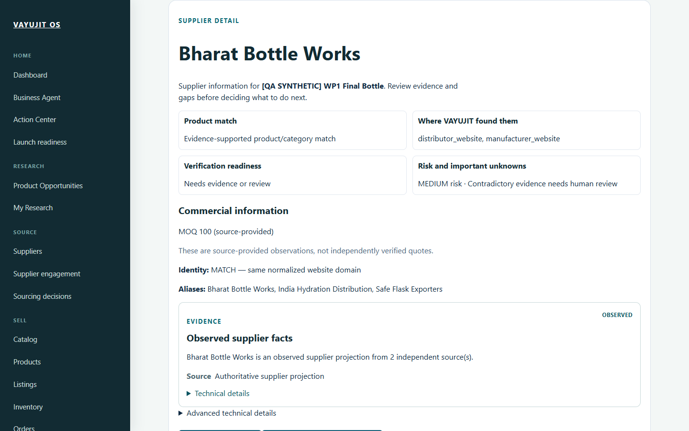

Figure 19. Historical synthetic supplier detail, with claims distinguished from independently verified quotes. Exact supplier substate is fixture-specific. Genuine historical synthetic capture, 2026-10-28.

### E. What do I see on this page?

Source-defined sections: Cross-marketplace Supplier Intelligence; Dynamic label varies with the selected record; exact current text is unverified.; Overview; Compare selected suppliers; Product match; Where VAYUJIT found them; Verification readiness; Risk and important unknowns; Commercial information; Sources; Commercial Intelligence; Verification / certifications; Capabilities / facilities; Risk / contradictions; Confidence explanation; Comparison; Reports and history

Disclosures: Already know a supplier?; Advanced: unscoped supplier records (not canonical journey results); Advanced technical details; View source metadata; View commercial fields; View verification fields; View capability fields; View risk and contradiction fields; View confidence fields; Advanced research controls; View server report. Open only the relevant section; expanded state does not mean its action ran.

Detected structures: 0 table declaration(s), 0 dialog declaration(s). Conditional/shared controls can appear only after valid context. Loading, empty, error and blocked conditions must be distinguished; their complete current runtime combinations are not verified in this edition.

| Action shown in source | Meaning and safety | Availability |
| --- | --- | --- |
| Back to Intelligence | Source-declared navigation/view control; exact destination/state UNVERIFIED. | Not statically disabled |
| Record a supplier manually | Source-declared navigation/view control; exact destination/state UNVERIFIED. | Not statically disabled |
| Dynamic label varies with the selected record; exact current text is unverified. | Source-declared navigation/view control; exact destination/state UNVERIFIED. | Conditional |
| Review product opportunities | Source-declared navigation/view control; exact destination/state UNVERIFIED. | Not statically disabled |
| Dynamic label varies with the selected record; exact current text is unverified. | Source-declared navigation/view control; exact destination/state UNVERIFIED. | Not statically disabled |
| Reconcile accepted evidence | Source-declared navigation/view control; exact destination/state UNVERIFIED. | Conditional |
| Refresh | Reloads the relevant view; exact data-source side effects still depend on that screen. | Not statically disabled |
| Review product opportunities | Source-declared navigation/view control; exact destination/state UNVERIFIED. | Not statically disabled |
| Dynamic label varies with the selected record; exact current text is unverified. | Source-declared navigation/view control; exact destination/state UNVERIFIED. | Not statically disabled |
| Research again | Source-declared navigation/view control; exact destination/state UNVERIFIED. | Conditional |
| View supplier | Source-declared navigation/view control; exact destination/state UNVERIFIED. | Not statically disabled |
| Shortlist suppliers | Source-declared navigation/view control; exact destination/state UNVERIFIED. | Not statically disabled |
| Dynamic label varies with the selected record; exact current text is unverified. | Source-declared navigation/view control; exact destination/state UNVERIFIED. | Conditional |
| Shortlist this supplier | Source-declared navigation/view control; exact destination/state UNVERIFIED. | Not statically disabled |
| Continue to sourcing economics | Source-declared navigation/view control; exact destination/state UNVERIFIED. | Not statically disabled |
| Prepare local requirements and record quotes | Source-declared navigation/view control; exact destination/state UNVERIFIED. | Not statically disabled |
| Evaluate ranking | Source-declared navigation/view control; exact destination/state UNVERIFIED. | Not statically disabled |
| Generate report | Effect UNVERIFIED; potentially changes data or invokes another workflow. Confirm prerequisites before acting. | Not statically disabled |
| Prepare internal sourcing handoff | Source-declared navigation/view control; exact destination/state UNVERIFIED. | Not statically disabled |
| Dynamic label varies with the selected record; exact current text is unverified. | Source-declared navigation/view control; exact destination/state UNVERIFIED. | Conditional |

### F. Input-field guide

Field records below state type, purpose, requiredness, accepted values and examples. Unless a specific effect is described, the parent action’s save/provider effect is UNVERIFIED. Common rule: enter only genuine facts, preserve UNKNOWN and units, and obey backend validation; no blank or unchecked prerequisite is permission to proceed. Complete per-field maintenance records retain these explicit limitations.

| Field | Type requiredness and accepted values | Purpose example and effect |
| --- | --- | --- |
| Compare this supplier [cross-marketplace-supplier-F001] | checkbox. Requiredness is not established by the template; do not assume optional. Checked or unchecked; confirm only truthful statements. | Records the specific choice or confirmation stated by its label. Example: Leave unchecked unless the statement is true. Effect unverified; common field rules apply. |

### G. Step-by-step usage

1. Open the intended owned context using the navigation/route above. Verify the brand and any Product, opportunity, supplier, listing or artifact identity before continuing.

2. Synthetic discovery, approved real discovery and unavailable/unauthorized discovery are distinct. Do not enable live calls to fill the page.

3. Read current warnings and input guidance. Use only an action whose purpose and authority you understand. Stop before unapproved provider, commercial or permanent-data effects.

### H. Worked example

Illustrative task: Review cross-marketplace supplier candidates and preserve selected opportunity context. Use a genuine selected record in your own authorized workspace; a synthetic screenshot is a learning example only. The field examples above illustrate the type of input, not prescribed business values.

### I. How to interpret the results

Inspect identity, source/provenance, date/freshness, included assumptions and missing information. A local status, score or successful fake workflow is not proof of real external completion. UNKNOWN, blocked, stale and not-comparable results must retain their actual meaning.

### J. What should I do next?

Open supplier evidence/assessment and preserve the exact identity into economics.

### K. Troubleshooting

If context is missing/invalid, use the appropriate collection or saved record link. If a request fails, retain the safe correlation reference and inspect current state before retrying. A 401 needs normal authentication; a 500 is not an empty successful result. Do not force-enable disabled actions or insert synthetic facts.

### L. Availability and limitations

DOCUMENTED BUT NOT CURRENTLY VERIFIED: current template and source inspected; no fresh authenticated session or complete per-control execution performed. Historical synthetic screenshot/functional evidence illustrates only its recorded state. Synthetic discovery, approved real discovery and unavailable/unauthorized discovery are distinct. Do not enable live calls to fill the page. The entire module is not certified by the presence of a route.

### M. Documentation evidence

Current source: apps/web/src/app/intelligence/cross-marketplace-supplier.component.ts. Source and template hashes are in source/ui-inventory.json; exact field/action declarations in inventory/field-register.md and source/control-inventory.md. Screenshot evidence: docs/product-handbook/screenshots/suppliers/01-detail.png (Figure 19).

[Current UI source for Suppliers](../../../apps/web/src/app/intelligence/cross-marketplace-supplier.component.ts)

# Shared controls and field reference

These 35 source-declared fields belong to reusable components rather than a separately routed page. Their parent workflow controls when they appear. Exact labels/options below come from source; dynamic requiredness, provider contracts and all API validation are not exhaustively verified.

## catch up dialog

| Shared field | Type and rules | Purpose and example |
| --- | --- | --- |
| Catch-up date [catch-up-dialog-F001] | date. Required in the template. Exact API limits/accepted vocabulary are not fully verified. | Provides the stated input to this page’s supported workflow. Example: 2026-12-01, illustrative only; verify scheduling timezone. Parent action/API effect unverified; preserve UNKNOWN and genuine context. |
| Catch-up time [catch-up-dialog-F002] | time. Required in the template. Exact API limits/accepted vocabulary are not fully verified. | Provides the stated input to this page’s supported workflow. Example: 10:00, illustrative only; verify timezone and date. Parent action/API effect unverified; preserve UNKNOWN and genuine context. |
| IANA timezone [catch-up-dialog-F003] | text. Required in the template. Exact API limits/accepted vocabulary are not fully verified. | Provides the stated input to this page’s supported workflow. Example: Use the actual business fact; no invented value is supplied. Parent action/API effect unverified; preserve UNKNOWN and genuine context. |
| Reason [catch-up-dialog-F004] | textarea. Requiredness is not established by the template; do not assume optional. maxlength 500 | Records your scoped explanation; keep it factual and free of secrets. Example: Use the actual business fact; no invented value is supplied. Parent action/API effect unverified; preserve UNKNOWN and genuine context. |
| Choose DST interpretation [catch-up-dialog-F005] | select. Requiredness is not established by the template; do not assume optional. Choose a fold; Fold 0 - first occurrence; Fold 1 - second occurrence | Chooses the relevant saved context or supported option. Example: Choose only a relevant legitimate saved option. Parent action/API effect unverified; preserve UNKNOWN and genuine context. |

## reschedule dialog

| Shared field | Type and rules | Purpose and example |
| --- | --- | --- |
| Local date [reschedule-dialog-F001] | date. Required by the template and client. A date input; no minimum or maximum date is declared here. Server eligibility remains authoritative. | Sets the proposed calendar date in the activity timezone, not UTC by itself. Example: 2026-12-01, illustrative only and not a scheduling recommendation. Source-defined effect: Combined with Local time and timezone in Preview change; does not save a reschedule by itself. Avoid: Assuming a valid date guarantees an eligible schedule. No fresh runtime validation is claimed. |
| Local time [reschedule-dialog-F002] | time. Required by the template and client. A time input; the preview request combines date and time with seconds set to 00. | Sets the proposed local clock time for the selected activity. Example: 10:00 with the intended date and Asia/Kolkata, illustrative only. Source-defined effect: Preview resolves the proposed local time and UTC representation before separate confirmation. Avoid: Treating local time as UTC or ignoring daylight-saving warnings. No fresh runtime validation is claimed. |
| IANA timezone [reschedule-dialog-F003] | text. Required; client maximum 100 characters. IANA timezone text. Suggestions: UTC, America/New_York, Europe/London, Asia/Kolkata; these are suggestions, not an exhaustive allowed list. Server validates the zone. | Identifies the timezone used to interpret the proposed date and time. Example: Asia/Kolkata for an activity genuinely scheduled in Indian local time. Source-defined effect: Initially populated from the activity; preview displays the resolved UTC time, offset and DST classification. Avoid: Entering IST as though it were the documented IANA identifier or assuming the default UTC matches your activity. No fresh runtime validation is claimed. |
| Reason [reschedule-dialog-F004] | textarea. Optional under the reviewed client validators. At most 500 characters; plain factual text without secrets. | Optionally explains why this activity should move. Example: Move the internal review to match the agreed team availability. Source-defined effect: Included in preview and separate confirmation requests; the note alone grants no authorization. Avoid: Believing a reason is mandatory just to preview, or putting credentials in it. No fresh runtime validation is claimed. |
| Choose DST interpretation [reschedule-dialog-F005] | select. Conditional: choose an interpretation when preview reports ambiguous_local_time before confirmation. Fold 0 is the first occurrence; Fold 1 is the second. An empty choice leaves the ambiguity unresolved. | Disambiguates a local clock time repeated during a daylight-saving transition. Example: Choose only after comparing the actual preview interpretations; no fold is guessed. Source-defined effect: Selecting a fold refreshes the preview. A nonexistent local time requires a different time instead. Avoid: Choosing an arbitrary fold merely to enable confirmation. No fresh runtime validation is claimed. |

## catalog cost estimate

| Shared field | Type and rules | Purpose and example |
| --- | --- | --- |
| Saved product cost scenario [catalog-cost-estimate-F001] | select. Requiredness is not established by the template; do not assume optional. Choose a saved estimate Additional choices depend on saved records/current context and are UNVERIFIED. | Chooses the relevant saved context or supported option. Example: Choose only a relevant legitimate saved option. Parent action/API effect unverified; preserve UNKNOWN and genuine context. |
| Planned quantity [catalog-cost-estimate-F002] | text. Required in the template. Exact API limits/accepted vocabulary are not fully verified. | Provides the stated input to this page’s supported workflow. Example: Use the actual business fact; no invented value is supplied. Parent action/API effect unverified; preserve UNKNOWN and genuine context. |
| Quantity unit [catalog-cost-estimate-F003] | text. Required in the template. maxlength 40 | Provides the stated input to this page’s supported workflow. Example: Use the actual business fact; no invented value is supplied. Parent action/API effect unverified; preserve UNKNOWN and genuine context. |
| Assumed acquisition cost per unit [catalog-cost-estimate-F004] | text. Required in the template. Exact API limits/accepted vocabulary are not fully verified. | Provides the stated input to this page’s supported workflow. Example: Use the actual business fact; no invented value is supplied. Parent action/API effect unverified; preserve UNKNOWN and genuine context. |
| Estimate currency [catalog-cost-estimate-F005] | text. Required in the template. maxlength 3 | Provides the stated input to this page’s supported workflow. Example: INR only if this is the genuine currency. Parent action/API effect unverified; preserve UNKNOWN and genuine context. |
| Assumption basis and limitations [catalog-cost-estimate-F006] | textarea. Required in the template. maxlength 4000 | Provides the stated input to this page’s supported workflow. Example: Use the actual business fact; no invented value is supplied. Parent action/API effect unverified; preserve UNKNOWN and genuine context. |

## opportunity next actions

| Shared field | Type and rules | Purpose and example |
| --- | --- | --- |
| Catalog brand [opportunity-next-actions-F001] | select. Requiredness is not established by the template; do not assume optional. Choose an existing brand Additional choices depend on saved records/current context and are UNVERIFIED. | Chooses the relevant saved context or supported option. Example: Choose only a relevant legitimate saved option. Parent action/API effect unverified; preserve UNKNOWN and genuine context. |
| I confirm this creates or opens a local Catalog draft only. [opportunity-next-actions-F002] | checkbox. Requiredness is not established by the template; do not assume optional. Checked or unchecked; confirm only truthful statements. | Records the specific choice or confirmation stated by its label. Example: Leave unchecked unless the statement is true. Parent action/API effect unverified; preserve UNKNOWN and genuine context. |

## product discovery review

| Shared field | Type and rules | Purpose and example |
| --- | --- | --- |
| Discovered domain [product-discovery-review-F001] | select. Requiredness is not established by the template; do not assume optional. No fixed options enumerated in the template. Additional choices depend on saved records/current context and are UNVERIFIED. | Chooses the relevant saved context or supported option. Example: Choose only a relevant legitimate saved option. Parent action/API effect unverified; preserve UNKNOWN and genuine context. |
| I reviewed the robots policy and approve this read-only access. [product-discovery-review-F002] | checkbox. Requiredness is not established by the template; do not assume optional. Checked or unchecked; confirm only truthful statements. | Records the specific choice or confirmation stated by its label. Example: Leave unchecked unless the statement is true. Parent action/API effect unverified; preserve UNKNOWN and genuine context. |
| I reviewed the source terms and approve this use. [product-discovery-review-F003] | checkbox. Requiredness is not established by the template; do not assume optional. Checked or unchecked; confirm only truthful statements. | Records the specific choice or confirmation stated by its label. Example: Leave unchecked unless the statement is true. Parent action/API effect unverified; preserve UNKNOWN and genuine context. |
| I confirm this access is permitted without bypassing authentication or restrictions. [product-discovery-review-F004] | checkbox. Requiredness is not established by the template; do not assume optional. Checked or unchecked; confirm only truthful statements. | Records the specific choice or confirmation stated by its label. Example: Leave unchecked unless the statement is true. Parent action/API effect unverified; preserve UNKNOWN and genuine context. |
| Additional policy review note (optional) [product-discovery-review-F005] | textarea. Requiredness is not established by the template; do not assume optional. maxlength 400 | Records your scoped explanation; keep it factual and free of secrets. Example: Use the actual business fact; no invented value is supplied. Parent action/API effect unverified; preserve UNKNOWN and genuine context. |

## marketplace inventory

| Shared field | Type and rules | Purpose and example |
| --- | --- | --- |
| Marketplace [marketplace-inventory-F001] | select. Requiredness is not established by the template; do not assume optional. All Additional choices depend on saved records/current context and are UNVERIFIED. | Chooses the relevant saved context or supported option. Example: Choose only a relevant legitimate saved option. Parent action/API effect unverified; preserve UNKNOWN and genuine context. |
| Low stock only [marketplace-inventory-F002] | checkbox. Requiredness is not established by the template; do not assume optional. Checked or unchecked; confirm only truthful statements. | Records the specific choice or confirmation stated by its label. Example: Leave unchecked unless the statement is true. Parent action/API effect unverified; preserve UNKNOWN and genuine context. |

## marketplace orders

| Shared field | Type and rules | Purpose and example |
| --- | --- | --- |
| Marketplace [marketplace-orders-F001] | select. Requiredness is not established by the template; do not assume optional. All Additional choices depend on saved records/current context and are UNVERIFIED. | Chooses the relevant saved context or supported option. Example: Choose only a relevant legitimate saved option. Parent action/API effect unverified; preserve UNKNOWN and genuine context. |
| Status [marketplace-orders-F002] | text. Requiredness is not established by the template; do not assume optional. Exact API limits/accepted vocabulary are not fully verified. | Provides the stated input to this page’s supported workflow. Example: Use the actual business fact; no invented value is supplied. Parent action/API effect unverified; preserve UNKNOWN and genuine context. |
| Fulfilment [marketplace-orders-F003] | text. Requiredness is not established by the template; do not assume optional. Exact API limits/accepted vocabulary are not fully verified. | Provides the stated input to this page’s supported workflow. Example: Use the actual business fact; no invented value is supplied. Parent action/API effect unverified; preserve UNKNOWN and genuine context. |
| From [marketplace-orders-F004] | date. Requiredness is not established by the template; do not assume optional. Exact API limits/accepted vocabulary are not fully verified. | Provides the stated input to this page’s supported workflow. Example: 2026-12-01, illustrative only; verify scheduling timezone. Parent action/API effect unverified; preserve UNKNOWN and genuine context. |
| To [marketplace-orders-F005] | date. Requiredness is not established by the template; do not assume optional. Exact API limits/accepted vocabulary are not fully verified. | Provides the stated input to this page’s supported workflow. Example: 2026-12-01, illustrative only; verify scheduling timezone. Parent action/API effect unverified; preserve UNKNOWN and genuine context. |

## business entity selectors

| Shared field | Type and rules | Purpose and example |
| --- | --- | --- |
| Dynamic label varies with the selected record; exact current text is unverified. [business-entity-selectors-F001] | select. Requiredness is not established by the template; do not assume optional. Select a Product Additional choices depend on saved records/current context and are UNVERIFIED. | Chooses the relevant saved context or supported option. Example: Choose only a relevant legitimate saved option. Parent action/API effect unverified; preserve UNKNOWN and genuine context. |
| Dynamic label varies with the selected record; exact current text is unverified. [business-entity-selectors-F002] | checkbox. Requiredness is not established by the template; do not assume optional. Checked or unchecked; confirm only truthful statements. | Records the specific choice or confirmation stated by its label. Example: Leave unchecked unless the statement is true. Parent action/API effect unverified; preserve UNKNOWN and genuine context. |
| Dynamic label varies with the selected record; exact current text is unverified. [business-entity-selectors-F003] | select. Requiredness is not established by the template; do not assume optional. Select a Brand Additional choices depend on saved records/current context and are UNVERIFIED. | Chooses the relevant saved context or supported option. Example: Choose only a relevant legitimate saved option. Parent action/API effect unverified; preserve UNKNOWN and genuine context. |
| Dynamic label varies with the selected record; exact current text is unverified. [business-entity-selectors-F004] | select. Requiredness is not established by the template; do not assume optional. No fixed options enumerated in the template. Additional choices depend on saved records/current context and are UNVERIFIED. | Chooses the relevant saved context or supported option. Example: Choose only a relevant legitimate saved option. Parent action/API effect unverified; preserve UNKNOWN and genuine context. |
| Dynamic label varies with the selected record; exact current text is unverified. [business-entity-selectors-F005] | checkbox. Requiredness is not established by the template; do not assume optional. Checked or unchecked; confirm only truthful statements. | Records the specific choice or confirmation stated by its label. Example: Leave unchecked unless the statement is true. Parent action/API effect unverified; preserve UNKNOWN and genuine context. |

# Troubleshooting and safe recovery

## Cannot connect to local API

Verify the intended services/origin and /health/live plus /health/ready with support. Do not change database URLs, initialize another owner or paste secrets into tickets.

## 401 or repeated sign in

Check you are using the intended frontend/API origin and existing owner login. A session may have expired. Reauthenticate normally; do not disable owner checks or cookie protections.

## 500 Internal Server Error

Retain the route, time and safe correlation ID. This is a server failure, not proof your password is wrong or your business has no data. Ask support before database/migration changes.

## Dashboard is empty

Check active brand, date/context and actual recorded evidence. Empty data can be legitimate; a loading/error state must not be interpreted as zero business activity.

## No product opportunity

Inspect search/page outcomes and final eligibility reasons. Directory pages, category mismatch, unknown identity, quota or source approval may block progress. Approval is not a product guarantee.

## Research step failed

Open the failed stage and evidence. Retry only after the relevant cause changes. Reused evidence can remain unchanged; do not keep creating duplicate goals to bypass a block.

## Select product is disabled

Read the missing assessment, evidence, context or current HUMAN prerequisite. Continue the canonical research/review step; do not force-enable the button.

## Source approval required

Review the actual domain policy, terms and allowed access. Make only truthful confirmations. Approval purpose is not supplier verification; additional note may be optional.

## Supplier has little information

Leave unknown price, MOQ, lead time and verification facts unknown. Review due-diligence gaps rather than labelling the supplier verified.

## Cost or margin is UNKNOWN

Inspect missing components, currencies, quantities and source evidence. Do not enter zero just to make a calculation available.

## Stale review or 409 conflict

Reload the canonical record, inspect changed inputs/version and re-review. An identical retry and a conflicting changed request are different contracts.

## Date or schedule looks wrong

Compare the displayed timezone, local date/time and intended schedule. A calendar entry is not proof execution happened. Do not confirm an old preview after editing dependencies.

## Failed or unknown background job

Inspect current job/workflow status and execution history before retry. Repeated writes can duplicate external effects if the outcome is unknown. Use only eligible canonical recovery.

## Credential field is blank

Write-only credentials are not returned for display. Review configuration status; never paste the secret into a note or screenshot to prove it exists.

## Marketplace configured but not connected

Local configuration, real registration, API entitlement and successful authorized connectivity are separate. Keep live operations blocked until all relevant prerequisites pass.

## Login input is difficult to see

An empty enabled Email boundary has a known 2.09:1 contrast defect; login/Campaign focus corrections are 8.56:1. The remaining defect is not repaired by this documentation project.

## Backups page looks healthy

A listed artifact or a doctor check is not independent restore certification. PC-first backup/restore remains parked; do not activate permanent business data based on this handbook.

# Operating routines and safety checklists

## Your first day

Read Start here and evidence definitions. Sign in to the intended existing workspace. Learn Dashboard, Business Agent, Product Opportunities and Catalog. Inspect one safe saved record before creating any genuine business data.

## Your first week

Choose one product-research or existing-product task. Review its context, unknowns and next boundary daily. Learn costs, variants and local listing readiness. Keep a separate list of missing business/account/provider prerequisites.

## Daily fifteen minute review

Spend five minutes on Dashboard/Action Center, five on failed/stale work in its source workflow, and five recording human next steps. Do not turn the routine into automatic execution.

## Weekly review

Review active opportunities, supplier gaps, current cost assumptions, stock/order evidence, scheduled work and financial unknowns. Revisit old recommendations after material changes.

## Monthly review

Review product/supplier dependency, evidence retention, cost and financial-purpose assumptions, access/credential custody, storage and actual recovery readiness with the owner. An unverified backup must not be ticked as tested.

## Before spending money

Confirm genuine supplier/product identity, evidence, known and unknown costs, total capital exposure, required business/category checks, relevant accounting arrangement and exact separate HUMAN authority. A score or agent recommendation is insufficient.

## Before publishing

Check the actual product/claims/media rights, account/marketplace, exact current artifact/version, genuine connector eligibility, readiness, review and execution authorization. Keep external writes disabled unless specifically approved.

## Before launch

Use the release gate ledger: accessibility, security/data integrity, current supported workflows, accounting scope, recovery, deployment/operations and real-provider prerequisites. Local synthetic tests alone cannot close launch.

# Product status vision and roadmap

The product vision is a connected evidence-backed single-seller workspace, with AI assistance and explicit human control. That is a direction, not a guarantee that every integration or commercial activity is available. Compared with tool categories, the intended distinction is connected context and provenance across research, sourcing, preparation and operations. This is not a verified superiority claim about named competitor products.

| Module family | Current evidence boundary | Remaining requirement |
| --- | --- | --- |
| Research and opportunity selection | Supported local goal/plan/evidence/selection paths have bounded functional evidence. | Useful real permitted source evidence remains provider/authorization dependent. |
| Suppliers due diligence and economics | Supported synthetic persisted context, assessments, scenarios and human decisions. | Genuine supplier identity/quotes/verification, missing costs and stale evidence cannot be fabricated. |
| Catalog inventory orders and Finance | Supported local records, safeguards and deterministic projections. | Genuine transactions and accounting/retention purpose need separate decisions; projections are not an immutable ledger. |
| Marketplace preparation | Amazon/Flipkart fake-transport/local workflows; Meesho local/manual boundaries. | Real registration, API entitlement, official contracts and authorized live certification not established. |
| Content media campaigns and Ads | Supported draft/review/version/preview/dependency paths have bounded local evidence. | Configured generation and real delivery/spend are separate; historical Ads 502 is unattributed. |
| Accessibility | Gate A PASS; login and Campaign focus corrected to 8.56:1. | Gate B NOT PASSED; empty Email border 2.09:1 and speech/native zoom/applicability evidence outstanding. |
| Recovery and real activation | Production-like preparation and safety foundations exist. | PC-first encrypted independent backup/restore remains PARKED; not production activation proof. |

WP1–WP6B completed bounded seller-experience and quality corrections. WP7A closed 48 prioritized local functional entries, not every operation on all 156 routes. WP7B is paused and INCOMPLETE. Gate A remains PASS; Gate B remains NOT PASSED. The accessibility backlog preserves 40 groups: 9 verified passes, 1 verified failure and 30 not verified.

WP7C residual integrity/security/reliability and WP8 release qualification are proposals for owner scope approval, not implemented commitments or release dates. No R6, WP7C, WP8 or backup work is started by this handbook. Further usability ideas, generic action execution and immutable accounting architecture require separate requirements/approval rather than being described as available.

Preserve historical Ads 502 uncertainty, PostgreSQL timestamp attribution risk, financial-history/precision limitations, remaining typing/lint/schema/performance debt and unverified real-provider expiry. Older green or red reports apply to their own build and scope; later focused fixes do not resolve unrelated historical uncertainty.

Roadmap and release decisions: docs/roadmap/vayujit-remaining-work-assessment.md; docs/roadmap/vayujit-forward-execution-plan.md; docs/roadmap/vayujit-release-readiness-gates.md; docs/qa/seller-experience/wp7b-consolidated-accessibility-backlog.md.

# Glossary

| Term | Meaning |
| --- | --- |
| Goal | Your saved statement of the business question. |
| Plan | A versioned set of supported steps proposed for a goal. |
| Run | A record of steps actually attempted and their outcomes. |
| Opportunity | A research candidate with identity/context; not automatically a seller Product. |
| Product | Your owned product master used in supported preparation/operation workflows. |
| Catalog | The preparation workspace for owned products, variants, media, costs and local listing drafts. |
| SKU | Your stock-keeping code for a specific item or variant. |
| Variant | A distinct form of a product, such as a real size or colour. |
| MOQ | Minimum order quantity, known only when supported by supplier evidence. |
| Lead time | The evidenced or explicitly assumed time to supply; not a guaranteed delivery date. |
| Landed cost | Supported acquisition costs with included components, quantities/currency and missing inputs disclosed. |
| Margin | A calculated proportion under a specific model; read its basis, not just the percentage. |
| Capital fit | Whether a supported scenario fits the stated available funds under its known inputs. |
| UNKNOWN | A fact or result is not established; never a substitute for zero. |
| Evidence | Recorded information with source and provenance. |
| Provenance | Where a fact came from and whether it is observed, assumed, synthetic or otherwise classified. |
| Lineage | Links between an input, evidence/version and a resulting calculation or decision. |
| Freshness | Whether inputs remain current enough for the current purpose. |
| Stale | A prior result/review no longer matches required current inputs or time context. |
| Fingerprint | A recorded identity of the exact context/version being reviewed or authorized. |
| Idempotency | An identical legitimate retry follows its contract without creating a duplicate action. |
| HUMAN | The actual owner decision through the appropriate canonical workflow. |
| Source approval | Permission for a bounded source read; not permission to select, contact, purchase or publish. |
| Execution authorization | Separate scoped permission for an eligible consequential operation. |
| Synthetic | Test/demo data, not real supplier/marketplace/financial evidence. |
| Read only | A permitted inspection boundary; not a promise that every visible button is safe to execute. |
| NOT_COMPARABLE | Available inputs cannot support a valid comparison under current rules. |
| Readiness | Eligibility for a particular next workflow, not guaranteed market success. |
| Projection | A calculated current view; not necessarily immutable financial history. |
| Reconciliation | Matching records to authoritative external totals or events; not established by a local fake success. |
| Worker | A background service that attempts eligible queued work. |
| Recovery | A controlled response to a recorded failure; not permission to bypass its prerequisites. |

# Frequently asked questions

## Is VAYUJIT a marketplace?

No. It is your seller workspace; it does not replace Amazon, Flipkart or a supplier directory.

## Can it guarantee a winning product?

No. Evidence may be incomplete and a valid research outcome can be no eligible candidate.

## Must I research before adding my existing product?

No. Manual seller-authored Product/Catalog and counted opening stock are independent supported paths.

## Does the Business Agent do everything I ask?

No. It uses supported capabilities in the generated plan. Specialist content, portfolio and operations tasks may require their own screens.

## Why do I still need HUMAN decisions?

Selection, commercial commitments and external effects need the actual owner’s scoped decision; a recommendation is not consent.

## Does source approval guarantee a product?

No. It permits an allowed read. The fetched evidence must still establish compatible product identity and eligibility.

## Should I enter unknown freight as zero?

No. Unknown means not established; zero asserts that the cost is known to be absent.

## Can I use the synthetic screenshots as business evidence?

No. Their accounts, products, amounts and transactions are demonstration fixtures.

## Does local Amazon validation prove SP API works?

No. Real registration, API access, official contract, credentials and authorized live certification are separate.

## Can I add several staff accounts?

The current architecture is one owner per installation/database, not shared multi-user SaaS. Do not bypass that invariant.

## Is Finance a complete accounting ledger?

No. Current projections and lineage are useful but do not establish immutable accounting history, tax/period close or bank/settlement reconciliation.

## Why not just retry every failed job?

A previous action may have committed while its response was lost. Inspect canonical state and the supported replay contract first.

## Is the application production ready now?

No. Functional closure is bounded, WP7B remains incomplete, recovery is parked and real-provider/activation gates remain separate.

# Quick navigation reference

| Navigation path | Exact route |
| --- | --- |
| Home → Dashboard | /dashboard |
| Home → Business Agent | /intelligence/business-agent |
| Home → Action Center | /operations/action-center |
| Home → Launch readiness | /operations/launch-readiness |
| Research → Product Opportunities | /intelligence/product-opportunities |
| Research → My Research | /intelligence/research |
| Source → Suppliers | /intelligence/cross-marketplace |
| Source → Requirements & quotes | /intelligence/sourcing |
| Source → Supplier engagement | /intelligence/supplier-engagement |
| Source → Sourcing decisions | /intelligence/sourcing-scenarios |
| Sell → Catalog | /catalog |
| Sell → Products | /products |
| Sell → Listings | /marketplaces/listings |
| Sell → Inventory | /marketplaces/inventory |
| Sell → Orders | /marketplaces/orders |
| Sell → Financials | /marketplaces/financials |
| Create → Content | /ai/studio |
| Create → SEO | /ai/studio/seo |
| Create → Images | /ai/images |
| Create → Videos | /ai/video |
| Grow → Campaigns | /campaigns |
| Grow → Social | /social |
| Grow → Advertising | /ads |
| Manage → Calendar | /calendar |
| Advanced → Intelligence → Trend Intelligence | /intelligence/trends |
| Advanced → Intelligence → Competitors | /intelligence/competitors |
| Advanced → Intelligence → Customer Reviews | /intelligence/reviews |
| Advanced → Intelligence → Website Intelligence | /intelligence/websites |
| Advanced → Intelligence → External Research | /intelligence/external |
| Advanced → Intelligence → Autonomous Research | /intelligence/autonomous |
| Advanced → Intelligence → IndiaMART Discovery | /intelligence/indiamart |
| Advanced → Intelligence → Alibaba Discovery | /intelligence/alibaba |
| Advanced → Intelligence → TradeIndia Discovery | /intelligence/tradeindia |
| Advanced → Intelligence → Global Sources Discovery | /intelligence/global-sources |
| Advanced → Intelligence → Portfolio & Resilience | /intelligence/supplier-portfolios |
| Advanced → Intelligence → Shortlists | /intelligence/supplier-shortlisting |
| Advanced → Intelligence → Supplier Verification | /intelligence/due-diligence |
| Advanced → Intelligence → Sourcing Economics | /intelligence/sourcing-economics |
| Advanced → Intelligence → Supplier Engagement | /intelligence/supplier-engagement |
| Advanced → Operations → Operations | /operations |
| Advanced → Operations → Workflows | /workflows |
| Advanced → Operations → Approvals | /approvals |
| Advanced → Operations → Execution History | /execution-history |
| Advanced → Operations → Jobs | /publishing/jobs |
| Advanced → Operations → Schedules | /publishing/schedules |
| Advanced → Operations → Recovery | /operations/recovery |
| Advanced → Operations → System Doctor | /operations/health |
| Advanced → Configuration → Integrations | /settings/publishing/connectors |
| Advanced → Configuration → AI Providers | /settings/ai/providers |
| Advanced → Configuration → Provider Integrations | /settings/providers |
| Advanced → Configuration → Settings | /settings |

# Edition evidence and maintenance

Edition 0.9.1 Evidence backed reference edition. Updated 6 November 2026. Product package 0.1.0-rc.1; source revision 3ebf4e900e6cf44ececa4491d7219cd61cd23f32 with an uncommitted worktree. Revision alone is not a complete build identity. The inventory records current route, template and lockfile hashes.

The 25-page September 2026 VAYUJIT_OS_User_Guide.pdf was located in the owner’s Downloads folder. Its page 2 identifies its screen images as illustrative UI maps. Its business-oriented structure informed this edition; its images, labels, sample scores and obsolete page references were not reused as current evidence.

Coverage: 156 routes represented; 150 page routes mapped to 104 A–M family references; 693 field entries indexed and given explicit guidance/unknowns; 26 manually reviewed semantic overrides; 19 genuine retained screenshots; 6 illustrative journeys; 24 task prompts. This is source/reference coverage, not 100% current UI or complete validation coverage.

No current authenticated page was exercised in this documentation task. Browser access host was unavailable; R5 was closed. No new QA database, permanent data, provider action, application fix, process interruption, branch, commit or push was performed. Screenshot gaps, dynamic dropdowns, exact API constraints and action effects remain explicitly listed in the companion quality report.

To update: review the changed page/source and original acceptance; rerun the documentation discovery, edit the structured editorial/page guidance and reviewed screenshot manifest, regenerate the sources/Word, inspect all affected fields/options and real captures, update Word fields, render and review layout, validate links/coverage/privacy, then add the changelog entry. New screenshot sessions require current separate authorization; never reopen retired origins.

Revision history: 0.9, 6 November 2026 — initial evidence-backed reference edition, including genuine historical synthetic captures and explicit current-verification gaps. 0.9.1: targeted WP7B-R5 Campaign detail and shared rescheduling-field clarification; no post-baseline application change was found. All 19 historical screenshots are retained unchanged; no fresh capture or new application certification is claimed. This is not labelled 1.0 fully verified. See changes/handbook-changelog.md and quality/r5-update-report.md.
